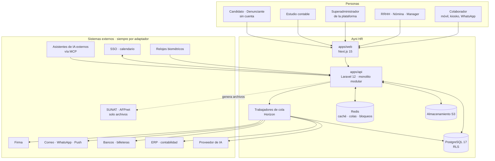
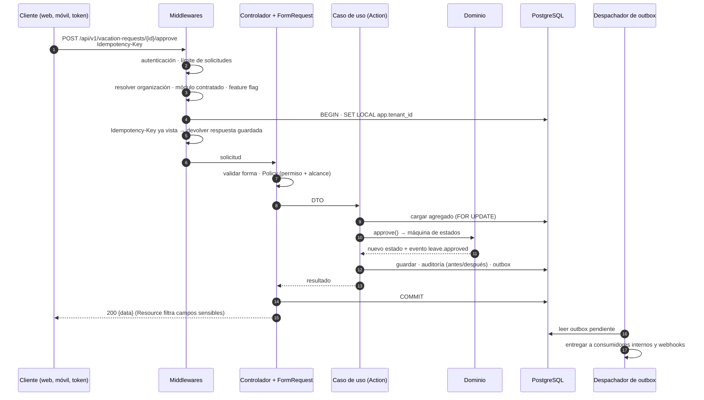
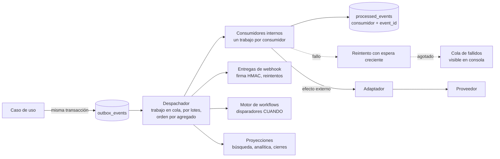
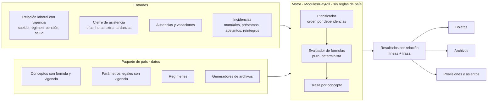
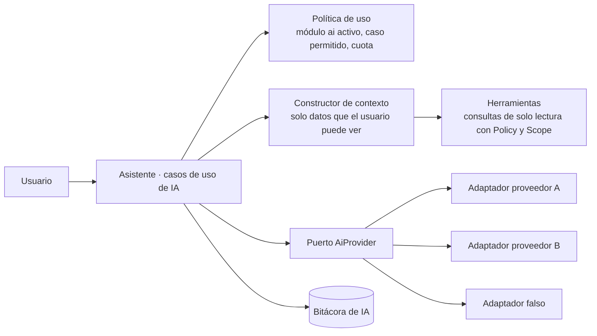

# 02 · Arquitectura

Stack recomendado (decisión A-01, a confirmar): Laravel 12 / PHP 8.4 · PostgreSQL 17 · Redis · Next.js 15 (React, TypeScript, Tailwind) · colas con Horizon · almacenamiento compatible con S3 · monorepo `apps/api`, `apps/web`, `packages/contracts`.

Los nombres de tablas citados aquí son conceptuales; mandan `database/schema.sql` y `04-modelo-de-datos.md`.

## 1. Contexto



Decisiones de forma:

- **Monolito modular**, no microservicios. Un despliegue de API, uno de web, N trabajadores de cola. Los límites entre módulos se imponen con pruebas de arquitectura, no con red.
- **API primero.** `apps/web` es un cliente más de `/api/v1`; no hay lógica de negocio en acciones de servidor de Next.js. El mismo contrato sirve a la app móvil, a WhatsApp, a integraciones y al servidor MCP.
- **Base y esquema compartidos** con `tenant_id` + RLS + claves foráneas compuestas (alternativas en A-02).

## 2. Capas

| Capa | Carpeta | Contiene | No puede |
|---|---|---|---|
| Dominio | `Modules/X/Domain` | Entidades, objetos de valor, máquinas de estado, eventos, puertos (interfaces), servicios puros | Importar Eloquent, HTTP, colas, SDK externos |
| Aplicación | `Modules/X/Application` | Casos de uso de escritura (`Actions`), consultas (`Queries`), DTO, políticas de autorización, manejadores de eventos | Devolver modelos Eloquent a HTTP; llamar a proveedores |
| Infraestructura | `Modules/X/Infrastructure` | Modelos Eloquent, repositorios, adaptadores, trabajos en cola, proyecciones | Contener reglas de negocio |
| Interfaz | `Modules/X/Http` | Controladores finos, FormRequests, Resources, rutas | Abrir transacciones; consultar tablas de otro módulo |

Regla de dependencia: `Http → Application → Domain ← Infrastructure`. Se verifica con pruebas de arquitectura (Pest Arch).

Un caso de uso de escritura hace siempre lo mismo, en este orden y dentro de **una** transacción:

1. Autorizar (permiso, alcance, módulo, límite del plan).
2. Cargar el agregado con bloqueo si hay concurrencia (`SELECT … FOR UPDATE` o versión optimista).
3. Ejecutar la regla de dominio (incluida la transición de estado).
4. Persistir.
5. Registrar auditoría (antes y después).
6. Escribir los eventos de dominio en outbox.

Después del `COMMIT`, el despachador de outbox entrega los eventos.

## 3. Mapa de módulos de dominio

```mermaid
flowchart TB
  subgraph Shared[Shared · núcleo transversal]
    TEN[Tenancy] --- PERM[Permisos y alcance] --- VIG[Vigencia] --- AUDI[Auditoría]
    WFL[Workflow y aprobaciones] --- OBX[Outbox y eventos] --- NOTI[Notificaciones] --- FIL[Archivos]
    CFG[Parámetros · campos personalizados · i18n · dinero] --- BUS[Búsqueda]
  end
  PLAT[Platform<br/>planes, módulos, flags, consola]
  IDN[Identity<br/>usuarios, roles, sesiones]
  ORG[Org<br/>empresas, sedes, unidades, puestos, posiciones]
  PEO[People<br/>personas, relaciones, historia]
  CTR[Contracts]
  DOCS[Documents<br/>plantillas, firma]
  TIME[Time<br/>marcación, turnos, vacaciones, ausencias]
  PAY[Payroll<br/>motor, conceptos, periodos]
  CPE[country-pe<br/>paquete de país]
  REC[Recruiting]
  ONB[Onboarding]
  PERF[Performance]
  LRN[Learning]
  CAR[Careers]
  COMP[Compensation]
  BEN[Benefits]
  ENG[Engagement]
  HD[Helpdesk]
  SST[Sst]
  GRV[Grievances · Discipline]
  AST[Assets]
  EXP[Expenses]
  CMPL[Compliance · Privacy · Unions]
  ANA[Analytics · Reports · Alerts]
  AI[Ai]
  INT[Integrations<br/>webhooks, conectores, MCP]

  PLAT --> Shared
  IDN --> Shared
  ORG --> Shared
  PEO --> ORG
  CTR --> PEO
  DOCS --> PEO
  TIME --> PEO
  PAY --> PEO
  PAY -. lee cierre .-> TIME
  CPE --> PAY
  REC --> ORG
  REC -. candidate.hired .-> PEO
  ONB -. employee.hired/terminated .-> PEO
  PERF --> PEO
  LRN --> PEO
  CAR --> PERF
  COMP --> PEO
  BEN --> PEO
  ENG --> PEO
  HD --> PEO
  SST --> PEO
  GRV --> PEO
  AST --> PEO
  EXP --> PEO
  CMPL -. consultas .-> PEO & TIME & PAY & SST
  ANA -. proyecciones .-> PEO & TIME & PAY & PERF
  AI -. herramientas con permisos .-> ANA & PEO
  INT -. consume outbox .-> Shared
```

### Límites

| Módulo | Dueño de | Expone a otros | Épicas |
|---|---|---|---|
| `Platform` | Organizaciones, planes, suscripciones, módulos, límites, feature flags, sesiones de soporte, paquetes de país | `Entitlements::moduleOn()`, `::limit()`, `Features::on()` | SAS, PAI |
| `Identity` | Usuarios, credenciales, MFA, sesiones, roles, permisos, tokens | `Gate`, `Scope::for($user)` | SEG |
| `Org` | Razones sociales, sedes, unidades, centros de costo, puestos de catálogo, posiciones, planes de dotación | Consultas de estructura con `as_of` | ORG, POS |
| `People` | Personas, relaciones laborales, asignaciones, compensaciones, derechohabientes, solicitudes de cambio | `EmploymentReader` (único camino para leer sueldo, jefe y puesto) | COL, HIS, ESS, MSS |
| `Contracts` | Contratos, adendas, renovaciones, topes de modalidad | Contrato vigente con `as_of` | CON |
| `Documents` | Repositorio, versiones, plantillas, generación de PDF, solicitudes de firma | `DocumentGenerator`, `SignatureService` | DOC |
| `Imports` | Trabajos de importación, mapeos, validación | — | IMP |
| `Time` | Marcaciones, días de asistencia, horarios, turnos, feriados, vacaciones, ausencias, horas extra, bolsa de horas, hojas de tiempo | `AttendanceSummary` del periodo cerrado; saldos | ASI, TUR, VAC, AUS, BHO, TSH |
| `Payroll` | Motor, conceptos, parámetros legales, regímenes, periodos, incidencias, resultados, boletas, beneficios sociales, préstamos, adelantos, declaraciones, provisiones, asientos, liquidaciones, locadores | Resultados cerrados; `SettlementSimulator` | NOM … LOC |
| `Recruiting` | Requisiciones, candidatos, postulaciones, entrevistas, ofertas, base de talento | Evento `candidate.hired` | ATS, ENT |
| `Onboarding` | Plantillas de proceso, procesos de ingreso y salida, tareas | — | ONB, OFF |
| `Performance` | Ciclos, evaluaciones, objetivos, competencias, habilidades, 1:1, feedback | Puntaje de evaluación | DES, OKR, CMP, FBK |
| `Learning` | Cursos, inscripciones, plan anual, certificados | `CourseAssigner` | LMS |
| `Careers` | Planes de desarrollo, rutas, sucesión, sesiones de talento | — | CAR |
| `Compensation` | Bandas, ciclos de revisión, propuestas, categorías de igualdad salarial | Propone cambios; **no** escribe sueldos: llama a `People` | COM |
| `Benefits` | Catálogo y afiliaciones | Incidencias a planilla | BNF |
| `Engagement` | Encuestas, respuestas, planes de acción, reconocimientos, comunicados | Indicadores agregados | ENC, REC, CIN |
| `Helpdesk` | Tickets, plazos de atención, base de conocimiento | — | HSD |
| `Sst` | Incidentes, riesgos, inspecciones, exámenes, comités, acciones correctivas | Registros para el expediente | SST |
| `Grievances` | Denuncias, medidas de protección, casos disciplinarios | Nada (aislado; ver §3.1) | DEN, DIS |
| `Assets` | Activos, EPP, entregas | Pendientes de devolución | ACT |
| `Expenses` | Políticas, rendiciones, anticipos | Reembolsos a planilla | GAS |
| `Compliance` | Obligaciones, expediente de inspección, casilla, privacidad, sindicatos | — | CUM, PRI, SIN |
| `Analytics` | Indicadores, tableros, reportes, exportaciones, alertas | — | ANA, RPT, ALE |
| `Ai` | Conversaciones, herramientas, bitácora | — | IAR |
| `Integrations` | Conexiones, salud, webhooks, entregas, MCP, WhatsApp, marca, consola de socio | Puertos de `Shared` | API, INT, WHA, WLB, EST |

Reglas entre módulos:

1. Un módulo **no consulta tablas de otro**. Usa la interfaz pública del otro (`Modules/X/Api/*`) o reacciona a sus eventos.
2. Las claves foráneas entre módulos existen en base (integridad), pero el código las atraviesa solo por la interfaz pública.
3. Sueldo, jefe, puesto y saldo de vacaciones tienen **un solo escritor** (`People` y `Time`). Compensación, ATS, Nómina o el importador llaman a sus casos de uso.
4. Un módulo opcional nunca es dependencia dura de `Shared`, `Org` ni `People`.

### 3.1 Módulo de denuncias: aislamiento reforzado

- Tablas propias con cifrado a nivel de campo y clave distinta de la del resto.
- Sin búsqueda global, sin aparición en analítica ni en el asistente de IA, sin registro de actividad del usuario común.
- El alcance «toda la organización» no da acceso: solo investigadores asignados al caso.
- La auditoría de este módulo va a un registro separado con acceso restringido.
- El formulario público no registra IP, agente de usuario ni cookie de sesión (regla 14 de `CLAUDE.md`).

## 4. Jerarquía

```
Plataforma (propietario del SaaS)
└─ Organización (tenant)               tenants
   ├─ Razón social                     legal_entities   país, RUC, moneda, zona horaria, régimen por defecto
   │  └─ Sede                          sites            dirección, zona horaria, sede de riesgo
   ├─ Unidad organizativa (árbol)      org_units        área, departamento, equipo: un solo árbol con tipo
   │  └─ Posición                      positions        plaza presupuestada; apunta a un puesto de catálogo
   ├─ Puesto de catálogo               job_profiles     «Analista Contable», nivel, categoría
   ├─ Persona                          people           una por ser humano en la organización
   │  └─ Relación laboral              employments      con UNA razón social; estado; régimen
   │     ├─ Asignación (vigencia)      posición, unidad, sede, centro de costo, jefe
   │     ├─ Compensación (vigencia)    sueldo, moneda, componentes
   │     └─ Contrato (vigencia)        tipo, fechas, adendas
   └─ Usuario                          users            acceso; puede o no estar ligado a una persona
```

- Áreas, departamentos, subdepartamentos y equipos del pedido son **un solo árbol** `org_units` con `type` configurable: evita migraciones cuando una organización tiene más o menos niveles.
- Las unidades son de la organización y pueden cruzar razones sociales (un área corporativa con personas de dos empresas). La pertenencia legal la da la relación laboral, no la unidad.
- El **jefe** se resuelve por posición (`reports_to_position_id`) con excepción por relación (`manager_employment_id` en la asignación). El organigrama se dibuja por posiciones, incluidas las vacantes.
- Una persona con dos relaciones simultáneas en empresas del grupo tiene dos fichas laborales y una sola identidad.
- Reingreso = nueva relación laboral para la misma persona; la anterior queda cesada e intacta.

## 5. Multiempresa y aislamiento

### 5.1 Resolución de la organización

| Entrada | Cómo se resuelve |
|---|---|
| Web y API con sesión | Subdominio `{slug}.dominio` → organización; la sesión guarda `tenant_id` y se verifica que el usuario pertenezca |
| Dominio propio (marca blanca) | Tabla de dominios verificados → organización |
| Token de API | El token pertenece a una organización; el subdominio, si viene, debe coincidir |
| Consola de plataforma | Dominio aparte (`admin.`), guard aparte, sin `tenant_id`; para entrar a una organización se abre una **sesión de soporte** con motivo, vigencia y auditoría visible para el cliente |
| Modo estudio contable | El socio elige una organización cliente; se emite una sesión acotada a esa organización (`partner/clients/{id}/enter`) |
| Rutas públicas (empleos, denuncias) | Subdominio o dominio propio; sin sesión |
| Webhook entrante (WhatsApp, biométrico) | Identificador de conexión en la URL o cabecera → organización, tras verificar la firma |
| Trabajo en cola | `tenant_id` serializado en el trabajo; middleware `RestoreTenant` lo restaura antes de ejecutar |
| Comando programado | Itera organizaciones activas y despacha un trabajo por organización |

### 5.2 Doble barrera

1. **Aplicación.** `TenantContext` (singleton por solicitud o trabajo). Todo modelo de negocio usa el trait `BelongsToTenant`: scope global `where tenant_id = ?` y asignación automática al crear. Sin contexto, el scope lanza excepción (no devuelve todo).
2. **Base de datos.** Al iniciar la transacción: `SET LOCAL app.tenant_id = '…'`. Cada tabla tiene:

```sql
ALTER TABLE employments ENABLE ROW LEVEL SECURITY;
ALTER TABLE employments FORCE ROW LEVEL SECURITY;
CREATE POLICY tenant_isolation ON employments
  USING (tenant_id = current_setting('app.tenant_id', true)::uuid)
  WITH CHECK (tenant_id = current_setting('app.tenant_id', true)::uuid);
```

   Si `app.tenant_id` no está definido, la política no devuelve filas.
3. **Integridad.** Claves foráneas compuestas `(tenant_id, x_id) → x(tenant_id, id)`: es imposible referenciar una fila de otra organización aunque falle el código.

Roles de base de datos:

| Rol | Uso | RLS |
|---|---|---|
| `ayni_app` | API y trabajadores | Sujeto a RLS; sin `UPDATE`/`DELETE` en tablas de solo inserción |
| `ayni_platform` | Consola SaaS y tareas entre organizaciones (métricas, facturación) | `BYPASSRLS`; solo accesible desde `Modules/Platform` |
| `migrator` | Migraciones | Dueño del esquema (no lo crea `schema.sql`: es el rol con el que se carga) |
| `readonly_analytics` | Proyecciones y réplica de lectura | Sujeto a RLS (no lo crea `schema.sql`; se añade al montar la réplica) |

Puntos de cuidado:

- **Agrupador de conexiones**: `SET LOCAL` solo vive en la transacción; toda solicitud abre transacción antes de la primera consulta (middleware). Con agrupamiento por transacción no se usan `SET` de sesión.
- **Caché**: toda clave lleva prefijo `t:{tenant_id}:`. El envoltorio `TenantCache` lo impone; usar `Cache::` directo falla la prueba de arquitectura.
- **Archivos**: ruta `tenants/{tenant_id}/…`; las URL firmadas se emiten tras validar el permiso del recurso dueño.
- **Búsqueda**: índice con `tenant_id` y filtro obligatorio.
- **Colas**: etiqueta `tenant:{id}` en Horizon; límite de concurrencia por organización para que una planilla grande no retrase al resto.
- **Logs técnicos**: llevan `tenant_id` y `request_id`, nunca datos personales.

### 5.3 Alcance dentro de la organización

El aislamiento entre organizaciones no basta: dentro de una organización cada usuario ve un subconjunto.

- Alcances: `organization`, `legal_entity`, `site`, `unit` (incluye descendientes), `team` (reportes directos e indirectos por posición), `self`.
- Un usuario puede tener varias asignaciones de rol, cada una con su alcance (RRHH de la empresa A y manager de su equipo).
- `Scope::apply($query, $user, $permission)` añade el filtro a la consulta. Para `team` y `unit` se usa una tabla de cierre (`org_unit_closure`, `reporting_closure`) mantenida por eventos, no CTE recursivas en cada listado.
- Un registro fuera de alcance responde 404, no 403 (no se revela su existencia).

## 6. Motor de vigencias

Aplica a: asignación, compensación, contrato, jefe, horario asignado, unidad (nombre y padre), parámetros legales, conceptos de planilla, bandas salariales, afiliación sindical, derechohabientes, régimen pensionario y de salud.

Modelo:

- Cada fila tiene `valid_from date not null` y `valid_to date null` (intervalo cerrado-abierto `[valid_from, valid_to)`; `null` = vigente sin fin).
- Restricción de exclusión por dueño: no hay dos filas que se solapen.

```sql
ALTER TABLE employment_compensations ADD CONSTRAINT no_overlap
  EXCLUDE USING gist (tenant_id WITH =, employment_id WITH =,
                      daterange(valid_from, valid_to, '[)') WITH &&);
```

- Además `recorded_at` (cuándo se registró) y `recorded_by`: permite saber qué se sabía en una fecha (necesario para explicar una planilla ya cerrada).

Operaciones del servicio `Vigencia` (única vía de escritura):

| Operación | Efecto |
|---|---|
| `changeFrom(fecha, valores, motivo)` | Cierra la fila vigente en `fecha` e inserta la nueva. Si `fecha` es futura, queda programada |
| `correct(fila, valores, motivo)` | Corrección de un error: marca la fila como reemplazada (`superseded_by`) e inserta la corregida con las mismas fechas. La original no se borra |
| `cancelFuture(fila, motivo)` | Anula un cambio programado y reabre la anterior |
| `asOf(fecha)` | Devuelve la fila vigente en esa fecha |
| `history()` | Todas las filas, con las reemplazadas marcadas |

Consecuencias:

- Toda lectura acepta `as_of`; por defecto, hoy en la zona horaria de la razón social.
- **Cambios retroactivos**: un cambio con `valid_from` dentro de un periodo de planilla cerrado emite `employment.retroactive_change`; Nómina crea incidencias de reintegro o descuento en el siguiente periodo abierto. Los periodos cerrados no se recalculan (D-07).
- **Cambios futuros**: un trabajo diario emite el evento de entrada en vigencia (`employment.assignment_effective`, `employment.compensation_effective`) para que organigrama, alcances y notificaciones se actualicen ese día.
- La línea de tiempo de la ficha es la unión ordenada de las filas con vigencia y los eventos de la relación.

## 7. Flujo de una solicitud



Errores: cualquier excepción antes del `COMMIT` revierte todo, incluida la auditoría y el outbox; el manejador la traduce a la envoltura de error (`08-api.md` §4).

## 8. Máquinas de estado

- El catálogo de máquinas está en `05-maquinas-de-estado.md`. Cada recurso con estados define la suya en `Domain/States` como datos: estados, transiciones `(desde, acción, hacia)`, guardas, permiso de cada acción y eventos que emite.
- La API expone solo acciones (`POST /recurso/{id}/accion`). El campo `status` es de solo lectura.
- La misma definición genera: las rutas de acción, la prueba de matriz estado × acción, y el campo `meta.available_actions` de la respuesta (el frontend pinta botones a partir de ahí; no replica la lógica).
- Transición inválida → 409 `invalid_transition` con `meta.current_status` y `meta.allowed_actions`.

## 9. Eventos de dominio y outbox

### 9.1 Mecánica



- Fila de outbox: `id`, `tenant_id`, `name`, `version`, `aggregate_type`, `aggregate_id`, `payload`, `occurred_at`, `actor`, `request_id`, `dispatched_at`.
- **Entrega al menos una vez**; cada consumidor registra `(consumer, event_id)` en `processed_events` dentro de su propia transacción → efecto exactamente una vez por consumidor.
- **Orden**: garantizado por agregado (los eventos del mismo `aggregate_id` se entregan en orden); no entre agregados.
- **Payload mínimo**: identificadores y los campos no sensibles necesarios. Nunca sueldos, diagnósticos ni contenido de denuncias; el consumidor los pide por API con sus permisos.
- **Versionado**: `version` entera por evento; un cambio incompatible crea versión nueva y ambas conviven durante la transición.
- Nombres en inglés, `agregado.hecho` en pasado. Los eventos se exponen en `GET /events`.

### 9.2 Catálogo

| Evento | Se emite cuando | Consumidores internos principales |
|---|---|---|
| `tenant.created` / `tenant.suspended` / `tenant.reactivated` | Cambia el estado de la organización | Asistente de primeros pasos; cierre de sesiones |
| `tenant.module_enabled` / `tenant.module_disabled` | Cambia un módulo contratado | Menús, trabajos programados |
| `user.invited` / `user.suspended` | Gestión de accesos | Notificaciones; cierre de sesiones |
| `position.approved` / `position.frozen` / `position.closed` | Cambia una posición | ATS, dotación, organigrama |
| `employee.hired` | Se activa una relación laboral (alta o reingreso) | Onboarding, cursos obligatorios, saldos de vacaciones, T-Registro (alta), usuario, EPP, cumplimiento |
| `employee.updated` | Cambia un dato personal o laboral no vigenciado | Búsqueda, directorio, T-Registro (modificación) |
| `employment.assignment_changed` / `employment.assignment_effective` | Se registra / entra en vigencia un cambio de puesto, unidad, sede o jefe | Alcances, organigrama, igualdad salarial (evidencia de comunicación) |
| `employment.compensation_changed` / `employment.compensation_effective` | Se registra / entra en vigencia un cambio de sueldo | Nómina, igualdad salarial, auditoría sensible |
| `employment.retroactive_change` | Cambio con vigencia en un periodo cerrado | Nómina (incidencias de reintegro) |
| `employee.terminated` | Se registra el cese | Offboarding, liquidación, T-Registro (baja), activos, accesos, vacaciones truncas, sucesión |
| `contract.issued` / `contract.signed` / `contract.expiring` / `contract.renewed` | Ciclo del contrato | Alertas, firma, cumplimiento |
| `document.uploaded` / `document.expiring` | Repositorio | Alertas, tareas |
| `signature.completed` / `signature.declined` | Termina una solicitud de firma | Contratos, boletas, EPP, políticas |
| `approval.requested` / `approval.approved` / `approval.rejected` | Motor de aprobaciones | El módulo dueño del asunto; bandeja; notificaciones |
| `attendance.punched` | Se registra una marcación | Día de asistencia, alertas de inasistencia |
| `attendance.period_closed` | Se cierra la asistencia de un periodo | Nómina (incidencias) |
| `shift.published` | Se publica una programación de turnos | Notificaciones |
| `leave.requested` / `leave.approved` / `leave.rejected` / `leave.cancelled` | Vacaciones y ausencias | Saldos, calendario, asistencia, nómina, notificaciones |
| `overtime.approved` | Se aprueba sobretiempo | Bolsa de horas o incidencia de planilla |
| `payroll.calculated` / `payroll.approved` | Avance del periodo | Revisión, anomalías |
| `payroll.closed` | Se cierra un periodo | Boletas, archivos, provisiones, asientos, cuotas de préstamos, analítica |
| `payslip.published` | Boleta disponible | Notificaciones, WhatsApp |
| `loan.approved` / `advance.paid` | Préstamos y adelantos | Incidencias de planilla |
| `settlement.approved` | Liquidación aprobada | Documentos de cese |
| `requisition.approved` / `requisition.published` | Vacantes | Portal de empleos |
| `candidate.applied` / `application.stage_changed` | Postulaciones | Notificaciones, analítica |
| `offer.accepted` | El candidato acepta | Pre-onboarding |
| `candidate.hired` | Se contrata a un candidato | `People` crea persona y relación en `pre_hire`; posición pasa a ocupada |
| `onboarding.completed` / `offboarding.completed` | Procesos | Analítica |
| `review_cycle.launched` / `review.submitted` / `review_cycle.closed` | Desempeño | Notificaciones, planes de desarrollo, 9-box |
| `objective.updated` | Avance de objetivos | Objetivos padre |
| `course.assigned` / `course.completed` / `course.expired` | Aprendizaje | SST, cumplimiento |
| `compensation_cycle.applied` | Se aplica una revisión salarial | `People` (cambios con vigencia) |
| `survey.launched` / `survey.closed` | Encuestas | Notificaciones, resultados |
| `ticket.created` / `ticket.sla_breached` / `ticket.resolved` | Mesa de ayuda | Notificaciones, alertas |
| `sst.incident_reported` / `sst.exam_expiring` | SST | Acciones correctivas, alertas, registros |
| `grievance.received` | Nueva denuncia | Solo notificación a investigadores; sin payload de contenido |
| `asset.assigned` / `asset.returned` | Activos | Offboarding |
| `expense.approved` | Rendición aprobada | Incidencia de reembolso o archivo de pago |
| `compliance.obligation_overdue` | Obligación vencida | Alertas |
| `privacy.incident_opened` | Incidente de datos | Cuenta regresiva de notificación |
| `integration.health_changed` | Cambia la salud de un conector | Consola, alertas |

Los seis eventos del pedido original (`employee.hired`, `employee.updated`, `employee.terminated`, `leave.approved`, `payroll.closed`, `candidate.hired`) son contrato público estable desde la fase en que nace su módulo. El pedido menciona también `employee.created`; se publica como alias de `employee.hired` en webhooks (D-17).

## 10. Motor de aprobaciones y workflows

Dos piezas distintas que comparten ejecución:

**Aprobaciones** (WFL, fase 0): quién debe decir sí.

- Un **flujo de aprobación** se define por tipo de asunto (`vacation_request`, `expense_report`, `position`, `offer`, `compensation_proposal`, `overtime_request`, `payroll_period`, `profile_change_request`, …) con condiciones (empresa, unidad, monto, días) y pasos.
- Paso: aprobadores por regla (`manager`, `manager_of_manager`, `role:x`, `unit_head`, `user:x`, `position:x`), modo `any` o `all` (paralelo), plazo, escalamiento y delegación.
- Los pasos son secuenciales; dentro de un paso puede haber paralelismo. N niveles.
- El módulo dueño llama `Approvals::request($asunto)` y se suscribe a `approval.approved` / `approval.rejected`. **El módulo no sabe quién aprueba.**
- El aprobador se resuelve al **llegar** al paso (no al crear), con la jerarquía vigente ese día. Si no hay aprobador (posición vacante), sube al siguiente nivel o a la regla de respaldo.
- Nadie aprueba su propia solicitud; si la regla lo señala, se salta al siguiente nivel.
- Los flujos tienen versión; una solicitud en curso termina con la versión con la que empezó.
- La **bandeja de pendientes** (`GET /inbox`) une aprobaciones, firmas, tareas, evaluaciones y cursos por vencer: cada módulo implementa `PendingSource`.

**Workflows** (CUANDO → SI → ENTONCES):

- Disparador: un evento de dominio del catálogo, una fecha relativa (N días antes o después de un campo fecha) o una programación.
- Condiciones: expresión sobre el payload y los datos del agregado (mismo evaluador seguro que las fórmulas; sin código arbitrario).
- Nodos: condición, aprobación, acción, notificación, espera, fin.
- Acciones: catálogo cerrado y registrado por cada módulo (`ActionCatalog`): crear tarea, iniciar onboarding, asignar curso, solicitar documento, solicitar firma, notificar, llamar webhook, crear ticket. Ninguna acción de alto impacto (cesar, cambiar sueldo, sancionar).
- Las acciones se ejecutan **con los permisos de un usuario de sistema acotado al workflow**, no con los de quien lo creó, y quedan auditadas con `actor = workflow:{id}`.
- Ejecución durable: `workflow_instances` + `workflow_tasks` (y `automation_runs` para las reglas); las esperas son filas con `resume_at`, no trabajos dormidos. Reintentos por paso; idempotencia por `(run, step)`.
- Protección contra bucles: profundidad máxima de encadenamiento y marca de origen en los eventos que emite un workflow.
- Centro de automatizaciones: reglas activas, ejecuciones, errores, última y próxima ejecución.

## 11. Motor de nómina

Planilla = **motor + reglas + paquete de país + régimen** (C-05).



Piezas:

- **Motor** (genérico): toma un periodo, un conjunto de relaciones y un conjunto de conceptos; ordena los conceptos por dependencias (grafo acíclico); evalúa cada fórmula; produce líneas y una **traza** (qué fórmula, qué parámetros con qué vigencia, qué entradas). No conoce países.
- **Concepto**: dato con vigencia y versión. Código, tipo (ingreso, descuento, aporte del empleador, impuesto, provisión, informativo), fórmula, condiciones de aplicación (régimen, tipo de trabajador, empresa), **afectaciones** (qué bases integra), código oficial para la declaración, cuenta contable, orden.
- **Lenguaje de fórmulas**: expresiones sin efectos secundarios. Funciones del motor: `base('…')` suma de conceptos afectos a una base; `param('clave')` parámetro legal vigente en la fecha del periodo; `concept('código')`; `days('worked'|'absent'|…)`; `hours('overtime_25')`; `avg(concepto, n_meses)`; `ytd(concepto)`; `prorate(monto, días)`; `round(x, n)`; `min`, `max`, `if`. Se interpreta con un evaluador propio; nunca `eval`.
- **Parámetro legal**: clave + país + régimen opcional + valores con `valid_from`, unidad y referencia normativa. Los actualiza el propietario de la plataforma (parámetros globales del paquete) y, donde la norma lo permite, la organización (parámetros propios: tolerancias, políticas).
- **Régimen**: conjunto de reglas que activa o modifica conceptos (general, microempresa, pequeña empresa, construcción civil, agrario, modalidades formativas). Se asigna por razón social (defecto) y por relación laboral (según fecha de ingreso).
- **Paquete de país**: carpeta de datos versionada (conceptos, parámetros, regímenes, feriados, plantillas, generadores de archivos, obligaciones de cumplimiento). Se instala por organización y se aplica por razón social según su país.

Reglas de ejecución:

1. El cálculo corre en cola, **por lotes de relaciones** (tamaño configurable), con una fila de progreso; cada relación se calcula de forma independiente → paralelizable y reintentable.
2. **Determinista**: mismas entradas + misma versión de conceptos y parámetros ⇒ mismo resultado. El resultado guarda la versión del motor, de cada concepto y la vigencia de cada parámetro usado.
3. **Simulación** = mismo motor sobre una copia de entradas, sin persistir en el periodo. La comparación con el periodo anterior y la detección de anomalías (variación de neto mayor que un umbral parametrizable, concepto nuevo, concepto ausente) se calcula en servidor y cada anomalía lleva explicación.
4. **Estados del periodo**: abierto → calculado → en revisión → aprobado → cerrado → pagado. Recalcular solo en abierto o calculado. Cerrado es inmutable; reabrir es una acción auditada con permiso propio y política (D-07).
5. **Retroactivos**: no se recalcula el pasado; se generan incidencias en el periodo abierto.
6. **Redondeo**: decimal exacto (`numeric`, `brick/math`); la regla de redondeo es parámetro del paquete.
7. **Multimoneda**: cada razón social calcula en su moneda. La consolidación de grupo convierte con el tipo de cambio de la fecha del periodo y solo para reportes.
8. **Proyecciones anuales** (renta de quinta categoría, gratificaciones, CTS): conceptos que usan `ytd()` y proyección; sus tramos y deducciones son parámetros. No se verificaron los tramos intermedios en `research.md`: se cargan como parámetro «por validar».
9. Beneficios sociales (CTS, gratificaciones, utilidades) y liquidaciones son **tipos de periodo** del mismo motor con su propio conjunto de conceptos.
10. Las **pruebas doradas** (`11-pruebas-y-calidad.md` §8) son la definición de «correcto».

Valores de referencia citados en `research.md` (UIT, RMV, aporte a ONP, EsSalud, bonificación extraordinaria): se cargan como valores iniciales de parámetros con su fuente y marca «por validar»; no son constantes.

## 12. Módulos por plan y feature flags

Tres mecanismos distintos; no mezclarlos:

| Mecanismo | Pregunta que responde | Quién lo cambia | Dónde se evalúa |
|---|---|---|---|
| **Módulo contratado** | ¿Esta organización tiene Nómina? | Plan + complementos, desde la consola | Middleware `module:payroll` en rutas; `moduleOn()` en web; trabajos programados |
| **Límite del plan** | ¿Puede crear otro colaborador activo? | Plan | Caso de uso de creación (`Entitlements::assertWithin('employees')`) |
| **Feature flag** | ¿Está encendida la función nueva X? | Plataforma: por organización, plan, grupo beta o país | `Features::on('clave')` en backend; `GET /me` lo entrega al frontend |
| **Permiso** | ¿Este usuario puede hacerlo? | Administrador de la organización | Policy |

- Orden de evaluación en una solicitud: organización activa → módulo → flag → permiso → alcance → límite.
- `GET /me` devuelve módulos activos, flags, permisos efectivos y alcance; el menú se arma con eso.
- Las tablas de todos los módulos existen para todas las organizaciones (sin migraciones al activar).
- Los planes son datos (nombre, ciclo, moneda, límites, módulos, complementos); ningún nombre de plan en código.
- Medición de uso (colaboradores activos, almacenamiento, llamadas de API, uso de IA) en contadores por organización alimentados por eventos.

## 13. Almacenamiento de archivos

- Almacenamiento compatible con S3, privado. Ruta `tenants/{tenant_id}/{módulo}/{yyyy}/{id}`; el nombre original va en la base, no en la ruta.
- **Subida**: `POST /files` crea el registro (`pending`) y devuelve URL firmada de subida; el cliente sube directo; un trabajo verifica tipo real (firma del archivo, no extensión), tamaño, antivirus y calcula `sha256`; pasa a `ready` o `rejected`.
- **Descarga**: `GET /files/{id}/download-url` valida el permiso **del recurso dueño** (documento, boleta, evidencia) y devuelve URL firmada de vida corta. Descargas de documentos sensibles quedan en el registro de accesos.
- Cifrado en reposo; documentos de clase `sensitive` (salud, denuncias) con cifrado adicional por organización.
- Versiones: cada versión es un archivo nuevo; el documento apunta a la vigente.
- PDF generados (boletas, contratos, certificados) se guardan con el `sha256` y la versión de la plantilla; nunca se regeneran en silencio.
- Cuota de almacenamiento por plan; el consumo se calcula por eventos.

## 14. Búsqueda global

- Fase 0–1: PostgreSQL (`pg_trgm` + `tsvector` con configuración sin acentos) sobre una tabla de proyección `search_documents (tenant_id, entity_type, entity_id, title, subtitle, body, scope_keys, required_permission, search_vector)`, alimentada por eventos. Motor externo solo si las métricas lo exigen (A-05).
- Filtrado en la consulta por `tenant_id`, permiso del tipo y `scope_keys` (empresa, sede, unidades, jefe) contra el alcance del usuario. No se filtra después de buscar.
- No se indexan campos sensibles (sueldo, diagnósticos, denuncias, casos disciplinarios).
- Tipos: personas, documentos, vacantes, candidatos, cursos, solicitudes, reportes, artículos. Cada módulo registra su `SearchProvider`.

## 15. Caché

| Qué | Dónde | Invalidación |
|---|---|---|
| Permisos efectivos y alcance del usuario | Redis, `t:{tenant}:perm:{user}` | Eventos de rol, asignación y estructura |
| Módulos, límites y flags de la organización | Redis | `tenant.module_*`, cambios de plan |
| Parámetros legales por fecha | Memoria del proceso de cálculo + Redis | Versión del paquete y de parámetros |
| Catálogos (unidades, puestos, sedes) | Redis con etiqueta | Evento de cambio |
| Tablas de cierre (jerarquía) | Tablas materializadas | Evento de asignación |
| Indicadores de tableros | Tablas de agregados por día | Trabajo incremental por evento + recomputo nocturno |

Nunca se cachean respuestas con campos sensibles fuera del alcance de la solicitud. En el navegador, la caché de consultas es por sesión y se vacía al cerrar sesión o cambiar de organización.

## 16. Colas y trabajos programados

| Cola | Uso | Nota |
|---|---|---|
| `critical` | Outbox, OTP, firma, marcaciones entrantes | Latencia mínima |
| `default` | Notificaciones, proyecciones, búsqueda | |
| `payroll` | Cálculo y generación de boletas por lotes | Concurrencia limitada por organización |
| `imports` | Importaciones y exportaciones | Por fragmentos |
| `integrations` | Llamadas a proveedores, webhooks | Reintento con espera creciente; cortacircuitos por conector |
| `reports` | Reportes, expediente de inspección, analítica | Baja prioridad |
| `ai` | Llamadas al proveedor de IA | Límite por organización |

Reglas: todo trabajo lleva `tenant_id`, es idempotente, tiene tiempo máximo y número de intentos; los procesos masivos usan lotes (`Bus::batch`) con progreso consultable; un trabajo fallido aparece en la consola con su organización. Los trabajos programados (vencimientos, devengo de vacaciones, entrada en vigencia, alertas, retención) iteran organizaciones activas y despachan un trabajo por organización, repartidos en el tiempo.

## 17. Rendimiento: de 50 a 50 000 colaboradores

Objetivo de diseño: la misma arquitectura sirve a una organización de 50 y a una de 50 000 sin cambios de código.

- **Listados**: paginación en servidor siempre (`per_page` ≤ 100). Paginación por cursor en colecciones de solo inserción (marcaciones, auditoría, entregas). `total` es opcional y aproximado en tablas grandes.
- **Sin N+1**: `Model::preventLazyLoading()` activo fuera de producción; las consultas de listado declaran sus relaciones.
- **Índices**: todos empiezan por `tenant_id`. Cada filtro u orden expuesto tiene índice. Índices parciales para lo vigente (`WHERE valid_to IS NULL`) y lo no eliminado. GiST para rangos de vigencia.
- **Particionado** por rango de fecha en tablas de crecimiento alto: marcaciones, días de asistencia, líneas de resultado de planilla, auditoría, registro de accesos, outbox, entregas de webhook, notificaciones (A-06).
- **Lecturas con vigencia**: índice `(tenant_id, employment_id, valid_from desc)`; para listados de «estado actual» se mantiene una **proyección** `employment_current` actualizada por eventos y por el trabajo diario de entrada en vigencia.
- **Jerarquía**: tablas de cierre para unidades y línea de reporte; nada de CTE recursivas en listados.
- **Masivos por lotes**: cálculo de planilla, generación de boletas, importaciones, renovación masiva, asignación de turnos, exportaciones y expediente de inspección corren en cola por fragmentos con progreso; la API responde 202 con un recurso de trabajo consultable.
- **Exportaciones**: asíncronas, por flujo (streaming) a archivo; nunca en memoria.
- **Marcación**: escritura mínima (una inserción); el cálculo del día es asíncrono. Lotes sin conexión por `POST /time-punches/batch`.
- **Tableros**: sobre tablas de agregados, no sobre tablas transaccionales.
- **Réplica de lectura** para reportes y analítica cuando el volumen lo pida (A-07).
- **Frontend**: tablas virtualizadas, carga diferida por ruta, organigrama con carga por niveles (no el árbol completo), búsquedas con retardo de tecleo.
- **Presupuestos y prueba de carga**: ver `11-pruebas-y-calidad.md` §11.

## 18. i18n y multimoneda

- **Idiomas**: es (base), en, pt. Backend: `lang/{locale}/` por módulo; mensajes de error y notificaciones traducidos según el idioma del usuario. Frontend: `messages/{locale}.json` por espacio de nombres.
- Los **nombres de catálogo** definidos por el cliente (unidades, puestos, conceptos) admiten traducciones opcionales (`jsonb` por idioma) con respaldo al idioma base de la organización.
- Los términos legales vienen del paquete de país (en Perú «boleta», «CTS», «gratificación»); no se traducen entre países, se sustituyen.
- **Idioma efectivo**: preferencia del usuario → idioma de la razón social → idioma de la organización.
- **Dinero**: objeto `{amount, currency}`; `amount` decimal exacto, como texto en JSON. Moneda por razón social y por compensación (una relación puede pactarse en USD en una empresa en PEN).
- **Tipo de cambio**: tabla por fecha y fuente; la conversión siempre indica fecha y tipo usados; solo para reportes consolidados y bandas, nunca para pagar.
- **Fechas**: `timestamptz` en UTC para instantes; `date` para fechas laborales. La zona horaria se resuelve por sede → razón social → organización. Una marcación guarda el instante y la zona de la sede.
- **Formato**: números, fechas y moneda con `Intl` en el cliente según idioma; el servidor no formatea, salvo en PDF.

## 19. Capa de IA



- **Proveedor intercambiable**: puerto `AiProvider` (`complete`, `stream`, `embed`) con adaptadores; el proveedor y el modelo se eligen por configuración de plataforma y, si el plan lo permite, por organización (A-09). Adaptador falso determinista para pruebas.
- **Permisos**: la IA no tiene acceso propio a datos. Cada herramienta es una consulta de la capa de aplicación ejecutada **con el usuario que pregunta** (misma Policy, mismo alcance, mismos permisos por campo). Si el usuario no ve sueldos, la IA tampoco.
- **Herramientas de solo lectura** en el asistente: indicadores, búsquedas, listados. Las de escritura generan **borradores** (descripción de puesto, comunicado, preguntas de entrevista, resumen) que una persona revisa y guarda.
- **Prohibido**: herramientas que contraten, cesen, sancionen, promuevan o cambien sueldos; puntajes automáticos de candidatos que descarten sin revisión humana.
- **Bitácora** (solo inserción): usuario, caso de uso, proveedor y modelo, alcances de datos tocados, herramientas llamadas, referencia a entrada y salida (almacenadas cifradas con retención propia), fecha.
- **Minimización**: antes de enviar al proveedor se retiran identificadores que no hacen falta (documento de identidad, dirección, teléfono). Nunca se envían denuncias, casos disciplinarios ni datos de salud.
- **Explicabilidad**: alertas, anomalías y riesgo de rotación devuelven `explanation` y `factors`; el riesgo de rotación (E-26) se calcula con reglas e indicadores visibles, no con un modelo opaco (D-20).
- **Límites**: cuota por organización y por usuario; cola `ai`; tiempo máximo; degradación a «no disponible» sin afectar al resto.
- Evaluación de impacto para perfilado y biometría: ver `12-seguridad-y-privacidad.md` §13.

## 20. Servidor MCP

- Expone a asistentes externos (E-22) un conjunto de **herramientas y recursos** equivalentes a la API pública, en `POST /api/v1/mcp` (JSON-RPC sobre HTTP).
- Autenticación: token con scopes de un usuario o de una integración; se aplican los mismos permisos, alcance y permisos por campo. No hay «superusuario MCP».
- Herramientas iniciales de solo lectura: buscar personas, ver ficha (sin sensibles salvo permiso), saldos de vacaciones, organigrama, indicadores, vacantes, pendientes propios. De escritura, solo las de bajo impacto que el usuario ya puede hacer: crear solicitud de vacaciones, crear ticket, registrar gasto. Lista cerrada y versionada (D-21).
- Las herramientas se generan desde el mismo registro de casos de uso que la API (una sola implementación).
- Cada llamada queda en la bitácora de IA con `client = mcp:{token}` y en la auditoría si escribe.
- Límite de solicitudes propio por token.

## 21. Observabilidad

- Tres almacenes separados (C-07): **auditoría de negocio** (tabla de solo inserción, visible al cliente), **actividad de usuario** (qué pantallas y acciones, visible en la ficha y la consola), **logs técnicos** (salida estructurada a la plataforma de logs, sin datos personales).
- `request_id` propagado de web → API → trabajos → adaptadores → webhooks.
- Métricas: latencia por ruta, profundidad y antigüedad de colas, trabajos fallidos, outbox pendiente, entregas de webhook, salud de conectores, duración de cálculo de planilla por organización.
- La consola SaaS muestra errores, trabajos fallidos, uso de API, webhooks fallidos, almacenamiento, colas e integraciones por organización.

## 22. Despliegue (forma, no proveedor)

- Contenedores: `api`, `web`, `worker` (Horizon), `scheduler`. PostgreSQL y Redis administrados.
- Entornos: local, pruebas, preproducción (con datos sintéticos), producción.
- Migraciones compatibles hacia atrás (expandir → migrar → contraer) para desplegar sin corte.
- Región de alojamiento y transferencia internacional de datos: decisión A-08.
