# 05 · Máquinas de estado

Ayni HR · kit de desarrollo. Fuente: `SPEC.md` (regla transversal 3: los estados cambian solo por acciones explícitas).

## Cómo leer y cómo implementar

- Cada entidad con ciclo de vida tiene una máquina con código `ME-nn`. El estado se guarda en la entidad; **nunca se edita como un campo**: solo cambia mediante `POST /api/v1/<recurso>/{id}/<accion>`.
- La columna «Acción» es el nombre funcional de la transición, en español. La ruta real usa el verbo en inglés de `api/openapi.yaml`, que es el mismo verbo del permiso de la columna «Quién puede» (por ejemplo la acción `aprobar` de un periodo de planilla es `POST /payroll-periods/{id}/approve` con el permiso `payroll.periods.approve`). Si una transición no tiene todavía ruta en el contrato, se añade siguiendo `03-convenciones.md`.
- Los nombres y etiquetas de estado están en español porque son los que ve el usuario; el valor almacenado es el identificador en inglés del esquema (ver la línea «Valores en `schema.sql`» de cada máquina y la tabla de conciliación al final).
- Eventos: se nombran `agregado.hecho`. El catálogo canónico es `02-arquitectura.md` §9.2; los eventos de este documento que no figuren allí son los que la especificación funcional necesita añadir a ese catálogo.
- El servicio de cada acción hace, en una sola transacción: 1) comprobar módulo contratado, permiso y alcance; 2) comprobar que el estado actual figura en «Desde»; 3) ejecutar las validaciones; 4) aplicar los efectos; 5) insertar auditoría (antes y después); 6) insertar el evento en la bandeja de salida. Si algo falla, nada se confirma.
- «Quién puede» nombra el permiso (`modulo.recurso.accion`, ver `07-permisos-y-roles.md`) o «Sistema» cuando la transición la dispara un proceso programado o un evento. Las transiciones de sistema quedan auditadas con origen «sistema» y el evento que las causó.
- Una acción pedida desde un estado que no figura en «Desde» responde error de validación con el estado actual y las acciones permitidas. La API expone por registro la lista de acciones disponibles para el usuario; la interfaz muestra solo esos botones.
- Toda acción acepta clave de idempotencia. Repetirla devuelve el resultado original.
- Los nombres de tabla son los de `database/schema.sql`.
- Los estados finales no admiten más transiciones; lo que venga después es un registro nuevo enlazado (reingreso, rectificatoria, nueva versión, liquidación complementaria).
- Plazos, umbrales y ventanas mencionados en validaciones son parámetros con vigencia (ver `06-reglas-de-negocio.md` y `14-localizacion-peru.md`).

## Índice

| Código | Entidad | Tabla / entidad | Épica |
|---|---|---|---|
| ME-01 | Relación laboral | `employments` | COL, HIS |
| ME-02 | Cuenta de usuario | `users` | SEG |
| ME-03 | Posición | `positions` | POS |
| ME-04 | Solicitud de posición | `position_requests` | POS |
| ME-05 | Vacante | `job_requisitions` | ATS |
| ME-06 | Postulación del candidato | `applications` | ATS |
| ME-07 | Oferta laboral | `job_offers` | ENT |
| ME-08 | Proceso de onboarding | `onboarding_processes` | ONB |
| ME-09 | Proceso de offboarding | `terminations` | OFF |
| ME-10 | Flujo de firma | `signature_requests` | DOC |
| ME-11 | Contrato | `contracts` | CON |
| ME-12 | Documento | `documents` | DOC |
| ME-13 | Marcación | `attendance_punches` | ASI |
| ME-14 | Corrección de marcación | `attendance_correction_requests` | ASI |
| ME-15 | Solicitud de vacaciones | `vacation_requests` | VAC |
| ME-16 | Ausencia | `absence_requests` | AUS |
| ME-17 | Horas extra | `overtime_requests` | BHO |
| ME-18 | Hoja de tiempo | `timesheets` | TSH |
| ME-19 | Periodo de planilla | `payroll_periods` | PER, NOM |
| ME-20 | Boleta de pago | `payslips` | BOL |
| ME-21 | Préstamo | `loans` | PRE |
| ME-22 | Adelanto de sueldo | `salary_advances` | PRE |
| ME-23 | Liquidación de beneficios | `settlements` | LIQ |
| ME-24 | Archivo de declaración o pago | `statutory_filings` | DEC |
| ME-25 | Campaña de evaluación | `performance_cycles` | DES |
| ME-26 | Evaluación individual | `reviews` | DES |
| ME-27 | Objetivo | `goals` | OKR |
| ME-28 | Inscripción a curso | `enrollments` | LMS |
| ME-29 | Ciclo de revisión salarial | `compensation_review_cycles` | COM |
| ME-30 | Encuesta | `surveys` | ENC |
| ME-31 | Solicitud a RRHH (ticket) | `tickets` | HSD |
| ME-32 | Informe de gastos | `expense_reports` | GAS |
| ME-33 | Anticipo de viático y rendición | `expense_advances` | GAS |
| ME-34 | Activo | `assets` | ACT |
| ME-35 | Incidente o accidente SST | `sst_incidents` | SST |
| ME-36 | Medida correctiva | `corrective_actions` | SST |
| ME-37 | Denuncia | `complaints` | DEN |
| ME-38 | Caso disciplinario | `disciplinary_cases` | DIS |
| ME-39 | Solicitud de derechos sobre datos personales | `data_subject_requests` | PRI |
| ME-40 | Organización y suscripción | `tenants` | SAS |
| ME-41 | Importación | `import_jobs` | IMP |
| ME-42 | Definición de workflow | `workflow_definitions` | WFL |
| ME-43 | Solicitud de aprobación | `workflow_instances` | WFL |
| ME-44 | Ejecución de automatización | `automation_runs` | WFL |
| ME-45 | Requerimiento de la autoridad (casilla electrónica) | `mailbox_notices` | CUM |
| ME-46 | Proceso electoral del comité de SST | `sst_committee_elections` | SST |
| ME-47 | Sesión del comité de SST | `sst_committee_meetings` | SST |
| ME-48 | Procedimiento de hostigamiento sexual | `complaints` | DEN |
| ME-49 | Devolución de retención de quinta en exceso | `fifth_category_refunds` | DEC |

## ME-01 · Relación laboral

Entidad: `employments` · Épica: COL, HIS · Estados: **Por ingresar**, **Activa**, **Suspendida**, **En proceso de cese**, **Cesada**, **Anulada**.

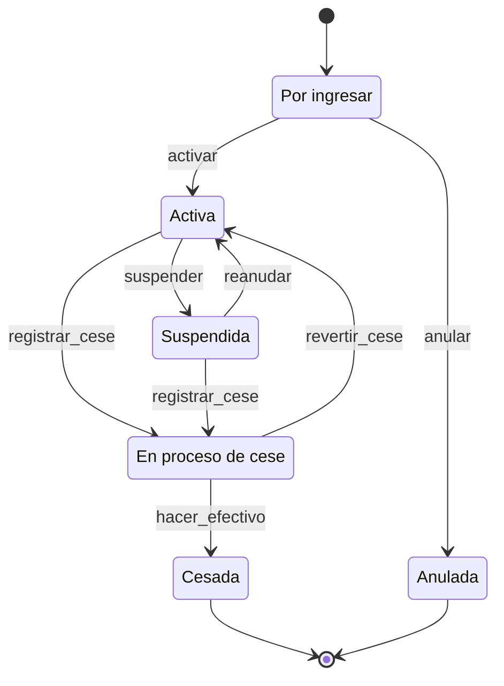

| Desde | Acción | Hacia | Quién puede | Validaciones | Efectos | Evento emitido |
|---|---|---|---|---|---|---|
| Por ingresar | `activar` | Activa | Sistema (fecha de ingreso) o RRHH (`people.employments.activate`) | Fecha de ingreso alcanzada; datos obligatorios completos; límite del plan | Habilita marcación, saldos y planilla; ocupa la posición | `employment.activated` |
| Por ingresar | `anular` | Anulada | RRHH (`people.employments.update`) | Sin marcaciones ni resultados de planilla | Libera la posición; cancela onboarding; datos de pre-ingreso pasan a régimen de candidato | `employee.hire_cancelled` |
| Activa | `suspender` | Suspendida | RRHH (`people.employments.suspend`) o sistema por ausencia o medida | Motivo de suspensión (perfecta o imperfecta) y fechas | Ajusta cómputo de beneficios según el tipo; avisa a planilla | `employment.status_changed` |
| Suspendida | `reanudar` | Activa | RRHH o sistema (fin de la causa) | Fecha de fin alcanzada o registrada | Reanuda cómputos | `employment.status_changed` |
| Activa, Suspendida | `registrar_cese` | En proceso de cese | RRHH (`people.employments.terminate`) | Fecha y motivo; fecha no anterior al último periodo cerrado | Inicia offboarding y liquidación en borrador; crea novedad de baja | `offboarding.started` |
| En proceso de cese | `revertir_cese` | Activa | RRHH (`people.employments.cancel_termination`) | Antes de la fecha efectiva; liquidación no pagada | Cancela offboarding y liquidación | `offboarding.cancelled` |
| En proceso de cese | `hacer_efectivo` | Cesada | Sistema (fecha efectiva) | Fecha de cese alcanzada | Libera posición; retira roles; modo ex-colaborador; cierra saldos hacia liquidación | `employee.terminated` |

Un reingreso crea una relación nueva en «Por ingresar»; la relación cesada no se reabre. El estado se guarda con vigencia (M-HIS).

Valores en `schema.sql` (`employments`): `status` ∈ {pending, active, suspended, terminated, terminating, cancelled}.

## ME-02 · Cuenta de usuario

Entidad: `users` · Épica: SEG · Estados: **Invitado**, **Activo**, **Bloqueado**, **Ex-colaborador (solo lectura)**, **Desactivado**.

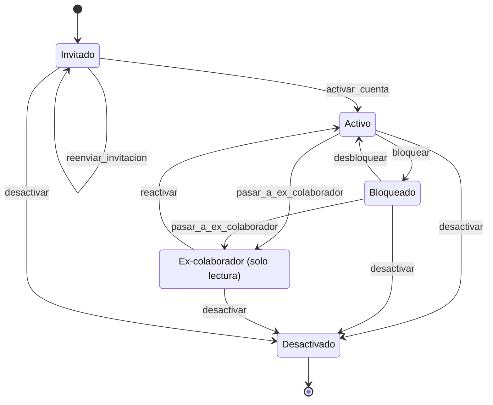

| Desde | Acción | Hacia | Quién puede | Validaciones | Efectos | Evento emitido |
|---|---|---|---|---|---|---|
| Invitado | `activar_cuenta` | Activo | El propio usuario | Enlace u OTP válido; clave conforme a política; aviso de privacidad aceptado | Crea sesión; registra factor MFA si el rol lo exige | `user.activated` |
| Invitado | `reenviar_invitacion` | Invitado | `identity.users.invite` | Invitación vencida o no recibida | Nuevo enlace; invalida el anterior | `user.invited` |
| Activo | `bloquear` | Bloqueado | Sistema (intentos fallidos) o `identity.users.suspend` | Umbral superado o motivo registrado | Cierra sesiones; reasigna aprobaciones según regla | `user.suspended` |
| Bloqueado | `desbloquear` | Activo | Sistema (tiempo cumplido) o `identity.users.reactivate` | Verificación de identidad | Restablece acceso | `user.unlocked` |
| Activo, Bloqueado | `pasar_a_ex_colaborador` | Ex-colaborador (solo lectura) | Sistema (cese efectivo) | Sin otra relación activa ni otro rol vigente | Retira roles; deja lectura de boletas, certificados y liquidación | `user.deactivated` |
| Ex-colaborador (solo lectura) | `reactivar` | Activo | Sistema (reingreso) o `identity.users.reactivate` | Nueva relación activa | Asigna rol Empleado | `user.activated` |
| Activo, Bloqueado, Ex-colaborador (solo lectura), Invitado | `desactivar` | Desactivado | `identity.users.update` o sistema (fin del periodo de ex-colaborador) | No deja a la organización sin administrador | Cierra sesiones y credenciales | `user.deactivated` |

Valores en `schema.sql` (`users`): `status` ∈ {invited, active, locked, disabled, alumni}.

## ME-03 · Posición

Entidad: `positions` · Épica: POS · Estados: **Propuesta**, **Aprobada**, **Vacante**, **En reclutamiento**, **Ocupada**, **Congelada**, **Cerrada**.

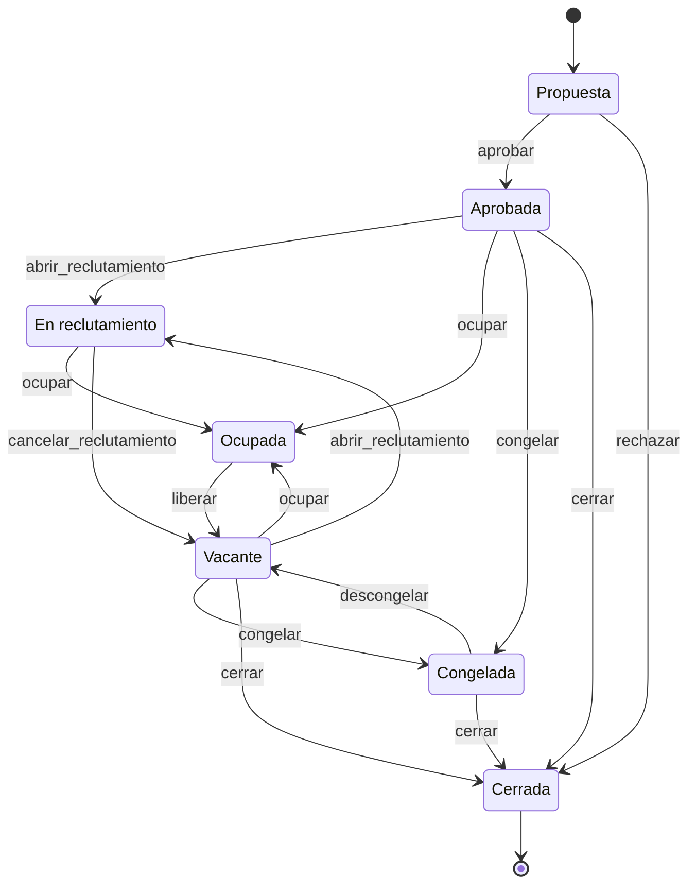

| Desde | Acción | Hacia | Quién puede | Validaciones | Efectos | Evento emitido |
|---|---|---|---|---|---|---|
| Propuesta | `aprobar` | Aprobada | `org.positions.approve` (vía motor de aprobaciones) | Presupuesto disponible o excepción aprobada | Reserva presupuesto | `position.approved` |
| Propuesta | `rechazar` | Cerrada | `org.positions.approve` | Motivo | Notifica al solicitante | `position.closed` |
| Aprobada, Vacante | `abrir_reclutamiento` | En reclutamiento | `recruiting.requisitions.create` | No congelada; sin vacante abierta para el mismo cupo | Crea o enlaza vacante | `position.opened` |
| Aprobada, Vacante, En reclutamiento | `ocupar` | Ocupada | Sistema al activar una relación | Cupo disponible | Asigna ocupante; actualiza organigrama | `position.filled` |
| Ocupada | `liberar` | Vacante | Sistema (cese o traslado efectivo) | Sin ocupante activo | Actualiza organigrama y headcount | `position.vacated` |
| En reclutamiento | `cancelar_reclutamiento` | Vacante | `recruiting.requisitions.publish` | Vacante cerrada sin contratación | — | `position.vacated` |
| Aprobada, Vacante | `congelar` | Congelada | `org.positions.freeze` | Motivo y fecha | Bloquea vacantes y asignaciones | `position.frozen` |
| Congelada | `descongelar` | Vacante | `org.positions.unfreeze` | — | Vuelve a estar disponible | `position.unfrozen` |
| Aprobada, Vacante, Congelada | `cerrar` | Cerrada | `org.positions.close` | Sin ocupante ni vacante abierta | Libera presupuesto | `position.closed` |

Valores en `schema.sql` (`positions`): `status` ∈ {proposed, approved, open, filled, frozen, closed, recruiting}.

## ME-04 · Solicitud de posición

Entidad: `position_requests` · Épica: POS · Estados: **Borrador**, **En aprobación**, **Aprobada**, **Rechazada**, **Cancelada**.

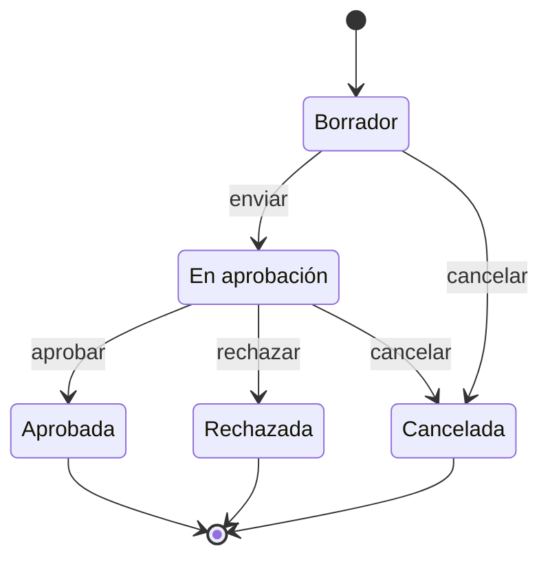

| Desde | Acción | Hacia | Quién puede | Validaciones | Efectos | Evento emitido |
|---|---|---|---|---|---|---|
| Borrador | `enviar` | En aprobación | `org.position_requests.create` | Puesto, unidad, motivo y costo estimado | Crea solicitud en el motor de aprobaciones | `position.requested` |
| En aprobación | `aprobar` | Aprobada | Aprobadores del flujo | Todos los niveles cumplidos | Crea la posición en «Aprobada» | `position.approved` |
| En aprobación | `rechazar` | Rechazada | Aprobadores del flujo | Motivo | Notifica | `approval.rejected` |
| Borrador, En aprobación | `cancelar` | Cancelada | Solicitante | — | Anula pasos pendientes | `approval.cancelled` |

Valores en `schema.sql` (`position_requests`): `status` ∈ {draft, submitted, approved, rejected, cancelled, fulfilled}.

## ME-05 · Vacante

Entidad: `job_requisitions` · Épica: ATS · Estados: **Borrador**, **En aprobación**, **Aprobada**, **Publicada**, **Pausada**, **Cubierta**, **Cancelada**.

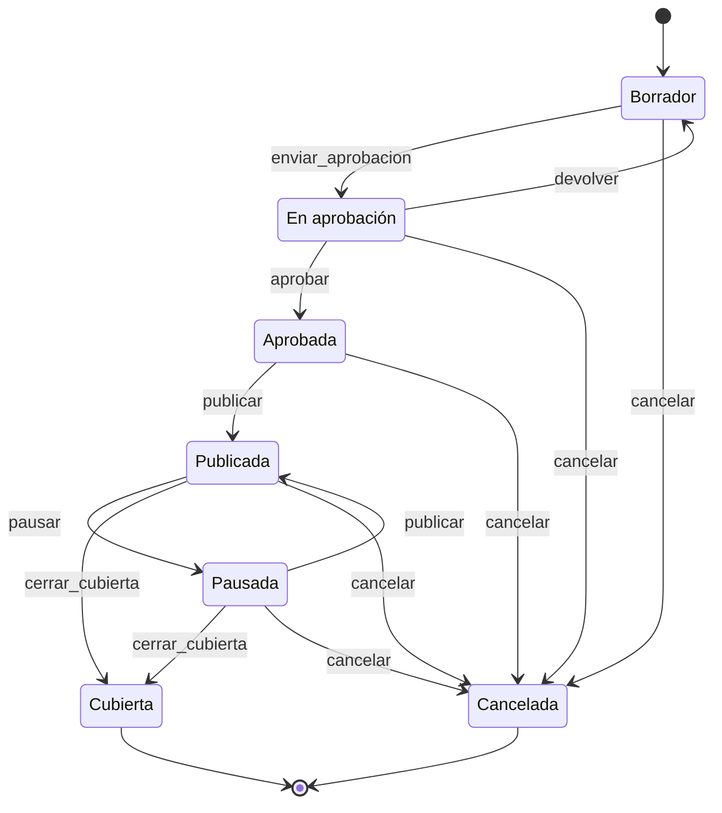

| Desde | Acción | Hacia | Quién puede | Validaciones | Efectos | Evento emitido |
|---|---|---|---|---|---|---|
| Borrador | `enviar_aprobacion` | En aprobación | `recruiting.requisitions.submit` | Posición válida si la política lo exige; descripción y requisitos | Solicitud de aprobación | `requisition.created` |
| En aprobación | `aprobar` | Aprobada | `recruiting.requisitions.approve` | — | — | `requisition.approved` |
| En aprobación | `devolver` | Borrador | `recruiting.requisitions.approve` | Observaciones | Notifica al reclutador | `approval.rejected` |
| Aprobada, Pausada | `publicar` | Publicada | `recruiting.requisitions.publish` | Etapas y formulario definidos | Visible en el portal; posición «En reclutamiento» | `requisition.published` |
| Publicada | `pausar` | Pausada | `recruiting.requisitions.hold` | — | Oculta del portal; conserva postulaciones | `requisition.on_hold` |
| Publicada, Pausada | `cerrar_cubierta` | Cubierta | Sistema (plazas cubiertas) o `recruiting.requisitions.close` | Ofertas aceptadas = plazas | Descarta postulaciones restantes previa confirmación | `requisition.closed` |
| Borrador, En aprobación, Aprobada, Publicada, Pausada | `cancelar` | Cancelada | `recruiting.requisitions.close` | Motivo | Libera la posición; avisa a postulantes | `requisition.closed` |

Valores en `schema.sql` (`job_requisitions`): `status` ∈ {draft, pending_approval, approved, open, on_hold, filled, cancelled, closed}.

## ME-06 · Postulación del candidato

Entidad: `applications` · Épica: ATS · Estados: **Nuevo**, **En proceso (etapas configurables)**, **Oferta**, **Contratado**, **Descartado**, **Retirado**.

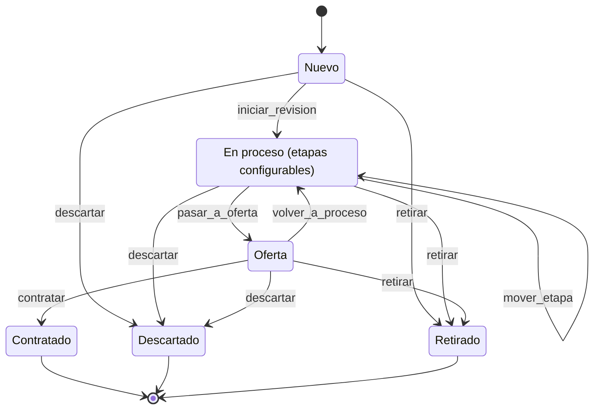

| Desde | Acción | Hacia | Quién puede | Validaciones | Efectos | Evento emitido |
|---|---|---|---|---|---|---|
| Nuevo | `iniciar_revision` | En proceso (etapas configurables) | `recruiting.applications.move_stage` | — | Entra a la primera etapa del tablero | `application.stage_changed` |
| En proceso (etapas configurables) | `mover_etapa` | En proceso (etapas configurables) | `recruiting.applications.move_stage` | Etapa destino existe en la vacante | Registra la etapa y el tiempo en la anterior | `application.stage_changed` |
| En proceso (etapas configurables) | `pasar_a_oferta` | Oferta | `recruiting.offers.create` | Evaluaciones requeridas completas | Crea oferta en borrador | `application.stage_changed` |
| Oferta | `contratar` | Contratado | Sistema al aceptarse la oferta | Oferta aceptada | Inicia pre-onboarding; precarga el ingreso | `candidate.hired` |
| Oferta | `volver_a_proceso` | En proceso (etapas configurables) | `recruiting.applications.move_stage` | Oferta rechazada, vencida o retirada | — | `application.stage_changed` |
| Nuevo, En proceso (etapas configurables), Oferta | `descartar` | Descartado | `recruiting.applications.reject` | Motivo de catálogo | Mensaje opcional; pasa a base de talento si consintió | `application.rejected` |
| Nuevo, En proceso (etapas configurables), Oferta | `retirar` | Retirado | Candidato (enlace de seguimiento) o reclutador | — | Cancela entrevistas pendientes | `application.withdrawn` |

Las etapas dentro de «En proceso» (preselección, entrevista RRHH, entrevista técnica, evaluación, referencias) son datos configurables por vacante, no estados fijos.

Valores en `schema.sql` (`applications`): `status` ∈ {active, hired, rejected, withdrawn, on_hold, new, offer}.

## ME-07 · Oferta laboral

Entidad: `job_offers` · Épica: ENT · Estados: **Borrador**, **En revisión**, **En aprobación**, **Aprobada**, **Enviada**, **Aceptada**, **Rechazada**, **Vencida**, **Retirada**.

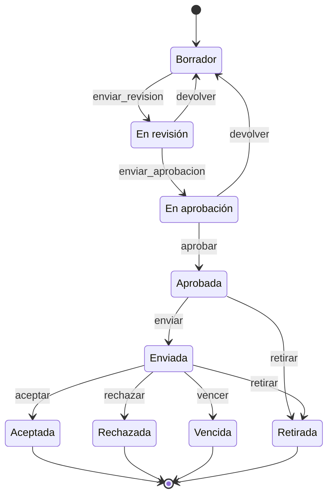

| Desde | Acción | Hacia | Quién puede | Validaciones | Efectos | Evento emitido |
|---|---|---|---|---|---|---|
| Borrador | `enviar_revision` | En revisión | `recruiting.offers.create` | Plantilla y variables completas | — | `offer.created` |
| En revisión | `enviar_aprobacion` | En aprobación | `recruiting.offers.submit` | Monto comparado con banda y presupuesto | Solicitud de aprobación con nivel según exceso | `approval.requested` |
| En revisión, En aprobación | `devolver` | Borrador | Revisor o aprobador | Observaciones | — | `approval.rejected` |
| En aprobación | `aprobar` | Aprobada | `recruiting.offers.approve` | — | — | `offer.approved` |
| Aprobada | `enviar` | Enviada | `recruiting.offers.send` | Posición con cupo; fecha de vencimiento | Enlace seguro al candidato | `offer.sent` |
| Enviada | `aceptar` | Aceptada | Candidato | Dentro de plazo; firma con evidencia | Postulación «Contratado»; inicia pre-onboarding | `offer.accepted` |
| Enviada | `rechazar` | Rechazada | Candidato | Motivo opcional | Libera cupo | `offer.declined` |
| Enviada | `vencer` | Vencida | Sistema | Fecha de vencimiento superada | Libera cupo | `offer.expired` |
| Aprobada, Enviada | `retirar` | Retirada | `recruiting.offers.withdraw` | Motivo | Invalida el enlace | `offer.withdrawn` |

Valores en `schema.sql` (`job_offers`): `status` ∈ {draft, in_review, approved, sent, accepted, declined, expired, withdrawn, pending_approval}.

## ME-08 · Proceso de onboarding

Entidad: `onboarding_processes` · Épica: ONB · Estados: **Pre-ingreso**, **En curso**, **Pausado**, **Completado**, **Cancelado**.

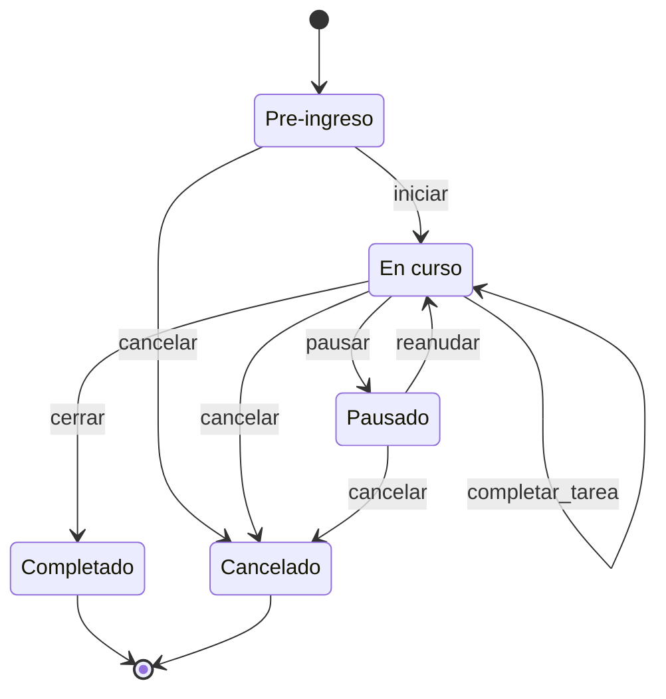

| Desde | Acción | Hacia | Quién puede | Validaciones | Efectos | Evento emitido |
|---|---|---|---|---|---|---|
| Pre-ingreso | `iniciar` | En curso | Sistema (`employee.hired`) | Relación creada; plantilla resuelta | Crea tareas con fechas y responsables | `onboarding.started` |
| Pre-ingreso | `cancelar` | Cancelado | `onboarding.processes.cancel` o sistema (ingreso anulado) | — | Anula tareas; datos pasan a régimen de candidato | `onboarding.cancelled` |
| En curso | `completar_tarea` | En curso | Responsable de la tarea (`onboarding.processes.complete_task`) | Evidencia si la tarea la exige | Recalcula avance | `onboarding.task_completed` |
| En curso | `pausar` | Pausado | `onboarding.processes.create` | Motivo (licencia) | Suspende plazos | `onboarding.paused` |
| Pausado | `reanudar` | En curso | `onboarding.processes.create` | — | Recalcula fechas | `onboarding.resumed` |
| En curso | `cerrar` | Completado | `onboarding.processes.complete` o sistema | Todas las tareas obligatorias completas | Lanza encuesta de onboarding | `onboarding.completed` |
| En curso, Pausado | `cancelar` | Cancelado | `onboarding.processes.cancel` o sistema (cese) | — | Anula tareas pendientes | `onboarding.cancelled` |

Las tareas del proceso tienen su propio ciclo simple: pendiente → en curso → completada / omitida (con motivo) / vencida.

Valores en `schema.sql` (`onboarding_processes`): `status` ∈ {not_started, in_progress, completed, cancelled, preboarding, paused}.

## ME-09 · Proceso de offboarding

Entidad: `terminations` · Épica: OFF · Estados: **Iniciado**, **En curso**, **Pendiente de liquidación**, **Completado**, **Cancelado**.

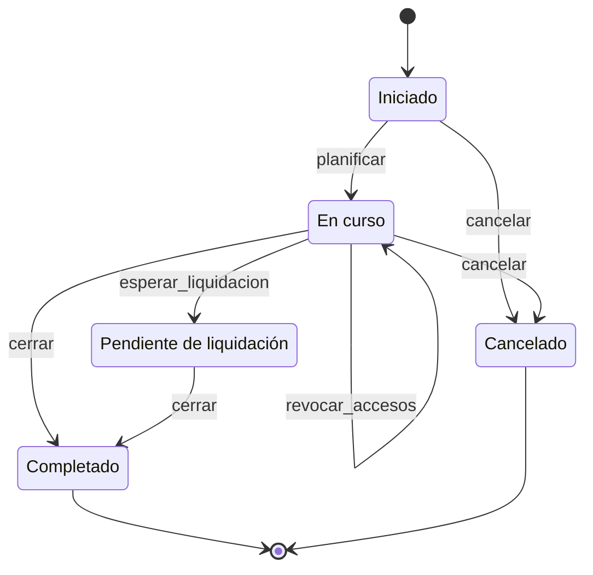

| Desde | Acción | Hacia | Quién puede | Validaciones | Efectos | Evento emitido |
|---|---|---|---|---|---|---|
| Iniciado | `planificar` | En curso | `onboarding.offboardings.update` | Plantilla del tipo de salida; sucesor de aprobaciones designado | Crea tareas | `offboarding.started` |
| En curso | `completar_tarea` | En curso | Responsable (`onboarding.offboardings.complete_task`) | Evidencia cuando aplica | Recalcula avance | `offboarding.task_completed` |
| En curso | `revocar_accesos` | En curso | Sistema (fecha efectiva) | Fecha de cese alcanzada | Desactiva accesos | `offboarding.access_revoked` |
| En curso | `esperar_liquidacion` | Pendiente de liquidación | Sistema | Tareas obligatorias completas; liquidación sin pagar | Alerta de plazo de pago | — |
| En curso, Pendiente de liquidación | `cerrar` | Completado | `onboarding.offboardings.complete` | Liquidación pagada y documentos entregados | Registra motivo final | `offboarding.completed` |
| Iniciado, En curso | `cancelar` | Cancelado | `onboarding.offboardings.cancel` | Cese revertido antes de la fecha efectiva | Revierte tareas no ejecutadas | `offboarding.cancelled` |

Valores en `schema.sql` (`terminations`): `status` ∈ {draft, pending_approval, approved, executed, cancelled, in_progress, pending_settlement}.

## ME-10 · Flujo de firma

Entidad: `signature_requests` · Épica: DOC · Estados: **Borrador**, **Enviado**, **Visto**, **Firmado parcialmente**, **Completado**, **Rechazado**, **Vencido**, **Cancelado**.

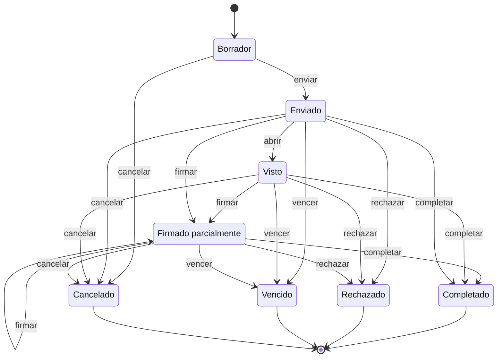

| Desde | Acción | Hacia | Quién puede | Validaciones | Efectos | Evento emitido |
|---|---|---|---|---|---|---|
| Borrador | `enviar` | Enviado | `documents.signature_requests.send` | Documento final; firmantes y orden definidos; contacto de cada firmante | Calcula hash; notifica al primer firmante o a todos | `signature.sent` |
| Enviado | `abrir` | Visto | Firmante | Identidad verificada | Registra fecha, hora e IP | `signature.viewed` |
| Visto, Enviado | `firmar` | Firmado parcialmente | Firmante (`documents.signature_requests.sign`) | OTP válido; es su turno | Añade evidencia; notifica al siguiente | `signature.signed` |
| Firmado parcialmente | `firmar` | Firmado parcialmente | Firmante siguiente | OTP válido; es su turno | Añade evidencia | `signature.signed` |
| Firmado parcialmente, Visto, Enviado | `completar` | Completado | Sistema | Último firmante firmó | Sella el PDF; genera constancia; archiva | `signature.completed` |
| Enviado, Visto, Firmado parcialmente | `rechazar` | Rechazado | Firmante | Motivo obligatorio | Notifica al emisor | `signature.declined` |
| Enviado, Visto, Firmado parcialmente | `vencer` | Vencido | Sistema | Fecha de caducidad superada | Permite reenviar como nuevo envío | `signature.expired` |
| Borrador, Enviado, Visto, Firmado parcialmente | `cancelar` | Cancelado | `documents.signature_requests.cancel` | — | Invalida enlaces | `signature.cancelled` |

Valores en `schema.sql` (`signature_requests`): `status` ∈ {draft, sent, in_progress, completed, declined, expired, cancelled, viewed}.

## ME-11 · Contrato

Entidad: `contracts` · Épica: CON · Estados: **Borrador**, **En aprobación**, **En firma**, **Firmado**, **Vigente**, **Por vencer**, **Vencido sin regularizar**, **Terminado**, **Anulado**.

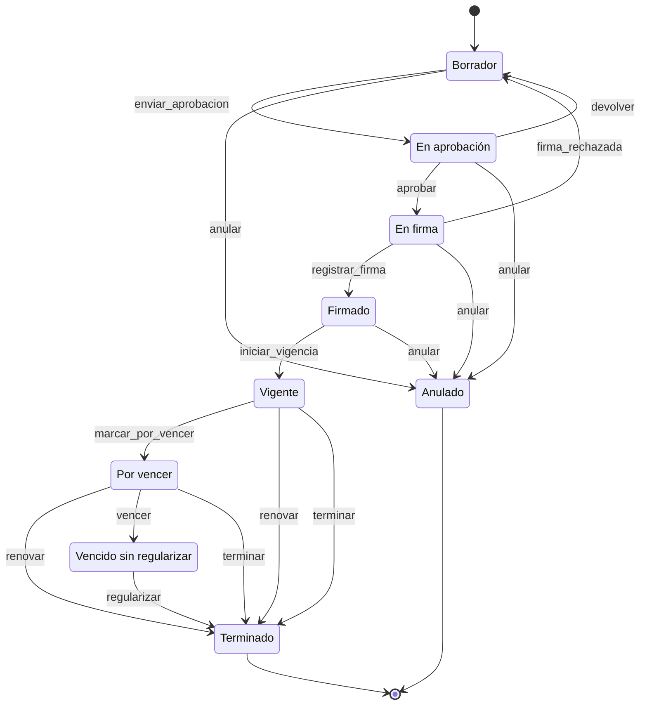

| Desde | Acción | Hacia | Quién puede | Validaciones | Efectos | Evento emitido |
|---|---|---|---|---|---|---|
| Borrador | `enviar_aprobacion` | En aprobación | `contracts.contracts.create` | Tipo, fechas, causa objetiva si es a plazo, topes de modalidad | — | `contract.created` |
| En aprobación | `aprobar` | En firma | `contracts.contracts.approve` | — | Genera documento y envío de firma | `contract.issued` |
| En aprobación | `devolver` | Borrador | `contracts.contracts.approve` | Observaciones | — | `approval.rejected` |
| En firma | `registrar_firma` | Firmado | Sistema (`signature.completed`) | Ambas partes firmaron | Archiva el documento | `contract.signed` |
| En firma | `firma_rechazada` | Borrador | Sistema (`signature.declined` o vencido) | — | Notifica a RRHH | `signature.declined` |
| Firmado | `iniciar_vigencia` | Vigente | Sistema (fecha de inicio) | Fecha de inicio alcanzada | Crea registro de vigencia en M-HIS | `contract.started` |
| Vigente | `marcar_por_vencer` | Por vencer | Sistema | Dentro de la ventana de aviso | Alertas a RRHH y jefe | `contract.expiring` |
| Por vencer, Vigente | `renovar` | Terminado | `contracts.contracts.renew` | Prórroga firmada; topes respetados | Crea contrato sucesor enlazado | `contract.renewed` |
| Por vencer | `vencer` | Vencido sin regularizar | Sistema | Fecha fin superada sin renovación ni cese | Alerta de riesgo; aparece en cumplimiento | `contract.expired` |
| Vencido sin regularizar | `regularizar` | Terminado | `contracts.contracts.renew` | Renovación, conversión a indeterminado o cese registrados | Crea sucesor o cierra la relación | `contract.regularized` |
| Vigente, Por vencer | `terminar` | Terminado | Sistema (cese efectivo) o `contracts.contracts.terminate` | Motivo | — | `contract.terminated` |
| Borrador, En aprobación, En firma, Firmado | `anular` | Anulado | `contracts.contracts.update` | Antes del inicio de vigencia | Cancela firma pendiente | `contract.voided` |

Una adenda es un documento con su propio flujo de firma (ME-10) que, al completarse, emite `contract.amended` y crea el movimiento con vigencia.

Valores en `schema.sql` (`contracts`): `status` ∈ {draft, pending_signature, active, expired, terminated, superseded, cancelled, pending_approval, signed}.

## ME-12 · Documento

Entidad: `documents` · Épica: DOC · Estados: **Solicitado**, **Entregado (en revisión)**, **Vigente**, **Rechazado**, **Por vencer**, **Vencido**, **Archivado**.

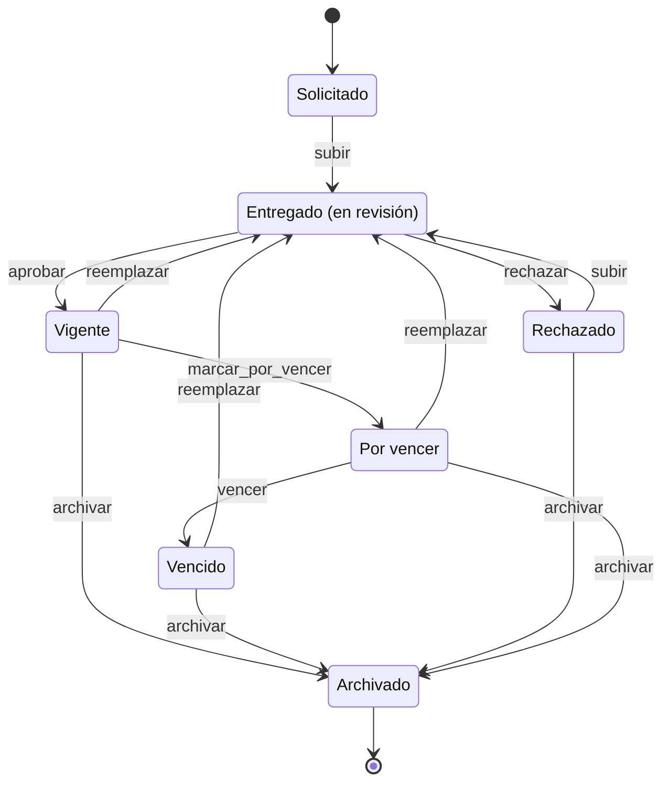

| Desde | Acción | Hacia | Quién puede | Validaciones | Efectos | Evento emitido |
|---|---|---|---|---|---|---|
| Solicitado | `subir` | Entregado (en revisión) | Titular o `documents.documents.create` | Tipo y tamaño permitidos; antivirus | Nueva versión | `document.uploaded` |
| Entregado (en revisión) | `aprobar` | Vigente | `documents.documents.approve` | Legible y corresponde al tipo | Agenda vencimiento si aplica | `document.approved` |
| Entregado (en revisión) | `rechazar` | Rechazado | `documents.documents.approve` | Motivo | Notifica al titular | `document.rejected` |
| Rechazado | `subir` | Entregado (en revisión) | Titular o `documents.documents.create` | — | Nueva versión | `document.uploaded` |
| Vigente | `marcar_por_vencer` | Por vencer | Sistema | Ventana de aviso del tipo | Alerta | `document.expiring` |
| Por vencer | `vencer` | Vencido | Sistema | Fecha superada | Alerta; puede afectar cumplimiento | `document.expired` |
| Vigente, Por vencer, Vencido | `reemplazar` | Entregado (en revisión) | Titular o `documents.documents.create` | — | Conserva la versión anterior | `document.uploaded` |
| Vigente, Vencido, Rechazado, Por vencer | `archivar` | Archivado | `documents.documents.archive` | No está bajo retención legal activa que exija disponibilidad | Sale de las vistas activas; se conserva | `document.archived` |

Un documento subido directamente por RRHH o generado desde plantilla nace en «Vigente» (si su tipo no exige revisión).

Valores en `schema.sql` (`documents`): `status` ∈ {draft, pending_approval, active, archived, expired, rejected, requested}.

## ME-13 · Marcación

Entidad: `attendance_punches` · Épica: ASI · Estados: **Registrada**, **Con incidencia**, **Validada**, **Reemplazada por corrección**, **Duplicada**.

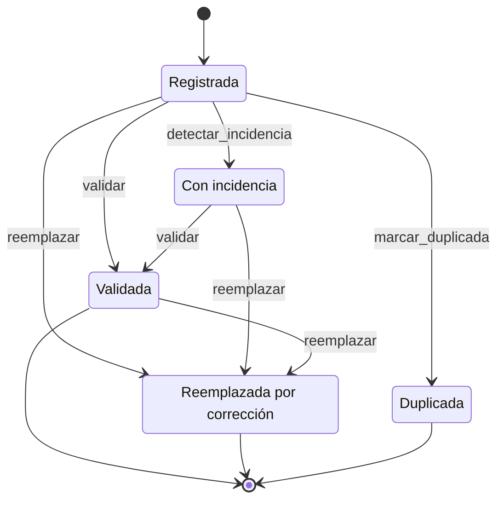

| Desde | Acción | Hacia | Quién puede | Validaciones | Efectos | Evento emitido |
|---|---|---|---|---|---|---|
| Registrada | `detectar_incidencia` | Con incidencia | Sistema | Fuera de geocerca, sin horario, diferencia de reloj o marca incompleta | Aparece en revisión | `attendance.punched` |
| Registrada | `marcar_duplicada` | Duplicada | Sistema | Misma persona y tipo dentro de la ventana de duplicado | No entra al cálculo | — |
| Registrada, Con incidencia | `validar` | Validada | Sistema (cálculo diario) o `time.attendance_corrections.approve` | Incidencia resuelta o inexistente | Entra al cálculo del día | `attendance.day_calculated` |
| Registrada, Con incidencia, Validada | `reemplazar` | Reemplazada por corrección | Sistema al aprobarse una corrección | Corrección aprobada enlazada | La marca original se conserva; la correctiva la sustituye en el cálculo | `attendance.correction_approved` |

La marca es de solo inserción: sus datos nunca cambian; el estado es una clasificación derivada que se guarda en un registro aparte.

En `schema.sql` la tabla `attendance_punches` no declara una columna de estado con lista cerrada: el estado se deriva o debe añadirse.

## ME-14 · Corrección de marcación

Entidad: `attendance_correction_requests` · Épica: ASI · Estados: **Solicitada**, **Aprobada**, **Rechazada**, **Cancelada**.

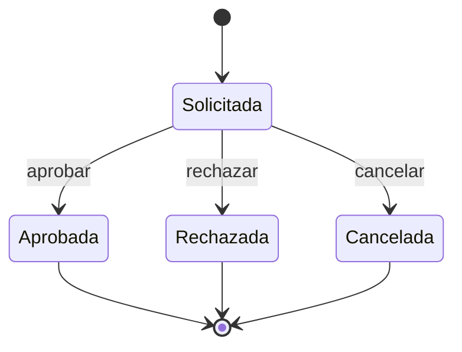

| Desde | Acción | Hacia | Quién puede | Validaciones | Efectos | Evento emitido |
|---|---|---|---|---|---|---|
| Solicitada | `aprobar` | Aprobada | `time.attendance_corrections.approve` (jefe o RRHH; no el solicitante) | Asistencia del periodo abierta; motivo y sustento | Inserta marca correctiva; recalcula el día | `attendance.correction_approved` |
| Solicitada | `rechazar` | Rechazada | `time.attendance_corrections.approve` | Motivo | Notifica | `attendance.correction_rejected` |
| Solicitada | `cancelar` | Cancelada | Solicitante | — | — | — |

Valores en `schema.sql` (`attendance_correction_requests`): `status` ∈ {pending, approved, rejected, cancelled}.

## ME-15 · Solicitud de vacaciones

Entidad: `vacation_requests` · Épica: VAC · Estados: **Borrador**, **Pendiente de jefe**, **En validación de RRHH**, **Aprobada (programada)**, **En goce**, **Gozada**, **Rechazada**, **Cancelada**.

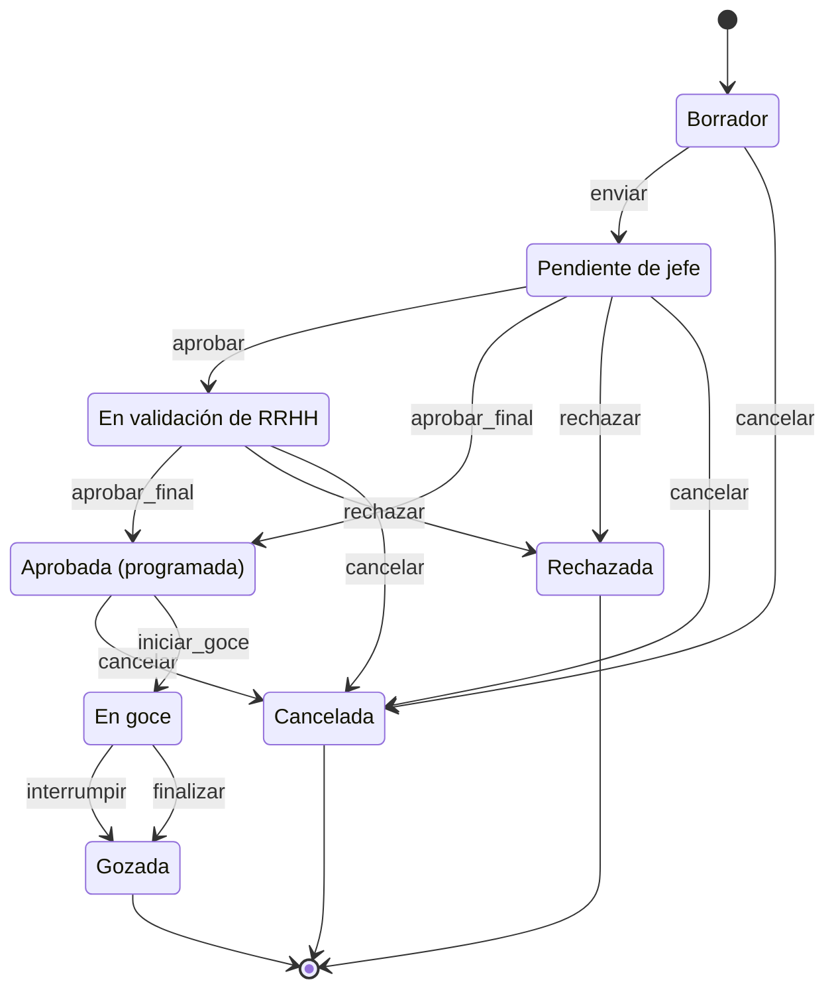

| Desde | Acción | Hacia | Quién puede | Validaciones | Efectos | Evento emitido |
|---|---|---|---|---|---|---|
| Borrador | `enviar` | Pendiente de jefe | Titular (`time.vacation_requests.create`) | Saldo, anticipación, fraccionamiento, sin traslape, periodo de planilla abierto | Crea solicitud de aprobación | `leave.requested` |
| Pendiente de jefe | `aprobar` | En validación de RRHH | Jefe (`time.vacation_requests.approve`) | Política exige validación de RRHH | Notifica a RRHH | `approval.step_approved` |
| Pendiente de jefe, En validación de RRHH | `aprobar_final` | Aprobada (programada) | Jefe o RRHH (`time.vacation_requests.validate`) según política | Último nivel del flujo | Reserva saldo; marca calendario; bloquea turnos; crea incidencia de planilla | `leave.approved` |
| Pendiente de jefe, En validación de RRHH | `rechazar` | Rechazada | Jefe o RRHH (`time.vacation_requests.reject`) | Motivo | Notifica | `leave.rejected` |
| Borrador, Pendiente de jefe, En validación de RRHH, Aprobada (programada) | `cancelar` | Cancelada | Titular o RRHH | Antes del inicio; periodo de planilla abierto | Devuelve saldo; libera calendario; retira incidencia | `leave.cancelled` |
| Aprobada (programada) | `iniciar_goce` | En goce | Sistema (fecha de inicio) | — | — | `leave.started` |
| En goce | `interrumpir` | Gozada | RRHH (`time.vacation_balances.adjust`) | Motivo; días no gozados calculados | Devuelve días no gozados al saldo | `leave.balance_adjusted` |
| En goce | `finalizar` | Gozada | Sistema (fecha de fin) | — | Saldo pasa de programado a tomado | `leave.completed` |

Valores en `schema.sql` (`vacation_requests`): `status` ∈ {draft, pending, approved, rejected, cancelled, taken, hr_review, in_progress}.

## ME-16 · Ausencia

Entidad: `absence_requests` · Épica: AUS · Estados: **Solicitada**, **Pendiente de sustento**, **Aprobada**, **En curso**, **Finalizada**, **Rechazada**, **Cancelada**.

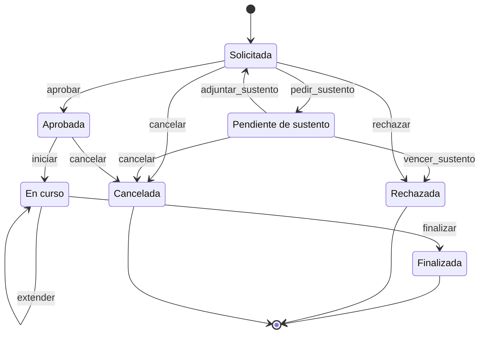

| Desde | Acción | Hacia | Quién puede | Validaciones | Efectos | Evento emitido |
|---|---|---|---|---|---|---|
| Solicitada | `aprobar` | Aprobada | `time.absences.approve` según tipo | Reglas del tipo; sustento si es obligatorio; sin traslape | Calendario, asistencia e incidencia de planilla | `absence.approved` |
| Solicitada | `pedir_sustento` | Pendiente de sustento | `time.absences.approve` o sistema | Tipo exige sustento y falta | Plazo para adjuntar | `absence.requested` |
| Pendiente de sustento | `adjuntar_sustento` | Solicitada | Titular o RRHH | Documento válido | — | `document.uploaded` |
| Pendiente de sustento | `vencer_sustento` | Rechazada | Sistema | Plazo superado | Se trata como falta según política | `absence.rejected` |
| Solicitada | `rechazar` | Rechazada | `time.absences.reject` | Motivo | — | `absence.rejected` |
| Aprobada | `iniciar` | En curso | Sistema | Fecha de inicio | — | `absence.started` |
| En curso | `extender` | En curso | `time.absences.create_for_others` | Nuevo sustento contiguo | Recalcula acumulado y subsidio | `absence.subsidy_started` |
| En curso | `finalizar` | Finalizada | Sistema o RRHH | Fecha de fin o alta anticipada | Cierra efecto en planilla | `absence.ended` |
| Solicitada, Pendiente de sustento, Aprobada | `cancelar` | Cancelada | Titular o RRHH | Antes del inicio | Revierte efectos | `absence.cancelled` |

Valores en `schema.sql` (`absence_requests`): `status` ∈ {draft, pending, approved, rejected, cancelled, pending_document, in_progress, completed}.

## ME-17 · Horas extra

Entidad: `overtime_requests` · Épica: BHO · Estados: **Solicitada**, **Autorizada**, **Por calificar**, **Calificada**, **En planilla**, **En bolsa de horas**, **Rechazada**.

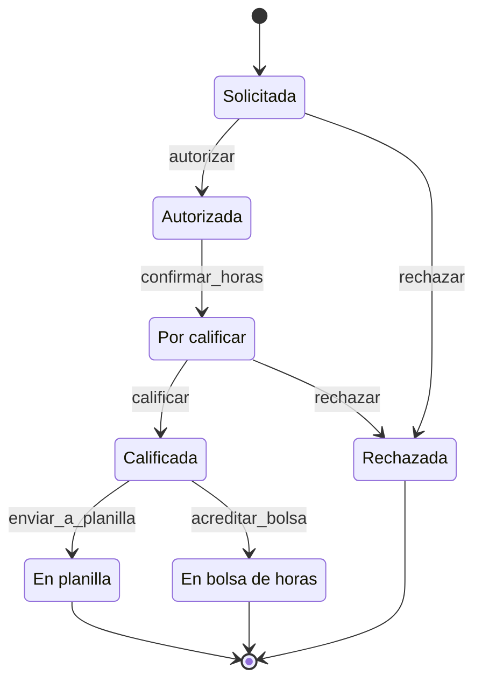

| Desde | Acción | Hacia | Quién puede | Validaciones | Efectos | Evento emitido |
|---|---|---|---|---|---|---|
| Solicitada | `autorizar` | Autorizada | `time.overtime_requests.approve` | Tope del periodo; persona sujeta a control | — | `overtime.approved` |
| Solicitada | `rechazar` | Rechazada | `time.overtime_requests.reject` | Motivo | — | `overtime.rejected` |
| Autorizada | `confirmar_horas` | Por calificar | Sistema (asistencia del día) | Marcas validadas | Toma horas reales hasta el máximo autorizado | `attendance.day_calculated` |
| Por calificar | `calificar` | Calificada | Sistema o RRHH | Tramos y sobretasas vigentes | Calcula horas por tramo | `overtime.qualified` |
| Por calificar | `rechazar` | Rechazada | `time.overtime_requests.reject` | Sobretiempo no reconocido, con motivo | Alerta de riesgo a RRHH | `overtime.rejected` |
| Calificada | `enviar_a_planilla` | En planilla | Sistema | Destino pago; periodo abierto | Incidencia de planilla | `overtime.qualified` |
| Calificada | `acreditar_bolsa` | En bolsa de horas | Sistema | Destino compensación; acuerdo aceptado | Movimiento en la bolsa | `time_bank.credited` |

El sobretiempo detectado sin solicitud previa nace directamente en «Por calificar».

Valores en `schema.sql` (`overtime_requests`): `status` ∈ {pending, approved, rejected, cancelled, pending_review, reviewed, in_payroll, banked}.

## ME-18 · Hoja de tiempo

Entidad: `timesheets` · Épica: TSH · Estados: **Abierta**, **Enviada**, **Aprobada**, **Devuelta**, **Bloqueada**.

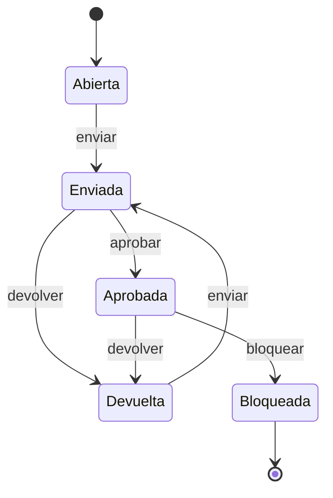

| Desde | Acción | Hacia | Quién puede | Validaciones | Efectos | Evento emitido |
|---|---|---|---|---|---|---|
| Abierta, Devuelta | `enviar` | Enviada | Titular (`time.timesheets.submit`) | Diferencia con asistencia dentro de tolerancia o justificada | — | `timesheet.submitted` |
| Enviada | `aprobar` | Aprobada | `time.timesheets.approve` | — | Alimenta costeo | `timesheet.approved` |
| Enviada, Aprobada | `devolver` | Devuelta | `time.timesheets.reject` | Motivo; periodo no bloqueado | — | `timesheet.returned` |
| Aprobada | `bloquear` | Bloqueada | Sistema (cierre de planilla) | — | Fija la distribución contable | — |

Valores en `schema.sql` (`timesheets`): `status` ∈ {open, submitted, approved, rejected, locked}.

## ME-19 · Periodo de planilla

Entidad: `payroll_periods` · Épica: PER, NOM · Estados: **Abierto**, **Calculado**, **En aprobación**, **Aprobado**, **Cerrado**, **Pagado**, **Contabilizado**.

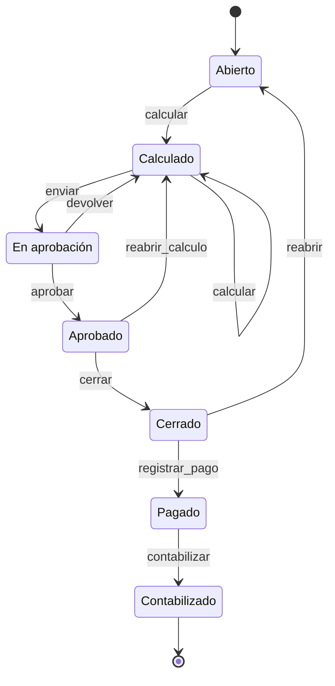

| Desde | Acción | Hacia | Quién puede | Validaciones | Efectos | Evento emitido |
|---|---|---|---|---|---|---|
| Abierto, Calculado | `calcular` | Calculado | `payroll.periods.calculate` | Parámetros del periodo disponibles | Guarda resultados con traza; detecta anomalías | `payroll.calculated` |
| Calculado | `enviar` | En aprobación | `payroll.periods.submit` | Sin relaciones con error; anomalías revisadas o confirmadas | Solicitud de aprobación | `payroll.submitted` |
| En aprobación | `aprobar` | Aprobado | `payroll.periods.approve` (distinto de quien calculó o cargó incidencias) | Segregación de funciones | — | `payroll.approved` |
| En aprobación | `devolver` | Calculado | `payroll.periods.reject` | Observaciones | Notifica a Payroll | `payroll.returned` |
| Aprobado | `cerrar` | Cerrado | `payroll.periods.close` | Periodo anterior cerrado; parámetros «a confirmar» confirmados | Resultados inmutables; genera boletas, archivos, provisiones y asiento | `payroll.closed` |
| Aprobado | `reabrir_calculo` | Calculado | `payroll.periods.calculate` | Motivo | Invalida la aprobación | `payroll.returned` |
| Cerrado | `reabrir` | Abierto | `payroll.periods.reopen` | No declarado ni pagado; motivo | Retira boletas; anula asiento no exportado | `payroll.reopened` |
| Cerrado | `registrar_pago` | Pagado | `payroll.periods.mark_paid` | Lote de pago conciliado | Marca cuotas y adelantos como descontados | `payroll.paid` |
| Pagado | `contabilizar` | Contabilizado | Sistema (asiento exportado) o `payroll.accounting_entries.export` | Asiento cuadrado | Guarda referencia del ERP | `accounting.entry_exported` |

Valores en `schema.sql` (`payroll_periods`): `status` ∈ {open, incidents_closed, calculated, in_review, approved, closed, paid, accounted}.

## ME-20 · Boleta de pago

Entidad: `payslips` · Épica: BOL · Estados: **Generada**, **Publicada**, **Vista**, **Con acuse**, **Anulada**.

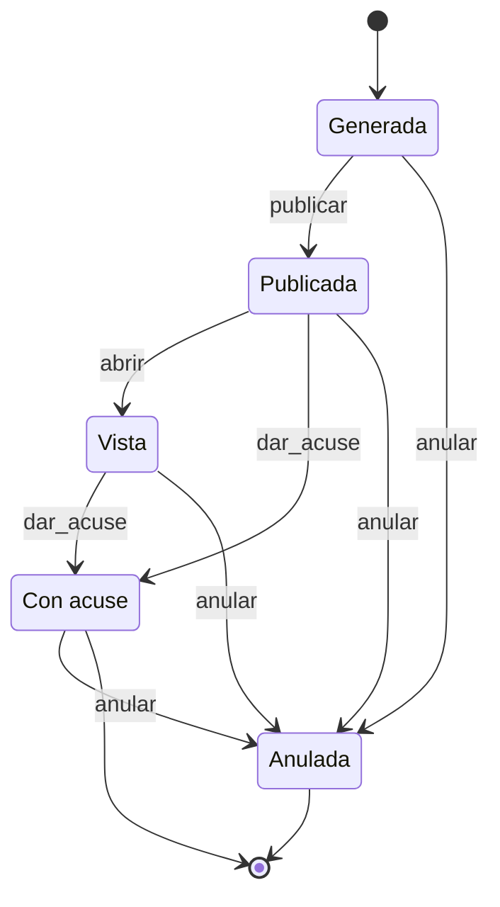

| Desde | Acción | Hacia | Quién puede | Validaciones | Efectos | Evento emitido |
|---|---|---|---|---|---|---|
| Generada | `publicar` | Publicada | Sistema (cierre) o `payroll.payslips.publish` | Firma del empleador aplicada | Visible en el portal; notifica | `payslip.published` |
| Publicada | `abrir` | Vista | Titular | — | Constancia de acceso | `payslip.viewed` |
| Vista, Publicada | `dar_acuse` | Con acuse | Titular | Política exige acuse | Constancia de recepción | `payslip.acknowledged` |
| Generada, Publicada, Vista, Con acuse | `anular` | Anulada | `payroll.payslips.void` o sistema (reapertura) | Motivo | Conserva la versión; genera la nueva si hay recálculo | `payslip.voided` |

Valores en `schema.sql` (`payslips`): `status` ∈ {draft, closed}.

## ME-21 · Préstamo

Entidad: `loans` · Épica: PRE · Estados: **Solicitado**, **Aprobado**, **Desembolsado**, **En pago**, **Pagado**, **Refinanciado**, **Rechazado**, **Cancelado**.

```mermaid
stateDiagram-v2
    state "Solicitado" as solicitado
    state "Aprobado" as aprobado
    state "Desembolsado" as desembolsado
    state "En pago" as en_pago
    state "Pagado" as pagado
    state "Refinanciado" as refinanciado
    state "Rechazado" as rechazado
    state "Cancelado" as cancelado
    [*] --> solicitado
    solicitado --> aprobado: aprobar
    solicitado --> rechazado: rechazar
    aprobado --> desembolsado: desembolsar
    desembolsado --> en_pago: iniciar_descuento
    en_pago --> en_pago: pagar_cuota
    en_pago --> pagado: liquidar
    en_pago --> refinanciado: refinanciar
    solicitado --> cancelado: cancelar
    aprobado --> cancelado: cancelar
    pagado --> [*]
    refinanciado --> [*]
    rechazado --> [*]
    cancelado --> [*]
```

| Desde | Acción | Hacia | Quién puede | Validaciones | Efectos | Evento emitido |
|---|---|---|---|---|---|---|
| Solicitado | `aprobar` | Aprobado | `payroll.loans.approve` | Elegibilidad; capacidad de descuento | — | `loan.approved` |
| Solicitado | `rechazar` | Rechazado | `payroll.loans.reject` | Motivo | — | `loan.rejected` |
| Aprobado | `desembolsar` | Desembolsado | `payroll.loans.disburse` | Pago confirmado por el adaptador | Genera cronograma | `loan.disbursed` |
| Desembolsado | `iniciar_descuento` | En pago | Sistema (primera cuota) | — | Cuota como incidencia | `loan.installment_due` |
| En pago | `pagar_cuota` | En pago | Sistema (cierre de planilla) o pago directo | Monto descontado | Actualiza saldo | `loan.installment_paid` |
| En pago | `liquidar` | Pagado | Sistema | Saldo cero | — | `loan.paid_off` |
| En pago | `refinanciar` | Refinanciado | `payroll.loans.update` | Nueva aprobación | Crea préstamo sucesor con el saldo | `loan.refinanced` |
| Solicitado, Aprobado | `cancelar` | Cancelado | Titular o Payroll | Antes del desembolso | — | `loan.cancelled` |

Valores en `schema.sql` (`loans`): `status` ∈ {requested, approved, rejected, active, paid, cancelled, settled_on_termination, disbursed, refinanced}.

## ME-22 · Adelanto de sueldo

Entidad: `salary_advances` · Épica: PRE · Estados: **Solicitado**, **Aprobado**, **Pagado**, **Descontado**, **Rechazado**.

```mermaid
stateDiagram-v2
    state "Solicitado" as solicitado
    state "Aprobado" as aprobado
    state "Pagado" as pagado
    state "Descontado" as descontado
    state "Rechazado" as rechazado
    [*] --> solicitado
    solicitado --> aprobado: aprobar
    solicitado --> rechazado: rechazar
    aprobado --> pagado: pagar
    pagado --> descontado: descontar
    descontado --> [*]
    rechazado --> [*]
```

| Desde | Acción | Hacia | Quién puede | Validaciones | Efectos | Evento emitido |
|---|---|---|---|---|---|---|
| Solicitado | `aprobar` | Aprobado | Sistema (cumple política) o `payroll.salary_advances.approve` | Monto ≤ disponible; elegibilidad | — | `advance.requested` |
| Solicitado | `rechazar` | Rechazado | Sistema o `payroll.salary_advances.reject` | Motivo | — | `advance.rejected` |
| Aprobado | `pagar` | Pagado | `payroll.salary_advances.pay` o adaptador de pago | Confirmación del medio de pago | Crea incidencia de descuento en el periodo que corresponde | `advance.paid` |
| Pagado | `descontar` | Descontado | Sistema (cierre de planilla) | Periodo cerrado | — | `advance.deducted` |

Valores en `schema.sql` (`salary_advances`): `status` ∈ {requested, approved, rejected, paid, deducted, cancelled}.

## ME-23 · Liquidación de beneficios

Entidad: `settlements` · Épica: LIQ · Estados: **Borrador**, **Calculada**, **En aprobación**, **Aprobada**, **Pagada**, **Documentos entregados**, **Anulada**.

```mermaid
stateDiagram-v2
    state "Borrador" as borrador
    state "Calculada" as calculada
    state "En aprobación" as en_aprobacion
    state "Aprobada" as aprobada
    state "Pagada" as pagada
    state "Documentos entregados" as entregada
    state "Anulada" as anulada
    [*] --> borrador
    borrador --> calculada: calcular
    calculada --> calculada: calcular
    calculada --> en_aprobacion: enviar
    en_aprobacion --> aprobada: aprobar
    en_aprobacion --> calculada: devolver
    aprobada --> pagada: pagar
    pagada --> entregada: entregar_documentos
    borrador --> anulada: anular
    calculada --> anulada: anular
    en_aprobacion --> anulada: anular
    entregada --> [*]
    anulada --> [*]
```

| Desde | Acción | Hacia | Quién puede | Validaciones | Efectos | Evento emitido |
|---|---|---|---|---|---|---|
| Borrador, Calculada | `calcular` | Calculada | `payroll.settlements.calculate` | Fecha y motivo de cese; parámetros vigentes | Guarda detalle con traza | `settlement.calculated` |
| Calculada | `enviar` | En aprobación | `payroll.settlements.calculate` | Sin errores | — | `approval.requested` |
| En aprobación | `aprobar` | Aprobada | `payroll.settlements.approve` (distinto de quien calculó) | — | Inmutable | `settlement.approved` |
| En aprobación | `devolver` | Calculada | `payroll.settlements.approve` | Observaciones | — | `approval.rejected` |
| Aprobada | `pagar` | Pagada | `payroll.settlements.mark_paid` | Dentro del plazo legal (alerta si no) | Crea bajas en T-Registro y seguros | `settlement.paid` |
| Pagada | `entregar_documentos` | Documentos entregados | `payroll.settlements.mark_paid` | Documentos de cese firmados | Publica en el portal del ex-colaborador | `settlement.documents_issued` |
| Borrador, Calculada, En aprobación | `anular` | Anulada | `payroll.settlements.void` | Cese revertido | — | `settlement.voided` |

Valores en `schema.sql` (`settlements`): `status` ∈ {draft, calculated, approved, paid, voided, pending_approval, documents_delivered}.

## ME-24 · Archivo de declaración o pago

Entidad: `statutory_filings` · Épica: DEC · Estados: **Borrador**, **Validado**, **Con errores**, **Presentado**, **Aceptado**, **Observado**, **Rectificado**.

```mermaid
stateDiagram-v2
    state "Borrador" as borrador
    state "Validado" as validado
    state "Con errores" as con_errores
    state "Presentado" as presentado
    state "Aceptado" as aceptado
    state "Observado" as observado
    state "Rectificado" as rectificado
    [*] --> borrador
    borrador --> validado: validar
    con_errores --> validado: validar
    borrador --> con_errores: validar_con_errores
    con_errores --> con_errores: validar_con_errores
    validado --> presentado: presentar
    presentado --> aceptado: aceptar
    presentado --> observado: observar
    observado --> rectificado: rectificar
    aceptado --> rectificado: rectificar
    aceptado --> [*]
    rectificado --> [*]
```

| Desde | Acción | Hacia | Quién puede | Validaciones | Efectos | Evento emitido |
|---|---|---|---|---|---|---|
| Borrador, Con errores | `validar` | Validado | `payroll.declaration_files.validate` | Periodo cerrado; validación previa sin errores | Fija hash | `filing.validated` |
| Borrador, Con errores | `validar_con_errores` | Con errores | `payroll.declaration_files.validate` | Validación previa con errores | Lista errores con enlace al dato | `filing.generated` |
| Validado | `presentar` | Presentado | `payroll.declaration_files.mark_submitted` | Constancia adjunta | Registra fecha | `filing.submitted` |
| Presentado | `aceptar` | Aceptado | `payroll.declaration_files.mark_submitted` | Respuesta de la entidad | Actualiza cumplimiento | `filing.accepted` |
| Presentado | `observar` | Observado | `payroll.declaration_files.mark_submitted` | Detalle de la observación | Tarea de corrección | `filing.observed` |
| Observado, Aceptado | `rectificar` | Rectificado | `payroll.declaration_files.rectify` | Motivo | Crea nueva versión en «Borrador» enlazada | `filing.rectified` |

Valores en `schema.sql` (`statutory_filings`): `status` ∈ {draft, generated, validated, with_errors, submitted, accepted, rejected, observed, rectified}.

## ME-25 · Campaña de evaluación

Entidad: `performance_cycles` · Épica: DES · Estados: **Borrador**, **En evaluación**, **En calibración**, **Resultados publicados**, **Cerrada**, **Cancelada**.

```mermaid
stateDiagram-v2
    state "Borrador" as borrador
    state "En evaluación" as lanzada
    state "En calibración" as calibracion
    state "Resultados publicados" as publicada
    state "Cerrada" as cerrada
    state "Cancelada" as cancelada
    [*] --> borrador
    borrador --> lanzada: lanzar
    lanzada --> calibracion: pasar_a_calibracion
    calibracion --> publicada: publicar
    publicada --> cerrada: cerrar
    borrador --> cancelada: cancelar
    lanzada --> cancelada: cancelar
    cerrada --> [*]
    cancelada --> [*]
```

| Desde | Acción | Hacia | Quién puede | Validaciones | Efectos | Evento emitido |
|---|---|---|---|---|---|---|
| Borrador | `lanzar` | En evaluación | `performance.cycles.launch` | Población, formulario, evaluadores y fechas | Crea evaluaciones; notifica | `review_cycle.launched` |
| En evaluación | `pasar_a_calibracion` | En calibración | `performance.cycles.start_calibration` | Fecha límite o avance mínimo | Bloquea respuestas; calcula resultados | `review_cycle.evaluation_closed` |
| En calibración | `publicar` | Resultados publicados | `performance.reviews.share` | Calibración registrada | Resultados visibles al jefe y luego al evaluado | `review.published` |
| Resultados publicados | `cerrar` | Cerrada | `performance.cycles.close` | — | Genera insumos para desarrollo, 9-box y compensación | `review_cycle.closed` |
| Borrador, En evaluación | `cancelar` | Cancelada | `performance.cycles.update` | Motivo | Cancela evaluaciones pendientes | `review_cycle.cancelled` |

Valores en `schema.sql` (`performance_cycles`): `status` ∈ {draft, nomination, in_progress, calibration, results_published, closed, cancelled}.

## ME-26 · Evaluación individual

Entidad: `reviews` · Épica: DES · Estados: **Asignada**, **En progreso**, **Enviada**, **Calibrada**, **Publicada**, **Con acuse**, **Cancelada**.

```mermaid
stateDiagram-v2
    state "Asignada" as asignada
    state "En progreso" as en_progreso
    state "Enviada" as enviada
    state "Calibrada" as calibrada
    state "Publicada" as publicada
    state "Con acuse" as con_acuse
    state "Cancelada" as cancelada
    [*] --> asignada
    asignada --> en_progreso: empezar
    asignada --> enviada: enviar
    en_progreso --> enviada: enviar
    enviada --> en_progreso: reabrir
    enviada --> calibrada: calibrar
    enviada --> publicada: publicar
    calibrada --> publicada: publicar
    publicada --> con_acuse: dar_acuse
    asignada --> cancelada: cancelar
    en_progreso --> cancelada: cancelar
    con_acuse --> [*]
    cancelada --> [*]
```

| Desde | Acción | Hacia | Quién puede | Validaciones | Efectos | Evento emitido |
|---|---|---|---|---|---|---|
| Asignada | `empezar` | En progreso | Evaluador (`performance.reviews.submit`) | Campaña en evaluación | Guarda borrador | `review.started` |
| Asignada, En progreso | `enviar` | Enviada | Evaluador | Preguntas obligatorias completas | Bloquea edición | `review.submitted` |
| Enviada | `reabrir` | En progreso | `performance.reviews.reopen` | Motivo; campaña aún en evaluación | — | `review.reopened` |
| Enviada | `calibrar` | Calibrada | `performance.reviews.calibrate` | Guarda original, ajuste y motivo | — | `review.calibrated` |
| Enviada, Calibrada | `publicar` | Publicada | Sistema (publicación de campaña) | — | Visible según anonimato | `review.published` |
| Publicada | `dar_acuse` | Con acuse | Evaluado | — | Comentario opcional | `review.acknowledged` |
| Asignada, En progreso | `cancelar` | Cancelada | `performance.cycles.update` o sistema (cese) | — | — | `review.cancelled` |

Valores en `schema.sql` (`reviews`): `status` ∈ {pending, in_progress, submitted, declined, calibrated, published, acknowledged, cancelled}.

## ME-27 · Objetivo

Entidad: `goals` · Épica: OKR · Estados: **Borrador**, **En aprobación**, **Activo**, **En riesgo**, **Cerrado**, **Cancelado**.

```mermaid
stateDiagram-v2
    state "Borrador" as borrador
    state "En aprobación" as en_aprobacion
    state "Activo" as activo
    state "En riesgo" as en_riesgo
    state "Cerrado" as cerrado
    state "Cancelado" as cancelado
    [*] --> borrador
    borrador --> en_aprobacion: enviar
    en_aprobacion --> activo: aprobar
    en_aprobacion --> borrador: devolver
    activo --> activo: actualizar_avance
    en_riesgo --> activo: actualizar_avance
    activo --> en_riesgo: marcar_en_riesgo
    activo --> en_aprobacion: modificar_meta
    en_riesgo --> en_aprobacion: modificar_meta
    activo --> cerrado: cerrar
    en_riesgo --> cerrado: cerrar
    borrador --> cancelado: cancelar
    en_aprobacion --> cancelado: cancelar
    activo --> cancelado: cancelar
    en_riesgo --> cancelado: cancelar
    cerrado --> [*]
    cancelado --> [*]
```

| Desde | Acción | Hacia | Quién puede | Validaciones | Efectos | Evento emitido |
|---|---|---|---|---|---|---|
| Borrador | `enviar` | En aprobación | Dueño (`performance.objectives.create`) | Resultados clave con métrica y meta; pesos válidos | — | `objective.created` |
| En aprobación | `aprobar` | Activo | Jefe (`performance.objectives.activate`) | — | — | `objective.approved` |
| En aprobación | `devolver` | Borrador | Jefe | Comentario | — | `approval.rejected` |
| Activo, En riesgo | `actualizar_avance` | Activo | Dueño | Ciclo abierto | Recalcula avance | `objective.updated` |
| Activo | `marcar_en_riesgo` | En riesgo | Dueño o sistema (sin actualización o confianza baja) | — | Avisa al jefe | `objective.at_risk` |
| Activo, En riesgo | `modificar_meta` | En aprobación | Dueño | Motivo | Conserva historial | `objective.created` |
| Activo, En riesgo | `cerrar` | Cerrado | Dueño, jefe o sistema (fin de ciclo) | Calificación final | Insumo para desempeño | `objective.closed` |
| Borrador, En aprobación, Activo, En riesgo | `cancelar` | Cancelado | Dueño o jefe | Motivo | — | `objective.cancelled` |

Valores en `schema.sql` (`goals`): `status` ∈ {draft, active, at_risk, achieved, missed, cancelled, pending_approval, closed}.

## ME-28 · Inscripción a curso

Entidad: `enrollments` · Épica: LMS · Estados: **No iniciado**, **En progreso**, **Completado**, **Vencido**, **Cancelado**.

```mermaid
stateDiagram-v2
    state "No iniciado" as no_iniciado
    state "En progreso" as en_progreso
    state "Completado" as completado
    state "Vencido" as vencido
    state "Cancelado" as cancelado
    [*] --> no_iniciado
    no_iniciado --> en_progreso: iniciar
    en_progreso --> completado: completar
    no_iniciado --> vencido: vencer
    en_progreso --> vencido: vencer
    vencido --> completado: completar
    no_iniciado --> cancelado: cancelar
    en_progreso --> cancelado: cancelar
    vencido --> cancelado: cancelar
    completado --> [*]
    cancelado --> [*]
```

| Desde | Acción | Hacia | Quién puede | Validaciones | Efectos | Evento emitido |
|---|---|---|---|---|---|---|
| No iniciado | `iniciar` | En progreso | Inscrito (`learning.enrollments.complete`) | Curso publicado | Registra inicio | `enrollment.started` |
| En progreso | `completar` | Completado | Sistema | Lecciones vistas y evaluación aprobada (o asistencia a sesión) | Emite certificado; actualiza registros legales | `course.completed` |
| No iniciado, En progreso | `vencer` | Vencido | Sistema | Fecha límite superada | Alerta a inscrito, jefe y responsable | `course.expired` |
| Vencido | `completar` | Completado | Sistema | Requisitos cumplidos fuera de plazo | Marca «completado con retraso» | `course.completed` |
| No iniciado, En progreso, Vencido | `cancelar` | Cancelado | `learning.enrollments.create` o sistema (cese) | — | — | `enrollment.cancelled` |

Valores en `schema.sql` (`enrollments`): `status` ∈ {not_started, in_progress, completed, overdue, failed, cancelled}.

## ME-29 · Ciclo de revisión salarial

Entidad: `compensation_review_cycles` · Épica: COM · Estados: **Borrador**, **Propuestas de managers**, **Revisión de RRHH**, **Aprobación de finanzas**, **Aprobación de dirección**, **Aprobado**, **Aplicado**, **Cancelado**.

```mermaid
stateDiagram-v2
    state "Borrador" as borrador
    state "Propuestas de managers" as propuestas
    state "Revisión de RRHH" as revision_rrhh
    state "Aprobación de finanzas" as aprobacion_finanzas
    state "Aprobación de dirección" as aprobacion_direccion
    state "Aprobado" as aprobado
    state "Aplicado" as aplicado
    state "Cancelado" as cancelado
    [*] --> borrador
    borrador --> propuestas: lanzar
    propuestas --> revision_rrhh: cerrar_propuestas
    revision_rrhh --> aprobacion_finanzas: enviar_a_finanzas
    aprobacion_finanzas --> aprobacion_direccion: aprobar
    aprobacion_direccion --> aprobado: aprobar
    revision_rrhh --> propuestas: devolver
    aprobacion_finanzas --> propuestas: devolver
    aprobacion_direccion --> propuestas: devolver
    aprobado --> aplicado: aplicar
    borrador --> cancelado: cancelar
    propuestas --> cancelado: cancelar
    revision_rrhh --> cancelado: cancelar
    aprobacion_finanzas --> cancelado: cancelar
    aprobacion_direccion --> cancelado: cancelar
    aprobado --> cancelado: cancelar
    aplicado --> [*]
    cancelado --> [*]
```

| Desde | Acción | Hacia | Quién puede | Validaciones | Efectos | Evento emitido |
|---|---|---|---|---|---|---|
| Borrador | `lanzar` | Propuestas de managers | `compensation.cycles.open` | Población, presupuesto por unidad, lineamientos, fecha de vigencia | Notifica a managers | `compensation_cycle.launched` |
| Propuestas de managers | `cerrar_propuestas` | Revisión de RRHH | `compensation.cycles.submit` | Propuestas enviadas o plazo vencido | Bloquea edición de managers | `compensation_cycle.proposals_submitted` |
| Revisión de RRHH | `enviar_a_finanzas` | Aprobación de finanzas | `compensation.proposals.approve` | Excepciones justificadas | — | `approval.requested` |
| Aprobación de finanzas | `aprobar` | Aprobación de dirección | Aprobador de finanzas del flujo | Costo dentro del presupuesto o excepción | — | `approval.step_approved` |
| Aprobación de dirección | `aprobar` | Aprobado | Aprobador de dirección del flujo | — | — | `compensation_cycle.approved` |
| Revisión de RRHH, Aprobación de finanzas, Aprobación de dirección | `devolver` | Propuestas de managers | Aprobador de la etapa | Observaciones | Reabre propuestas indicadas | `approval.rejected` |
| Aprobado | `aplicar` | Aplicado | `compensation.cycles.apply` | Fecha de vigencia; periodo de planilla abierto | Crea compensaciones con vigencia; genera cartas y evidencia de comunicación | `compensation_cycle.applied` |
| Borrador, Propuestas de managers, Revisión de RRHH, Aprobación de finanzas, Aprobación de dirección, Aprobado | `cancelar` | Cancelado | `compensation.cycles.close` | Motivo | Sin efectos en sueldos | `compensation_cycle.cancelled` |

Valores en `schema.sql` (`compensation_review_cycles`): `status` ∈ {draft, open, hr_review, finance_review, executive_review, approved, applied, cancelled}.

## ME-30 · Encuesta

Entidad: `surveys` · Épica: ENC · Estados: **Borrador**, **Programada**, **Abierta**, **Cerrada**, **Resultados publicados**, **Archivada**.

```mermaid
stateDiagram-v2
    state "Borrador" as borrador
    state "Programada" as programada
    state "Abierta" as abierta
    state "Cerrada" as cerrada
    state "Resultados publicados" as publicada
    state "Archivada" as archivada
    [*] --> borrador
    borrador --> programada: programar
    borrador --> abierta: lanzar
    programada --> abierta: lanzar
    abierta --> cerrada: cerrar
    cerrada --> publicada: publicar
    cerrada --> archivada: archivar
    publicada --> archivada: archivar
    archivada --> [*]
```

| Desde | Acción | Hacia | Quién puede | Validaciones | Efectos | Evento emitido |
|---|---|---|---|---|---|---|
| Borrador | `programar` | Programada | `engagement.surveys.update` | Preguntas, población y modo de anonimato fijados | — | `survey.scheduled` |
| Borrador, Programada | `lanzar` | Abierta | `engagement.surveys.launch` o sistema (fecha) | Población no vacía | Fija segmentos; envía invitaciones | `survey.launched` |
| Abierta | `cerrar` | Cerrada | `engagement.surveys.close` o sistema (fecha) | — | Calcula resultados con umbral | `survey.closed` |
| Cerrada | `publicar` | Resultados publicados | `engagement.surveys.update` | Participación mínima o confirmación | Visible a managers en su alcance | `survey.results_published` |
| Cerrada, Resultados publicados | `archivar` | Archivada | `engagement.surveys.update` | — | Conserva agregados | `survey.archived` |

Valores en `schema.sql` (`surveys`): `status` ∈ {draft, scheduled, open, closed, archived, results_published}.

## ME-31 · Solicitud a RRHH (ticket)

Entidad: `tickets` · Épica: HSD · Estados: **Nuevo**, **En atención**, **Esperando información**, **Resuelto**, **Cerrado**.

```mermaid
stateDiagram-v2
    state "Nuevo" as nuevo
    state "En atención" as en_atencion
    state "Esperando información" as esperando
    state "Resuelto" as resuelto
    state "Cerrado" as cerrado
    [*] --> nuevo
    nuevo --> en_atencion: tomar
    en_atencion --> esperando: pedir_informacion
    esperando --> en_atencion: responder
    esperando --> cerrado: cerrar_por_inactividad
    en_atencion --> resuelto: resolver
    nuevo --> resuelto: resolver
    resuelto --> en_atencion: reabrir
    resuelto --> cerrado: cerrar
    cerrado --> [*]
```

| Desde | Acción | Hacia | Quién puede | Validaciones | Efectos | Evento emitido |
|---|---|---|---|---|---|---|
| Nuevo | `tomar` | En atención | Agente (`helpdesk.tickets.assign`) o asignación automática | No es el solicitante | Registra primera respuesta para el SLA | `ticket.assigned` |
| En atención | `pedir_informacion` | Esperando información | Agente (`helpdesk.tickets.request_info`) | Mensaje al solicitante | Detiene el reloj del SLA | `ticket.waiting_info` |
| Esperando información | `responder` | En atención | Solicitante | — | Reanuda el reloj | `ticket.updated` |
| Esperando información | `cerrar_por_inactividad` | Cerrado | Sistema | Plazo sin respuesta | Aviso al solicitante | `ticket.closed` |
| En atención, Nuevo | `resolver` | Resuelto | Agente | Respuesta registrada | Pide confirmación y valoración | `ticket.resolved` |
| Resuelto | `reabrir` | En atención | Solicitante | Dentro del plazo de reapertura | — | `ticket.reopened` |
| Resuelto | `cerrar` | Cerrado | Solicitante o sistema (plazo) | — | — | `ticket.closed` |

Valores en `schema.sql` (`tickets`): `status` ∈ {new, in_progress, waiting_info, resolved, closed, cancelled}.

## ME-32 · Informe de gastos

Entidad: `expense_reports` · Épica: GAS · Estados: **Borrador**, **Enviado (manager)**, **En revisión de finanzas**, **Observado**, **Aprobado**, **Pagado**, **Rechazado**.

```mermaid
stateDiagram-v2
    state "Borrador" as borrador
    state "Enviado (manager)" as enviado
    state "En revisión de finanzas" as en_revision
    state "Observado" as observado
    state "Aprobado" as aprobado
    state "Pagado" as pagado
    state "Rechazado" as rechazado
    [*] --> borrador
    borrador --> enviado: enviar
    observado --> enviado: enviar
    enviado --> en_revision: aprobar
    en_revision --> aprobado: aprobar
    enviado --> observado: observar
    en_revision --> observado: observar
    enviado --> rechazado: rechazar
    en_revision --> rechazado: rechazar
    aprobado --> pagado: pagar
    pagado --> [*]
    rechazado --> [*]
```

| Desde | Acción | Hacia | Quién puede | Validaciones | Efectos | Evento emitido |
|---|---|---|---|---|---|---|
| Borrador, Observado | `enviar` | Enviado (manager) | Titular (`expenses.reports.create`) | Comprobantes exigidos; excesos justificados | Solicitud de aprobación | `expense.submitted` |
| Enviado (manager) | `aprobar` | En revisión de finanzas | Manager (`expenses.reports.approve`; no el titular) | — | — | `approval.step_approved` |
| En revisión de finanzas | `aprobar` | Aprobado | Finanzas (`expenses.reports.review`) | Comprobantes válidos; sin duplicados | Define medio de pago | `expense.approved` |
| Enviado (manager), En revisión de finanzas | `observar` | Observado | Manager o finanzas | Observación por gasto | Devuelve al titular | `expense.observed` |
| Enviado (manager), En revisión de finanzas | `rechazar` | Rechazado | Manager o finanzas (`expenses.reports.reject`) | Motivo | — | `expense.rejected` |
| Aprobado | `pagar` | Pagado | `expenses.reports.mark_paid` o sistema (cierre de planilla) | Pago confirmado | Contabiliza | `expense.paid` |

Valores en `schema.sql` (`expense_reports`): `status` ∈ {draft, submitted, manager_approved, finance_approved, rejected, paid, cancelled, observed}.

## ME-33 · Anticipo de viático y rendición

Entidad: `expense_advances` · Épica: GAS · Estados: **Solicitado**, **Aprobado**, **Entregado**, **Por rendir**, **Rendido**, **Vencido sin rendir**, **Cerrado**, **Rechazado**.

```mermaid
stateDiagram-v2
    state "Solicitado" as solicitado
    state "Aprobado" as aprobado
    state "Entregado" as entregado
    state "Por rendir" as por_rendir
    state "Rendido" as rendido
    state "Vencido sin rendir" as vencido
    state "Cerrado" as cerrado
    state "Rechazado" as rechazado
    [*] --> solicitado
    solicitado --> aprobado: aprobar
    solicitado --> rechazado: rechazar
    aprobado --> entregado: entregar
    entregado --> por_rendir: iniciar_plazo
    por_rendir --> rendido: rendir
    vencido --> rendido: rendir
    por_rendir --> vencido: vencer
    rendido --> cerrado: cerrar
    cerrado --> [*]
    rechazado --> [*]
```

| Desde | Acción | Hacia | Quién puede | Validaciones | Efectos | Evento emitido |
|---|---|---|---|---|---|---|
| Solicitado | `aprobar` | Aprobado | `expenses.advances.approve` | Política de viáticos; sin anticipos vencidos | — | `approval.approved` |
| Solicitado | `rechazar` | Rechazado | `expenses.advances.reject` | Motivo | — | `approval.rejected` |
| Aprobado | `entregar` | Entregado | `expenses.advances.mark_paid` | Pago confirmado | — | `travel_advance.granted` |
| Entregado | `iniciar_plazo` | Por rendir | Sistema (fin del viaje) | — | Empieza el plazo de rendición | — |
| Por rendir, Vencido sin rendir | `rendir` | Rendido | Titular | Informe de gastos aprobado enlazado | Calcula saldo a devolver o reembolsar | `travel_advance.settled` |
| Por rendir | `vencer` | Vencido sin rendir | Sistema | Plazo superado | Alerta; bloquea nuevos anticipos según política | `travel_advance.overdue` |
| Rendido | `cerrar` | Cerrado | `expenses.advances.mark_paid` | Devolución o reembolso registrado | — | `travel_advance.closed` |

Valores en `schema.sql` (`expense_advances`): `status` ∈ {requested, paid, partially_settled, settled, deducted, approved, pending_settlement, overdue, closed, rejected}.

## ME-34 · Activo

Entidad: `assets` · Épica: ACT · Estados: **Disponible**, **Asignado**, **Mantenimiento**, **Perdido**, **Baja**.

```mermaid
stateDiagram-v2
    state "Disponible" as disponible
    state "Asignado" as asignado
    state "Mantenimiento" as mantenimiento
    state "Perdido" as perdido
    state "Baja" as baja
    [*] --> disponible
    disponible --> asignado: asignar
    asignado --> disponible: devolver
    asignado --> mantenimiento: enviar_mantenimiento
    disponible --> mantenimiento: enviar_mantenimiento
    mantenimiento --> disponible: retornar
    asignado --> perdido: marcar_perdido
    disponible --> perdido: marcar_perdido
    mantenimiento --> perdido: marcar_perdido
    perdido --> disponible: recuperar
    disponible --> baja: dar_baja
    mantenimiento --> baja: dar_baja
    perdido --> baja: dar_baja
    baja --> [*]
```

| Desde | Acción | Hacia | Quién puede | Validaciones | Efectos | Evento emitido |
|---|---|---|---|---|---|---|
| Disponible | `asignar` | Asignado | `assets.assets.assign` | Acta firmada por quien recibe | Registra asignación | `asset.assigned` |
| Asignado | `devolver` | Disponible | `assets.assets.return` | Estado verificado; acta de devolución | Cierra asignación | `asset.returned` |
| Asignado, Disponible | `enviar_mantenimiento` | Mantenimiento | `assets.assets.send_to_maintenance` | Motivo | Cierra asignación si la había | `asset.sent_to_maintenance` |
| Mantenimiento | `retornar` | Disponible | `assets.assets.update` | — | — | `asset.available` |
| Asignado, Disponible, Mantenimiento | `marcar_perdido` | Perdido | `assets.assets.report_lost` | Motivo y fecha | Informa a liquidación si hay cese | `asset.lost` |
| Perdido | `recuperar` | Disponible | `assets.assets.update` | — | — | `asset.available` |
| Disponible, Mantenimiento, Perdido | `dar_baja` | Baja | `assets.assets.retire` | Motivo | Conserva historial | `asset.retired` |

Valores en `schema.sql` (`assets`): `status` ∈ {available, assigned, maintenance, lost, retired}.

## ME-35 · Incidente o accidente SST

Entidad: `sst_incidents` · Épica: SST · Estados: **Reportado**, **Clasificado**, **En investigación**, **Con medidas en curso**, **Cerrado**, **Descartado**.

```mermaid
stateDiagram-v2
    state "Reportado" as reportado
    state "Clasificado" as clasificado
    state "En investigación" as en_investigacion
    state "Con medidas en curso" as con_medidas
    state "Cerrado" as cerrado
    state "Descartado" as descartado
    [*] --> reportado
    reportado --> clasificado: clasificar
    reportado --> descartado: descartar
    clasificado --> en_investigacion: investigar
    en_investigacion --> con_medidas: definir_medidas
    con_medidas --> cerrado: cerrar
    en_investigacion --> cerrado: cerrar
    cerrado --> [*]
    descartado --> [*]
```

| Desde | Acción | Hacia | Quién puede | Validaciones | Efectos | Evento emitido |
|---|---|---|---|---|---|---|
| Reportado | `clasificar` | Clasificado | `sst.incidents.update` | Tipo y gravedad | Crea tarea de notificación a la autoridad si el tipo lo exige | `sst.incident_classified` |
| Reportado | `descartar` | Descartado | `sst.incidents.close` | Motivo (no constituye incidente) | — | `sst.incident_discarded` |
| Clasificado | `investigar` | En investigación | `sst.incidents.investigate` | Responsable asignado | — | `sst.investigation_started` |
| En investigación | `definir_medidas` | Con medidas en curso | `sst.incidents.investigate` | Causas registradas | Crea medidas correctivas | `sst.corrective_action_created` |
| Con medidas en curso | `cerrar` | Cerrado | `sst.incidents.close` | Todas las medidas verificadas o descartadas | Entra al registro obligatorio y estadísticas | `sst.incident_closed` |
| En investigación | `cerrar` | Cerrado | `sst.incidents.close` | Investigación concluye sin medidas, con fundamento | — | `sst.incident_closed` |

Valores en `schema.sql` (`sst_incidents`): `status` ∈ {reported, under_investigation, closed, classified, actions_in_progress, dismissed}.

## ME-36 · Medida correctiva

Entidad: `corrective_actions` · Épica: SST · Estados: **Pendiente**, **En curso**, **Ejecutada**, **Verificada**, **Vencida**, **Descartada**.

```mermaid
stateDiagram-v2
    state "Pendiente" as pendiente
    state "En curso" as en_curso
    state "Ejecutada" as ejecutada
    state "Verificada" as verificada
    state "Vencida" as vencida
    state "Descartada" as descartada
    [*] --> pendiente
    pendiente --> en_curso: iniciar
    pendiente --> ejecutada: ejecutar
    en_curso --> ejecutada: ejecutar
    vencida --> ejecutada: ejecutar
    ejecutada --> verificada: verificar
    ejecutada --> en_curso: rechazar_verificacion
    pendiente --> vencida: vencer
    en_curso --> vencida: vencer
    pendiente --> descartada: descartar
    en_curso --> descartada: descartar
    vencida --> descartada: descartar
    verificada --> [*]
    descartada --> [*]
```

| Desde | Acción | Hacia | Quién puede | Validaciones | Efectos | Evento emitido |
|---|---|---|---|---|---|---|
| Pendiente | `iniciar` | En curso | Responsable (`sst.corrective_actions.complete`) | — | — | `sst.corrective_action_started` |
| Pendiente, En curso, Vencida | `ejecutar` | Ejecutada | Responsable | Evidencia adjunta | Solicita verificación | `sst.corrective_action_executed` |
| Ejecutada | `verificar` | Verificada | `sst.corrective_actions.verify` (distinto del responsable) | Eficacia comprobada | Permite cerrar el incidente | `sst.corrective_action_verified` |
| Ejecutada | `rechazar_verificacion` | En curso | `sst.corrective_actions.verify` | Motivo | — | `sst.corrective_action_reopened` |
| Pendiente, En curso | `vencer` | Vencida | Sistema | Plazo superado | Alerta a responsable y SST | `sst.corrective_action_overdue` |
| Pendiente, En curso, Vencida | `descartar` | Descartada | `sst.corrective_actions.update` | Motivo | — | `sst.corrective_action_discarded` |

Valores en `schema.sql` (`corrective_actions`): `status` ∈ {open, in_progress, done, verified, overdue, cancelled}.

## ME-37 · Denuncia

Entidad: `complaints` · Épica: DEN · Estados: **Recibida**, **Admitida**, **En investigación**, **Con informe**, **Resuelta**, **Cerrada**, **No admitida**.

```mermaid
stateDiagram-v2
    state "Recibida" as recibida
    state "Admitida" as admitida
    state "En investigación" as en_investigacion
    state "Con informe" as con_informe
    state "Resuelta" as resuelta
    state "Cerrada" as cerrada
    state "No admitida" as no_admitida
    [*] --> recibida
    recibida --> admitida: admitir
    recibida --> no_admitida: no_admitir
    admitida --> en_investigacion: asignar
    en_investigacion --> en_investigacion: registrar_actuacion
    en_investigacion --> con_informe: emitir_informe
    con_informe --> resuelta: resolver
    resuelta --> cerrada: cerrar
    cerrada --> [*]
    no_admitida --> [*]
```

| Desde | Acción | Hacia | Quién puede | Validaciones | Efectos | Evento emitido |
|---|---|---|---|---|---|---|
| Recibida | `admitir` | Admitida | `grievances.cases.admit` | Categoría; sin conflicto de interés del receptor | Dicta medidas de protección si es hostigamiento; inicia plazos | `grievance.received` |
| Recibida | `no_admitir` | No admitida | `grievances.cases.dismiss` | Fundamento; orientación al canal correcto | Visible al denunciante con su código | `grievance.closed` |
| Admitida | `asignar` | En investigación | `grievances.cases.assign` | Investigador no mencionado en el caso | Acceso solo al asignado | — |
| En investigación | `registrar_actuacion` | En investigación | `grievances.cases.investigate` | — | Bitácora del caso | — |
| En investigación | `emitir_informe` | Con informe | `grievances.cases.investigate` | Hechos, descargos y conclusión | — | `grievance.deadline_approaching` |
| Con informe | `resolver` | Resuelta | `grievances.cases.resolve` (órgano decisor) | Decisión y medidas | Deriva a caso disciplinario si corresponde, sin identidad del denunciante | — |
| Resuelta | `cerrar` | Cerrada | `grievances.cases.close` | Comunicación a las partes | Programa anonimización al vencer la retención | `grievance.closed` |

Ningún evento de este módulo lleva datos del caso ni identidades; solo los reciben los asignados.

Valores en `schema.sql` (`complaints`): `status` ∈ {received, admitted, under_investigation, protection_measures, resolved, dismissed, closed, report_issued}.

## ME-38 · Caso disciplinario

Entidad: `disciplinary_cases` · Épica: DIS · Estados: **Abierto**, **Imputación notificada**, **En descargos**, **En evaluación**, **Decidido**, **Medida notificada**, **Cerrado**, **Archivado sin medida**.

```mermaid
stateDiagram-v2
    state "Abierto" as abierto
    state "Imputación notificada" as imputado
    state "En descargos" as en_descargos
    state "En evaluación" as en_evaluacion
    state "Decidido" as decidido
    state "Medida notificada" as notificado
    state "Cerrado" as cerrado
    state "Archivado sin medida" as archivado
    [*] --> abierto
    abierto --> imputado: notificar_imputacion
    abierto --> archivado: archivar
    imputado --> en_descargos: abrir_descargos
    en_descargos --> en_evaluacion: recibir_descargos
    en_evaluacion --> decidido: decidir
    en_evaluacion --> archivado: archivar
    decidido --> notificado: notificar_medida
    notificado --> cerrado: cerrar
    cerrado --> [*]
    archivado --> [*]
```

| Desde | Acción | Hacia | Quién puede | Validaciones | Efectos | Evento emitido |
|---|---|---|---|---|---|---|
| Abierto | `notificar_imputacion` | Imputación notificada | `discipline.cases.notify` | Hechos y evidencias documentados | Genera carta con plazo de descargos | `disciplinary.charge_notified` |
| Abierto | `archivar` | Archivado sin medida | `discipline.cases.update` | Fundamento | — | `disciplinary.closed` |
| Imputación notificada | `abrir_descargos` | En descargos | Sistema (constancia de notificación) | Notificación recibida | Corre el plazo | — |
| En descargos | `recibir_descargos` | En evaluación | Trabajador (`discipline.cases.submit_defense`) o sistema (plazo vencido) | — | Registra descargos o su ausencia | `disciplinary.defense_submitted` |
| En evaluación | `decidir` | Decidido | `discipline.cases.resolve` (distinto de quien condujo, para suspensión o despido) | Medida proporcional y fundamentada | — | `disciplinary.decided` |
| En evaluación | `archivar` | Archivado sin medida | `discipline.cases.resolve` | Fundamento | — | `disciplinary.closed` |
| Decidido | `notificar_medida` | Medida notificada | `discipline.cases.notify` | Documento firmado | Suspensión crea ausencia; despido inicia offboarding | `disciplinary.measure_notified` |
| Medida notificada | `cerrar` | Cerrado | `discipline.cases.close` | Efectos aplicados | Registra antecedente con vigencia | `disciplinary.closed` |

Valores en `schema.sql` (`disciplinary_cases`): `status` ∈ {open, charges_notified, defense_received, under_review, sanctioned, dismissed, closed, awaiting_defense, decided}.

## ME-39 · Solicitud de derechos sobre datos personales

Entidad: `data_subject_requests` · Épica: PRI · Estados: **Recibida**, **Verificando identidad**, **En proceso**, **Atendida**, **Denegada (con fundamento)**, **Cerrada**.

```mermaid
stateDiagram-v2
    state "Recibida" as recibida
    state "Verificando identidad" as en_verificacion
    state "En proceso" as en_proceso
    state "Atendida" as atendida
    state "Denegada (con fundamento)" as denegada
    state "Cerrada" as cerrada
    [*] --> recibida
    recibida --> en_verificacion: verificar_identidad
    recibida --> en_proceso: admitir
    en_verificacion --> en_proceso: admitir
    en_proceso --> atendida: atender
    en_proceso --> denegada: denegar
    en_verificacion --> denegada: denegar
    atendida --> cerrada: cerrar
    denegada --> cerrada: cerrar
    cerrada --> [*]
```

| Desde | Acción | Hacia | Quién puede | Validaciones | Efectos | Evento emitido |
|---|---|---|---|---|---|---|
| Recibida | `verificar_identidad` | Verificando identidad | `privacy.subject_requests.resolve` | Titular externo o sin sesión | Pide sustento | `privacy.request_received` |
| Recibida, Verificando identidad | `admitir` | En proceso | `privacy.subject_requests.resolve` | Identidad verificada; tipo de derecho | Calcula fecha límite | — |
| En proceso | `atender` | Atendida | `privacy.subject_requests.resolve` | Acción ejecutada (entrega, rectificación, cancelación, oposición, portabilidad) | Registra respuesta | `privacy.request_resolved` |
| En proceso | `denegar` | Denegada (con fundamento) | `privacy.subject_requests.reject` | Fundamento legal (obligación de conservar) | Responde al titular | `privacy.request_resolved` |
| Verificando identidad | `denegar` | Denegada (con fundamento) | `privacy.subject_requests.reject` | Identidad no acreditada en plazo | — | `privacy.request_resolved` |
| Atendida, Denegada (con fundamento) | `cerrar` | Cerrada | Sistema | Respuesta entregada | Conserva expediente | — |

Valores en `schema.sql` (`data_subject_requests`): `status` ∈ {received, identity_verified, in_progress, answered, rejected, closed, verifying_identity}.

## ME-40 · Organización y suscripción

Entidad: `tenants` · Épica: SAS · Estados: **En prueba**, **Activa**, **En periodo de gracia**, **Suspendida**, **Cancelada**, **Eliminada o anonimizada**.

```mermaid
stateDiagram-v2
    state "En prueba" as prueba
    state "Activa" as activa
    state "En periodo de gracia" as gracia
    state "Suspendida" as suspendida
    state "Cancelada" as cancelada
    state "Eliminada o anonimizada" as eliminada
    [*] --> prueba
    prueba --> activa: convertir
    prueba --> gracia: vencer_prueba
    activa --> gracia: entrar_en_gracia
    gracia --> activa: regularizar
    gracia --> suspendida: suspender
    activa --> suspendida: suspender
    suspendida --> activa: reactivar
    activa --> cancelada: cancelar
    suspendida --> cancelada: cancelar
    gracia --> cancelada: cancelar
    prueba --> cancelada: cancelar
    cancelada --> activa: reactivar
    cancelada --> eliminada: eliminar
    eliminada --> [*]
```

| Desde | Acción | Hacia | Quién puede | Validaciones | Efectos | Evento emitido |
|---|---|---|---|---|---|---|
| En prueba | `convertir` | Activa | `platform.subscriptions.change_plan` o cliente | Plan elegido | Activa módulos y límites del plan | `tenant.activated` |
| En prueba | `vencer_prueba` | En periodo de gracia | Sistema | Fin de la prueba sin conversión | Avisos al administrador | `tenant.trial_ended` |
| Activa | `entrar_en_gracia` | En periodo de gracia | Sistema | Pago vencido | Avisos; operación normal | `subscription.past_due` |
| En periodo de gracia | `regularizar` | Activa | Sistema o `platform.subscriptions.update` | Pago o conversión | — | `tenant.reactivated` |
| En periodo de gracia, Activa | `suspender` | Suspendida | Sistema (fin de gracia) o `platform.tenants.suspend` | Motivo | Bloquea operación; colaboradores conservan lectura de boletas | `tenant.suspended` |
| Suspendida | `reactivar` | Activa | `platform.tenants.reactivate` | Causa resuelta | Continúa donde quedó | `tenant.reactivated` |
| Activa, Suspendida, En periodo de gracia, En prueba | `cancelar` | Cancelada | Cliente (administrador) o `platform.tenants.cancel` | Confirmación | Ofrece exportación; inicia periodo de retención | `tenant.cancelled` |
| Cancelada | `reactivar` | Activa | `platform.tenants.reactivate` | Dentro del periodo de retención | — | `tenant.reactivated` |
| Cancelada | `eliminar` | Eliminada o anonimizada | Sistema | Periodo de retención cumplido; sin retención legal | Elimina o anonimiza; deja acta | `tenant.deleted` |

Cambios de plan o de módulos no cambian el estado: emiten `subscription.changed`, `tenant.module_enabled` y `tenant.module_disabled`.

Valores en `schema.sql` (`tenants`): `status` ∈ {trial, active, suspended, blocked, cancelled, grace_period, deleted}.

## ME-41 · Importación

Entidad: `import_jobs` · Épica: IMP · Estados: **Archivo cargado**, **Mapeado**, **Validado**, **Con errores**, **Importando**, **Completado**, **Fallido**, **Revertido**, **Descartado**.

```mermaid
stateDiagram-v2
    state "Archivo cargado" as cargado
    state "Mapeado" as mapeado
    state "Validado" as validado
    state "Con errores" as con_errores
    state "Importando" as importando
    state "Completado" as completado
    state "Fallido" as fallido
    state "Revertido" as revertido
    state "Descartado" as descartado
    [*] --> cargado
    cargado --> mapeado: mapear
    mapeado --> validado: validar
    con_errores --> validado: validar
    mapeado --> con_errores: validar_con_errores
    con_errores --> con_errores: validar_con_errores
    validado --> importando: confirmar
    importando --> completado: finalizar
    importando --> fallido: fallar
    completado --> revertido: deshacer
    cargado --> descartado: descartar
    mapeado --> descartado: descartar
    validado --> descartado: descartar
    con_errores --> descartado: descartar
    fallido --> descartado: descartar
    revertido --> [*]
    descartado --> [*]
    completado --> [*]
```

| Desde | Acción | Hacia | Quién puede | Validaciones | Efectos | Evento emitido |
|---|---|---|---|---|---|---|
| Archivo cargado | `mapear` | Mapeado | `imports.imports.map` | Columnas obligatorias mapeadas | Guarda el mapeo | — |
| Mapeado, Con errores | `validar` | Validado | `imports.imports.validate` | Sin filas con error (o política «solo válidas») | Genera vista previa | `import.validated` |
| Mapeado, Con errores | `validar_con_errores` | Con errores | `imports.imports.validate` | Filas con error | Lista descargable de errores | `import.validated` |
| Validado | `confirmar` | Importando | `imports.imports.execute` | Vista previa revisada; permisos de campo | Proceso en segundo plano | `import.started` |
| Importando | `finalizar` | Completado | Sistema | Todos los lotes confirmados | Informe del lote | `import.completed` |
| Importando | `fallar` | Fallido | Sistema | Error no recuperable | Revierte el lote parcial | `import.failed` |
| Completado | `deshacer` | Revertido | `imports.imports.revert` | Ningún registro usado por otro proceso | Elimina o restaura a valores anteriores | `import.reverted` |
| Archivo cargado, Mapeado, Validado, Con errores, Fallido | `descartar` | Descartado | `imports.imports.cancel` | — | Borra el archivo temporal | — |

Valores en `schema.sql` (`import_jobs`): `status` ∈ {uploaded, mapped, validating, validated, previewed, importing, completed, failed, cancelled, with_errors, reverted}.

## ME-42 · Definición de workflow

Entidad: `workflow_definitions` · Épica: WFL · Estados: **Borrador**, **Publicado**, **Pausado**, **Archivado**.

```mermaid
stateDiagram-v2
    state "Borrador" as borrador
    state "Publicado" as publicado
    state "Pausado" as pausado
    state "Archivado" as archivado
    [*] --> borrador
    borrador --> publicado: publicar
    publicado --> pausado: pausar
    pausado --> publicado: reanudar
    publicado --> borrador: editar
    pausado --> borrador: editar
    borrador --> archivado: archivar
    publicado --> archivado: archivar
    pausado --> archivado: archivar
    archivado --> [*]
```

| Desde | Acción | Hacia | Quién puede | Validaciones | Efectos | Evento emitido |
|---|---|---|---|---|---|---|
| Borrador | `publicar` | Publicado | `workflow.workflows.activate` | Grafo válido (inicio, fin, sin nodos sueltos); sin acciones de alto impacto automáticas; prueba ejecutada | Nueva versión activa; la anterior queda para trámites en curso | `workflow.published` |
| Publicado | `pausar` | Pausado | `workflow.workflows.pause` o sistema (bucle o fallos) | Motivo | Deja de dispararse | `workflow.paused` |
| Pausado | `reanudar` | Publicado | `workflow.workflows.activate` | Causa corregida | — | `workflow.resumed` |
| Publicado, Pausado | `editar` | Borrador | `workflow.workflows.update` | — | Crea borrador de la siguiente versión; la publicada sigue activa | — |
| Borrador, Publicado, Pausado | `archivar` | Archivado | `workflow.workflows.retire` | Sin trámites en curso o con plan de reasignación | — | `workflow.archived` |

Valores en `schema.sql` (`workflow_definitions`): `status` ∈ {draft, active, inactive, archived}.

## ME-43 · Solicitud de aprobación

Entidad: `workflow_instances` · Épica: WFL · Estados: **Pendiente**, **En curso**, **Aprobada**, **Rechazada**, **Cancelada**, **Escalada**.

```mermaid
stateDiagram-v2
    state "Pendiente" as pendiente
    state "En curso" as en_curso
    state "Aprobada" as aprobada
    state "Rechazada" as rechazada
    state "Cancelada" as cancelada
    state "Escalada" as escalada
    [*] --> pendiente
    pendiente --> en_curso: asignar_pasos
    en_curso --> en_curso: aprobar_paso
    en_curso --> aprobada: aprobar_ultimo_paso
    escalada --> aprobada: aprobar_ultimo_paso
    en_curso --> rechazada: rechazar
    escalada --> rechazada: rechazar
    en_curso --> escalada: escalar
    escalada --> en_curso: aprobar_paso
    pendiente --> cancelada: cancelar
    en_curso --> cancelada: cancelar
    escalada --> cancelada: cancelar
    aprobada --> [*]
    rechazada --> [*]
    cancelada --> [*]
```

| Desde | Acción | Hacia | Quién puede | Validaciones | Efectos | Evento emitido |
|---|---|---|---|---|---|---|
| Pendiente | `asignar_pasos` | En curso | Sistema | Flujo resuelto; aprobadores resueltos (no el solicitante) | Notifica al primer nivel | `approval.requested` |
| En curso | `aprobar_paso` | En curso | Aprobador del paso (`workflow.approval_requests.approve`) | Es su turno; no es el solicitante | Activa el siguiente paso | `approval.step_approved` |
| En curso, Escalada | `aprobar_ultimo_paso` | Aprobada | Aprobador del último paso | Mínimo requerido del paso cumplido | Devuelve el resultado al módulo de origen | `approval.approved` |
| En curso, Escalada | `rechazar` | Rechazada | Cualquier aprobador activo (`workflow.approval_requests.reject`) | Motivo obligatorio | Devuelve el resultado al módulo | `approval.rejected` |
| En curso | `escalar` | Escalada | Sistema (plazo) o `workflow.approval_requests.reassign` | Plazo superado o aprobador no disponible | Reasigna a suplente o nivel superior | `approval.escalated` |
| Escalada | `aprobar_paso` | En curso | Nuevo aprobador | — | Activa el siguiente paso | `approval.step_approved` |
| Pendiente, En curso, Escalada | `cancelar` | Cancelada | Solicitante o módulo de origen | Antes de la decisión final | Anula pasos pendientes | `approval.cancelled` |

Valores en `schema.sql` (`workflow_instances`): `status` ∈ {running, approved, rejected, cancelled, completed, failed, pending, escalated}.

## ME-44 · Ejecución de automatización

Entidad: `automation_runs` · Épica: WFL · Estados: **En cola**, **En ejecución**, **En espera**, **Completada**, **Fallida**, **Cancelada**.

```mermaid
stateDiagram-v2
    state "En cola" as en_cola
    state "En ejecución" as en_ejecucion
    state "En espera" as en_espera
    state "Completada" as completada
    state "Fallida" as fallida
    state "Cancelada" as cancelada
    [*] --> en_cola
    en_cola --> en_ejecucion: iniciar
    en_ejecucion --> en_espera: esperar
    en_espera --> en_ejecucion: reanudar
    en_ejecucion --> completada: terminar
    en_ejecucion --> fallida: fallar
    fallida --> en_cola: reintentar
    en_cola --> cancelada: cancelar
    en_espera --> cancelada: cancelar
    fallida --> cancelada: cancelar
    completada --> [*]
    cancelada --> [*]
```

| Desde | Acción | Hacia | Quién puede | Validaciones | Efectos | Evento emitido |
|---|---|---|---|---|---|---|
| En cola | `iniciar` | En ejecución | Sistema | Condiciones del disparador cumplidas; sin bucle | — | `workflow.run_started` |
| En ejecución | `esperar` | En espera | Sistema (nodo espera o aprobación) | — | Programa la reanudación | — |
| En espera | `reanudar` | En ejecución | Sistema (tiempo o decisión) | — | — | — |
| En ejecución | `terminar` | Completada | Sistema | Todas las acciones ejecutadas | Registro completo | `workflow.run_completed` |
| En ejecución | `fallar` | Fallida | Sistema | Error tras reintentos | Detiene acciones dependientes; alerta | `workflow.run_failed` |
| Fallida | `reintentar` | En cola | `workflow.runs.retry` | Acciones idempotentes | Reanuda desde la acción fallida | `workflow.run_retried` |
| En cola, En espera, Fallida | `cancelar` | Cancelada | `workflow.runs.cancel` | Motivo | — | `workflow.run_cancelled` |

Valores en `schema.sql` (`automation_runs`): `status` ∈ {running, succeeded, failed, skipped, queued, waiting, cancelled}.

## ME-45 · Requerimiento de la autoridad (casilla electrónica)

Entidad: `mailbox_notices` · Épica: CUM · Estados: **Registrado**, **Asignado**, **En preparación**, **Respondido**, **Vencido**, **Cerrado**.

```mermaid
stateDiagram-v2
    state "Registrado" as registrado
    state "Asignado" as asignado
    state "En preparación" as en_preparacion
    state "Respondido" as respondido
    state "Vencido" as vencido
    state "Cerrado" as cerrado
    [*] --> registrado
    registrado --> asignado: asignar
    asignado --> en_preparacion: preparar
    en_preparacion --> respondido: responder
    asignado --> respondido: responder
    vencido --> respondido: responder
    asignado --> vencido: vencer
    en_preparacion --> vencido: vencer
    respondido --> cerrado: cerrar
    cerrado --> [*]
```

| Desde | Acción | Hacia | Quién puede | Validaciones | Efectos | Evento emitido |
|---|---|---|---|---|---|---|
| Registrado | `asignar` | Asignado | `compliance.notices.assign` | Fecha de notificación y plazo | Calcula vencimiento; alerta | `authority_request.registered` |
| Asignado | `preparar` | En preparación | Responsable | — | Puede generar expediente de inspección | `inspection_file.generated` |
| En preparación, Asignado, Vencido | `responder` | Respondido | `compliance.notices.answer` | Constancia de presentación | — | `authority_request.answered` |
| Asignado, En preparación | `vencer` | Vencido | Sistema | Plazo superado sin respuesta | Alerta máxima a administradores | `authority_request.due` |
| Respondido | `cerrar` | Cerrado | `compliance.notices.close` | Resultado registrado | — | `authority_request.closed` |

Valores en `schema.sql` (`mailbox_notices`): `status` ∈ {new, assigned, answered, archived, in_preparation, overdue}.

## ME-46 · Proceso electoral del comité de SST

Entidad: `sst_committee_elections` · Épica: SST · Estados: **Planificado**, **Comunicado**, **Convocado**, **Junta electoral conformada**, **Inscripción de candidatos**, **Candidatos publicados**, **En votación**, **Escrutado**, **Proclamado**, **Instalado**, **Anulado**.

```mermaid
stateDiagram-v2
    state "Planificado" as planificado
    state "Comunicado" as comunicado
    state "Convocado" as convocado
    state "Junta electoral conformada" as junta
    state "Inscripción de candidatos" as inscripcion
    state "Candidatos publicados" as publicados
    state "En votación" as votacion
    state "Escrutado" as escrutado
    state "Proclamado" as proclamado
    state "Instalado" as instalado
    state "Anulado" as anulado
    [*] --> planificado
    planificado --> comunicado: comunicar
    comunicado --> convocado: convocar
    convocado --> junta: conformar_junta
    junta --> inscripcion: abrir_inscripcion
    inscripcion --> publicados: publicar_candidatos
    publicados --> votacion: abrir_votacion
    votacion --> escrutado: escrutar
    escrutado --> proclamado: proclamar
    proclamado --> instalado: instalar
    comunicado --> anulado: anular
    convocado --> anulado: anular
    junta --> anulado: anular
    inscripcion --> anulado: anular
    publicados --> anulado: anular
    votacion --> anulado: anular
    escrutado --> anulado: anular
    instalado --> [*]
    anulado --> [*]
```

| Desde | Acción | Hacia | Quién puede | Validaciones | Efectos | Evento emitido |
|---|---|---|---|---|---|---|
| Planificado | `comunicar` | Comunicado | `sst.elections.communicate` | Dotación y número de miembros calculados; paridad | Comunica al sindicato mayoritario si existe | `sst.election.notified` |
| Comunicado | `convocar` | Convocado | Sindicato mayoritario (lo registra SST) o empleador (`sst.elections.call`) | Si convoca el empleador habiendo sindicato: venció el plazo del sindicato (parámetro) | Publica la convocatoria | `sst.election.called` |
| Convocado | `conformar_junta` | Junta electoral conformada | `sst.elections.form_board` | Presidente, secretario y vocales; ninguno es candidato | — | `sst.election.board_formed` |
| Junta electoral conformada | `abrir_inscripcion` | Inscripción de candidatos | `sst.elections.open_nominations` | Cronograma completo | — | `sst.election.nominations_opened` |
| Inscripción de candidatos | `publicar_candidatos` | Candidatos publicados | `sst.elections.publish_candidates` | Requisitos de cada candidato; tachas resueltas en su plazo (parámetro) | Lista de candidatos aptos | `sst.election.candidates_published` |
| Candidatos publicados | `abrir_votacion` | En votación | `sst.elections.open_voting` | Padrón cargado con los trabajadores hábiles | Habilita el voto secreto | `sst.election.voting_opened` |
| En votación | `escrutar` | Escrutado | `sst.elections.count` | Votos emitidos ≤ padrón; suma de votos cuadra | Acta de escrutinio | `sst.election.counted` |
| Escrutado | `proclamar` | Proclamado | `sst.elections.proclaim` | Titulares y suplentes por orden de votos | Acta del proceso firmada por la junta | `sst.election.proclaimed` |
| Proclamado | `instalar` | Instalado | `sst.elections.install` | Representantes del empleador designados; acta de instalación; dentro del plazo (parámetro) | Crea el comité y sus miembros; cierra el saliente | `sst.committee.installed` |
| Comunicado, Convocado, Junta electoral conformada, Inscripción de candidatos, Candidatos publicados, En votación, Escrutado | `anular` | Anulado | `sst.elections.annul` | Motivo | Planifica un proceso nuevo | `sst.election.annulled` |

El proceso nace «Planificado» cuando el mandato está por vencer, la dotación cruza el umbral o hay vacancia sin suplente. El voto se guarda en dos tablas sin vínculo (quién votó y cuántos votos por candidato). Cada transición deja un asiento en el libro inalterable (`compliance_ledger_entries`). Plazos y norma: `18-localizacion-peru-detalle-tecnico.md` §5.1.

Valores en `schema.sql` (`sst_committee_elections`): `status` ∈ {planned, notified, called, board_formed, nominations, candidates_published, voting, counted, proclaimed, installed, annulled}.

## ME-47 · Sesión del comité de SST

Entidad: `sst_committee_meetings` · Épica: SST · Estados: **Programada**, **Convocada**, **Realizada**, **Sin quórum**, **Acta redactada**, **Acta firmada**, **Cancelada**.

```mermaid
stateDiagram-v2
    state "Programada" as programada
    state "Convocada" as convocada
    state "Realizada" as realizada
    state "Sin quórum" as sin_quorum
    state "Acta redactada" as acta_redactada
    state "Acta firmada" as acta_firmada
    state "Cancelada" as cancelada
    [*] --> programada
    programada --> convocada: convocar
    convocada --> realizada: registrar_sesion
    convocada --> sin_quorum: registrar_sin_quorum
    realizada --> acta_redactada: redactar_acta
    acta_redactada --> acta_firmada: firmar_acta
    programada --> cancelada: cancelar
    convocada --> cancelada: cancelar
    sin_quorum --> [*]
    acta_firmada --> [*]
    cancelada --> [*]
```

| Desde | Acción | Hacia | Quién puede | Validaciones | Efectos | Evento emitido |
|---|---|---|---|---|---|---|
| Programada | `convocar` | Convocada | `sst.committee_meetings.call` | Agenda; fecha dentro del mes si es ordinaria | Avisa a los miembros | `sst.meeting.called` |
| Convocada | `registrar_sesion` | Realizada | `sst.committee_meetings.record_session` | Asistencia por miembro; presentes ≥ quórum salvo sesión reprogramada | — | `sst.meeting.held` |
| Convocada | `registrar_sin_quorum` | Sin quórum | `sst.committee_meetings.record_no_quorum` | Presentes < quórum | Crea la sesión reprogramada dentro del plazo (parámetro) | `sst.meeting.no_quorum` |
| Realizada | `redactar_acta` | Acta redactada | `sst.committee_meetings.draft_minutes` | Acuerdos con responsable y fecha | — | `sst.minutes.drafted` |
| Acta redactada | `firmar_acta` | Acta firmada | Miembros asistentes (`sst.committee_meetings.sign_minutes`) | Firman todos los asistentes | Asiento en el libro inalterable con la huella del acta; el acta ya no se edita | `sst.minutes.signed` |
| Programada, Convocada | `cancelar` | Cancelada | `sst.committee_meetings.cancel` | Motivo | Una ordinaria cancelada sin reemplazo deja la obligación del mes en incumplimiento | `sst.meeting.cancelled` |

Una sesión ordinaria por mes mientras el comité esté vigente. Quórum, reprogramación, vacancia y licencias: parámetros `sst_*` (`18-localizacion-peru-detalle-tecnico.md` §5.1).

Valores en `schema.sql` (`sst_committee_meetings`): `status` ∈ {scheduled, called, held, no_quorum, minutes_drafted, minutes_signed, cancelled}.

## ME-48 · Procedimiento de hostigamiento sexual

Entidad: `complaints` · Épica: DEN · Estados: **Recibida**, **Trasladada al comité**, **En investigación**, **Informe emitido**, **Decidida**, **Cerrada**.

```mermaid
stateDiagram-v2
    state "Recibida" as recibida
    state "Trasladada al comité" as trasladada
    state "En investigación" as investigacion
    state "Informe emitido" as informe
    state "Decidida" as decidida
    state "Cerrada" as cerrada
    [*] --> recibida
    recibida --> trasladada: trasladar_al_comite
    trasladada --> investigacion: iniciar_investigacion
    investigacion --> informe: emitir_informe
    informe --> decidida: decidir
    decidida --> cerrada: cerrar
    cerrada --> [*]
```

| Desde | Acción | Hacia | Quién puede | Validaciones | Efectos | Evento emitido |
|---|---|---|---|---|---|---|
| Recibida | `trasladar_al_comite` | Trasladada al comité | `grievances.cases.refer_to_committee` | Comité o delegado vigente; ningún miembro mencionado en la queja | Corre el plazo de traslado (1 día hábil, parámetro) | `complaint.referred` |
| Trasladada al comité | `iniciar_investigacion` | En investigación | `grievances.cases.start_investigation` | Traslado de la queja al quejado con plazo de descargos | — | `complaint.investigation_started` |
| En investigación | `emitir_informe` | Informe emitido | `grievances.cases.issue_report` | Descargos recibidos o plazo vencido; propuesta motivada; acuerdo por mayoría | Dentro de 15 días calendario desde la recepción (parámetro) | `complaint.report_issued` |
| Informe emitido | `decidir` | Decidida | `grievances.cases.decide` | Informe trasladado a las partes; alegatos o plazo vencido | Dentro de 10 días calendario desde el informe (parámetro); abre caso disciplinario sin la identidad del denunciante | `complaint.decided` |
| Decidida | `cerrar` | Cerrada | `grievances.cases.close` | Comunicación de la decisión a la autoridad presentada o sustentada | — | `complaint.closed` |

Aplica solo a denuncias de categoría hostigamiento sexual y se guarda en `complaints.procedure_stage`; convive con el estado general de la denuncia (ME-37). La atención médica y psicológica (1 día hábil), las medidas de protección (3 días hábiles) y las dos comunicaciones a la autoridad (6 días hábiles) son hitos paralelos en `compliance_deadlines` y `authority_communications`, no estados. Los plazos de una denuncia se computan por día: no se guarda la hora. Detalle: `18-localizacion-peru-detalle-tecnico.md` §5.2.

Valores en `schema.sql` (`complaints`): `status` ∈ {received, admitted, under_investigation, protection_measures, resolved, dismissed, closed, report_issued}.

## ME-49 · Devolución de retención de quinta en exceso

Entidad: `fifth_category_refunds` · Épica: DEC · Estados: **Pendiente**, **Devuelto al trabajador**, **Compensado**, **Solicitado a la autoridad**, **Cerrado**.

```mermaid
stateDiagram-v2
    state "Pendiente" as pendiente
    state "Devuelto al trabajador" as devuelto
    state "Compensado" as compensado
    state "Solicitado a la autoridad" as solicitado
    state "Cerrado" as cerrado
    [*] --> pendiente
    pendiente --> devuelto: devolver
    devuelto --> compensado: compensar
    devuelto --> solicitado: solicitar_devolucion
    compensado --> cerrado: cerrar
    solicitado --> cerrado: cerrar
    cerrado --> [*]
```

| Desde | Acción | Hacia | Quién puede | Validaciones | Efectos | Evento emitido |
|---|---|---|---|---|---|---|
| Pendiente | `devolver` | Devuelto al trabajador | `payroll.fifth_category_refunds.refund` (persona distinta de quien calculó) | Exceso calculado por el ajuste final, la regularización de diciembre o la declaración del trabajador | Paga en la liquidación o en la planilla; asiento en el libro de retenciones | `fifth_category.refund_paid` |
| Devuelto al trabajador | `compensar` | Compensado | `payroll.fifth_category_refunds.compensate` | Retenciones de otros trabajadores del periodo suficientes | Reduce el total a pagar del periodo tributario | `fifth_category.refund_compensated` |
| Devuelto al trabajador | `solicitar_devolucion` | Solicitado a la autoridad | `payroll.fifth_category_refunds.request_authority_refund` | Saldo no compensado | Guarda la referencia del trámite | `fifth_category.refund_requested` |
| Compensado, Solicitado a la autoridad | `cerrar` | Cerrado | `payroll.fifth_category_refunds.close` | Saldo en cero o resolución de la autoridad | — | `fifth_category.refund_closed` |

Reglas RN-PE-QTA-11 a RN-PE-QTA-18 en `18-localizacion-peru-detalle-tecnico.md` §2.7.

Valores en `schema.sql` (`fifth_category_refunds`): `status` ∈ {pending, refunded, compensated, authority_requested, closed}.

## Conciliación con `schema.sql`

Conciliado: cada estado funcional tiene su valor en el `CHECK` de la columna `status` de `schema.sql`, o está documentado como derivado. **No quedan diferencias.** Los valores de base van en inglés y `snake_case`; los nombres en español son solo de interfaz (archivos de traducción).

La columna «Otros valores del esquema» lista valores que el `CHECK` admite y la máquina no nombra: son estados técnicos o de detalle (por ejemplo `superseded` en contratos o `failed` en una ejecución) que la interfaz agrupa bajo el estado funcional más cercano. Esta sección la escribe `tools/esquema/estados.py`; si cambian las máquinas o el esquema, se actualiza el mapa de ese archivo y se vuelve a ejecutar.

| Máquina | Tabla | Estado funcional → valor en base de datos | Otros valores del esquema |
|---|---|---|---|
| ME-01 Relación laboral | `employments` | Por ingresar → `pending`, Activa → `active`, Suspendida → `suspended`, En proceso de cese → `terminating`, Cesada → `terminated`, Anulada → `cancelled` | — |
| ME-02 Cuenta de usuario | `users` | Invitado → `invited`, Activo → `active`, Bloqueado → `locked`, Ex-colaborador (solo lectura) → `alumni`, Desactivado → `disabled` | — |
| ME-03 Posición | `positions` | Propuesta → `proposed`, Aprobada → `approved`, Vacante → `open`, En reclutamiento → `recruiting`, Ocupada → `filled`, Congelada → `frozen`, Cerrada → `closed` | — |
| ME-04 Solicitud de posición | `position_requests` | Borrador → `draft`, En aprobación → `submitted`, Aprobada → `approved`, Rechazada → `rejected`, Cancelada → `cancelled` | `fulfilled` |
| ME-05 Vacante | `job_requisitions` | Borrador → `draft`, En aprobación → `pending_approval`, Aprobada → `approved`, Publicada → `open`, Pausada → `on_hold`, Cubierta → `filled`, Cancelada → `cancelled` | `closed` |
| ME-06 Postulación del candidato | `applications` | Nuevo → `new`, En proceso (etapas configurables) → `active`, Oferta → `offer`, Contratado → `hired`, Descartado → `rejected`, Retirado → `withdrawn` | `on_hold` |
| ME-07 Oferta laboral | `job_offers` | Borrador → `draft`, En revisión → `in_review`, En aprobación → `pending_approval`, Aprobada → `approved`, Enviada → `sent`, Aceptada → `accepted`, Rechazada → `declined`, Vencida → `expired`, Retirada → `withdrawn` | — |
| ME-08 Proceso de onboarding | `onboarding_processes` | Pre-ingreso → `preboarding`, En curso → `in_progress`, Pausado → `paused`, Completado → `completed`, Cancelado → `cancelled` | `not_started` |
| ME-09 Proceso de offboarding | `terminations` | Iniciado → `draft`, En curso → `in_progress`, Pendiente de liquidación → `pending_settlement`, Completado → `executed`, Cancelado → `cancelled` | `pending_approval`, `approved` |
| ME-10 Flujo de firma | `signature_requests` | Borrador → `draft`, Enviado → `sent`, Visto → `viewed`, Firmado parcialmente → `in_progress`, Completado → `completed`, Rechazado → `declined`, Vencido → `expired`, Cancelado → `cancelled` | — |
| ME-11 Contrato | `contracts` | Borrador → `draft`, En aprobación → `pending_approval`, En firma → `pending_signature`, Firmado → `signed`, Vigente → `active`, Por vencer → derivado, Vencido sin regularizar → `expired`, Terminado → `terminated`, Anulado → `cancelled` | `superseded` |
| ME-12 Documento | `documents` | Solicitado → `requested`, Entregado (en revisión) → `pending_approval`, Vigente → `active`, Rechazado → `rejected`, Por vencer → derivado, Vencido → `expired`, Archivado → `archived` | `draft` |
| ME-13 Marcación | `attendance_punches` | Registrada → derivado, Con incidencia → derivado, Validada → derivado, Reemplazada por corrección → derivado, Duplicada → derivado | — |
| ME-14 Corrección de marcación | `attendance_correction_requests` | Solicitada → `pending`, Aprobada → `approved`, Rechazada → `rejected`, Cancelada → `cancelled` | — |
| ME-15 Solicitud de vacaciones | `vacation_requests` | Borrador → `draft`, Pendiente de jefe → `pending`, En validación de RRHH → `hr_review`, Aprobada (programada) → `approved`, En goce → `in_progress`, Gozada → `taken`, Rechazada → `rejected`, Cancelada → `cancelled` | — |
| ME-16 Ausencia | `absence_requests` | Solicitada → `pending`, Pendiente de sustento → `pending_document`, Aprobada → `approved`, En curso → `in_progress`, Finalizada → `completed`, Rechazada → `rejected`, Cancelada → `cancelled` | `draft` |
| ME-17 Horas extra | `overtime_requests` | Solicitada → `pending`, Autorizada → `approved`, Por calificar → `pending_review`, Calificada → `reviewed`, En planilla → `in_payroll`, En bolsa de horas → `banked`, Rechazada → `rejected` | `cancelled` |
| ME-18 Hoja de tiempo | `timesheets` | Abierta → `open`, Enviada → `submitted`, Aprobada → `approved`, Devuelta → `rejected`, Bloqueada → `locked` | — |
| ME-19 Periodo de planilla | `payroll_periods` | Abierto → `open`, Calculado → `calculated`, En aprobación → `in_review`, Aprobado → `approved`, Cerrado → `closed`, Pagado → `paid`, Contabilizado → `accounted` | `incidents_closed` |
| ME-20 Boleta de pago | `payslips` | Generada → `closed`, Publicada → derivado, Vista → derivado, Con acuse → derivado, Anulada → derivado | `draft` |
| ME-21 Préstamo | `loans` | Solicitado → `requested`, Aprobado → `approved`, Desembolsado → `disbursed`, En pago → `active`, Pagado → `paid`, Refinanciado → `refinanced`, Rechazado → `rejected`, Cancelado → `cancelled` | `settled_on_termination` |
| ME-22 Adelanto de sueldo | `salary_advances` | Solicitado → `requested`, Aprobado → `approved`, Pagado → `paid`, Descontado → `deducted`, Rechazado → `rejected` | `cancelled` |
| ME-23 Liquidación de beneficios | `settlements` | Borrador → `draft`, Calculada → `calculated`, En aprobación → `pending_approval`, Aprobada → `approved`, Pagada → `paid`, Documentos entregados → `documents_delivered`, Anulada → `voided` | — |
| ME-24 Archivo de declaración o pago | `statutory_filings` | Borrador → `draft`, Validado → `validated`, Con errores → `with_errors`, Presentado → `submitted`, Aceptado → `accepted`, Observado → `observed`, Rectificado → `rectified` | `generated`, `rejected` |
| ME-25 Campaña de evaluación | `performance_cycles` | Borrador → `draft`, En evaluación → `in_progress`, En calibración → `calibration`, Resultados publicados → `results_published`, Cerrada → `closed`, Cancelada → `cancelled` | `nomination` |
| ME-26 Evaluación individual | `reviews` | Asignada → `pending`, En progreso → `in_progress`, Enviada → `submitted`, Calibrada → `calibrated`, Publicada → `published`, Con acuse → `acknowledged`, Cancelada → `cancelled` | `declined` |
| ME-27 Objetivo | `goals` | Borrador → `draft`, En aprobación → `pending_approval`, Activo → `active`, En riesgo → `at_risk`, Cerrado → `closed`, Cancelado → `cancelled` | `achieved`, `missed` |
| ME-28 Inscripción a curso | `enrollments` | No iniciado → `not_started`, En progreso → `in_progress`, Completado → `completed`, Vencido → `overdue`, Cancelado → `cancelled` | `failed` |
| ME-29 Ciclo de revisión salarial | `compensation_review_cycles` | Borrador → `draft`, Propuestas de managers → `open`, Revisión de RRHH → `hr_review`, Aprobación de finanzas → `finance_review`, Aprobación de dirección → `executive_review`, Aprobado → `approved`, Aplicado → `applied`, Cancelado → `cancelled` | — |
| ME-30 Encuesta | `surveys` | Borrador → `draft`, Programada → `scheduled`, Abierta → `open`, Cerrada → `closed`, Resultados publicados → `results_published`, Archivada → `archived` | — |
| ME-31 Solicitud a RRHH (ticket) | `tickets` | Nuevo → `new`, En atención → `in_progress`, Esperando información → `waiting_info`, Resuelto → `resolved`, Cerrado → `closed` | `cancelled` |
| ME-32 Informe de gastos | `expense_reports` | Borrador → `draft`, Enviado (manager) → `submitted`, En revisión de finanzas → `manager_approved`, Observado → `observed`, Aprobado → `finance_approved`, Pagado → `paid`, Rechazado → `rejected` | `cancelled` |
| ME-33 Anticipo de viático y rendición | `expense_advances` | Solicitado → `requested`, Aprobado → `approved`, Entregado → `paid`, Por rendir → `pending_settlement`, Rendido → `settled`, Vencido sin rendir → `overdue`, Cerrado → `closed`, Rechazado → `rejected` | `partially_settled`, `deducted` |
| ME-34 Activo | `assets` | Disponible → `available`, Asignado → `assigned`, Mantenimiento → `maintenance`, Perdido → `lost`, Baja → `retired` | — |
| ME-35 Incidente o accidente SST | `sst_incidents` | Reportado → `reported`, Clasificado → `classified`, En investigación → `under_investigation`, Con medidas en curso → `actions_in_progress`, Cerrado → `closed`, Descartado → `dismissed` | — |
| ME-36 Medida correctiva | `corrective_actions` | Pendiente → `open`, En curso → `in_progress`, Ejecutada → `done`, Verificada → `verified`, Vencida → `overdue`, Descartada → `cancelled` | — |
| ME-37 Denuncia | `complaints` | Recibida → `received`, Admitida → `admitted`, En investigación → `under_investigation`, Con informe → `report_issued`, Resuelta → `resolved`, Cerrada → `closed`, No admitida → `dismissed` | `protection_measures` |
| ME-38 Caso disciplinario | `disciplinary_cases` | Abierto → `open`, Imputación notificada → `charges_notified`, En descargos → `awaiting_defense`, En evaluación → `under_review`, Decidido → `decided`, Medida notificada → `sanctioned`, Cerrado → `closed`, Archivado sin medida → `dismissed` | `defense_received` |
| ME-39 Solicitud de derechos sobre datos personales | `data_subject_requests` | Recibida → `received`, Verificando identidad → `verifying_identity`, En proceso → `in_progress`, Atendida → `answered`, Denegada (con fundamento) → `rejected`, Cerrada → `closed` | `identity_verified` |
| ME-40 Organización y suscripción | `tenants` | En prueba → `trial`, Activa → `active`, En periodo de gracia → `grace_period`, Suspendida → `suspended`, Cancelada → `cancelled`, Eliminada o anonimizada → `deleted` | `blocked` |
| ME-41 Importación | `import_jobs` | Archivo cargado → `uploaded`, Mapeado → `mapped`, Validado → `validated`, Con errores → `with_errors`, Importando → `importing`, Completado → `completed`, Fallido → `failed`, Revertido → `reverted`, Descartado → `cancelled` | `validating`, `previewed` |
| ME-42 Definición de workflow | `workflow_definitions` | Borrador → `draft`, Publicado → `active`, Pausado → `inactive`, Archivado → `archived` | — |
| ME-43 Solicitud de aprobación | `workflow_instances` | Pendiente → `pending`, En curso → `running`, Aprobada → `approved`, Rechazada → `rejected`, Cancelada → `cancelled`, Escalada → `escalated` | `completed`, `failed` |
| ME-44 Ejecución de automatización | `automation_runs` | En cola → `queued`, En ejecución → `running`, En espera → `waiting`, Completada → `succeeded`, Fallida → `failed`, Cancelada → `cancelled` | `skipped` |
| ME-45 Requerimiento de la autoridad (casilla electrónica) | `mailbox_notices` | Registrado → `new`, Asignado → `assigned`, En preparación → `in_preparation`, Respondido → `answered`, Vencido → `overdue`, Cerrado → `archived` | — |
| ME-46 Proceso electoral del comité de SST | `sst_committee_elections` | Planificado → `planned`, Comunicado → `notified`, Convocado → `called`, Junta electoral conformada → `board_formed`, Inscripción de candidatos → `nominations`, Candidatos publicados → `candidates_published`, En votación → `voting`, Escrutado → `counted`, Proclamado → `proclaimed`, Instalado → `installed`, Anulado → `annulled` | — |
| ME-47 Sesión del comité de SST | `sst_committee_meetings` | Programada → `scheduled`, Convocada → `called`, Realizada → `held`, Sin quórum → `no_quorum`, Acta redactada → `minutes_drafted`, Acta firmada → `minutes_signed`, Cancelada → `cancelled` | — |
| ME-48 Procedimiento de hostigamiento sexual | `complaints` | Recibida → `received`, Trasladada al comité → `referred_to_committee`, En investigación → `investigating`, Informe emitido → `report_issued`, Decidida → `decided`, Cerrada → `closed` | — |
| ME-49 Devolución de retención de quinta en exceso | `fifth_category_refunds` | Pendiente → `pending`, Devuelto al trabajador → `refunded`, Compensado → `compensated`, Solicitado a la autoridad → `authority_requested`, Cerrado → `closed` | — |

Estados derivados (no se guardan):

- **ME-11 Contrato.** «Por vencer» se deriva de `valid_to` y del parámetro de aviso; no se guarda.
- **ME-12 Documento.** «Por vencer» se deriva de `expires_on`; no se guarda.
- **ME-13 Marcación.** La marcación es inalterable y no lleva columna de estado. «Con incidencia» = existe fila en `attendance_incidents`; «Validada» = `attendance_days.status`; «Reemplazada por corrección» = existe otra marcación con `corrects_punch_id` hacia ella; «Duplicada» = rechazada al sincronizar por `client_id` repetido (queda en `attendance_sync_batches.rejected_count`).
- **ME-20 Boleta de pago.** La boleta cerrada es inalterable: «Generada» = `payslips.status = closed` (`draft` es previo a la emisión). «Publicada», «Vista» y «Con acuse» se guardan en `payslip_deliveries.status` (`published`, `viewed`, `acknowledged`). «Anulada» = existe una boleta de rectificación con `rectifies_payslip_id` hacia ella.
