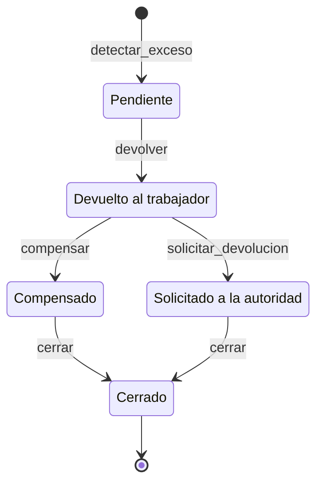
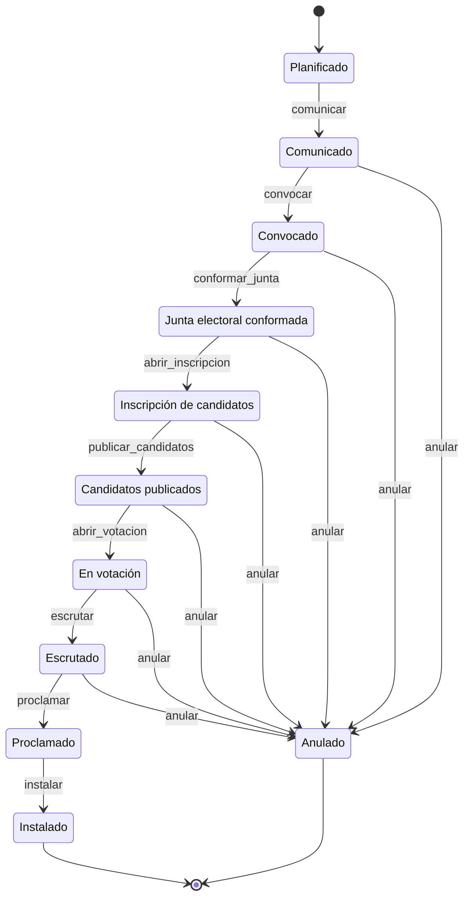
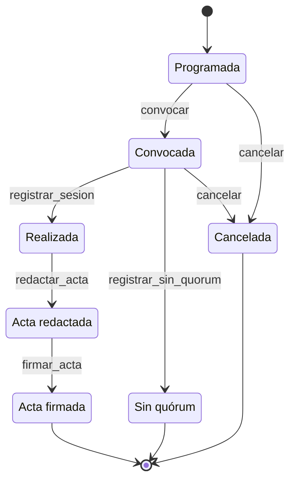
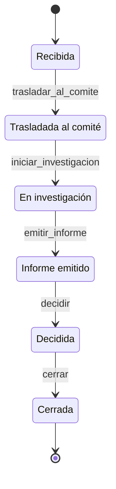

# 18 · Localización Perú: detalle técnico

Ayni HR · kit de desarrollo. Profundiza `14-localizacion-peru.md` en cinco frentes: ficha T-Registro, motor de quinta categoría, archivos planos (PLAME, T-Registro, AFPnet), regímenes especiales y flujos de cumplimiento. Fecha de la investigación: 2 de octubre de 2026.

**Cómo leer este documento**

- Cada dato normativo lleva su estado:
  - **V** = verificado en esta revisión contra una fuente oficial o primaria (SUNAT, MEF, Congreso, MTPE, AFPnet, acta o tabla del convenio).
  - **V2** = verificado solo en una fuente secundaria seria (estudio de abogados, cámara, revista contable). Se carga como valor inicial y lo confirma el especialista.
  - **PC** = por confirmar: no se pudo abrir la fuente o las fuentes discrepan. El valor queda como parámetro o tabla cargable **sin valor**, y bloquea el cierre igual que en `14-localizacion-peru.md` (RN-PAR-03, RN-QA-08).
- Límite de la verificación: las fuentes se leyeron a través de un extractor automático de texto. Los anexos de SUNAT en Excel (Anexo 2 y Anexo 3) **no se pudieron abrir**; lo que se cita de ellos viene de las páginas de ayuda de SUNAT, de sus cartillas en PDF y de fuentes secundarias. Ninguna estructura de archivo de este documento sustituye a la carga del anexo oficial ni a la prueba de archivo dorado (sección 3.7).
- Toda cifra es un parámetro con vigencia (`legal_parameters`). Los valores citados son los vigentes a la fecha indicada y solo sirven como dato inicial y para los casos de prueba.
- **Estado: aplicado al kit.** El diseño de las secciones 1 a 5 ya está en `database/schema.sql` (478 tablas), en los catálogos, en el contrato de API, en los documentos 05, 06, 07 y 14, en las especificaciones de módulo y en el backlog. Los bloques SQL de este documento muestran el diseño tabla por tabla; la fuente es `tools/esquema/model*.dsl` y `epilogue.sql`, y si difieren **manda `schema.sql`**. La sección 6 dice qué se aplicó y qué sigue pendiente.

**Correcciones a `14-localizacion-peru.md`** (ya aplicadas; detalle en 6.4): código PLAME de comisiones; plazo de las medidas de protección en hostigamiento; umbral del Comité de SST; entrega del certificado de quinta; composición de la remuneración proyectada; vigencia de la tabla de construcción civil.

---

## 0. Notas de diseño previas

### 0.1 El régimen laboral no es de la organización

| Nivel | Qué se guarda | Tabla | Regla |
|---|---|---|---|
| Organización (`tenants`) | Nada sobre régimen | — | Una organización agrupa varias razones sociales con regímenes distintos |
| Razón social | Régimen por defecto, número y fecha de acreditación, estado de la acreditación, fin del periodo de permanencia | `legal_entity_regimes` (se amplía en 4.7) | La acreditación (REMYPE u otra) es de la razón social y tiene vigencia |
| Relación laboral | Régimen aplicable al trabajador, con vigencia | `employment_labor_regimes` | El motor **solo** lee este nivel |

Reglas:

1. Al crear una relación, el régimen se propone desde `legal_entity_regimes` vigente en la fecha de ingreso, pero se guarda en `employment_labor_regimes`. Cambiar el régimen de la razón social **no** modifica las relaciones existentes.
2. Un trabajador contratado antes de la acreditación de la razón social conserva su régimen (V2, La Cámara: los contratados antes de la inscripción en REMYPE pertenecen al régimen general). Por eso la inscripción en REMYPE con fecha `F` solo propone el régimen especial a relaciones con `hire_date >= F`.
3. El cambio de régimen de un trabajador es un movimiento de personal (`personnel_actions.kind = 'regime_change'`) que cierra la fila vigente y abre otra. Los beneficios se calculan por tramos de vigencia (RN-NOM-05).
4. En una misma razón social conviven regímenes: en una constructora, los obreros de obra van por `pe_construccion` y el personal administrativo por `pe_general` (V2). En una agroexportadora, el personal administrativo no va por `pe_agrario` (V2, Noticiero Contable).
5. Esto es coherente con C-05 de `SPEC.md` («por empresa y por trabajador») y con RN-NOM-09.

### 0.2 `peruvian_employee_profiles` como extensión del paquete de país

- Es una extensión del paquete Perú sobre `employments`: **una fila vigente por relación laboral** en cada fecha (vigencia `valid_from` / `valid_to` con exclusión de solapes). Los datos que el T-Registro permite modificar generan una fila nueva, y esa fila nueva genera la novedad `worker_update` en `registry_events`.
- No duplica lo que ya vive en el núcleo. Regla de ubicación:

| Dato del T-Registro | Vive en | Motivo |
|---|---|---|
| Nombres, apellidos, fecha de nacimiento, sexo, estado civil, correo, teléfono | `people` | Dato de la persona, único entre relaciones |
| Tipo y número de documento | `person_documents` | Ya cifrado y con huella |
| Dirección (texto) | `person_addresses` | El núcleo guarda el texto; la estructura SUNAT va en `peruvian_person_addresses` |
| Fecha de inicio y de fin | `employments.hire_date`, `termination_date` | Fuente del periodo laboral |
| Remuneración vigente y periodicidad | `employment_compensations` | El perfil solo guarda la **básica inicial** declarada en el alta |
| Sede | `employment_assignments.site_id` → `sites.establishment_code` | El perfil hermano `peruvian_employment_establishments` guarda lo declarado |
| Régimen de salud y EPS | `employment_labor_regimes.health_scheme`, `health_provider_id` | Con vigencia; el código de la tabla 32 se deriva |
| Régimen pensionario y CUSPP | `employment_pension_affiliations` + `pension_funds.statutory_code` | Con vigencia; el código de la tabla 11 se deriva |
| Derechohabientes | `dependents` | El vínculo y su sustento SUNAT van en `peruvian_dependent_profiles` |
| Afiliación sindical | `union_memberships` (si el módulo SIN está activo) | El perfil guarda el indicador declarado |
| Condición de discapacidad (detalle) | `person_sensitive_data` | El perfil guarda solo el indicador sí/no declarado, con el mismo permiso de campo |
| Códigos SUNAT que no tienen equivalente en el núcleo | `peruvian_employee_profiles` | Tipo de trabajador, régimen laboral SUNAT, ocupación, situación educativa, tipo de contrato SUNAT, indicadores de jornada, situación especial, tipo de pago, convenio de doble tributación, SCTR |

- Los códigos que **sí** se pueden derivar del núcleo (tipo de trabajador desde `employments.worker_category`, tipo de contrato desde `contract_types.modality_code`, periodicidad desde `pay_frequency`) se guardan igualmente en el perfil porque son **lo declarado**: el generador de T-Registro compara lo declarado con lo derivado y, si difieren, crea la novedad de modificación. La derivación es la propuesta por defecto; el perfil es el registro de lo informado.

### 0.3 Umbrales de los órganos de cumplimiento

| Órgano | Umbral | Estado | Parámetro |
|---|---|---|---|
| Comité de SST | **20 o más** trabajadores; con menos de 20, Supervisor de SST elegido por los trabajadores | V2 (Pólemos, LP Derecho: Ley 29783 art. 29 y 30; DS 005-2012-TR) | `sst_comite_minimo_trabajadores` = 20, comparación `>=` |
| Comité de intervención frente al hostigamiento sexual | **20 o más** trabajadores por centro de trabajo; con menos de 20, Delegado | V (DS 014-2019-MIMP art. 27.1, texto publicado por la UDEP) | `hostigamiento_comite_minimo_trabajadores` = 20, comparación `>=` |

- La comparación correcta es `dotación >= umbral`. «Más de 20» (que sí es el texto del DL 892 para utilidades) no aplica a estos dos órganos.
- El umbral de hostigamiento es por **centro de trabajo** según el texto del reglamento; el de SST es por empleador, con subcomités por centro cuando corresponda. El indicador de cumplimiento se calcula en ambos niveles (`compliance_obligations.site_id` nulo o informado).
- Forma de contar la dotación (personal en formación, tiempo parcial, terceros): PC. Se configura en `compliance_obligation_templates.applicability_rule`.

---

## 1. Ficha T-Registro

Norma: DS 018-2007-TR (modificado por DS 015-2010-TR y DS 008-2011-TR), R.S. 183-2011/SUNAT y sus anexos: Anexo 1 (información), Anexo 2 (tablas paramétricas) y Anexo 3 (estructuras de importación). SUNAT publica las versiones vigentes en su portal de orientación: Anexo 1 con fecha 10-07-2023, Anexo 2 actualizado al 11-09-2026, Anexo 3 de julio de 2023 (V: índice de la página «Anexos – Tablas Paramétricas»). Las últimas modificatorias de los anexos se aprobaron por resoluciones ministeriales del MTPE (RM 286-2023-TR, entre otras; V2).

### 1.1 Datos del T-Registro por categoría y dónde viven

Numeración del Anexo 1 (V, PDF del 10-07-2023). «Tabla» = tabla paramétrica del Anexo 2. «Reúso»: P = PLAME, A = AFPnet, B = boleta.

**Identificación (Anexo 1: 2.1.1 a 2.1.8)**

| Dato | Tabla y columna | Tipo | Obligatorio | Tabla SUNAT | Validación | Reúso |
|---|---|---|---|---|---|---|
| Tipo de documento | `person_documents.doc_type` (enumerado interno) → código por mapa del paquete | text | Sí | 3 | Mapa `dni→01`, `ce→04`, `passport→07`, `ptp→23`, `cpp→26`; valores sin mapa bloquean el alta | P, A (AFPnet usa otra codificación: 3.5) |
| Número de documento | `person_documents.number_enc` + `number_hash` | text cifrado | Sí | — | DNI: 8 dígitos. Máximo 15 caracteres en los archivos (V, estructura 26). Único por organización | P, A, B |
| País emisor del documento | `peruvian_person_profiles.document_issuing_country_code` | text | Solo pasaporte y documento extranjero | 26 | Obligatorio si el tipo no es DNI ni carné de extranjería (regla exacta: PC) | — |
| Fecha de nacimiento | `people.birth_date` | date | Sí | — | Edad ≥ edad mínima de admisión (parámetro) | A (elegibilidad de prima) |
| Apellido paterno, materno, nombres | `people.paternal_surname`, `maternal_surname`, `first_names` | text | Paterno y nombres sí | — | Máximo 40 caracteres cada uno en archivos (V2, estructura 7); AFPnet 20 (V) | P, A, B |
| Sexo | `people.sex` | text | Sí | — | `unspecified` bloquea el alta; código numérico del archivo: PC | — |
| Estado civil | `people.marital_status` | text | No (SUNAT lo toma del RENIEC para DNI) | — | — | — |
| Nacionalidad | `peruvian_person_profiles.nationality_sunat_code` | text | Solo si el documento no es DNI | 4 | Código vigente | — |
| Teléfono | `peruvian_person_profiles.phone_area_code` + `people.mobile_phone` | text | Sí desde el 01-03-2018 (V, RM 242-2017-TR) | 29 | Código de larga distancia vigente; solo dígitos | — |
| Correo electrónico | `people.personal_email` | text | Sí desde el 01-03-2018 (V) | — | Formato; si no tiene, el alta requiere declaración (C-09: el correo no es obligatorio para operar el sistema, pero sí para el T-Registro) | — |
| Dirección 1 y 2 | `person_addresses` + `peruvian_person_addresses` | — | Al menos una | 5 (vía), 6 (zona), 28 (ubigeo) | Ubigeo de 6 dígitos vigente; vía o zona informada | — |
| Indicador de centro asistencial EsSalud | `peruvian_person_addresses.is_essalud_reference` | boolean | Si hay dos direcciones | — | Exactamente una dirección marcada | — |
| Cuenta de pago de remuneraciones | `person_bank_accounts` | — | Sí desde el 06-01-2018 si el pago es por depósito (V) | 36 | Entidad vigente; CCI de 20 dígitos | Bancos |

**Datos laborales (Anexo 1: 2.2.1 a 2.2.14, 2.2.18 a 2.2.20)**

| Dato | Columna de `peruvian_employee_profiles` | Tipo | Obligatorio | Tabla SUNAT | Validación | Reúso |
|---|---|---|---|---|---|---|
| Tipo de trabajador | `worker_type_code` | text | Sí | 8 | Coherente con el régimen (27 construcción civil, 64 agrario) | P, A (rubro) |
| Régimen laboral | `labor_regime_sunat_code` | text | Sí | 33 | Coherente con `employment_labor_regimes.labor_regime_code` (mapa en 4.7) | P |
| Categoría ocupacional | `occupational_category_code` | text | Sí en el sector privado | 24 | Coherente con `employments.worker_category` | P, B |
| Ocupación | `occupation_code` | text | Sí | 30 (privado), 10 (público y formación) | Código vigente; propuesto desde `job_profiles` | — |
| Situación educativa | `education_status_code` | text | Sí | 9 | Si indica superior completa, exige registro en `peruvian_education_records` | — |
| Discapacidad | `has_disability` | boolean | Sí | — | Campo sensible; requiere consentimiento registrado | Cuota de empleo |
| Sindicalizado | `is_unionized` | boolean | Sí | — | Campo sensible; se propone desde `union_memberships` | Cuota sindical |
| Sujeto a régimen alternativo, acumulativo o atípico | `alternative_working_regime` | boolean | Sí | — | — | Tiempo |
| Sujeto a jornada máxima | `subject_to_max_working_time` | boolean | Sí | — | `false` solo para dirección, confianza no fiscalizada, no sujetos a fiscalización inmediata o intermitentes (V, ayuda SUNAT) | Sobretiempo |
| Sujeto a horario nocturno | `subject_to_night_shift` | boolean | Sí | — | — | Sobretasa nocturna |
| Situación especial | `special_situation_code` | text | Sí | 35 | Ninguna, dirección, confianza (V valores; códigos PC) | Control de asistencia |
| Tipo de contrato | `contract_type_sunat_code` | text | Sí | 12 | Coherente con el contrato vigente (`contracts` → `contract_types.modality_code`) | — |
| Tipo de pago | `payment_type_code` | text | Sí | 16 | Efectivo, depósito en cuenta, otros (V valores; códigos PC). Depósito exige cuenta | Bancos |
| Periodicidad de la remuneración | `pay_periodicity_code` | text | Sí | 13 | 1 mensual, 2 quincenal, 3 semanal, 4 diaria, 5 otros (V) | Motor (4.6) |
| Monto de la remuneración básica inicial | `initial_basic_remuneration` + `currency` | numeric(14,2) | Sí | — | > 0; no menor que la RMV proporcional salvo tiempo parcial; es la pactada en la fecha de contratación (V, ayuda SUNAT) y no se actualiza con aumentos | — |
| Situación | `worker_situation_code` | text | Sí | 15 | 0 baja, 1 activo o subsidiado, 2 sin vínculo con conceptos pendientes de liquidar (V); 3 suspensión perfecta (V2) | P |
| Rentas de quinta exoneradas (LIR art. 19 inc. e) | `fifth_category_exempt` | boolean | Sí | — | Solo personal de gobiernos extranjeros y organismos internacionales (V, ayuda SUNAT) | Motor de quinta |
| Convenio para evitar la doble tributación | `tax_treaty_code` | text | Sí | 25 | `0` ninguno por defecto; códigos PC | Motor de quinta |
| Domiciliado (dato del PLAME, estructura 26) | `is_tax_resident` | boolean | Sí | — | 1 domiciliado, 2 no domiciliado en el archivo (V) | P, quinta |
| RUC (solo contrato CAS) | `cas_tax_id` | text | No | — | 11 dígitos | — |

**Seguridad social (Anexo 1: 2.2.15 a 2.2.17)**

| Dato | Dónde vive | Tabla SUNAT | Validación | Reúso |
|---|---|---|---|---|
| Régimen de aseguramiento de salud | `employment_labor_regimes.health_scheme` → código derivado | 32 | Coherente con el régimen laboral (SIS solo microempresa; agrario su propio código) | P |
| EPS o servicios propios | `employment_labor_regimes.health_provider_id`; `peruvian_employee_profiles.eps_code` para «servicios propios» | 14 | Obligatorio si la salud es EsSalud + EPS | P |
| Régimen pensionario | `employment_pension_affiliations` + `pension_funds.statutory_code` | 11 | Obligatorio; «sin régimen» solo en los supuestos de la norma | P, A |
| CUSPP | `employment_pension_affiliations.affiliate_code_enc` | — | 12 caracteres alfanuméricos (V, AFPnet); obligatorio si el régimen es SPP | A |
| SCTR salud | `peruvian_employee_profiles.sctr_health` | — | `essalud` o `eps`; obligatorio si la sede o el puesto es de riesgo | P (estructura 25) |
| SCTR pensión | `peruvian_employee_profiles.sctr_pension` | — | `onp` o `insurer` | P |
| EsSalud «+Vida» | `peruvian_employee_profiles.essalud_vida` | — | — | P (estructura 26) |

**Periodos, establecimientos, estudios, derechohabientes**

| Dato | Tabla | Fuente del dato | Tabla SUNAT |
|---|---|---|---|
| Periodo laboral (inicio, fin, motivo de fin) | `peruvian_registry_periods` con `record_type = 'period'` | `employments.hire_date`, `termination_date`; motivo desde el motivo de cese del núcleo por mapa | 17 |
| Periodo por tipo de trabajador | `record_type = 'worker_type'` | Historia de `peruvian_employee_profiles.worker_type_code` | 8 |
| Periodo por régimen de salud | `record_type = 'health_regime'` | Historia de `employment_labor_regimes` | 32, 14 |
| Periodo por régimen pensionario | `record_type = 'pension_regime'` | Historia de `employment_pension_affiliations` | 11 |
| Periodo de SCTR salud | `record_type = 'sctr_health'` | Historia de `sctr_health` | — |
| Establecimientos donde labora | `peruvian_employment_establishments` | `employment_assignments.site_id` → `sites.establishment_code` y RUC propio o del tercero | — |
| Estudios concluidos | `peruvian_education_records` (1:1 con `person_education`) | Ficha de la persona | 9, 34 |
| Derechohabientes | `peruvian_dependent_profiles` (1:1 con `dependents`) | Ficha de la persona | 19, 20, 27 |

`peruvian_registry_periods` no es la fuente de las fechas: es el **registro de lo declarado**. La conciliación entre lo declarado y la historia con vigencia del núcleo produce las novedades pendientes.

### 1.2 Tablas paramétricas clave

Se cargan en `pe_parametric_tables` y `pe_parametric_items` desde el Anexo 2 vigente (Excel de SUNAT actualizado al 11-09-2026), con `verified = false` hasta que el responsable confirme la carga. Los códigos de abajo son **dato inicial**; proceden de la fuente indicada y pueden estar desactualizados (las páginas de ayuda de SUNAT aún listan una AFP que ya no opera y no listan otra que sí).

**Índice de tablas del Anexo 2** (V2: anexo de la RM 286-2023-TR)

| N.° | Tabla | N.° | Tabla |
|---|---|---|---|
| 1 | Tipo de actividad | 21 | Tipo de suspensión de la relación laboral |
| 3 | Tipo de documento de identidad | 22 | Ingresos, tributos y descuentos |
| 4 | Nacionalidad | 23 | Tipo de comprobante de pago |
| 5 | Vía | 24 | Categoría ocupacional del trabajador |
| 6 | Zona | 25 | Convenios para evitar la doble tributación |
| 8 | Tipo de trabajador, pensionista o prestador de servicios | 26 | País emisor del documento |
| 9 | Situación educativa | 27 | Tipo de documento que acredita el vínculo familiar |
| 10 | Ocupación (sector público y personal en formación) | 28 | Ubigeo T-Registro |
| 11 | Régimen pensionario | 29 | Códigos de larga distancia nacional |
| 12 | Tipo de contrato de trabajo o condición laboral | 30 | Ocupación aplicable al sector privado |
| 13 | Periodicidad de la remuneración | 31 | Pliego presupuestal |
| 14 | Entidades prestadoras de salud | 32 | Régimen de aseguramiento de salud |
| 15 | Situación del trabajador o pensionista | 33 | Régimen laboral |
| 16 | Tipo de pago | 34 | Instituciones educativas y sus carreras |
| 17 | Motivo del fin del periodo | 35 | Situación especial |
| 18 | Tipo de modalidad formativa laboral | 36 | Entidades bancarias |
| 19 | Vínculo familiar | 37 | Organizaciones sindicales de servidores públicos |
| 20 | Motivo de baja como derechohabiente | | |

**Tabla 3 · Tipo de documento de identidad** (V2: anexo RM 286-2023-TR)

| Código | Descripción | Enumerado interno |
|---|---|---|
| 01 | Documento nacional de identidad | `dni` |
| 04 | Carné de extranjería | `ce` |
| 06 | Registro único de contribuyentes | `ruc` |
| 07 | Pasaporte | `passport` |
| 09 | Carné de solicitante de refugio | `other` (ampliar el enumerado: 6.2) |
| 11 | Partida de nacimiento | — (solo derechohabientes) |
| 22 | Carné de identidad – Relaciones Exteriores | `other` |
| 23 | Permiso temporal de permanencia | `ptp` |
| 24 | Documento de identidad extranjero | `other` |
| 26 | Carné de permiso temporal de permanencia | `cpp` |

En los archivos del PLAME solo se admiten los tipos 01, 04, 07 y 09 en la estructura 26 (V, anexo de la R.S. 223-2017/SUNAT); la lista vigente por estructura se toma del Anexo 3.

**Tabla 8 · Tipo de trabajador (sector privado)** (V: ayuda del T-Registro en SUNAT)

| Cód. | Descripción | Cód. | Descripción |
|---|---|---|---|
| 19 | Ejecutivo | 36 | Pescador – Ley 28320 |
| 20 | Obrero | 37 | Minero de tajo abierto |
| 21 | Empleado | 38 | Minero de la industria minera metalúrgica |
| 22 | Trabajador portuario | 56 | Artista – Ley 28131 |
| 23 | Practicante SENATI | 64 | Agrario dependiente (la ayuda aún cita la Ley 27360) |
| 27 | Construcción civil | 65 | Trabajador de la actividad acuícola |
| 28 | Piloto y copiloto de aviación comercial | 66 | Pescador y procesador artesanal independiente |
| 29 | Marítimo, fluvial o lacustre | 71 | Conductor de microempresa REMYPE |
| 30 | Periodista | 73 | Socio de cooperativa agraria – Ley 29972 |
| 31 | Trabajador de la industria del cuero | 98 | Persona que genera ingresos de cuarta-quinta categoría |
| 32 | Minero de socavón | | |

**Tabla 9 · Situación educativa** (V2: anexo RM 286-2023-TR; lista parcial, cargar completa del anexo)

01 sin educación formal · 04 primaria incompleta · 05 primaria completa · 06 secundaria incompleta · 07 secundaria completa · 08 técnica incompleta · 09 técnica completa · 12 universitaria incompleta · 13 universitaria completa · 21 grado de doctor. Los códigos intermedios (superior no universitaria, bachiller, titulado, maestría): PC.

**Tabla 11 · Régimen pensionario** (V: ayuda SUNAT, con salvedad)

02 DL 19990 – Sistema Nacional de Pensiones (ONP) · 03 DL 20530 · 09 Caja de Beneficios y Seguridad Social del Pescador · 10 Caja de Pensiones Militar · 11 Caja de Pensiones Policial · 13 Régimen del Servicio Diplomático · 21 SPP Integra · 22 SPP Horizonte (ya no opera) · 23 SPP Profuturo · 24 SPP Prima · 99 sin régimen pensionario. Fuente secundaria añade 25 SPP Habitat y 98 pendiente de elección (V2, AmaQuella): confirmar en el Anexo 2 vigente. El código se guarda en `pension_funds.statutory_code`.

**Tabla 12 · Tipo de contrato** (V: ayuda SUNAT)

01 plazo indeterminado (DLeg 728) · 02 tiempo parcial · 03 inicio o incremento de actividad · 04 necesidades del mercado · 05 reconversión empresarial · 06 ocasional · 07 suplencia · 08 emergencia · 09 obra determinada o servicio específico · 10 intermitente · 11 temporada · 12 exportación no tradicional · 13 trabajador extranjero · 14 administrativo de servicios (CAS, sector público) · 18 a domicilio · 19 futbolistas profesionales · 20 agrario (la ayuda cita la Ley 27360) · 21 migrante andino · 99 otros.

**Tabla 13 · Periodicidad** (V): 1 mensual · 2 quincenal · 3 semanal · 4 diaria · 5 otros.

**Tabla 14 · EPS** (V: ayuda SUNAT; V2 para el 7): 1 Persalud · 2 Pacífico · 3 Rímac · 4 servicios propios · 5 Mapfre · 6 Colsanitas/Sanitas · 7 La Positiva.

**Tabla 15 · Situación** (V): 0 baja · 1 activo o subsidiado · 2 sin vínculo laboral con conceptos pendientes de liquidar. V2: 3 suspensión perfecta de labores.

**Tabla 17 · Motivo del fin del periodo** (V: ayuda SUNAT)

| Cód. | Descripción | Cód. | Descripción |
|---|---|---|---|
| 01 | Renuncia | 08 | Mutuo disenso |
| 02 | Renuncia con incentivos | 09 | Fallecimiento |
| 03 | Despido o destitución | 14 | Baja por sucesión en posición del empleador |
| 04 | Cese colectivo | 15 | Extinción o liquidación del empleador |
| 05 | Jubilación | 17 | No se inició la relación laboral o la prestación efectiva de servicios |
| 06 | Invalidez absoluta permanente | 18 | Límite de edad 70 años (V2) |
| 07 | Terminación de la obra o servicio, cumplimiento de condición resolutoria o vencimiento del plazo | 99 | Sin vínculo laboral, habilitado para PLAME (V2) |

Los códigos 10 a 13, 19 y 20 son de pensionistas y del sector público.

**Tabla 19 · Vínculo familiar** (V: cartilla de derechohabientes de SUNAT, edición 2012)

02 cónyuge · 03 concubino(a) · 04 gestante · 05 hijo menor de edad · 06 hijo mayor de edad incapacitado.

**Tabla 21 · Tipo de suspensión** (códigos PC; solo se verificó la lista de causas, V2)

- Suspensión perfecta (días no laborados y no subsidiados): sanción disciplinaria; ejercicio del derecho de huelga; detención del trabajador; inhabilitación administrativa o judicial; permiso o licencia sin goce de haber; caso fortuito o fuerza mayor; falta no justificada; temporada o intermitente.
- Suspensión imperfecta (días subsidiados u otros no laborados): enfermedad o accidente (primeros veinte días); incapacidad temporal subsidiada; maternidad (pre y posnatal); descanso vacacional; licencia para cargo cívico o servicio militar; permiso sindical; licencia con goce de haber; días compensados por sobretiempo; licencia por paternidad; licencia por adopción.

El mapa `absence_types` → código de la tabla 21 es un dato del paquete (`concept_statutory_mappings` no aplica: son días, no montos); sin mapa, la validación previa del PLAME falla.

**Tabla 24 · Categoría ocupacional (privado)** (V): 01 ejecutivo · 02 obrero · 03 empleado.

**Tabla 32 · Régimen de aseguramiento de salud** (V: ayuda SUNAT)

00 EsSalud regular · 01 EsSalud regular y EPS o servicios propios · 02 EsSalud trabajadores pesqueros · 03 EsSalud pesqueros y EPS · 04 EsSalud agrario o acuícola · 20 sanidad de FF. AA. y policiales · 21 SIS – microempresa.

**Tabla 33 · Régimen laboral (privado)** (V: ayuda SUNAT)

01 privado general (DLeg 728) · 16 microempresa (DLeg 1086) · 17 pequeña empresa (DLeg 1086) · 18 agrario (la ayuda cita la Ley 27360; rótulo vigente: PC) · 19 exportación no tradicional (DL 22342) · 20 mineros · 21 construcción civil.

**Tablas 16, 20, 25, 27, 35**: no se verificaron sus códigos. Se cargan del Anexo 2.

### 1.3 Plazos del T-Registro

| Código de parámetro | Acto | Plazo | Estado | Fuente |
|---|---|---|---|---|
| `treg_alta_trabajador_dias` | Alta de trabajador, personal en formación y personal de terceros | **Dentro del día** en que se produce el ingreso a prestar servicios, cualquiera sea la modalidad de contratación (valor 0, día calendario) | V | SUNAT, «Obligaciones del empleador – T-Registro»; DS 015-2010-TR y DS 008-2011-TR |
| `treg_alta_pensionista` | Alta de pensionista | Primer día hábil del mes siguiente a aquel en que se puso a disposición la primera pensión | V | Misma página |
| `treg_modificacion_dias_habiles` | Modificación o actualización de datos | 5 días hábiles desde el evento o desde que se tomó conocimiento | V | Misma página |
| `treg_baja_dias` | Baja | SUNAT: «al día siguiente» de la fecha de término. Fuentes secundarias citan el DS 018-2007-TR art. 4-A: «dentro del primer día hábil siguiente». La guía MYPE del MTPE: «dentro de las 24 horas» | **PC** (hábil o calendario) | El sistema alerta con el criterio más estricto (día calendario siguiente) |
| `treg_constancia_alta_dias_habiles` | Entrega de la constancia de alta al trabajador | El día hábil siguiente al inicio de la prestación | V | Misma página |
| `treg_constancia_modificacion_dias` | Entrega de la constancia de modificación | 15 días calendario siguientes | V | Misma página |
| `treg_constancia_baja_dias` | Entrega de la constancia de baja | Solo a solicitud, en 2 días calendario | V | Misma página |
| `treg_alta_derechohabiente_dias_habiles` | Alta de derechohabiente | 1 día hábil siguiente a la comunicación del trabajador | V (cartilla de 2012; confirmar vigencia) | Cartilla SUNAT de registro de derechohabientes |
| `treg_modificacion_derechohabiente_dias_habiles` | Modificación de derechohabiente | 5 días hábiles | V (cartilla de 2012) | Misma cartilla |

El alta es previa o simultánea al ingreso: la novedad `worker_registration` se crea al aprobar la contratación, con `due_on = hire_date`, no al llegar el primer día.

### 1.4 DDL (aplicado al esquema)

Convenciones de `schema.sql`: `tenant_id` + RLS forzado, claves foráneas compuestas, enumerados `text` + `CHECK`, vigencias con exclusión, `-- SENSIBLE` en campos con permiso por campo. Las tablas paramétricas son de plataforma (sin `tenant_id`), como `labor_regimes` o `pension_funds`.

```sql
-- ---------------------------------------------------------------------------------------------
-- PAI-PE · Tablas paramétricas de la Planilla Electrónica (Anexo 2 de la R.S. 183-2011/SUNAT)
-- Catálogo de plataforma: sin tenant_id ni RLS. Se carga desde el anexo oficial, con vigencia.
-- ---------------------------------------------------------------------------------------------
CREATE TABLE pe_parametric_tables (
  id uuid PRIMARY KEY DEFAULT gen_random_uuid(),
  table_number smallint NOT NULL,
  name text NOT NULL,
  source_annex text NOT NULL DEFAULT 'R.S. 183-2011/SUNAT, Anexo 2',
  created_at timestamptz NOT NULL DEFAULT now(),
  updated_at timestamptz NOT NULL DEFAULT now(),
  CONSTRAINT uq_pe_parametric_tables_table_number UNIQUE (table_number)
);
COMMENT ON TABLE pe_parametric_tables IS 'Tablas paramétricas de la Planilla Electrónica (número y nombre oficial).';
CREATE TRIGGER trg_pe_parametric_tables_touch BEFORE UPDATE ON pe_parametric_tables FOR EACH ROW EXECUTE FUNCTION set_updated_at();

CREATE TABLE pe_parametric_items (
  id uuid PRIMARY KEY DEFAULT gen_random_uuid(),
  table_number smallint NOT NULL,
  code text NOT NULL,
  description text NOT NULL,
  short_description text,
  attributes jsonb,
  private_sector boolean NOT NULL DEFAULT true,
  source text,
  verified boolean NOT NULL DEFAULT false,
  valid_from date NOT NULL,
  valid_to date,
  created_at timestamptz NOT NULL DEFAULT now(),
  updated_at timestamptz NOT NULL DEFAULT now(),
  CONSTRAINT ck_pe_parametric_items_vigencia CHECK (valid_to IS NULL OR valid_to >= valid_from),
  CONSTRAINT ex_pe_parametric_items_vigencia EXCLUDE USING gist (table_number WITH =, code WITH =, daterange(valid_from, valid_to, '[]') WITH &&),
  CONSTRAINT fk_pe_parametric_items_table_number FOREIGN KEY (table_number) REFERENCES pe_parametric_tables (table_number)
);
COMMENT ON TABLE pe_parametric_items IS 'Códigos de cada tabla paramétrica con vigencia; attributes guarda datos propios de la tabla (por ejemplo afectaciones de la tabla 22).';
CREATE INDEX ix_pe_parametric_items_table_number ON pe_parametric_items (table_number, code);
CREATE TRIGGER trg_pe_parametric_items_touch BEFORE UPDATE ON pe_parametric_items FOR EACH ROW EXECUTE FUNCTION set_updated_at();

-- ¿Existe el código en la tabla paramétrica a la fecha? NULL de entrada = no se valida.
CREATE FUNCTION pe_param_ok(p_table smallint, p_code text, p_on date) RETURNS boolean
LANGUAGE sql STABLE
AS $$
  SELECT p_code IS NULL OR EXISTS (
    SELECT 1 FROM pe_parametric_items i
    WHERE i.table_number = p_table AND i.code = p_code
      AND daterange(i.valid_from, i.valid_to, '[]') @> p_on)
$$;
COMMENT ON FUNCTION pe_param_ok(smallint, text, date) IS 'Valida un código contra pe_parametric_items en una fecha.';

-- ---------------------------------------------------------------------------------------------
-- PAI-PE · Ficha T-Registro: extensión de la relación laboral (una fila vigente por relación)
-- ---------------------------------------------------------------------------------------------
CREATE TABLE peruvian_employee_profiles (
  id uuid PRIMARY KEY DEFAULT gen_random_uuid(),
  tenant_id uuid NOT NULL REFERENCES tenants (id),
  employment_id uuid NOT NULL,
  worker_type_code text NOT NULL,
  labor_regime_sunat_code text NOT NULL,
  occupational_category_code text,
  occupation_code text NOT NULL,
  education_status_code text NOT NULL,
  contract_type_sunat_code text NOT NULL,
  has_disability boolean NOT NULL DEFAULT false,  -- SENSIBLE
  is_unionized boolean NOT NULL DEFAULT false,  -- SENSIBLE
  alternative_working_regime boolean NOT NULL DEFAULT false,
  subject_to_max_working_time boolean NOT NULL DEFAULT true,
  subject_to_night_shift boolean NOT NULL DEFAULT false,
  special_situation_code text NOT NULL DEFAULT '0',
  payment_type_code text NOT NULL,
  pay_periodicity_code text NOT NULL,
  initial_basic_remuneration numeric(14,2) NOT NULL,  -- SENSIBLE
  currency char(3) NOT NULL DEFAULT 'PEN',
  worker_situation_code text NOT NULL DEFAULT '1',
  fifth_category_exempt boolean NOT NULL DEFAULT false,
  tax_treaty_code text NOT NULL DEFAULT '0',
  is_tax_resident boolean NOT NULL DEFAULT true,
  cas_tax_id text,
  eps_code text,
  sctr_health text NOT NULL DEFAULT 'none' CHECK (sctr_health IN ('none','essalud','eps')),
  sctr_pension text NOT NULL DEFAULT 'none' CHECK (sctr_pension IN ('none','onp','insurer')),
  essalud_vida boolean NOT NULL DEFAULT false,
  agrarian_benefit_payment text CHECK (agrarian_benefit_payment IN ('prorated_daily','semiannual')),
  completeness_status text NOT NULL DEFAULT 'draft' CHECK (completeness_status IN ('draft','ready','blocked')),
  missing_fields text[],
  personnel_action_id uuid,
  valid_from date NOT NULL,
  valid_to date,
  created_at timestamptz NOT NULL DEFAULT now(),
  updated_at timestamptz NOT NULL DEFAULT now(),
  lock_version integer NOT NULL DEFAULT 1,
  CONSTRAINT uq_peruvian_employee_profiles_tenant_id UNIQUE (tenant_id, id),
  CONSTRAINT ck_peruvian_employee_profiles_vigencia CHECK (valid_to IS NULL OR valid_to >= valid_from),
  CONSTRAINT ck_peruvian_employee_profiles_remuneration CHECK (initial_basic_remuneration > 0),
  CONSTRAINT ck_peruvian_employee_profiles_cas CHECK (cas_tax_id IS NULL OR cas_tax_id ~ '^[0-9]{11}$'),
  CONSTRAINT ex_peruvian_employee_profiles_vigencia EXCLUDE USING gist (tenant_id WITH =, employment_id WITH =, daterange(valid_from, valid_to, '[]') WITH &&) DEFERRABLE INITIALLY IMMEDIATE,
  CONSTRAINT fk_peruvian_employee_profiles_employment_id FOREIGN KEY (tenant_id, employment_id) REFERENCES employments (tenant_id, id),
  CONSTRAINT fk_peruvian_employee_profiles_personnel_action_id FOREIGN KEY (tenant_id, personnel_action_id) REFERENCES personnel_actions (tenant_id, id)
);
COMMENT ON TABLE peruvian_employee_profiles IS 'Datos laborales del T-Registro que no viven en el núcleo, con vigencia por relación laboral. No duplica people, employments, contracts ni afiliaciones.';
CREATE INDEX ix_peruvian_employee_profiles_employment_id ON peruvian_employee_profiles (tenant_id, employment_id);
CREATE INDEX ix_peruvian_employee_profiles_personnel_action_id ON peruvian_employee_profiles (tenant_id, personnel_action_id);
ALTER TABLE peruvian_employee_profiles ENABLE ROW LEVEL SECURITY;
ALTER TABLE peruvian_employee_profiles FORCE ROW LEVEL SECURITY;
CREATE POLICY tenant_isolation ON peruvian_employee_profiles USING (tenant_id = NULLIF(current_setting('app.tenant_id', true), '')::uuid) WITH CHECK (tenant_id = NULLIF(current_setting('app.tenant_id', true), '')::uuid);
CREATE TRIGGER trg_peruvian_employee_profiles_touch BEFORE UPDATE ON peruvian_employee_profiles FOR EACH ROW EXECUTE FUNCTION set_updated_at_and_lock();

CREATE FUNCTION pe_validate_employee_profile() RETURNS trigger
LANGUAGE plpgsql
AS $$
DECLARE
  v_bad text[] := '{}';
BEGIN
  IF NOT pe_param_ok(8::smallint,  NEW.worker_type_code,           NEW.valid_from) THEN v_bad := v_bad || 'worker_type_code'; END IF;
  IF NOT pe_param_ok(33::smallint, NEW.labor_regime_sunat_code,    NEW.valid_from) THEN v_bad := v_bad || 'labor_regime_sunat_code'; END IF;
  IF NOT pe_param_ok(24::smallint, NEW.occupational_category_code, NEW.valid_from) THEN v_bad := v_bad || 'occupational_category_code'; END IF;
  IF NOT pe_param_ok(30::smallint, NEW.occupation_code,            NEW.valid_from) THEN v_bad := v_bad || 'occupation_code'; END IF;
  IF NOT pe_param_ok(9::smallint,  NEW.education_status_code,      NEW.valid_from) THEN v_bad := v_bad || 'education_status_code'; END IF;
  IF NOT pe_param_ok(12::smallint, NEW.contract_type_sunat_code,   NEW.valid_from) THEN v_bad := v_bad || 'contract_type_sunat_code'; END IF;
  IF NOT pe_param_ok(35::smallint, NEW.special_situation_code,     NEW.valid_from) THEN v_bad := v_bad || 'special_situation_code'; END IF;
  IF NOT pe_param_ok(16::smallint, NEW.payment_type_code,          NEW.valid_from) THEN v_bad := v_bad || 'payment_type_code'; END IF;
  IF NOT pe_param_ok(13::smallint, NEW.pay_periodicity_code,       NEW.valid_from) THEN v_bad := v_bad || 'pay_periodicity_code'; END IF;
  IF NOT pe_param_ok(15::smallint, NEW.worker_situation_code,      NEW.valid_from) THEN v_bad := v_bad || 'worker_situation_code'; END IF;
  IF NOT pe_param_ok(25::smallint, NEW.tax_treaty_code,            NEW.valid_from) THEN v_bad := v_bad || 'tax_treaty_code'; END IF;
  IF NOT pe_param_ok(14::smallint, NEW.eps_code,                   NEW.valid_from) THEN v_bad := v_bad || 'eps_code'; END IF;
  IF array_length(v_bad, 1) > 0 THEN
    RAISE EXCEPTION 'Códigos fuera de las tablas paramétricas vigentes: %', array_to_string(v_bad, ', ') USING ERRCODE = 'AY010';
  END IF;
  RETURN NEW;
END
$$;
CREATE TRIGGER trg_peruvian_employee_profiles_codes BEFORE INSERT OR UPDATE ON peruvian_employee_profiles
  FOR EACH ROW EXECUTE FUNCTION pe_validate_employee_profile();

-- Establecimientos donde labora (Estructura 17)
CREATE TABLE peruvian_employment_establishments (
  id uuid PRIMARY KEY DEFAULT gen_random_uuid(),
  tenant_id uuid NOT NULL REFERENCES tenants (id),
  employment_id uuid NOT NULL,
  site_id uuid,
  establishment_tax_id text NOT NULL,
  establishment_code text NOT NULL,
  is_third_party boolean NOT NULL DEFAULT false,
  valid_from date NOT NULL,
  valid_to date,
  created_at timestamptz NOT NULL DEFAULT now(),
  updated_at timestamptz NOT NULL DEFAULT now(),
  lock_version integer NOT NULL DEFAULT 1,
  CONSTRAINT uq_peruvian_employment_establishments_tenant_id UNIQUE (tenant_id, id),
  CONSTRAINT ck_peruvian_employment_establishments_vigencia CHECK (valid_to IS NULL OR valid_to >= valid_from),
  CONSTRAINT ck_peruvian_employment_establishments_tax_id CHECK (establishment_tax_id ~ '^[0-9]{11}$'),
  CONSTRAINT ck_peruvian_employment_establishments_code CHECK (establishment_code ~ '^[0-9]{4}$'),
  CONSTRAINT ex_peruvian_employment_establishments_vigencia EXCLUDE USING gist (tenant_id WITH =, employment_id WITH =, establishment_tax_id WITH =, establishment_code WITH =, daterange(valid_from, valid_to, '[]') WITH &&) DEFERRABLE INITIALLY IMMEDIATE,
  CONSTRAINT fk_peruvian_employment_establishments_employment_id FOREIGN KEY (tenant_id, employment_id) REFERENCES employments (tenant_id, id),
  CONSTRAINT fk_peruvian_employment_establishments_site_id FOREIGN KEY (tenant_id, site_id) REFERENCES sites (tenant_id, id)
);
COMMENT ON TABLE peruvian_employment_establishments IS 'Establecimientos (RUC y código de establecimiento anexo) donde labora el trabajador, con vigencia.';
CREATE INDEX ix_peruvian_employment_establishments_employment_id ON peruvian_employment_establishments (tenant_id, employment_id);
CREATE INDEX ix_peruvian_employment_establishments_site_id ON peruvian_employment_establishments (tenant_id, site_id);
ALTER TABLE peruvian_employment_establishments ENABLE ROW LEVEL SECURITY;
ALTER TABLE peruvian_employment_establishments FORCE ROW LEVEL SECURITY;
CREATE POLICY tenant_isolation ON peruvian_employment_establishments USING (tenant_id = NULLIF(current_setting('app.tenant_id', true), '')::uuid) WITH CHECK (tenant_id = NULLIF(current_setting('app.tenant_id', true), '')::uuid);
CREATE TRIGGER trg_peruvian_employment_establishments_touch BEFORE UPDATE ON peruvian_employment_establishments FOR EACH ROW EXECUTE FUNCTION set_updated_at_and_lock();

-- Periodos declarados (Estructura 11): lo que se informó al T-Registro, no la fuente del dato
CREATE TABLE peruvian_registry_periods (
  id uuid PRIMARY KEY DEFAULT gen_random_uuid(),
  tenant_id uuid NOT NULL REFERENCES tenants (id),
  employment_id uuid NOT NULL,
  category text NOT NULL DEFAULT 'worker' CHECK (category IN ('worker','pensioner','third_party','trainee')),
  record_type text NOT NULL CHECK (record_type IN ('period','worker_type','health_regime','pension_regime','sctr_health')),
  starts_on date NOT NULL,
  ends_on date,
  indicator_code text,
  eps_code text,
  registry_event_id uuid,
  declared_at timestamptz,
  created_at timestamptz NOT NULL DEFAULT now(),
  updated_at timestamptz NOT NULL DEFAULT now(),
  lock_version integer NOT NULL DEFAULT 1,
  CONSTRAINT uq_peruvian_registry_periods_tenant_id UNIQUE (tenant_id, id),
  CONSTRAINT ck_peruvian_registry_periods_fechas CHECK (ends_on IS NULL OR ends_on >= starts_on),
  CONSTRAINT ck_peruvian_registry_periods_fin CHECK (record_type <> 'period' OR ends_on IS NULL OR indicator_code IS NOT NULL),
  CONSTRAINT ex_peruvian_registry_periods_r1 EXCLUDE USING gist (tenant_id WITH =, employment_id WITH =, record_type WITH =, daterange(starts_on, ends_on, '[]') WITH &&) DEFERRABLE INITIALLY IMMEDIATE,
  CONSTRAINT fk_peruvian_registry_periods_employment_id FOREIGN KEY (tenant_id, employment_id) REFERENCES employments (tenant_id, id),
  CONSTRAINT fk_peruvian_registry_periods_registry_event_id FOREIGN KEY (tenant_id, registry_event_id) REFERENCES registry_events (tenant_id, id)
);
COMMENT ON TABLE peruvian_registry_periods IS 'Periodos informados al T-Registro por tipo de registro (periodo laboral, tipo de trabajador, régimen de salud, régimen pensionario, SCTR salud).';
CREATE INDEX ix_peruvian_registry_periods_employment_id ON peruvian_registry_periods (tenant_id, employment_id);
CREATE INDEX ix_peruvian_registry_periods_registry_event_id ON peruvian_registry_periods (tenant_id, registry_event_id);
ALTER TABLE peruvian_registry_periods ENABLE ROW LEVEL SECURITY;
ALTER TABLE peruvian_registry_periods FORCE ROW LEVEL SECURITY;
CREATE POLICY tenant_isolation ON peruvian_registry_periods USING (tenant_id = NULLIF(current_setting('app.tenant_id', true), '')::uuid) WITH CHECK (tenant_id = NULLIF(current_setting('app.tenant_id', true), '')::uuid);
CREATE TRIGGER trg_peruvian_registry_periods_touch BEFORE UPDATE ON peruvian_registry_periods FOR EACH ROW EXECUTE FUNCTION set_updated_at_and_lock();

-- Datos de la persona que el T-Registro pide codificados
CREATE TABLE peruvian_person_profiles (
  id uuid PRIMARY KEY DEFAULT gen_random_uuid(),
  tenant_id uuid NOT NULL REFERENCES tenants (id),
  person_id uuid NOT NULL,
  document_issuing_country_code text,
  nationality_sunat_code text,
  phone_area_code text,
  created_at timestamptz NOT NULL DEFAULT now(),
  updated_at timestamptz NOT NULL DEFAULT now(),
  lock_version integer NOT NULL DEFAULT 1,
  CONSTRAINT uq_peruvian_person_profiles_tenant_id UNIQUE (tenant_id, id),
  CONSTRAINT uq_peruvian_person_profiles_person_id UNIQUE (tenant_id, person_id),
  CONSTRAINT fk_peruvian_person_profiles_person_id FOREIGN KEY (tenant_id, person_id) REFERENCES people (tenant_id, id)
);
COMMENT ON TABLE peruvian_person_profiles IS 'Códigos SUNAT de la persona: país emisor del documento (tabla 26), nacionalidad (tabla 4) y código de larga distancia (tabla 29).';
ALTER TABLE peruvian_person_profiles ENABLE ROW LEVEL SECURITY;
ALTER TABLE peruvian_person_profiles FORCE ROW LEVEL SECURITY;
CREATE POLICY tenant_isolation ON peruvian_person_profiles USING (tenant_id = NULLIF(current_setting('app.tenant_id', true), '')::uuid) WITH CHECK (tenant_id = NULLIF(current_setting('app.tenant_id', true), '')::uuid);
CREATE TRIGGER trg_peruvian_person_profiles_touch BEFORE UPDATE ON peruvian_person_profiles FOR EACH ROW EXECUTE FUNCTION set_updated_at_and_lock();

CREATE TABLE peruvian_person_addresses (
  id uuid PRIMARY KEY DEFAULT gen_random_uuid(),
  tenant_id uuid NOT NULL REFERENCES tenants (id),
  person_address_id uuid NOT NULL,
  address_slot smallint NOT NULL DEFAULT 1 CHECK (address_slot IN (1, 2)),
  via_type_code text,
  via_name_enc text,  -- SENSIBLE (cifrado en la aplicación)
  via_number text,
  department text,
  interior text,
  block_mz text,
  lot text,
  kilometer text,
  block text,
  stage text,
  zone_type_code text,
  zone_name text,
  reference_enc text,  -- SENSIBLE (cifrado en la aplicación)
  ubigeo_code text NOT NULL,
  is_essalud_reference boolean NOT NULL DEFAULT false,
  created_at timestamptz NOT NULL DEFAULT now(),
  updated_at timestamptz NOT NULL DEFAULT now(),
  lock_version integer NOT NULL DEFAULT 1,
  CONSTRAINT uq_peruvian_person_addresses_tenant_id UNIQUE (tenant_id, id),
  CONSTRAINT uq_peruvian_person_addresses_person_address_id UNIQUE (tenant_id, person_address_id),
  CONSTRAINT ck_peruvian_person_addresses_ubigeo CHECK (ubigeo_code ~ '^[0-9]{6}$'),
  CONSTRAINT ck_peruvian_person_addresses_via CHECK (via_type_code IS NOT NULL OR zone_type_code IS NOT NULL),
  CONSTRAINT fk_peruvian_person_addresses_person_address_id FOREIGN KEY (tenant_id, person_address_id) REFERENCES person_addresses (tenant_id, id)
);
COMMENT ON TABLE peruvian_person_addresses IS 'Dirección estructurada del T-Registro (vía, zona, ubigeo) para una dirección del núcleo. -- SENSIBLE';
ALTER TABLE peruvian_person_addresses ENABLE ROW LEVEL SECURITY;
ALTER TABLE peruvian_person_addresses FORCE ROW LEVEL SECURITY;
CREATE POLICY tenant_isolation ON peruvian_person_addresses USING (tenant_id = NULLIF(current_setting('app.tenant_id', true), '')::uuid) WITH CHECK (tenant_id = NULLIF(current_setting('app.tenant_id', true), '')::uuid);
CREATE TRIGGER trg_peruvian_person_addresses_touch BEFORE UPDATE ON peruvian_person_addresses FOR EACH ROW EXECUTE FUNCTION set_updated_at_and_lock();

-- Estudios concluidos (Estructura 29)
CREATE TABLE peruvian_education_records (
  id uuid PRIMARY KEY DEFAULT gen_random_uuid(),
  tenant_id uuid NOT NULL REFERENCES tenants (id),
  person_education_id uuid NOT NULL,
  education_status_code text NOT NULL,
  is_peruvian_institution boolean NOT NULL DEFAULT true,
  institution_code text,
  career_code text,
  graduation_year smallint CHECK (graduation_year BETWEEN 1940 AND 2100),
  created_at timestamptz NOT NULL DEFAULT now(),
  updated_at timestamptz NOT NULL DEFAULT now(),
  lock_version integer NOT NULL DEFAULT 1,
  CONSTRAINT uq_peruvian_education_records_tenant_id UNIQUE (tenant_id, id),
  CONSTRAINT uq_peruvian_education_records_person_education_id UNIQUE (tenant_id, person_education_id),
  CONSTRAINT ck_peruvian_education_records_institucion CHECK (NOT is_peruvian_institution OR (institution_code IS NOT NULL AND career_code IS NOT NULL)),
  CONSTRAINT fk_peruvian_education_records_person_education_id FOREIGN KEY (tenant_id, person_education_id) REFERENCES person_education (tenant_id, id)
);
COMMENT ON TABLE peruvian_education_records IS 'Estudios superiores concluidos codificados con la tabla 34 (institución y carrera) y la tabla 9.';
ALTER TABLE peruvian_education_records ENABLE ROW LEVEL SECURITY;
ALTER TABLE peruvian_education_records FORCE ROW LEVEL SECURITY;
CREATE POLICY tenant_isolation ON peruvian_education_records USING (tenant_id = NULLIF(current_setting('app.tenant_id', true), '')::uuid) WITH CHECK (tenant_id = NULLIF(current_setting('app.tenant_id', true), '')::uuid);
CREATE TRIGGER trg_peruvian_education_records_touch BEFORE UPDATE ON peruvian_education_records FOR EACH ROW EXECUTE FUNCTION set_updated_at_and_lock();

-- Derechohabientes (Estructura 13)
CREATE TABLE peruvian_dependent_profiles (
  id uuid PRIMARY KEY DEFAULT gen_random_uuid(),
  tenant_id uuid NOT NULL REFERENCES tenants (id),
  dependent_id uuid NOT NULL,
  family_link_code text NOT NULL,
  link_document_type_code text,
  link_document_number_enc text,  -- SENSIBLE (cifrado en la aplicación)
  conception_month date,
  document_issuing_country_code text,
  deregistration_reason_code text,
  school_allowance_until date,
  school_proof_file_id uuid,
  created_at timestamptz NOT NULL DEFAULT now(),
  updated_at timestamptz NOT NULL DEFAULT now(),
  lock_version integer NOT NULL DEFAULT 1,
  CONSTRAINT uq_peruvian_dependent_profiles_tenant_id UNIQUE (tenant_id, id),
  CONSTRAINT uq_peruvian_dependent_profiles_dependent_id UNIQUE (tenant_id, dependent_id),
  CONSTRAINT ck_peruvian_dependent_profiles_concepcion CHECK (conception_month IS NULL OR extract(day FROM conception_month) = 1),
  CONSTRAINT fk_peruvian_dependent_profiles_dependent_id FOREIGN KEY (tenant_id, dependent_id) REFERENCES dependents (tenant_id, id),
  CONSTRAINT fk_peruvian_dependent_profiles_school_proof_file_id FOREIGN KEY (tenant_id, school_proof_file_id) REFERENCES stored_files (tenant_id, id)
);
COMMENT ON TABLE peruvian_dependent_profiles IS 'Datos del derechohabiente que pide el T-Registro (vínculo, documento que lo acredita, mes de concepción, motivo de baja) y sustento de asignación escolar.';
CREATE INDEX ix_peruvian_dependent_profiles_school_proof_file_id ON peruvian_dependent_profiles (tenant_id, school_proof_file_id);
ALTER TABLE peruvian_dependent_profiles ENABLE ROW LEVEL SECURITY;
ALTER TABLE peruvian_dependent_profiles FORCE ROW LEVEL SECURITY;
CREATE POLICY tenant_isolation ON peruvian_dependent_profiles USING (tenant_id = NULLIF(current_setting('app.tenant_id', true), '')::uuid) WITH CHECK (tenant_id = NULLIF(current_setting('app.tenant_id', true), '')::uuid);
CREATE TRIGGER trg_peruvian_dependent_profiles_touch BEFORE UPDATE ON peruvian_dependent_profiles FOR EACH ROW EXECUTE FUNCTION set_updated_at_and_lock();

GRANT SELECT ON pe_parametric_tables, pe_parametric_items TO ayni_app;
GRANT SELECT, INSERT, UPDATE, DELETE ON pe_parametric_tables, pe_parametric_items TO ayni_platform;
GRANT SELECT, INSERT, UPDATE, DELETE ON peruvian_employee_profiles, peruvian_employment_establishments, peruvian_registry_periods,
  peruvian_person_profiles, peruvian_person_addresses, peruvian_education_records, peruvian_dependent_profiles TO ayni_app, ayni_platform;
```

Notas:

- `pe_validate_employee_profile` valida cada código contra la tabla paramétrica **vigente en `valid_from`**; un código retirado por SUNAT no invalida filas históricas.
- `completeness_status` y `missing_fields` los escribe el validador de 1.5; no son un estado de negocio (no hay transición que auditar), son el resultado de la última validación.
- `peruvian_registry_periods` impide solapes por tipo de registro: dos periodos laborales simultáneos de la misma relación son un error; el reingreso es otra relación (`employments.rehire_of_employment_id`).
- Permisos por campo: `has_disability` y `is_unionized` exigen los mismos permisos que `person_sensitive_data` y `union_memberships`; `initial_basic_remuneration` exige el permiso de compensación.

### 1.5 Validación previa al alta

El alta en T-Registro (transición de `registry_events` de `pending` a `included`) solo procede si **todas** las comprobaciones pasan. Cada fallo se devuelve con el campo, la pantalla de origen y el código de la regla (RN-DEC-05).

| Código | Comprobación | Bloquea |
|---|---|---|
| TR-01 | La persona tiene un documento primario con tipo mapeado a la tabla 3 y número con el formato del tipo | Sí |
| TR-02 | No existe otra relación activa de la misma persona en la misma razón social (reingreso sin baja previa) | Sí |
| TR-03 | Fecha de nacimiento informada y edad ≥ parámetro de edad mínima; menores de edad exigen autorización adjunta | Sí |
| TR-04 | Sexo distinto de `unspecified`; apellido paterno y nombres dentro de la longitud máxima de la estructura | Sí |
| TR-05 | Nacionalidad y país emisor informados cuando el documento no es DNI | Sí |
| TR-06 | Al menos una dirección estructurada con ubigeo vigente; si hay dos, una sola marcada como referencia EsSalud | Sí |
| TR-07 | Teléfono y correo informados | Sí (dato obligatorio desde 2018) |
| TR-08 | Existe fila de `peruvian_employee_profiles` vigente en `hire_date` con todos sus códigos válidos | Sí |
| TR-09 | `labor_regime_sunat_code` coherente con `employment_labor_regimes` vigente (mapa 4.7) | Sí |
| TR-10 | `worker_type_code` coherente con el régimen y con `employments.worker_category` | Sí |
| TR-11 | Contrato vigente en `hire_date`; `contract_type_sunat_code` coherente con su tipo; contrato a plazo con fecha de fin | Sí |
| TR-12 | Afiliación pensionaria vigente; si es SPP, CUSPP de 12 caracteres y AFP con `statutory_code`; «sin régimen» solo con sustento | Sí |
| TR-13 | Régimen de salud vigente; EPS informada si corresponde; SIS solo con régimen de microempresa | Sí |
| TR-14 | Sede con `establishment_code` de 4 dígitos y RUC; fila en `peruvian_employment_establishments` | Sí |
| TR-15 | Sede o puesto de riesgo ⇒ `sctr_health` y `sctr_pension` distintos de `none` y trabajador en la póliza vigente (RN-SST-08) | Sí |
| TR-16 | Tipo de pago «depósito» ⇒ cuenta bancaria vigente con entidad de la tabla 36 | Sí |
| TR-17 | `initial_basic_remuneration` igual a la básica de la primera vigencia de `employment_compensations` | Sí |
| TR-18 | Situación educativa «superior completa» ⇒ `peruvian_education_records` con institución y carrera (o indicador de institución extranjera) | Sí |
| TR-19 | Situación especial dirección o confianza ⇒ documento de comunicación de la calificación adjunto | Advertencia |
| TR-20 | `has_disability = true` ⇒ consentimiento vigente en `consents` | Sí |
| TR-21 | Derechohabientes con derecho a asignación familiar tienen `peruvian_dependent_profiles` y sustento | Advertencia (no bloquea el alta del titular) |
| TR-22 | Fecha de hoy ≤ `hire_date`; si ya pasó, el alta sale marcada «extemporánea» con días de atraso | No (alerta) |

```
validar_alta(employment, fecha):
    errores = []
    para cada regla en REGLAS_TR ordenadas por código:
        r = regla.evaluar(employment, fecha)            # consulta as_of(fecha) sobre el núcleo y el perfil
        si r.falla: errores.agregar({codigo, campo, origen, bloquea})
    perfil.completeness_status = 'blocked' si hay algún bloqueante, si no 'ready'
    perfil.missing_fields = campos de los errores bloqueantes
    devolver errores
```

La misma función corre: al guardar la ficha, al aprobar la contratación, y dentro de la validación previa del lote de T-Registro.

---

## 2. Renta de quinta categoría: motor de retención

Norma: TUO de la Ley del Impuesto a la Renta (arts. 34, 46, 53, 75) y su Reglamento, DS 122-94-EF (arts. 40 a 46), con las modificaciones del DS 136-2011-EF y del DS 033-2017-EF; R.S. 036-98/SUNAT (retenciones en exceso y de menos).

### 2.1 Qué quedó verificado

| Punto | Regla | Estado | Fuente |
|---|---|---|---|
| Proyección | Remuneración mensual × meses que faltan (incluido el de la retención) + gratificaciones ordinarias + remuneraciones y otros ingresos puestos a disposición en los meses anteriores (incluidos extraordinarios, participaciones, horas extra) | V | SUNAT, «Cálculo del impuesto»; informes SUNAT 220-2003 y 067-2011 (Reglamento art. 40) |
| Bonificación extraordinaria de la Ley 30334 | Es renta de quinta categoría (la inafectación de la Ley 30334 alcanza a aportes, no al impuesto): entra en la proyección junto con la gratificación | V2. La matriz de afectaciones de la Tabla 22 no se pudo leer de forma fiable: confirmar en ella los códigos 0406, 0407, 0312 y 0313 | Práctica contable; Tabla 22 SUNAT |
| Deducción | 7 UIT | V | SUNAT, «Cálculo del impuesto» |
| Escala | Hasta 5 UIT 8 % · más de 5 hasta 20 UIT 14 % · más de 20 hasta 35 UIT 17 % · más de 35 hasta 45 UIT 20 % · más de 45 UIT 30 % | V | SUNAT, «Tasas del impuesto» (LIR art. 53) |
| Divisores | Enero a marzo ÷ 12 · abril (menos retenciones de enero a marzo) ÷ 9 · mayo a julio (menos retenciones de enero a abril) ÷ 8 · agosto (menos enero a julio) ÷ 5 · setiembre a noviembre (menos enero a agosto) ÷ 4 · diciembre: impuesto anual menos retenciones de enero a noviembre | V | SUNAT, «Cálculo del impuesto» |
| Pagos extraordinarios del mes | Retención adicional sobre participaciones, gratificaciones extraordinarias y demás conceptos no ordinarios del mes, aplicando la escala; se suma a la retención ordinaria | V (existencia y suma); fórmula por diferencia de impuestos: V2 y coherente con el texto del DS 136-2011-EF (PC la redacción literal) | SUNAT, «Cálculo del impuesto» |
| 3 UIT adicionales | **No las aplica el empleador.** Solo se aplican en la determinación anual del trabajador | V | SUNAT, «Cálculo del impuesto»: «la deducción adicional de hasta 3 UIT se aplica solo en la declaración anual del trabajador, no en retenciones mensuales del empleador»; Reglamento art. 26-A (DS 033-2017-EF) |
| Trabajador incorporado después del 1 de enero | El empleador aplica el art. 40 tomando como base la remuneración del mes de incorporación; las remuneraciones y retenciones anteriores las acredita el trabajador con declaración jurada | V | DS 033-2017-EF (art. 41 inc. b); PwC, reporte de febrero de 2017 |
| Certificado de rentas y retenciones | El DS 033-2017-EF **derogó el numeral 1 del art. 45** del Reglamento: el empleador ya no está obligado a entregar el certificado de quinta antes del 1 de marzo | V | DS 033-2017-EF, disposición derogatoria |
| Más de un empleador | El trabajador presenta declaración jurada al empleador que paga la **mayor remuneración**, con los otros empleadores y sus montos; entrega copia del cargo a los demás, que **dejan de retener**; comunica las variaciones | V | SUNAT, «Obligaciones si cuentas con más de un empleador» |
| Cese antes del cierre | Ajuste final en el mes del cese (art. 41 inc. d). Si hay exceso, el empleador lo devuelve al trabajador y lo compensa con las retenciones del mes de otros trabajadores; el saldo, contra retenciones de meses siguientes o devolución ante SUNAT (art. 42 inc. a) | V | Informe SUNAT 067-2011 |
| Exceso detectado tras el cierre | Lo regula SUNAT (R.S. 036-98/SUNAT): el trabajador solicita la devolución o compensación al empleador actual o al último | V (existencia); detalle del trámite PC | Informe SUNAT 067-2011 |
| No domiciliados | 30 % sobre la **totalidad** de la renta, sin deducción de 7 UIT, declarado en el PLAME | V | SUNAT, «Obligaciones por las rentas de quinta categoría» |
| UIT del ejercicio 2026 | S/ 5 500 (DS 301-2025-EF) | V | MEF |
| Pagos semanales o quincenales | La retención del mes se fracciona proporcionalmente entre las fechas de pago | PC (redacción del art. 40) | — |
| Remuneración variable | Opción de proyectar con el promedio del mes y los dos anteriores (art. 41 inc. a) | PC | — |
| Créditos contra el impuesto (art. 40) | Saldos a favor y pagos a cuenta reconocidos | PC | — |

### 2.2 Las 3 UIT adicionales: por qué el motor no las incluye

- La deducción adicional de hasta 3 UIT (arrendamiento, honorarios de médicos y odontólogos, servicios de cuarta categoría, hoteles y restaurantes, aporte a EsSalud por trabajadores del hogar, y los demás rubros que fije el reglamento) se sustenta con comprobantes electrónicos y medios de pago que **solo SUNAT conoce** al cierre del ejercicio.
- SUNAT la aplica en la determinación anual; a quien solo percibe quinta categoría le calcula el saldo a favor y lo devuelve.
- El empleador no tiene esos comprobantes ni facultad para evaluarlos. Si el motor restara 10 UIT en vez de 7, retendría de menos y la empresa respondería como agente de retención.
- Regla de diseño: `quinta_deduccion_uit` = 7. No existe parámetro ni campo para gastos deducibles del trabajador. La boleta y el certificado pueden llevar un texto informativo («la deducción adicional de hasta 3 UIT se aplica en su declaración anual ante SUNAT»), sin efecto en el cálculo.

### 2.3 Definición formal

Para la relación laboral `e`, el ejercicio `E` y el mes `m ∈ {1..12}`:

| Símbolo | Definición |
|---|---|
| `R_m` | Remuneración ordinaria mensual del mes `m`: suma de los conceptos afectos a quinta de naturaleza ordinaria (básica, asignación familiar, otros fijos). Si el contrato lo prevé y la política lo activa, promedio de `m`, `m−1` y `m−2` para remuneración variable |
| `n_m` | `13 − m`: meses que faltan para terminar el ejercicio, incluido `m` |
| `G_m` | Gratificaciones ordinarias **aún no pagadas** del ejercicio y su bonificación extraordinaria, calculadas con la remuneración vigente en `m` y el régimen de la relación |
| `A_m` | Ingresos afectos puestos a disposición en los meses `1..m−1` del ejercicio por este empleador: ordinarios, extraordinarios y gratificaciones ya pagadas |
| `O_m` | Rentas de quinta de otros empleadores declaradas por el trabajador: las ya percibidas de empleadores anteriores, y la proyección de los simultáneos cuando este empleador es el que retiene |
| `X_m` | Ingresos afectos extraordinarios puestos a disposición en `m` (participación en utilidades, bonificaciones y gratificaciones extraordinarias, reintegros) |
| `U` | UIT del ejercicio `E` |
| `d` | `quinta_deduccion_uit` (7) |
| `T(x)` | Impuesto de la escala progresiva acumulativa sobre `x ≥ 0`; `T(x) = 0` si `x ≤ 0` |
| `c(m)` | Mes de corte de las retenciones a deducir: 0 para `m ≤ 3`; 3 para `m = 4`; 4 para `m ∈ {5,6,7}`; 7 para `m = 8`; 8 para `m ∈ {9,10,11}`; 11 para `m = 12` |
| `v(m)` | Divisor: 12, 12, 12, 9, 8, 8, 8, 5, 4, 4, 4, 1 |
| `P_m` | Retenciones efectuadas en los meses `1..c(m)`: las propias (ordinarias y adicionales) más las de empleadores anteriores declaradas para esos meses |
| `C_m` | Créditos y saldos a favor aplicables (PC) |

```
RBA_m  = R_m · n_m + G_m + A_m + O_m
RN_m   = max(0, RBA_m − d · U)
IA_m   = T(RN_m)
ord_m  = (IA_m − C_m − P_m) / v(m)
adic_m = T(max(0, RBA_m + X_m − d · U)) − IA_m          si X_m > 0, si no 0
ret_m  = max(0, ord_m) + adic_m                          para m < 12
ret_12 = ord_12 + adic_12                                puede ser negativo: exceso a devolver

T(x) = Σ_k  tasa_k · max(0, min(x, tope_k · U) − tope_{k−1} · U)      con tope_0 = 0 y tope_último = ∞
```

Propiedades que las pruebas deben afirmar:

1. Con ingresos constantes y sin extraordinarios, `Σ ret_m = T(ingresos reales − d·U)` exacto al céntimo (la regularización de diciembre absorbe el redondeo).
2. El extraordinario del mes **no** entra en `RBA_m` del propio mes: se grava por diferencia y se retiene íntegro. Desde el mes siguiente está en `A`.
3. `adic_m` se retiene completo aunque `ord_m` sea negativo.
4. El motor es una función pura: mismas entradas y mismos parámetros ⇒ mismo resultado. No lee el reloj ni la base.

**Cese (ajuste final)**, mes `m` del cese:

```
RBA_fin = A_m + (ingresos afectos del mes y de la liquidación) + O_m
IA_fin  = T(max(0, RBA_fin − d · U))
ret_fin = IA_fin − C_m − (todas las retenciones propias y declaradas de 1..m−1)
ret_fin < 0  ⇒  devolución al trabajador en la liquidación (2.7)
```

**No domiciliado:** `ret_m = quinta_no_domiciliado_tasa_pct · (ingresos afectos del mes)`, sin proyección ni deducción.

**Exonerado** (`fifth_category_exempt`): `ret_m = 0`; el libro registra el motivo.

### 2.4 Pseudocódigo del motor

```
tipo Parametros = {
    uit, deduccion_uit, escala: [{hasta_uit | null, tasa}], divisores: {mes→v}, cortes: {mes→c},
    tasa_no_domiciliado, redondeo: {decimales: 2, modo: 'half_up'},
    fraccionamiento_semanal: 'proporcional' | 'ultimo_pago'
}

funcion impuesto(base, p):
    si base <= 0: devolver 0
    total = 0 ; previo = 0
    para cada tramo en p.escala:
        tope = tramo.hasta_uit == null ? +inf : tramo.hasta_uit * p.uit
        total += tramo.tasa * (min(base, tope) − previo)
        si base <= tope: romper
        previo = tope
    devolver redondear(total, p.redondeo)

funcion retencion_quinta(e: Entrada, p: Parametros) → Resultado:
    # e: mes, es_cese, domiciliado, exonerado, retiene_este_empleador,
    #    rem_ordinaria_mes, grat_por_percibir, percibido_meses_anteriores,
    #    externos_percibidos, externos_proyectados, extraordinario_mes, afecto_mes_total,
    #    retenciones_por_mes: {mes→monto} (propias + declaradas), creditos
    si e.exonerado:               devolver resultado(0, motivo='exonerado')
    si no e.retiene_este_empleador: devolver resultado(0, motivo='retiene_otro_empleador')
    si no e.domiciliado:
        devolver resultado(redondear(p.tasa_no_domiciliado * e.afecto_mes_total), motivo='no_domiciliado')

    si e.es_cese:
        rba = e.percibido_meses_anteriores + e.afecto_mes_total + e.externos_percibidos
        ia  = impuesto(rba − p.deduccion_uit * p.uit, p)
        ret = ia − e.creditos − suma(e.retenciones_por_mes para todo mes < e.mes)
        devolver resultado(ret, tipo='ajuste_final', traza)                 # negativo = devolución

    meses_faltan = 13 − e.mes
    rba   = e.rem_ordinaria_mes * meses_faltan + e.grat_por_percibir
            + e.percibido_meses_anteriores + e.externos_percibidos + e.externos_proyectados
    rn    = rba − p.deduccion_uit * p.uit
    ia    = impuesto(rn, p)
    corte = p.cortes[e.mes]
    prev  = suma(e.retenciones_por_mes[k] para k <= corte)
    ord   = redondear((ia − e.creditos − prev) / p.divisores[e.mes])
    adic  = e.extraordinario_mes > 0 ? impuesto(rn + e.extraordinario_mes, p) − ia : 0
    si e.mes < 12: ret = max(0, ord) + adic
    si no:         ret = ord + adic                                         # regularización
    devolver resultado(ret, ord, adic, rba, rn, ia, prev, divisor, traza)
```

El llamador (paso del motor de nómina) arma `Entrada` desde las tablas de 2.5, resuelve `Parametros` por vigencia en el último día del periodo y escribe una fila en `fifth_category_ledger`. Reglas del llamador:

- **Recalcular no borra:** un recálculo del mismo mes inserta otra fila con `sequence + 1`. El acumulado retenido de un mes es el de su última `sequence`.
- **Planilla semanal o quincenal:** el motor corre por mes tributario (`payroll_periods.statutory_period_code`). Con `fraccionamiento_semanal = 'ultimo_pago'` la retención del mes sale en el último periodo de pago del mes; con `'proporcional'` se reparte entre los periodos según la remuneración de cada uno y el último ajusta la diferencia. Cuál exige la norma: PC.
- **Gratificaciones por percibir (`G_m`)**: las calcula el concepto de gratificación del régimen de la relación (4.5): factor 1 en el general, 0,5 en pequeña empresa, 0 en microempresa, 40 jornales en construcción civil; en agrario con pago prorrateado ya van dentro de `R_m`.
- **Retroactivos:** un ajuste a un mes cerrado no reabre el libro; el monto entra como ingreso del mes en que se paga (ordinario o extraordinario según su naturaleza).

### 2.5 Variables y su origen

| Variable | Origen | Detalle |
|---|---|---|
| `rem_ordinaria_mes` | `payroll_run_lines` del periodo, conceptos con afectación `quinta` y marca «ordinario» | La marca es la columna nueva `payroll_concept_affectations.projection_kind ∈ {ordinary, gratification, extraordinary}` |
| `grat_por_percibir` | Simulación del concepto `gratificacion` y `bonif_extraordinaria` para los procesos pendientes del ejercicio | Usa `employment_compensations` vigente y el régimen |
| `percibido_meses_anteriores` | Acumulador del ejercicio sobre `payroll_run_lines` de periodos cerrados con afectación `quinta` | Incluye gratificaciones, utilidades y liquidaciones parciales ya pagadas |
| `externos_percibidos` | `external_income_declarations` con `kind = 'previous_employer'`, `status = 'validated'` | `gross_income − exempt_income` |
| `externos_proyectados` | `external_income_declarations` con `kind = 'concurrent_employer'` y `this_employer_withholds = true` | Monto mensual declarado × meses que faltan + gratificaciones declaradas |
| `extraordinario_mes` | `payroll_run_lines` del periodo con `projection_kind = 'extraordinary'` | Utilidades (códigos 0910, 0911), bonos y gratificaciones extraordinarias (0403) |
| `retenciones_por_mes` | `fifth_category_ledger` (última `sequence` por mes) + `external_income_declarations.monthly_detail` | Las declaradas sin detalle mensual: ver RN-PE-QTA-05 |
| `creditos` | Incidencia de planilla con sustento | PC |
| `domiciliado`, `exonerado` | `peruvian_employee_profiles.is_tax_resident`, `fifth_category_exempt` vigentes | — |
| `retiene_este_empleador` | Falso si existe una declaración `concurrent_employer` con `this_employer_withholds = false` vigente | — |
| Parámetros | `legal_parameters`: `uit`, `quinta_deduccion_uit`, `quinta_escala`, `quinta_divisores`, `quinta_no_domiciliado_tasa_pct` | Vigentes en el último día del periodo |

### 2.6 Casos de ingreso, empleadores múltiples y falta de declaración

| Código | Regla | Estado |
|---|---|---|
| RN-PE-QTA-01 | El trabajador que ingresa después del 1 de enero puede presentar una **declaración jurada** de las remuneraciones percibidas y las retenciones sufridas con empleadores anteriores en el ejercicio. El sistema la pide en el onboarding y la guarda en `external_income_declarations` (`kind = 'previous_employer'`) con el documento firmado | V (DS 033-2017-EF; PwC) |
| RN-PE-QTA-02 | El certificado de rentas y retenciones del empleador anterior es el sustento natural de la declaración, pero ya no es exigible al empleador anterior. El sistema acepta la declaración con o sin certificado adjunto | V |
| RN-PE-QTA-03 | Oportunidad: antes del cierre del primer periodo de pago en la nueva empresa. Si llega después, se aplica desde el mes en que se valida y la diferencia se absorbe en los meses siguientes por el propio procedimiento (no se rectifican meses cerrados) | Diseño |
| RN-PE-QTA-04 | Sin declaración, el motor proyecta solo con lo pagado por este empleador (`O = 0`). El trabajador regulariza en su determinación anual. La ficha muestra «sin declaración de rentas anteriores» y el libro lo registra en la traza | V2 |
| RN-PE-QTA-05 | Las retenciones anteriores se deducen según el corte del mes (`c(m)`), por lo que la declaración pide el **detalle mensual**. Si solo trae totales, la política `quinta_previas_sin_detalle` decide: `'total'` (se deducen completas desde el primer cálculo) o `'prorrateo'` (se reparten entre los meses declarados). Valor por defecto y criterio de SUNAT: PC | PC |
| RN-PE-QTA-06 | Con empleadores simultáneos, retiene el que paga la mayor remuneración. La declaración `concurrent_employer` marca `this_employer_withholds`. Si es falso, este empleador deja de retener desde la recepción de la copia con cargo y hasta que el trabajador comunique que cesó la simultaneidad | V |
| RN-PE-QTA-07 | Si este empleador es el que retiene, acumula cada mes la remuneración declarada de los otros; un cambio comunicado crea otra declaración que reemplaza a la anterior (`superseded_by_id`), nunca la sobrescribe | V |
| RN-PE-QTA-08 | Dos relaciones simultáneas de la misma persona con dos razones sociales de la misma organización son dos empleadores: el sistema propone automáticamente la declaración cruzada y pide la firma del trabajador | Diseño |
| RN-PE-QTA-09 | La UIT es la del ejercicio. El motor toma el parámetro vigente en el último día del periodo; la regularización de diciembre y el ajuste final usan la UIT del ejercicio. Un cambio de UIT dentro del ejercicio (no ha ocurrido, pero el parámetro lo admite) recalcula la deducción y los tramos desde ese mes; criterio legal: PC | PC |
| RN-PE-QTA-10 | Son renta de quinta solo los conceptos con afectación `quinta`. La afectación de cada código de la Tabla 22 se carga desde la propia tabla (columna de quinta categoría) y la confirma el especialista | PC por concepto |

### 2.7 Retenciones en exceso y de menos

Máquina ME-49 (`fifth_category_refunds.status`).



| Código | Regla | Estado |
|---|---|---|
| RN-PE-QTA-11 | **Cese:** si el ajuste final es negativo, el exceso se devuelve al trabajador en la liquidación del mes del cese. Se crea `fifth_category_refunds` con `origin = 'termination'` | V |
| RN-PE-QTA-12 | **Compensación:** el empleador compensa lo devuelto contra las retenciones de quinta de los demás trabajadores en el mismo periodo tributario; el generador del PLAME informa la devolución con el código 0928 «Devolución de retención en exceso de quinta categoría» (V: Tabla 22) y reduce el total a pagar | V (regla); mecánica en el PDT: PC |
| RN-PE-QTA-13 | **Saldo no compensado:** se arrastra contra retenciones de meses siguientes o se solicita su devolución a SUNAT; `compensated_amount` y `authority_refund_reference` llevan el seguimiento | V |
| RN-PE-QTA-14 | **Trabajador que continúa:** si desde un mes `IA − P < 0`, la retención de ese mes es 0 (no se devuelve mes a mes). En diciembre, la regularización negativa crea el reembolso con `origin = 'december_adjustment'`. Si la devolución de diciembre la hace el empleador en la planilla de diciembre o se tramita por la R.S. 036-98/SUNAT: PC | PC |
| RN-PE-QTA-15 | **Después del cierre:** el trabajador presenta al empleador el formato de la R.S. 036-98/SUNAT; se registra con `origin = 'worker_declaration'` y el documento adjunto | V (existencia) |
| RN-PE-QTA-16 | **Retención de menos:** el mismo formato sirve para que el empleador retenga la diferencia; el motor la incorpora porque las retenciones acumuladas son menores que el impuesto (no requiere lógica especial). Retenciones de menos imputables al empleador: responsabilidad solidaria, fuera del cálculo | PC |
| RN-PE-QTA-17 | **Certificado:** se genera al cese, al cierre del ejercicio y a solicitud (`withholding_certificates.reason`). No hay alerta de incumplimiento por no entregarlo; sí se ofrece siempre al trabajador porque es el insumo de su declaración ante el siguiente empleador | V |
| RN-PE-QTA-18 | Quien calcula la devolución no la aprueba (misma segregación que RN-LIQ-06) | Diseño |

### 2.8 Diccionario de datos de las tablas de soporte

**`external_income_declarations`** (existente; columnas nuevas en negrita)

| Columna | Tipo | Oblig. | Descripción |
|---|---|---|---|
| `employment_id` | uuid | Sí | Relación que recibe la declaración |
| `fiscal_year` | smallint | Sí | Ejercicio |
| **`kind`** | text | Sí | `previous_employer` o `concurrent_employer` |
| `employer_tax_id`, `employer_name` | text | Sí / No | RUC (11 dígitos) y razón social del otro empleador |
| **`period_from`**, **`period_to`** | date | Sí para anteriores | Periodo laborado en el ejercicio |
| `gross_income` | numeric(14,2) | Sí | Rentas de quinta percibidas (anterior) o remuneración mensual declarada (simultáneo). Sensible |
| **`exempt_income`** | numeric(14,2) | No | Parte no afecta. Sensible |
| `tax_withheld` | numeric(14,2) | Sí | Retenciones sufridas. Sensible |
| **`monthly_detail`** | jsonb | No | `{"1": {"income": …, "withheld": …}, …}`; la suma debe igualar los totales |
| **`this_employer_withholds`** | boolean | Solo simultáneos | Si esta razón social es la que acumula y retiene |
| `document_id` | uuid | Sí | Declaración jurada firmada (y certificado si lo hay) |
| **`received_on`**, `declared_on` | date | Sí | Fecha de recepción con cargo y fecha de la declaración |
| **`status`** | text | Sí | `received` → `validated` → `superseded` / `rejected` |
| **`superseded_by_id`** | uuid | No | Declaración que la reemplaza |

**`fifth_category_ledger`** (nueva, solo inserción)

| Columna | Tipo | Descripción |
|---|---|---|
| `employment_id`, `fiscal_year`, `period_month`, `sequence` | — | Clave lógica junto con `entry_kind` |
| `entry_kind` | text | `monthly`, `final_adjustment`, `refund`, `prior_employer` (retención declarada, para dejarla en el libro), `correction` |
| `payroll_run_id` | uuid | Corrida que produjo el cálculo |
| `ordinary_remuneration`, `remaining_months`, `projected_gratifications`, `prior_income`, `external_income`, `extraordinary_income` | numeric | Entradas del cálculo (`R_m`, `n_m`, `G_m`, `A_m`, `O_m`, `X_m`) |
| `gross_annual_income`, `deduction_amount`, `net_annual_income`, `annual_tax` | numeric | `RBA`, `d·U`, `RN`, `IA` |
| `credits`, `prior_withholdings_deducted`, `divisor` | numeric | `C_m`, `P_m`, `v(m)` |
| `ordinary_withholding`, `additional_withholding`, `withholding_amount` | numeric | `ord`, `adic`, `ret` (negativo solo en ajuste, devolución o corrección) |
| `uit_value`, `parameters` | numeric, jsonb | UIT y copia de todos los parámetros usados (escala, divisores, cortes) |
| `trace` | jsonb | Líneas de planilla y declaraciones que entraron en cada sumando |
| `engine_version` | text | Versión de la función de cálculo |

**`fifth_category_refunds`** (nueva): `origin`, `amount`, `refunded_on`, `payroll_run_id`, `compensated_amount`, `compensation_period_code`, `authority_refund_reference`, `worker_declaration_document_id`, `status` (`pending`, `refunded`, `compensated`, `authority_requested`, `closed`).

**`withholding_certificates`** (existente, ampliada): `reason` (`annual`, `termination`, `on_request`), `period_from`, `period_to`, `total_income`, `exempt_income`, `external_income`, `deduction_amount`, `annual_tax`, `total_withheld`, `refunded_amount`, `document_id`, `content_hash`. Se elimina la unicidad por relación y ejercicio: un cese y una reemisión son certificados distintos.

```sql
-- Declaración jurada de rentas de otros empleadores (anteriores o simultáneos)
ALTER TABLE external_income_declarations
  ADD COLUMN kind text NOT NULL DEFAULT 'previous_employer' CHECK (kind IN ('previous_employer','concurrent_employer')),
  ADD COLUMN period_from date,
  ADD COLUMN period_to date,
  ADD COLUMN exempt_income numeric(14,2),  -- SENSIBLE
  ADD COLUMN monthly_detail jsonb,  -- SENSIBLE
  ADD COLUMN this_employer_withholds boolean,
  ADD COLUMN status text NOT NULL DEFAULT 'received' CHECK (status IN ('received','validated','superseded','rejected')),
  ADD COLUMN superseded_by_id uuid,
  ADD COLUMN received_on date,
  ADD CONSTRAINT ck_external_income_declarations_periodo CHECK (period_to IS NULL OR period_from IS NULL OR period_to >= period_from),
  ADD CONSTRAINT ck_external_income_declarations_ruc CHECK (employer_tax_id IS NULL OR employer_tax_id ~ '^[0-9]{11}$'),
  ADD CONSTRAINT fk_external_income_declarations_superseded_by_id FOREIGN KEY (tenant_id, superseded_by_id) REFERENCES external_income_declarations (tenant_id, id);
COMMENT ON COLUMN external_income_declarations.monthly_detail IS 'Detalle por mes {"1": {"income": 0, "withheld": 0}, ...}; necesario para aplicar los cortes de retenciones del procedimiento mensual.';

-- Libro de retenciones de quinta categoría: una fila por cálculo; solo inserción
CREATE TABLE fifth_category_ledger (
  id uuid PRIMARY KEY DEFAULT gen_random_uuid(),
  tenant_id uuid NOT NULL REFERENCES tenants (id),
  employment_id uuid NOT NULL,
  fiscal_year smallint NOT NULL,
  period_month smallint NOT NULL CHECK (period_month BETWEEN 1 AND 12),
  sequence smallint NOT NULL DEFAULT 1,
  entry_kind text NOT NULL CHECK (entry_kind IN ('monthly','final_adjustment','refund','prior_employer','correction')),
  payroll_run_id uuid,
  ordinary_remuneration numeric(14,2) NOT NULL DEFAULT 0,  -- SENSIBLE
  remaining_months smallint NOT NULL DEFAULT 0 CHECK (remaining_months BETWEEN 0 AND 12),
  projected_gratifications numeric(14,2) NOT NULL DEFAULT 0,  -- SENSIBLE
  prior_income numeric(14,2) NOT NULL DEFAULT 0,  -- SENSIBLE
  external_income numeric(14,2) NOT NULL DEFAULT 0,  -- SENSIBLE
  extraordinary_income numeric(14,2) NOT NULL DEFAULT 0,  -- SENSIBLE
  gross_annual_income numeric(14,2) NOT NULL DEFAULT 0,  -- SENSIBLE
  deduction_amount numeric(14,2) NOT NULL DEFAULT 0,
  net_annual_income numeric(14,2) NOT NULL DEFAULT 0,  -- SENSIBLE
  annual_tax numeric(14,2) NOT NULL DEFAULT 0,  -- SENSIBLE
  credits numeric(14,2) NOT NULL DEFAULT 0,
  prior_withholdings_deducted numeric(14,2) NOT NULL DEFAULT 0,
  divisor smallint CHECK (divisor BETWEEN 1 AND 12),
  ordinary_withholding numeric(14,2) NOT NULL DEFAULT 0,
  additional_withholding numeric(14,2) NOT NULL DEFAULT 0,
  withholding_amount numeric(14,2) NOT NULL,  -- SENSIBLE
  currency char(3) NOT NULL,
  uit_value numeric(14,2) NOT NULL,
  parameters jsonb NOT NULL,
  trace jsonb NOT NULL,
  engine_version text NOT NULL,
  created_by_user_id uuid,
  created_at timestamptz NOT NULL DEFAULT now(),
  CONSTRAINT uq_fifth_category_ledger_tenant_id UNIQUE (tenant_id, id),
  CONSTRAINT uq_fifth_category_ledger_r1 UNIQUE (tenant_id, employment_id, fiscal_year, period_month, entry_kind, sequence),
  CONSTRAINT ck_fifth_category_ledger_signo CHECK (withholding_amount >= 0 OR entry_kind IN ('final_adjustment','refund','correction')),
  CONSTRAINT fk_fifth_category_ledger_employment_id FOREIGN KEY (tenant_id, employment_id) REFERENCES employments (tenant_id, id),
  CONSTRAINT fk_fifth_category_ledger_payroll_run_id FOREIGN KEY (tenant_id, payroll_run_id) REFERENCES payroll_runs (tenant_id, id),
  CONSTRAINT fk_fifth_category_ledger_created_by_user_id FOREIGN KEY (tenant_id, created_by_user_id) REFERENCES users (tenant_id, id)
);
COMMENT ON TABLE fifth_category_ledger IS 'Libro de retenciones de quinta categoría por relación y ejercicio. Solo inserción: un recálculo es una fila nueva (sequence). El saldo retenido es la suma de withholding_amount de la última sequence de cada mes.';
CREATE INDEX ix_fifth_category_ledger_employment_id ON fifth_category_ledger (tenant_id, employment_id, fiscal_year, period_month);
CREATE INDEX ix_fifth_category_ledger_payroll_run_id ON fifth_category_ledger (tenant_id, payroll_run_id);
ALTER TABLE fifth_category_ledger ENABLE ROW LEVEL SECURITY;
ALTER TABLE fifth_category_ledger FORCE ROW LEVEL SECURITY;
CREATE POLICY tenant_isolation ON fifth_category_ledger USING (tenant_id = NULLIF(current_setting('app.tenant_id', true), '')::uuid) WITH CHECK (tenant_id = NULLIF(current_setting('app.tenant_id', true), '')::uuid);
CREATE TRIGGER trg_fifth_category_ledger_inmutable BEFORE UPDATE OR DELETE ON fifth_category_ledger FOR EACH ROW EXECUTE FUNCTION reject_mutation();
CREATE TRIGGER trg_fifth_category_ledger_no_truncate BEFORE TRUNCATE ON fifth_category_ledger FOR EACH STATEMENT EXECUTE FUNCTION reject_mutation();

-- Devolución de retenciones en exceso y su compensación
CREATE TABLE fifth_category_refunds (
  id uuid PRIMARY KEY DEFAULT gen_random_uuid(),
  tenant_id uuid NOT NULL REFERENCES tenants (id),
  employment_id uuid NOT NULL,
  fiscal_year smallint NOT NULL,
  origin text NOT NULL CHECK (origin IN ('termination','december_adjustment','worker_declaration')),
  amount numeric(14,2) NOT NULL CHECK (amount > 0),  -- SENSIBLE
  currency char(3) NOT NULL,
  refunded_on date,
  payroll_run_id uuid,
  compensated_amount numeric(14,2) NOT NULL DEFAULT 0 CHECK (compensated_amount >= 0),
  compensation_period_code text,
  authority_refund_reference text,
  worker_declaration_document_id uuid,
  status text NOT NULL DEFAULT 'pending' CHECK (status IN ('pending','refunded','compensated','authority_requested','closed')),
  created_at timestamptz NOT NULL DEFAULT now(),
  updated_at timestamptz NOT NULL DEFAULT now(),
  lock_version integer NOT NULL DEFAULT 1,
  CONSTRAINT uq_fifth_category_refunds_tenant_id UNIQUE (tenant_id, id),
  CONSTRAINT ck_fifth_category_refunds_compensado CHECK (compensated_amount <= amount),
  CONSTRAINT fk_fifth_category_refunds_employment_id FOREIGN KEY (tenant_id, employment_id) REFERENCES employments (tenant_id, id),
  CONSTRAINT fk_fifth_category_refunds_payroll_run_id FOREIGN KEY (tenant_id, payroll_run_id) REFERENCES payroll_runs (tenant_id, id),
  CONSTRAINT fk_fifth_category_refunds_worker_declaration_document_id FOREIGN KEY (tenant_id, worker_declaration_document_id) REFERENCES documents (tenant_id, id)
);
COMMENT ON TABLE fifth_category_refunds IS 'Excesos de retención devueltos al trabajador y su compensación contra las retenciones del periodo o su devolución ante la administración tributaria.';
CREATE INDEX ix_fifth_category_refunds_employment_id ON fifth_category_refunds (tenant_id, employment_id, fiscal_year);
CREATE INDEX ix_fifth_category_refunds_payroll_run_id ON fifth_category_refunds (tenant_id, payroll_run_id);
CREATE INDEX ix_fifth_category_refunds_worker_declaration_document_id ON fifth_category_refunds (tenant_id, worker_declaration_document_id);
ALTER TABLE fifth_category_refunds ENABLE ROW LEVEL SECURITY;
ALTER TABLE fifth_category_refunds FORCE ROW LEVEL SECURITY;
CREATE POLICY tenant_isolation ON fifth_category_refunds USING (tenant_id = NULLIF(current_setting('app.tenant_id', true), '')::uuid) WITH CHECK (tenant_id = NULLIF(current_setting('app.tenant_id', true), '')::uuid);
CREATE TRIGGER trg_fifth_category_refunds_touch BEFORE UPDATE ON fifth_category_refunds FOR EACH ROW EXECUTE FUNCTION set_updated_at_and_lock();

-- Certificado de rentas y retenciones: más de uno por ejercicio (cese, a solicitud, anual)
ALTER TABLE withholding_certificates
  DROP CONSTRAINT uq_withholding_certificates_employment_id_fiscal_year,
  ADD COLUMN reason text NOT NULL DEFAULT 'on_request' CHECK (reason IN ('annual','termination','on_request')),
  ADD COLUMN period_from date,
  ADD COLUMN period_to date,
  ADD COLUMN exempt_income numeric(14,2),  -- SENSIBLE
  ADD COLUMN external_income numeric(14,2),  -- SENSIBLE
  ADD COLUMN deduction_amount numeric(14,2),
  ADD COLUMN annual_tax numeric(14,2),  -- SENSIBLE
  ADD COLUMN refunded_amount numeric(14,2),  -- SENSIBLE
  ADD COLUMN content_hash text CHECK (content_hash ~ '^[0-9a-f]{64}$'),
  ADD CONSTRAINT uq_withholding_certificates_r1 UNIQUE (tenant_id, employment_id, fiscal_year, reason, issued_on);

-- Naturaleza del concepto dentro de una base proyectada (quinta: ordinario, gratificación, extraordinario)
ALTER TABLE payroll_concept_affectations
  ADD COLUMN projection_kind text CHECK (projection_kind IN ('ordinary','gratification','extraordinary'));

GRANT SELECT, INSERT ON fifth_category_ledger TO ayni_app, ayni_platform;
GRANT SELECT, INSERT, UPDATE, DELETE ON fifth_category_refunds TO ayni_app, ayni_platform;
```

### 2.9 Casos de prueba resueltos

Parámetros de los cuatro casos: `uit` = 5 500 (V, DS 301-2025-EF, ejercicio 2026) · deducción = 7 UIT = 38 500 · tramos: 27 500 / 110 000 / 192 500 / 247 500 · bonificación extraordinaria 9 % · régimen general · redondeo a dos decimales, mitad hacia arriba. La aritmética se comprobó con un programa (aritmética decimal exacta); en los cuatro casos la suma de retenciones del ejercicio coincide al céntimo con el impuesto sobre lo realmente percibido.

**Caso 1 · Normal.** Sueldo S/ 6 000 todo el año; gratificaciones de julio y diciembre de S/ 6 000 más S/ 540 de bonificación.

- `RBA` = 6 000 × 12 + 2 × 6 540 = 85 080 (constante todo el año: lo que sale de la proyección entra en lo percibido).
- `RN` = 85 080 − 38 500 = 46 580.
- `IA` = 27 500 × 8 % + (46 580 − 27 500) × 14 % = 2 200 + 2 671,20 = **4 871,20**.

| Mes | Retenciones deducidas `P` | Divisor | Retención |
|---|---|---|---|
| Enero a marzo | 0 | 12 | 405,93 |
| Abril | 1 217,79 | 9 | 405,93 |
| Mayo a julio | 1 623,72 | 8 | 405,94 |
| Agosto | 2 841,54 | 5 | 405,93 |
| Setiembre a noviembre | 3 247,47 | 4 | 405,93 |
| Diciembre | 4 465,26 | 1 | 405,94 |
| **Total** | | | **4 871,20** |

**Caso 2 · Ingreso el 1 de julio con declaración jurada.** Empleador anterior (enero a junio): S/ 30 000 percibidos y S/ 200 retenidos cada mes (S/ 1 200). Sueldo nuevo S/ 7 000; gratificación de diciembre S/ 7 000 + S/ 630.

- `RBA` (julio) = 7 000 × 6 + 7 630 + 0 + 30 000 = 79 630.
- `RN` = 41 130 · `IA` = 2 200 + (41 130 − 27 500) × 14 % = **4 108,20**.

| Mes | `P` (anteriores + propias hasta el corte) | Divisor | Retención |
|---|---|---|---|
| Julio | 800,00 (enero a abril del anterior) | 8 | (4 108,20 − 800) / 8 = 413,53 |
| Agosto | 1 200 + 413,53 = 1 613,53 | 5 | 498,93 |
| Setiembre a noviembre | 1 613,53 + 498,93 = 2 112,46 | 4 | 498,94 |
| Diciembre | 2 112,46 + 3 × 498,94 = 3 609,28 | 1 | 498,92 |
| **Total nuevo empleador** | | | **2 908,20** |

Comprobación: 1 200 + 2 908,20 = 4 108,20 = `T(79 630 − 38 500)`. Sin declaración (RN-PE-QTA-04): `RBA` = 49 630, `IA` = 890,40 y el trabajador tendría S/ 3 217,80 por regularizar en su determinación anual.

**Caso 3 · Utilidades en marzo.** Sueldo S/ 8 000; gratificaciones S/ 8 000 + S/ 720 cada una; participación en utilidades de S/ 20 000 pagada en marzo.

- Enero a marzo: `RBA` = 96 000 + 17 440 = 113 440 · `RN` = 74 940 · `IA` = 2 200 + 47 440 × 14 % = 8 841,60 · ordinaria = 736,80.
- Adicional de marzo: `T(74 940 + 20 000) − T(74 940)` = 11 641,60 − 8 841,60 = **2 800,00** (todo el extraordinario cae en el tramo del 14 %).
- Retención de marzo = 736,80 + 2 800,00 = **3 536,80**.
- Abril: `RBA` = 8 000 × 9 + 17 440 + (24 000 + 20 000) = 133 440 · `RN` = 94 940 · `IA` = 11 641,60 · `P` = 736,80 + 736,80 + 3 536,80 = 5 010,40 · (11 641,60 − 5 010,40) / 9 = 736,80.
- Mayo a diciembre: 736,80 cada mes.
- Total = 11 × 736,80 + 3 536,80 = **11 641,60** = `T(133 440 − 38 500)`.

La retención ordinaria no cambia tras el pago: el impuesto del extraordinario ya se retuvo íntegro en marzo.

**Caso 4 · Exceso por rebaja de sueldo.** Sueldo S/ 12 000 de enero a junio; desde julio, S/ 2 500 por reducción de jornada pactada. Gratificación de julio S/ 12 000 + S/ 1 080; de diciembre S/ 2 500 + S/ 225.

- Enero a junio: `RBA` = 144 000 + 26 160 = 170 160 · `RN` = 131 660 · `IA` = 2 200 + 82 500 × 14 % + 21 660 × 17 % = **17 432,20**.

| Mes | `RBA` | `IA` | `P` | Divisor | Resultado | Retención |
|---|---|---|---|---|---|---|
| Enero a marzo | 170 160 | 17 432,20 | 0 | 12 | 1 452,68 | 1 452,68 |
| Abril | 170 160 | 17 432,20 | 4 358,04 | 9 | 1 452,68 | 1 452,68 |
| Mayo y junio | 170 160 | 17 432,20 | 5 810,72 | 8 | 1 452,69 | 1 452,69 |
| Julio | 2 500 × 6 + 13 080 + 2 725 + 72 000 = 102 805 | 7 352,70 | 5 810,72 | 8 | 192,75 | 192,75 |
| Agosto | 102 805 | 7 352,70 | 8 908,85 | 5 | −311,23 | 0,00 |
| Setiembre a noviembre | 102 805 | 7 352,70 | 8 908,85 | 4 | −389,04 | 0,00 |
| Diciembre | 102 805 | 7 352,70 | 8 908,85 | 1 | **−1 556,15** | −1 556,15 |

- Retenido de enero a julio: 8 908,85. Impuesto del ejercicio: 7 352,70. Exceso: **S/ 1 556,15**.
- De agosto a noviembre no se retiene y no se devuelve (RN-PE-QTA-14). En diciembre se crea `fifth_category_refunds` por 1 556,15.
- Si la persona cesara el 31 de agosto, el ajuste final sería: percibido 72 000 + 13 080 + 2 500 × 2 + gratificación trunca; el exceso se devolvería en la liquidación (RN-PE-QTA-11).

Estos cuatro casos entran a la batería de pruebas doradas (`Tests/Golden`) con la UIT como dato del caso, y se repiten con otra UIT para comprobar que no hay ningún monto fijo en el código.

---

## 3. Archivos planos: PLAME, T-Registro y AFPnet

**Advertencia de alcance.** El Anexo 3 vigente (Excel de SUNAT, julio de 2023) no se pudo abrir. Lo que sigue combina: una estructura leída del anexo oficial de la R.S. 223-2017/SUNAT (estructura 26), los ejemplos oficiales de carga masiva del T-Registro (actualizados a junio de 2020), la guía oficial de AFPnet y documentación de terceros. **Ninguna longitud u obligatoriedad marcada PC puede programarse como constante**: las estructuras viven en `statutory_file_layouts` y se cargan del anexo.

### 3.1 PLAME (PDT 601): archivos de importación

**Nomenclatura** (V: anexo de la R.S. 223-2017/SUNAT): `ffffaaaamm###########.ext`, donde `ffff` = código de formulario `0601`, `aaaa` = año del periodo, `mm` = mes del periodo, `###########` = RUC del empleador (11 dígitos), `ext` = extensión de la estructura. Ejemplo: `060120260920123456789.rem`.

**Reglas generales**

| Regla | Valor | Estado |
|---|---|---|
| Separador de campos | Barra vertical `\|` | V (estructura 26) |
| Barra al final de cada línea | Sí, después del último campo | PC (práctica habitual; confirmar con archivo dorado) |
| Cabecera | Sin fila de títulos | PC |
| Codificación | ANSI (Windows-1252 / ISO-8859-1) | PC |
| Fin de línea | CR LF | PC |
| Montos | Hasta dos decimales, punto decimal, sin separador de miles | V2 |
| Una línea por | Trabajador y concepto (.rem); trabajador (.jor, .toc); trabajador y tipo de suspensión (.snl) | V2 |
| Identificación del trabajador | Tipo (tabla 3) y número de documento; el trabajador debe existir en el T-Registro con periodo vigente en el mes | V2 |

**Estructuras y extensiones**

| Estructura | Extensión | Contenido | Estado de la extensión |
|---|---|---|---|
| 7 | `.ps4` | Prestadores de servicios con rentas de cuarta categoría: datos del prestador | V2 |
| 7.2 u 8 | `.ps4` según una fuente; otra extensión en el anexo | Prestadores de cuarta: detalle de comprobantes | PC |
| 12 | `.or5` | Trabajador: otras rentas de quinta categoría (otros empleadores) | V2 |
| 14 | `.jor` | Trabajador: datos de la jornada laboral | V2 |
| 15 | `.snl` | Trabajador: días subsidiados y otros no laborados | V2 |
| 18 | `.rem` | Trabajador: detalle de ingresos, tributos y descuentos | V2 |
| 21 | `.for` | Personal en formación: monto pagado | V2 |
| 25 | `.tas` | Trabajador: tasas de SCTR (EsSalud) | V2 |
| 26 | `.toc` | Trabajador: otras condiciones | V |
| Pensionistas, personal de terceros, y demás | — | Existen en el Anexo 3; extensión y campos no verificados | PC |

**Estructura 18 · `.rem` — ingresos, tributos y descuentos**

| N.° | Campo | Tipo | Long. máx. | Oblig. | Tabla | Estado |
|---|---|---|---|---|---|---|
| 1 | Tipo de documento del trabajador | Texto | 2 | Sí | 3 | Orden V2; longitud por analogía con la estructura 26 (V) |
| 2 | Número de documento del trabajador | Texto | 15 | Sí | — | Ídem |
| 3 | Código de concepto | Texto | 4 | Sí | 22 | Orden V2; longitud PC |
| 4 | Monto devengado | Numérico | 7 enteros, 2 decimales | Sí | — | Orden V2; formato PC |
| 5 | Monto pagado o descontado | Numérico | 7 enteros, 2 decimales | Sí | — | Orden V2; formato PC |

Reglas: un concepto por línea; no se repite el par trabajador-concepto; solo conceptos de la Tabla 22 habilitados para el empleador en el PDT; aportes del empleador calculados por el PDT no se importan (cuáles: PC); devengado y pagado difieren cuando el pago se hace en otro mes.

**Estructura 14 · `.jor` — jornada laboral**

| N.° | Campo | Tipo | Long. máx. | Oblig. | Estado |
|---|---|---|---|---|---|
| 1 | Tipo de documento | Texto | 2 | Sí | V2 |
| 2 | Número de documento | Texto | 15 | Sí | V2 |
| 3 | Horas ordinarias trabajadas | Numérico | 3 | Sí | Orden V2; longitud PC |
| 4 | Minutos ordinarios trabajados | Numérico | 2 | Sí | Ídem |
| 5 | Horas en sobretiempo | Numérico | 3 | Sí | Ídem |
| 6 | Minutos en sobretiempo | Numérico | 2 | Sí | Ídem |

Origen: asistencia cerrada del mes (`attendance_days`) y sobretiempo aprobado y pagado (M-BHO). Minutos entre 0 y 59. Trabajadores no sujetos a control: horas de la jornada pactada.

**Estructura 15 · `.snl` — días subsidiados y otros no laborados**

| N.° | Campo | Tipo | Long. máx. | Oblig. | Tabla | Estado |
|---|---|---|---|---|---|---|
| 1 | Tipo de documento | Texto | 2 | Sí | 3 | V2 |
| 2 | Número de documento | Texto | 15 | Sí | — | V2 |
| 3 | Tipo de suspensión de la relación laboral | Texto | 2 | Sí | 21 | Orden V2; longitud PC |
| 4 | Número de días | Numérico | 2 | Sí | — | Ídem |

Origen: `absence_requests` aprobadas y vacaciones gozadas dentro del mes, agrupadas por código de la tabla 21. Días laborados + días de la `.snl` = días del mes (o del tramo de vigencia de la relación en el mes); si no cuadra, la validación previa falla.

**Estructura 26 · `.toc` — otras condiciones** (V: anexo de la R.S. 223-2017/SUNAT)

| N.° | Campo | Tipo | Long. máx. | Valores |
|---|---|---|---|---|
| 1 | Tipo de documento del trabajador | Texto | 2 | Tabla 3; solo 01, 04, 07 y 09 |
| 2 | Número de documento del trabajador | Texto | 15 | — |
| 3 | Indicador de aporte a «Asegura tu pensión» | Texto | 1 | 0: no aporta (el otro valor: PC) |
| 4 | Indicador de aporte a «+Vida Seguro de Accidentes» | Texto | 1 | 1: aporta · 0: no aporta |
| 5 | Indicador de aporte al Fondo de Derechos Sociales del Artista o de retención del régimen pensionario (Ley 29903) | Texto | 1 | Condicional para los tipos de trabajador 56 y 98 |
| 6 | Domiciliado | Texto | 1 | 1: domiciliado · 2: no domiciliado |

Origen: `peruvian_employee_profiles.essalud_vida`, `is_tax_resident`.

**Estructura 12 · `.or5`** (orden V2): tipo de documento · número · RUC del otro empleador · monto de la renta de quinta. Origen: `external_income_declarations` validadas.

**Estructura 21 · `.for`** (orden V2): tipo de documento del personal en formación · número · monto pagado.

**Estructura 25 · `.tas`** (orden V2): tipo de documento · número · indicador de SCTR · tasa. Origen: `insurance_policies` de SCTR salud con EsSalud.

**Estructura 7 · `.ps4`** (V2, con longitudes): tipo de documento (2) · número (15) · apellido paterno (40) · apellido materno (40) · nombres (40) · domiciliado (1) · convenio para evitar la doble tributación (1). Detalle de comprobantes: tipo y número de documento · tipo de comprobante (1, tabla 23) · serie (4) · número (8) · monto total (7,2) · fecha de emisión y de pago (dd/mm/aaaa) · indicador de retención (1) · régimen pensionario (1) · importe del aporte (7,2). Origen: `contractor_invoices`.

### 3.2 Tabla 22: códigos de concepto

Verificada contra la «Tabla 22 – Definición de conceptos PLAME» publicada por SUNAT (versión del 01-10-2025). Códigos que usa la plantilla del paquete:

| Código | Concepto SUNAT | Concepto de la plantilla |
|---|---|---|
| 0103 | Comisiones o destajo | `comisiones` |
| 0105 | Trabajo en sobretiempo (horas extras) 25 % | `he_tramo1` |
| 0106 | Trabajo en sobretiempo (horas extras) 35 % | `he_tramo2` |
| 0107 | Trabajo en día feriado o día de descanso | `feriado_trabajado` |
| 0114 | Vacaciones truncas | `vacaciones_truncas` |
| 0115 | Remuneración día de descanso y feriados | Dominical (construcción civil) |
| 0117 | Compensación vacacional | `vacaciones_compra` (PC) |
| 0118 | Remuneración vacacional | `rem_vacacional` |
| 0121 | Remuneración o jornal básico | `rem_basica`, jornal básico |
| 0201 | Asignación familiar | `asig_familiar` |
| 0211 | Asignación por escolaridad 30 jornales básicos por año | Asignación escolar (construcción civil) |
| 0303 | Bonificación por producción, altura, turno, etc. | Altura (construcción civil) |
| 0309 | Bonificación por turno nocturno 20 % jornal básico | Nocturno (construcción civil; el porcentaje del rótulo difiere del convenio: 4.3) |
| 0310 | Bonificación contacto directo con agua 20 % jornal básico | Contacto con agua (construcción civil) |
| 0311 | Bonificación unificada de construcción | BUC |
| 0312 | Bonificación extraordinaria temporal – Ley 29351 | `bonif_extraordinaria` |
| 0313 | Bonificación extraordinaria proporcional – Ley 29351 | Bonificación de la gratificación trunca |
| 0314 | Bonificación especial por trabajo agrario Ley 31110 – BETA | BETA |
| 0403 | Gratificaciones extraordinarias | `bono_extraordinario` (según naturaleza) |
| 0406 | Gratificaciones de Fiestas Patrias y Navidad – Ley 29351 | `gratificacion` |
| 0407 | Gratificaciones proporcionales – Ley 29351 | `gratificacion_trunca` |
| 0501 | Indemnización por despido injustificado u hostilidad | `indemnizacion_despido` |
| 0504 | Indemnización por vacaciones no gozadas | `indemnizacion_vacacional` |
| 0601 | SPP – comisión porcentual | `afp_comision` |
| 0602 | CONAFOVICER | CONAFOVICER |
| 0605 | Renta de quinta categoría – retenciones | `renta_quinta` |
| 0606 | Prima de seguro AFP | `afp_prima` |
| 0607 | Sistema Nacional de Pensiones – DL 19990 | `onp_aporte` |
| 0608 | SPP – aportación obligatoria | `afp_aporte` |
| 0701 | Adelanto | `dscto_adelanto` |
| 0702 | Cuota sindical | `cuota_sindical` |
| 0703 | Descuento autorizado u ordenado por mandato judicial | `dscto_judicial` |
| 0704 | Tardanzas | `tardanzas` |
| 0705 | Inasistencias | `faltas` |
| 0706 / 0707 | Otros descuentos no deducibles / deducibles de la base imponible | `dscto_prestamo`, `eps_copago` (cuál: PC) |
| 0902 | Bono de productividad | `bono_productividad` |
| 0904 | Compensación por tiempo de servicios | `cts` |
| 0909 | Movilidad supeditada a asistencia y que cubre solo el traslado | `movilidad` |
| 0910 / 0911 | Participación en las utilidades pagada antes / después de la declaración anual | `utilidades` |
| 0915 / 0916 | Subsidios por maternidad / de incapacidad por enfermedad | `subsidio_maternidad`, `subsidio_incapacidad` |
| 0917 | Condiciones de trabajo | `teletrabajo_gastos` (PC) |
| 0928 | Devolución de retención en exceso de quinta categoría | Devolución de quinta (2.7) |

La serie 0800 (aportes a cargo del empleador: EsSalud, SCTR y otros) **no se pudo leer** en esta revisión: el código `0804` que `conceptos_pe.json` asigna a `essalud` queda PC. La matriz de afectaciones de la Tabla 22 (EsSalud, SNP, SPP, quinta) tampoco se leyó de forma fiable: se carga del PDF oficial en `pe_parametric_items.attributes` y la valida el especialista.

### 3.3 T-Registro: archivos de carga masiva

Fuente: «Ejemplos de carga masiva al T-Registro», SUNAT, actualizado a 06/2020 (V para el número, el nombre y el orden de los campos de las estructuras 4, 5, 11 y 17). El prefijo del nombre (`RP_` + RUC) no se pudo confirmar: PC.

| Estructura | Extensión | Contenido | Estado |
|---|---|---|---|
| 4 | `.ide` | Datos personales del trabajador, pensionista, personal en formación o de terceros | Estructura V; extensión PC |
| 5 | `.tra` | Datos del trabajador | Estructura V; extensión PC |
| 6 | `.pen` | Datos del pensionista | Estructura V; extensión PC |
| 9 | `.pfl` | Datos del personal en formación | Estructura V; extensión PC |
| 10 | `.ter` | Datos del personal de terceros | Estructura V; extensión PC |
| 11 | `.per` | Periodos | Estructura V; extensión PC |
| 17 | `.est` | Establecimientos donde labora el trabajador | Estructura V; extensión PC |
| 23 | `.lug` | Lugar de formación o de destaque | Estructura V; extensión PC |
| 29 | `.edu` | Datos de estudios concluidos (incorporada en junio de 2014) | Estructura V; extensión y campos PC |
| 30 | `.cta` | Cuenta bancaria de pago | Estructura V; extensión y campos PC |
| 13 | `RD_<RUC>_<DDMMAAAA>_ALTA.TXT` | Derechohabientes: alta (46 campos separados por `\|`) | V (cartilla SUNAT de 2012; confirmar vigencia) |

Las extensiones son las de uso general en el aplicativo; el documento de ejemplos no permitió confirmarlas una por una. Van en `statutory_file_layouts.file_extension` y se validan con el archivo dorado.

**Estructura 4 — datos personales (41 campos)**

| N.° | Campo | Origen | Estado |
|---|---|---|---|
| 1 | Tipo de documento | `person_documents.doc_type` → tabla 3 | V |
| 2 | Número de documento | `person_documents.number_enc` | V |
| 3 | País emisor del documento | `peruvian_person_profiles` (tabla 26) | V |
| 4 | Fecha de nacimiento (dd/mm/aaaa) | `people.birth_date` | V |
| 5 – 7 | Apellido paterno, apellido materno, nombres | `people` | V |
| 8 | Sexo | `people.sex` | V |
| 9 | Nacionalidad | Tabla 4 | V |
| 10 – 12 | Código de larga distancia, teléfono, correo electrónico | Tabla 29; `people` | Posición inferida de la línea de ejemplo oficial: PC |
| 13 – 26 | Dirección 1: tipo de vía, nombre de vía, número, departamento, interior, manzana, lote, kilómetro, block, etapa, tipo de zona, nombre de zona, referencia, ubigeo | `peruvian_person_addresses` (tablas 5, 6, 28) | V (nombres); posición exacta PC |
| 27 – 41 | Dirección 2 (los mismos 14 campos) e indicador de centro asistencial EsSalud | Ídem | PC (posición del indicador) |

**Estructura 5 — datos del trabajador (23 campos)** (orden V)

| N.° | Campo | Columna de origen | Tabla |
|---|---|---|---|
| 1 – 3 | Tipo de documento, número, país emisor | Como en la estructura 4 | 3, 26 |
| 4 | Régimen laboral | `labor_regime_sunat_code` | 33 |
| 5 | Situación educativa | `education_status_code` | 9 |
| 6 | Ocupación | `occupation_code` | 30 / 10 |
| 7 | Discapacidad | `has_disability` | — |
| 8 | CUSPP | `employment_pension_affiliations.affiliate_code_enc` | — |
| 9 | SCTR pensión | `sctr_pension` | — |
| 10 | Tipo de contrato | `contract_type_sunat_code` | 12 |
| 11 | Sujeto a régimen alternativo, acumulativo o atípico | `alternative_working_regime` | — |
| 12 | Sujeto a jornada de trabajo máxima | `subject_to_max_working_time` | — |
| 13 | Sujeto a horario nocturno | `subject_to_night_shift` | — |
| 14 | Sindicalizado | `is_unionized` | — |
| 15 | Periodicidad de la remuneración | `pay_periodicity_code` | 13 |
| 16 | Monto de la remuneración básica inicial | `initial_basic_remuneration` | — |
| 17 | Situación | `worker_situation_code` | 15 |
| 18 | Rentas de quinta exoneradas (art. 19 inc. e) | `fifth_category_exempt` | — |
| 19 | Situación especial | `special_situation_code` | 35 |
| 20 | Tipo de pago | `payment_type_code` | 16 |
| 21 | Categoría ocupacional | `occupational_category_code` | 24 |
| 22 | Convenio para evitar la doble tributación | `tax_treaty_code` | 25 |
| 23 | Número de RUC (CAS) | `cas_tax_id` | — |

Tipos, longitudes, y la codificación de los indicadores sí/no (1/0): PC.

**Estructura 11 — periodos (9 campos)** (orden V)

| N.° | Campo | Origen | Estado |
|---|---|---|---|
| 1 – 3 | Tipo de documento, número, país emisor | — | V |
| 4 | Categoría (trabajador, pensionista, personal en formación, personal de terceros) | `peruvian_registry_periods.category` | V (campo); códigos PC |
| 5 | Tipo de registro (periodo, tipo de trabajador, régimen de aseguramiento de salud, régimen pensionario, SCTR salud) | `record_type` | V (campo); códigos PC |
| 6 | Fecha de inicio | `starts_on` | V |
| 7 | Fecha de fin | `ends_on` | V |
| 8 | Indicador del tipo de registro: motivo de fin (tabla 17), tipo de trabajador (tabla 8), régimen de salud (tabla 32), régimen pensionario (tabla 11) o SCTR salud, según el campo 5 | `indicator_code` | V (campo) |
| 9 | EPS o servicios propios (tabla 14) | `eps_code` | V (campo) |

La **baja** no tiene archivo propio: es un periodo con fecha de fin y motivo. Las **modificaciones** se cargan con las mismas estructuras; qué campos admite la modificación masiva y cuáles exigen el formulario en línea: PC.

**Estructura 17 — establecimientos (5 campos)** (V): tipo de documento · número · país emisor · RUC propio o del tercero empleador · código de establecimiento (4 dígitos, anexo del RUC; `0000` domicilio fiscal: PC).

**Estructura 29 — estudios concluidos** (campos PC): se remite cuando la situación educativa indica educación superior completa (V). Campos esperados: documento, situación educativa, indicador de institución del Perú, código de institución y de carrera (tabla 34), año de egreso.

**Estructura 13 — derechohabientes** (V: cartilla de 2012): 46 campos: documento del titular; documento, fecha de nacimiento, país emisor, apellidos, nombres y sexo del derechohabiente; vínculo familiar (tabla 19); tipo y número del documento que acredita el vínculo (tabla 27); mes de concepción (`mmaaaa`, solo gestante); dos direcciones; indicador de centro asistencial; teléfono y correo. Los datos numéricos van sin comas.

Orden de carga: PC (lo habitual es datos personales antes que los demás).

### 3.4 Reglas de validación previa comunes

| Código | Regla | Archivo |
|---|---|---|
| AR-01 | El periodo de planilla está cerrado; los archivos de un periodo abierto solo salen como borrador de validación (RN-DEC-01) | PLAME, AFPnet |
| AR-02 | Cada trabajador de la planilla del mes tiene alta confirmada en T-Registro y periodo vigente en algún día del mes | PLAME |
| AR-03 | Cada concepto con monto distinto de cero tiene mapeo vigente a un código de la Tabla 22 (`concept_statutory_mappings` con vigencia) y el código existe en `pe_parametric_items` en la fecha del periodo | PLAME |
| AR-04 | No hay dos conceptos internos que, sumados, repitan el mismo código para un trabajador sin que el generador los agregue | PLAME |
| AR-05 | Suma de montos pagados de ingresos − descuentos − aportes del trabajador = neto del periodo cerrado, por trabajador y total | PLAME |
| AR-06 | Días laborados + días de suspensión = días del mes o del tramo de vigencia | `.jor`, `.snl` |
| AR-07 | Cada tipo de ausencia con días en el mes tiene código de la tabla 21 | `.snl` |
| AR-08 | Longitud, tipo y obligatoriedad de cada campo según `statutory_file_layouts.fields`; caracteres fuera de la codificación del archivo se transliteran o se rechazan según política | Todos |
| AR-09 | La retención de quinta del archivo coincide con `fifth_category_ledger` del mes | PLAME |
| AR-10 | Planillas semanales o quincenales: todos los periodos de pago con el mismo `statutory_period_code` están cerrados antes de generar el mes (4.6) | PLAME, AFPnet |
| AR-11 | La estructura usada está vigente en la fecha del periodo y marcada `verified`; con una estructura sin verificar el archivo solo puede salir como borrador | Todos |

### 3.5 AFPnet: planilla de declaración de aportes

Fuente: «Guía rápida para empleadores» de AFPnet (V). Acepta un archivo **Excel** o un archivo de **texto de posiciones fijas** con el mismo orden de columnas; una línea por trabajador (más de una solo si en el mes tuvo más de un tipo de trabajo).

| N.° | Columna | Formato | Valores admitidos | Oblig. | Origen |
|---|---|---|---|---|---|
| 1 | Número de secuencia | 9(5) | Correlativo | — | Generador |
| 2 | CUSPP | A(12) | Código único del SPP | No (vacío si no se conoce) | `employment_pension_affiliations.affiliate_code_enc` |
| 3 | Tipo de documento de identidad | 9(1) | 0 DNI · 1 carné de extranjería · 2 carné militar y policial · 3 libreta del adolescente trabajador · 4 pasaporte; códigos 6 en adelante (permisos temporales, carné de Relaciones Exteriores, refugio): PC | Sí | `person_documents.doc_type` por mapa propio de AFPnet |
| 4 | Número de documento | A(20) | Texto | Sí | `person_documents` |
| 5 | Apellido paterno | A(20) | — | — | `people` |
| 6 | Apellido materno | A(20) | — | — | `people` |
| 7 | Nombres | A(20) | — | — | `people` |
| 8 | Relación laboral | A(1) | S: tiene relación laboral en el mes · N: no | Sí | `employments` en el mes de devengue |
| 9 | Inicio de relación laboral | A(1) | S: inició en el mes · N | Sí | `hire_date` dentro del mes |
| 10 | Cese de relación laboral | A(1) | S: cesó en el mes · N | Sí | `termination_date` dentro del mes |
| 11 | Excepción de aportar | A(1) | Vacío: aporta · L: licencia sin goce · U: subsidio de EsSalud · J: pensionado por jubilación · I: pensionado por invalidez · P: inicio de labores posterior al cierre de planilla · O: otro motivo | — | Ausencias del mes y condición pensionaria |
| 12 | Remuneración asegurable | 9(7).9(2) | Monto | Sí | `base(pension)` del mes |
| 13 | Aporte voluntario con fin previsional | 9(7).9(2) | Monto | Sí (0 si no hay) | Concepto de aporte voluntario |
| 14 | Aporte voluntario sin fin previsional | 9(7).9(2) | Monto | Sí (0 si no hay) | Ídem |
| 15 | Aporte voluntario del empleador | 9(7).9(2) | Monto | Sí (0 si no hay) | Ídem |
| 16 | Tipo de trabajo o rubro | A(1) | N: dependiente normal · C: construcción · M: minería · P: pesquería; vacío se asume N | — | Régimen de la relación (`pe_construccion` → C) y tipo de trabajador |
| 17 | AFP | A(2) | HA Habitat · IN Integra · PR Profuturo · RI Prima; vacío si no se conoce (la guía aún lista HO y NV, que ya no operan) | No | `pension_funds.afpnet_code` (columna nueva) |

- **Texto:** ancho fijo de 141 caracteres por línea (suma de las longitudes). Los montos van **sin punto decimal y con ceros a la izquierda**: 600,20 → `000060020` (V).
- **Excel:** mismas columnas, montos numéricos con decimales, número de documento como texto.
- AFPnet identifica al afiliado y su AFP; calcula aporte obligatorio, comisión y prima. El sistema los calcula igual (5.4 de `14-localizacion-peru.md`) para la boleta y concilia contra la liquidación que devuelve AFPnet: una diferencia mayor que la tolerancia de redondeo (parámetro) detiene la presentación.
- La ONP no pasa por AFPnet: se declara y paga en el PLAME (código 0607).

| Dato | Valor | Estado |
|---|---|---|
| Plazo de declaración y pago | Dentro de los cinco primeros días hábiles del mes siguiente al devengue | V2 (Profuturo AFP; Buk) → `afpnet_plazo_dias_habiles` = 5 |
| Declaración sin pago | Presentada dentro del plazo, deja la deuda reconocida y generando intereses (Res. SBS 2751-2020) | V2 |
| Sin declaración | Deuda presunta y cobranza de la AFP | V2 |
| Resultado | Planilla presentada (constancia) y **ticket de pago** por AFP para pagar en banco o en línea | V2; formato del ticket PC |

Flujo en `statutory_filings` (`kind = 'afpnet'`): `generated` → `validated` → `submitted` (se adjunta la constancia) → `accepted` (se adjunta el ticket pagado). El número de planilla y el número de ticket van en `external_reference` y en `statutory_filing_files` (`file_kind` = `afpnet_planilla`, `afpnet_constancia`, `afpnet_ticket`).

### 3.6 Diseño del generador

```
generar(filing_kind, razon_social, periodo):
    estructuras = statutory_file_layouts vigentes en fin(periodo) para filing_kind       # versionado por vigencia
    datos       = LectorPeriodo(razon_social, periodo)                                    # solo periodos cerrados
    errores     = validar_previo(datos, estructuras)                                      # AR-01 … AR-11
    si errores bloqueantes: filing.status = 'with_errors'; devolver errores
    para cada estructura:
        filas   = Proyector[estructura.structure_code](datos)                             # función pura por estructura
        lineas  = [ serializar(fila, estructura) para fila en ordenar(filas) ]            # orden estable: documento, concepto
        bytes   = codificar(unir(lineas, estructura.line_ending), estructura.encoding)
        nombre  = aplicar(estructura.file_name_pattern, {formulario, periodo, ruc})
        archivo = stored_files.guardar(bytes)                                             # objeto inmutable
        statutory_filing_files.insertar(layout, nombre, sha256(bytes), tamaño, filas, totales_de_control, version_generador)
    filing.status = 'generated'
```

- **Estructura como dato:** `statutory_file_layouts.fields` describe cada campo: `{"n": 3, "name": "codigo_concepto", "type": "text", "max_len": 4, "required": true, "table": 22, "pad": null, "decimals": null}`. El serializador es único para todos los archivos delimitados y otro para los de ancho fijo (AFPnet); no hay un generador por estructura con posiciones escritas en código.
- **Versionado:** una modificación de SUNAT se carga como fila nueva con `valid_from`; los periodos anteriores se regeneran (rectificatorias) con la estructura de su fecha.
- **Mapeo concepto → código:** `concept_statutory_mappings` pasa a tener vigencia (`valid_from`, `valid_to`), `verified` y `amount_role` (devengado y pagado, solo devengado, solo pagado). Varios conceptos internos pueden apuntar al mismo código: el proyector suma. Un concepto interno no puede apuntar a dos códigos del mismo archivo en la misma fecha (exclusión).
- **Determinismo:** mismo periodo cerrado + misma estructura + misma versión del generador ⇒ mismos bytes y misma huella. La huella se muestra en pantalla y se compara con la del archivo que el usuario sube como «presentado».
- **Almacenamiento:** el archivo va a `stored_files` (su `sha256` ya es obligatorio) y `statutory_filing_files` guarda `sha256`, `byte_size`, `file_name`, `control_totals`, `generator_version`, `statutory_file_layout_id` y `supersedes_file_id`. Un archivo presentado no se regenera encima: la rectificatoria es otro `statutory_filings` enlazado (RN-DEC-03).
- **Totales de control** (`control_totals`): número de trabajadores, suma por código de concepto, suma de devengado y de pagado, suma de días. Se comparan con el periodo cerrado antes de permitir la descarga.

```sql
-- Estructuras de archivos oficiales versionadas por vigencia (catálogo de plataforma)
CREATE TABLE statutory_file_layouts (
  id uuid PRIMARY KEY DEFAULT gen_random_uuid(),
  country_code text NOT NULL,
  filing_kind text NOT NULL,
  structure_code text NOT NULL,
  name text NOT NULL,
  file_name_pattern text NOT NULL,
  file_extension text,
  layout_version text NOT NULL,
  field_separator text,
  encoding text NOT NULL DEFAULT 'ISO-8859-1',
  line_ending text NOT NULL DEFAULT 'CRLF' CHECK (line_ending IN ('CRLF','LF')),
  has_header boolean NOT NULL DEFAULT false,
  trailing_separator boolean NOT NULL DEFAULT true,
  fields jsonb NOT NULL,
  source text,
  verified boolean NOT NULL DEFAULT false,
  valid_from date NOT NULL,
  valid_to date,
  created_at timestamptz NOT NULL DEFAULT now(),
  updated_at timestamptz NOT NULL DEFAULT now(),
  CONSTRAINT ck_statutory_file_layouts_vigencia CHECK (valid_to IS NULL OR valid_to >= valid_from),
  CONSTRAINT ck_statutory_file_layouts_fields CHECK (jsonb_typeof(fields) = 'array' AND jsonb_array_length(fields) > 0),
  CONSTRAINT ex_statutory_file_layouts_vigencia EXCLUDE USING gist (country_code WITH =, filing_kind WITH =, structure_code WITH =, daterange(valid_from, valid_to, '[]') WITH &&),
  CONSTRAINT fk_statutory_file_layouts_country_code FOREIGN KEY (country_code) REFERENCES countries (code)
);
COMMENT ON TABLE statutory_file_layouts IS 'Estructura campo por campo de cada archivo oficial, con vigencia. fields = [{"n":1,"name":"...","type":"text|number|date","max_len":2,"decimals":0,"required":true,"table":3,"source":"expr"}].';
CREATE TRIGGER trg_statutory_file_layouts_touch BEFORE UPDATE ON statutory_file_layouts FOR EACH ROW EXECUTE FUNCTION set_updated_at();

-- El mapeo concepto → código oficial pasa a tener vigencia
ALTER TABLE concept_statutory_mappings
  DROP CONSTRAINT uq_concept_statutory_mappings_payroll_concept_id_filing_kind,
  ADD COLUMN amount_role text NOT NULL DEFAULT 'accrued_and_paid' CHECK (amount_role IN ('accrued_and_paid','accrued_only','paid_only')),
  ADD COLUMN verified boolean NOT NULL DEFAULT false,
  ADD COLUMN verified_by_user_id uuid,
  ADD COLUMN valid_from date NOT NULL DEFAULT DATE '2000-01-01',
  ADD COLUMN valid_to date,
  ADD CONSTRAINT ck_concept_statutory_mappings_vigencia CHECK (valid_to IS NULL OR valid_to >= valid_from),
  ADD CONSTRAINT ex_concept_statutory_mappings_vigencia EXCLUDE USING gist (tenant_id WITH =, payroll_concept_id WITH =, filing_kind WITH =, daterange(valid_from, valid_to, '[]') WITH &&) DEFERRABLE INITIALLY IMMEDIATE,
  ADD CONSTRAINT fk_concept_statutory_mappings_verified_by_user_id FOREIGN KEY (tenant_id, verified_by_user_id) REFERENCES users (tenant_id, id);

-- Archivo generado: estructura usada, huella y trazabilidad
ALTER TABLE statutory_filing_files
  ADD COLUMN statutory_file_layout_id uuid REFERENCES statutory_file_layouts (id),
  ADD COLUMN file_name text,
  ADD COLUMN sha256 text CHECK (sha256 ~ '^[0-9a-f]{64}$'),
  ADD COLUMN byte_size bigint CHECK (byte_size >= 0),
  ADD COLUMN control_totals jsonb,
  ADD COLUMN generator_version text,
  ADD COLUMN generated_by_user_id uuid,
  ADD COLUMN supersedes_file_id uuid,
  ADD CONSTRAINT fk_statutory_filing_files_generated_by_user_id FOREIGN KEY (tenant_id, generated_by_user_id) REFERENCES users (tenant_id, id),
  ADD CONSTRAINT fk_statutory_filing_files_supersedes_file_id FOREIGN KEY (tenant_id, supersedes_file_id) REFERENCES statutory_filing_files (tenant_id, id);

-- Código de la AFP en AFPnet (distinto del código de la tabla 11 de SUNAT, que va en statutory_code)
ALTER TABLE pension_funds ADD COLUMN afpnet_code text;

-- Periodo tributario al que consolida un periodo de pago (planillas semanales o quincenales)
ALTER TABLE payroll_periods
  ADD COLUMN statutory_period_code text CHECK (statutory_period_code ~ '^[0-9]{4}(0[1-9]|1[0-2])$');
CREATE INDEX ix_payroll_periods_statutory_period_code ON payroll_periods (tenant_id, payroll_group_id, statutory_period_code);

GRANT SELECT ON statutory_file_layouts TO ayni_app;
GRANT SELECT, INSERT, UPDATE, DELETE ON statutory_file_layouts TO ayni_platform;
```

### 3.7 Pruebas de archivo dorado

| Prueba | Qué fija |
|---|---|
| Dorado por estructura | Un periodo demo cerrado produce, byte a byte, el archivo esperado guardado en `Tests/Golden/pe/<estructura>/<versión>/`. El archivo esperado lo aporta el especialista tras **importarlo sin errores en el PDT PLAME, en el T-Registro o en AFPnet** |
| Ida y vuelta | Analizar el archivo generado con la misma estructura devuelve las filas de origen |
| Bordes | Apellidos con ñ y tildes; nombres que exceden la longitud; documento de 15 caracteres; monto 0,00; monto máximo; trabajador con ingreso y cese en el mes; sin apellido materno |
| Vigencia | Con dos versiones de la estructura, cada periodo usa la de su fecha |
| Huella | Regenerar no cambia el `sha256`; cambiar un dato del periodo no es posible porque está cerrado |
| Negativas | Concepto sin mapeo, trabajador sin alta, días que no cuadran, estructura sin verificar: el generador se niega y explica |

Hasta que exista el dorado aceptado por la herramienta oficial, la estructura queda `verified = false` y el archivo solo sale como borrador (AR-11).

---

## 4. Regímenes especiales

`14-localizacion-peru.md` dejó construcción civil y agrario «vacíos de valores». Esta sección los llena con lo verificado y deja como parámetro sin valor lo que no.

### 4.1 Comparativo contra el régimen general

Columna «General»: valores de referencia de `14-localizacion-peru.md`, no reverificados aquí. Las demás columnas llevan su estado.

| Aspecto | General (`pe_general`) | Microempresa (`pe_micro`) | Pequeña empresa (`pe_pequena`) | Construcción civil (`pe_construccion`) | Agrario (`pe_agrario`) |
|---|---|---|---|---|---|
| Norma | TUO DLeg 728 | TUO Ley MYPE, DS 013-2013-PRODUCE (V) | Ídem (V) | DLeg 727; convenio colectivo por rama CAPECO–FTCCP (V) | Ley 31110 y DS 005-2021-MIDAGRI (V) |
| Condición | Por defecto | Ventas anuales hasta 150 UIT + REMYPE (V) | Ventas de más de 150 hasta 1 700 UIT + REMYPE (V) | Obra cuyo costo supera 50 UIT; trabajador de obra, no de dirección ni confianza (V2) | Actividad agraria, agroexportadora o agroindustrial de la ley; personal administrativo excluido (V2) |
| Remuneración | Mensual, ≥ RMV | ≥ RMV (V) | ≥ RMV (V) | Jornal básico diario por categoría, tabla anual (V) | Remuneración básica ≥ RMV (V); remuneración diaria con beneficios prorrateados |
| Periodicidad habitual | Mensual o quincenal | Mensual | Mensual | **Semanal** | Diaria, semanal o quincenal |
| Vacaciones | 30 días (ref.) | 15 días por año (V) | 15 días por año (V) | Compensación vacacional: 10 % del jornal básico por día trabajado (V2) | 30 días por año; truncas 8,33 % de la remuneración básica (V) |
| CTS | Una remuneración por año aprox., depósitos semestrales (ref.) | No (V) | 15 remuneraciones diarias por año, tope 90 (V) | 15 % de los jornales básicos percibidos: 12 % CTS + 3 % sustitutoria de utilidades (V2) | 9,72 % de la remuneración básica, prorrateado en la remuneración diaria o pagado en la oportunidad legal a elección del trabajador (V; opción V2) |
| Gratificaciones | Una remuneración en julio y en diciembre (ref.) | No (V) | Media remuneración en julio y en diciembre (V) | 40 jornales básicos en Fiestas Patrias y 40 en Navidad, por sétimos (enero a julio) y quintos (agosto a diciembre) (V2) | 16,66 % de la remuneración básica, misma opción que la CTS (V) |
| Bonificación extraordinaria Ley 30334 | 9 % (ref.) | No aplica | Sobre la media gratificación (PC) | Sobre la gratificación (PC) | Sobre la gratificación (PC) |
| Asignación familiar | 10 % RMV (ref.) | No (V2) | No (V2) | Asignación escolar: 30 jornales básicos por año por hijo en educación (V) | Sí, «cuando corresponda», proporcional a los días (V2) |
| Otros ingresos propios | — | — | — | BUC, movilidad, dominical, altura, contacto con agua, nocturno, altas temperaturas, alta especialización (4.3) | BETA: 30 % de la RMV, no remunerativa (V) |
| Utilidades | Sí, más de 20 trabajadores (ref.) | No (V) | Sí (V) | Sustituidas por el 3 % incluido en la compensación (V2) | 5 % (2021-2023), 7,5 % (2024-2026), 10 % desde 2027 (V) |
| Salud | EsSalud 9 % (ref.) | SIS (semicontributivo) o EsSalud a elección (V) | EsSalud (V) | EsSalud 9 % (ref.) + «+Vida» según convenio (PC) | EsSalud con tasa progresiva por tamaño y año (4.4) |
| Pensiones | ONP o AFP (ref.) | ONP o AFP (V); obligatoriedad PC | ONP o AFP (V) | ONP o AFP; régimen de jubilación anticipada del sector (PC) | ONP o AFP (ref.) |
| Indemnización por despido | 1,5 remuneraciones por año, tope 12 (ref., PC) | 10 remuneraciones diarias por año, tope 90 (V) | 20 remuneraciones diarias por año, tope 120 (V) | Según convenio y fin de obra (PC) | 45 remuneraciones diarias por año, tope 360 (V) |
| SCTR | Si la actividad es de riesgo | No aplica (V) | Sí (V) | Sí, actividad de riesgo (V2) | Si la actividad es de riesgo (V) |
| Vida Ley | Desde el inicio (ref.) | No aplica (V) | Sí (V) | Sí, desde el primer día (V2) | Sí (ref.) |
| Sobretasa nocturna | 35 % (ref.) | No si la jornada es habitualmente nocturna (V) | 35 % sobre la RMV (V) | Bonificación de convenio (4.3) | 35 % (V) |
| Sobretiempo | 25 % y 35 % (ref.) | Régimen general | Régimen general | 60 % hasta la décima hora y 100 % después (V2) | 25 % las dos primeras horas, 35 % las restantes (V) |
| T-Registro: régimen laboral (tabla 33) | 01 | 16 | 17 | 21 | 18 |
| T-Registro: tipo de trabajador (tabla 8) | 19, 20, 21 | 19, 20, 21 (71 conductor) | 19, 20, 21 | 27 | 64 |
| T-Registro: salud (tabla 32) | 00 o 01 | 21 (SIS) o 00 | 00 o 01 | 00 | 04 |
| AFPnet: rubro | N | N | N | C | N |

### 4.2 Micro y pequeña empresa

**Estado normativo a octubre de 2026.** Rige el TUO aprobado por DS 013-2013-PRODUCE (V, guía del MTPE). La **Ley 32353** (27-05-2025) crea un régimen laboral especial permanente y deroga la Ley 28015 y el DLeg 1086, pero su parte laboral entra en vigencia al día siguiente de publicarse su reglamento; una fuente de junio de 2026 la da por **aún no reglamentada** (V2: confirmar). Cambios que traería: permanencia de 3 años para ambas categorías, posibilidad de retorno, indemnización especial por reemplazo de trabajadores del régimen general. Diseño: todo lo que cambia son parámetros con vigencia; al publicarse el reglamento se cargan filas nuevas con su `valid_from`, sin tocar código.

| Código | Regla | Estado |
|---|---|---|
| RN-PE-MYP-01 | La razón social califica por ventas anuales: micro hasta `mype_ventas_max_uit[pe_micro]` (150 UIT), pequeña hasta `mype_ventas_max_uit[pe_pequena]` (1 700 UIT). Las ventas se registran por ejercicio en `legal_entity_annual_figures` con la UIT de ese ejercicio | V |
| RN-PE-MYP-02 | El régimen especial solo se propone si la razón social tiene acreditación REMYPE vigente (`legal_entity_regimes.accreditation_status = 'accredited'`, número y fecha). La acreditación se emite en 7 días hábiles desde la solicitud (V); mientras está `pending`, las relaciones nuevas van al régimen general | V (plazo); efecto de la solicitud en trámite PC |
| RN-PE-MYP-03 | Solo se propone el régimen especial a relaciones con `hire_date` igual o posterior a la fecha de acreditación. Las anteriores conservan el suyo | V2 |
| RN-PE-MYP-04 | No aplica a quien cesó y fue recontratado por el mismo empleador sin que transcurra un año (regla de la Ley 32353; la del TUO vigente: PC). El alta de un reingreso dentro de `mype_recontratacion_meses` propone el régimen anterior y exige confirmación | PC |
| RN-PE-MYP-05 | Si las ventas superan el tope durante **dos años consecutivos**, la microempresa conserva el régimen un año calendario adicional y la pequeña empresa tres; luego pasa al régimen que corresponda. El sistema marca `in_grace_period` y `grace_period_ends_on` | V |
| RN-PE-MYP-06 | No hay retorno a la categoría anterior con la norma vigente (V); con la Ley 32353 sí habría (V2). Parámetro `mype_permite_retorno` | V / V2 |
| RN-PE-MYP-07 | Al vencer la permanencia, el cambio de régimen de cada relación es un movimiento masivo con fecha efectiva; los beneficios se calculan por tramos (CTS y gratificación del semestre partido en dos factores) | Diseño |
| RN-PE-MYP-08 | Microempresa: no se generan procesos de gratificación, CTS ni utilidades; vacaciones de 15 días; indemnización 10 remuneraciones diarias por año, tope 90 | V |
| RN-PE-MYP-09 | Pequeña empresa: gratificación = media remuneración por semestre; CTS = 15 remuneraciones diarias por año completo, hasta 90; indemnización 20 remuneraciones diarias por año, tope 120; utilidades, SCTR y Vida Ley como el régimen general | V |
| RN-PE-MYP-10 | Microempresa con SIS: no hay aporte a EsSalud; el aporte al SIS lo fija el propio SIS (monto y reparto con el Estado: PC, parámetro `mype_sis_aporte`). El trabajador puede ir por EsSalud si el empleador lo elige | V (opción); PC (aporte) |
| RN-PE-MYP-11 | Hostigamiento sexual: la capacitación anual especializada no es exigible a microempresas acreditadas en REMYPE | V (DS 014-2019-MIMP art. 11) |
| RN-PE-MYP-12 | El tablero de cumplimiento muestra las ventas en UIT de los dos últimos ejercicios y alerta al superar el tope el primer año («riesgo de salida») y el segundo («inicia permanencia») | Diseño |

Parámetros: `mype_ventas_max_uit` (por régimen) · `mype_permanencia_anios` (micro 1, pequeña 3) · `mype_anios_consecutivos_exceso` (2) · `mype_permite_retorno` · `mype_recontratacion_meses` · `vacaciones_dias` (15) · `gratificacion_factor` (0,5 pequeña; 0 micro) · `cts_dias_por_anio` (15) · `cts_tope_dias` (90) · `indemnizacion_dias_por_anio` (10 / 20) · `indemnizacion_tope_dias` (90 / 120) · `mype_sis_aporte` (PC) · `remype_acreditacion_dias_habiles` (7).

### 4.3 Construcción civil

**Fuente salarial vigente** (V: tabla publicada por la FTCCP; página de la negociación 2026): acta final suscrita el 05-12-2025, aprobada por **RM 197-2025-TR** (publicada el 19-12-2025), con vigencia **del 01-01-2026 al 31-12-2026**. El convenio dejó el ciclo de junio a mayo de los años anteriores: la vigencia de la tabla es un dato, no una convención del calendario.

| Parámetro (régimen `pe_construccion`) | Operario | Oficial | Peón | Estado |
|---|---|---|---|---|
| `cc_jornal_basico` (S/ por día) | 89,30 | 69,75 | 62,80 | V |
| `cc_buc_pct` (sobre el jornal básico) | 32 % | 30 % | 30 % | V |
| `cc_movilidad_dia` (S/ por día trabajado) | 8,60 | 8,60 | 8,60 | V |
| Dominical por día trabajado (jornal ÷ 6) | 14,88 | 11,63 | 10,47 | V (derivado) |
| Asignación escolar diaria por hijo (30 jornales ÷ 360) | 7,44 | 5,81 | 5,23 | V (derivado) |
| Gratificación por periodo (40 jornales) | 3 572,00 | 2 790,00 | 2 512,00 | V2 (derivado) |

| Parámetro | Valor | Estado |
|---|---|---|
| `cc_gratificacion_jornales` | 40 por Fiestas Patrias y 40 por Navidad | V2 |
| `cc_gratificacion_fracciones` | Julio: sétimos por mes laborado de enero a julio. Diciembre: quintos de agosto a diciembre | V2 |
| `cc_vacaciones_pct` | 10 % de los jornales básicos percibidos | V2 |
| `cc_compensacion_pct` | 15 % de los jornales básicos percibidos (12 % CTS + 3 % utilidades) | V2 |
| `cc_asignacion_escolar_jornales_anio` | 30 jornales básicos por año por cada hijo que curse educación inicial, básica, técnica o superior | V |
| `cc_asignacion_escolar_edad_max` | Hasta 24 años si cursa estudios técnicos o superiores (desde 2026) | V (FTCCP); una fuente secundaria cita 23 para años anteriores |
| `cc_altura_pct` | 8 % del jornal básico por día (desde 2026; antes 7 %), a partir del cuarto piso o 10 metros | V (FTCCP) el porcentaje; V2 la condición |
| `cc_contacto_agua_pct` | 20 % del jornal básico | V (rótulo del código 0310 de la Tabla 22); V2 |
| `cc_nocturno_pct` | Una fuente secundaria: 25 % entre las 11 p. m. y las 6 a. m.; el rótulo del código 0309 de la Tabla 22 dice 20 % del jornal básico | **PC** (discrepancia) |
| `cc_altas_temperaturas_dia` | S/ 4,50 por día en cuadrillas de asfalto de infraestructura vial (antes 3,50) | V (FTCCP) |
| `cc_altitud` | No verificado | PC |
| `cc_bae_pct` (alta especialización de operarios) | Porcentajes por especialidad: las dos lecturas de la tabla discrepan | PC |
| `cc_feriado_bae_pct` | Asignación por trabajo en feriado: 25 % de la BAE (antes 10 %) | V (FTCCP) |
| `cc_he_tasa_1_pct`, `cc_he_tasa_2_pct` | 60 % hasta la décima hora, 100 % después | V2 |
| `cc_conafovicer_pct` | 2 % a cargo del trabajador (código 0602) | V2; base (jornal básico percibido) PC |
| `cc_fondo_capacitacion_pct` | 0,45 % del jornal básico diario, a cargo del empleador (2026) | V2, una sola fuente: PC |
| `cc_costo_obra_min_uit` | 50 UIT | V2 |
| Aporte al SENCICO | Contribución de la empresa constructora sobre sus ingresos, no sobre la planilla | PC; fuera del motor de nómina |
| Día del trabajador de construcción civil | 25 de octubre, no laborable con goce (Ley 24324) | V2 → feriado del régimen |

| Código | Regla | Estado |
|---|---|---|
| RN-PE-CC-01 | El régimen aplica a la relación solo si está asignada a una obra (`pe_construction_assignments`) con `special_regime_applies = true` (costo de obra en UIT > `cc_costo_obra_min_uit`). En obras por debajo del umbral, la relación va por el régimen general | V2 |
| RN-PE-CC-02 | La categoría (operario, oficial, peón) y la especialidad tienen vigencia; un cambio de categoría a mitad de semana parte la semana en tramos | Diseño |
| RN-PE-CC-03 | El jornal y todas las bonificaciones se toman de la tabla vigente **en cada día trabajado**. Si el acta se aprueba con vigencia retroactiva, el motor genera los reintegros por diferencia como proceso retroactivo, no reabre semanas cerradas | Diseño |
| RN-PE-CC-04 | Dominical: por cada día efectivamente laborado en la semana se devenga un sexto del jornal básico; con seis días se cobra el dominical completo | V |
| RN-PE-CC-05 | BUC: porcentaje de la categoría sobre el jornal básico de los días laborados. Afectaciones a aportes y a quinta: PC (se cargan de la Tabla 22) | V (monto); PC (afectación) |
| RN-PE-CC-06 | Movilidad: monto fijo por día efectivamente laborado; no afecta a aportes (V2) | V / V2 |
| RN-PE-CC-07 | Asignación escolar: por cada hijo con sustento de estudios vigente (`peruvian_dependent_profiles.school_allowance_until`) y edad dentro del máximo. Devengo diario o pago en la oportunidad que fije el convenio: PC; el motor soporta ambos con `cc_asignacion_escolar_modo` | V (monto); PC (oportunidad) |
| RN-PE-CC-08 | Gratificaciones: 40 jornales por periodo, en proporción a los meses laborados del periodo (sétimos o quintos). Al cese o fin de obra se paga la parte proporcional | V2 |
| RN-PE-CC-09 | Compensación vacacional (10 %) y compensación por tiempo de servicios (15 %) se devengan sobre los jornales básicos percibidos. Oportunidad de pago (semanal o al término de la relación en la obra): PC; el motor las provisiona cada semana y las paga según `cc_liquidacion_modo` | V2 (porcentajes); PC (oportunidad) |
| RN-PE-CC-10 | Bonificaciones por condición (altura, contacto con agua, nocturno, altas temperaturas, altitud) se pagan por día en que se cumple la condición, registrada en el parte diario de obra (incidencia con supervisor y sustento) | Diseño |
| RN-PE-CC-11 | CONAFOVICER: descuento al trabajador, declarado con el código 0602 | V2 |
| RN-PE-CC-12 | Término de obra o cese: liquidación con remuneración de la semana, gratificación proporcional, compensación vacacional y por tiempo de servicios pendientes, y baja en T-Registro con motivo 07 (terminación de obra) | Diseño; motivo V |
| RN-PE-CC-13 | Actualización anual: la tabla salarial se carga como **un lote de parámetros** con la misma `valid_from`, `legal_source` = resolución ministerial y `verified = false` hasta que el responsable la confirme contra el acta. El paquete de país publica el lote; ninguna organización lo teclea a mano | Diseño |
| RN-PE-CC-14 | Si el periodo de pago cae después del `valid_to` de la tabla y no hay tabla nueva cargada, el cálculo usa la última y marca a los afectados «tabla salarial vencida» (advertencia, no bloqueo: el convenio anterior sigue rigiendo hasta el nuevo y luego se reintegra) | Diseño |

### 4.4 Agrario

**Estado normativo a octubre de 2026.** La Ley 31110 (vigente desde 2021) sigue rigiendo el régimen laboral. La **Ley 32434** (setiembre de 2025, «nueva ley agraria») trae incentivos tributarios desde 2026 y **no deroga expresamente** el régimen laboral de la Ley 31110 ni lo modifica (V2: La Cámara, EY). Su reglamento y cualquier efecto sobre aportes: PC.

| Parámetro (régimen `pe_agrario`) | Valor | Estado |
|---|---|---|
| `agr_rb_minima` | Remuneración básica no menor que la RMV | V (Ley 31110 art. 3) |
| `agr_gratificacion_pct` | 16,66 % de la remuneración básica | V |
| `agr_cts_pct` | 9,72 % de la remuneración básica | V |
| `agr_beta_pct_rmv` | 30 % de la RMV, no remunerativa para todo efecto | V |
| `agr_vacaciones_dias` | 30 días por año | V2 |
| `agr_vacaciones_truncas_pct` | 8,33 % de la remuneración básica sobre los días trabajados | V |
| `agr_indemnizacion_dias_por_anio` · `agr_indemnizacion_tope_dias` | 45 remuneraciones diarias por año completo · tope 360 | V |
| `agr_he_tasa_1_pct` · `agr_he_tasa_2_pct` | 25 % las dos primeras horas · 35 % las restantes (mínimos) | V |
| `agr_nocturno_pct` | 35 % entre las 10 p. m. y las 6 a. m. | V |
| `agr_jornada_minima_horas` | Más de 4 horas diarias en promedio para acceder a los beneficios | V2 |
| `agr_utilidades_pct` | 5 % (2021-2023) · 7,5 % (2024-2026) · 10 % desde 2027; tope 18 remuneraciones | V |
| `agr_essalud_pct` tramo A (100 o más trabajadores, o ventas mayores de 1 700 UIT) | 7 % (2021-2022) · 8 % (2023-2024) · 9 % desde 2025 | V |
| `agr_essalud_pct` tramo B (menos de 100 trabajadores, o ventas hasta 1 700 UIT) | 6 % de 2021 a 2027 · 9 % desde 2028 | V2 (una lectura del texto consolidado dio otro año de inicio del 9 %): **PC el año** |
| Base del aporte a EsSalud | Remuneración básica | V2 |
| `agr_preferencia_contrataciones` | Contratado dos veces, consecutivas o no, por el mismo empleador: preferencia en las temporadas siguientes | V |
| `agr_preferencia_convocatoria_dias` | El empleador convoca dentro de los 15 días anteriores al inicio de la temporada | V |

| Código | Regla | Estado |
|---|---|---|
| RN-PE-AGR-01 | Remuneración diaria `RD = (RB + agr_cts_pct × RB + agr_gratificacion_pct × RB) / 30` cuando el trabajador recibe CTS y gratificaciones prorrateadas (`agrarian_benefit_payment = 'prorated_daily'`, opción por defecto) | V |
| RN-PE-AGR-02 | El trabajador puede optar por recibir CTS y gratificaciones en las oportunidades del régimen general (`'semiannual'`). La opción se guarda con vigencia y con el documento de elección; el cambio rige desde el periodo siguiente | V2 |
| RN-PE-AGR-03 | Los tres componentes de la remuneración diaria se calculan y se declaran **por separado** (remuneración básica, gratificación, CTS): cada uno con su concepto y su código de la Tabla 22 (0121, 0406, 0904) y sus propias afectaciones | V2 |
| RN-PE-AGR-04 | BETA = `agr_beta_pct_rmv × rmv` mensual, proporcional a los días laborados; concepto no remunerativo con código 0314; no entra en ninguna base de beneficios ni de aportes | V |
| RN-PE-AGR-05 | Sobretiempo y sobretasa nocturna se calculan sobre la remuneración básica, sin CTS ni gratificación prorrateadas | V2 |
| RN-PE-AGR-06 | EsSalud: la tasa depende del tramo de la razón social en el ejercicio (dotación y ventas en UIT del ejercicio anterior, `legal_entity_annual_figures`) y del año. Se modela como parámetro `agr_essalud_pct` con dimensión `tramo` en `value_json` y vigencia anual | V |
| RN-PE-AGR-07 | Con prorrateo, no hay proceso semestral de gratificación ni depósito de CTS para esa relación; el proceso semestral la salta y lo deja en la traza. Con opción semestral, entra a los procesos del régimen general con los factores del agrario | Diseño |
| RN-PE-AGR-08 | Quinta categoría: con prorrateo, la gratificación ya está en la remuneración ordinaria; `G_m = 0` | Diseño |
| RN-PE-AGR-09 | Derecho preferencial: el sistema lista, antes de cada temporada, a los extrabajadores con dos o más contrataciones y genera la convocatoria con constancia de envío; quien no se presenta en el plazo pierde la preferencia de esa temporada | V (regla); plazo de respuesta del trabajador PC |
| RN-PE-AGR-10 | El personal administrativo y de soporte de la misma razón social va por el régimen general | V2 |
| RN-PE-AGR-11 | Utilidades: el proceso usa `agr_utilidades_pct` vigente en el ejercicio que se reparte | V |
| RN-PE-AGR-12 | Intermediación y tercerización están prohibidas en el régimen: el alta de personal de terceros en una razón social agraria genera alerta de cumplimiento | V2 |

Comprobación con la RMV de referencia (S/ 1 130, vigente en 2026 según fuentes secundarias: V2): `RD = 1 130 × 1,2638 / 30 = 47,60`; BETA = 339,00 al mes, 11,30 por día. Una revista contable publica 47,61 porque redondea cada componente por separado (37,67 + 3,66 + 6,28): la política de redondeo por componente es un parámetro del concepto y se fija con el caso dorado.

### 4.5 Conceptos de planilla por régimen

Notación de `14-localizacion-peru.md`: `P(codigo)` = parámetro vigente para el régimen de la relación en la fecha; `dias` = días efectivamente laborados del periodo según asistencia cerrada.

```
# ---------- Construcción civil (periodo semanal) ----------
cc_jornal        = Σ_dia  P(cc_jornal_basico)[categoria(dia)]                         # código 0121
cc_dominical     = Σ_dia  P(cc_jornal_basico)[categoria(dia)] / 6                     # código 0115
cc_buc           = Σ_dia  P(cc_jornal_basico)[cat] × P(cc_buc_pct)[cat]               # código 0311
cc_movilidad     = dias × P(cc_movilidad_dia)                                         # no remunerativa
cc_escolar       = hijos_con_sustento × Σ_dia P(cc_jornal_basico)[cat] × P(cc_asignacion_escolar_jornales_anio) / 360    # código 0211
cc_altura        = Σ_dia_en_altura  P(cc_jornal_basico)[cat] × P(cc_altura_pct)       # código 0303
cc_agua          = Σ_dia_con_agua   P(cc_jornal_basico)[cat] × P(cc_contacto_agua_pct)   # código 0310
cc_nocturno      = Σ_dia_nocturno   P(cc_jornal_basico)[cat] × P(cc_nocturno_pct)     # código 0309
cc_he            = horas_tramo1 × valor_hora × (1 + P(cc_he_tasa_1_pct)) + horas_tramo2 × valor_hora × (1 + P(cc_he_tasa_2_pct))
cc_prov_vacac    = cc_jornal × P(cc_vacaciones_pct)                                   # provisión; pago según cc_liquidacion_modo
cc_prov_cts      = cc_jornal × P(cc_compensacion_pct)
cc_gratificacion = P(cc_gratificacion_jornales) × P(cc_jornal_basico)[cat] × meses_laborados_del_periodo / fracciones_del_periodo
cc_conafovicer   = base(conafovicer) × P(cc_conafovicer_pct)                          # código 0602, aporte del trabajador

# ---------- Agrario ----------
agr_rb           = RB_mensual × dias / 30                                             # código 0121
agr_gratif_pror  = agr_rb × P(agr_gratificacion_pct)        si opción = prorrateo     # código 0406
agr_cts_pror     = agr_rb × P(agr_cts_pct)                  si opción = prorrateo     # código 0904
agr_beta         = P(rmv) × P(agr_beta_pct_rmv) × dias / 30                           # código 0314, no remunerativo
agr_essalud      = base(essalud) × P(agr_essalud_pct)[tramo(razon_social, ejercicio)]
agr_vac_truncas  = Σ agr_rb del periodo vacacional en curso × P(agr_vacaciones_truncas_pct)

# ---------- Pequeña empresa ----------
peq_gratificacion = rc × P(gratificacion_factor) × meses / 6                          # factor 0,5
peq_cts           = (rc / 30) × P(cts_dias_por_anio) × tiempo_en_anios , acumulado ≤ P(cts_tope_dias) remuneraciones diarias
```

| Concepto | Tipo | EsSalud | Pensión | Quinta | Estado de las afectaciones |
|---|---|---|---|---|---|
| `cc_jornal`, `cc_dominical` | Ingreso | Sí | Sí | Sí | V2 |
| `cc_buc` | Ingreso | PC | PC | PC | Cargar de la Tabla 22 (0311) |
| `cc_movilidad` | Ingreso no remunerativo | No | No | PC | V2 |
| `cc_escolar` | Ingreso | PC | PC | PC | Cargar de la Tabla 22 (0211) |
| `cc_altura`, `cc_agua`, `cc_nocturno` | Ingreso | PC | PC | PC | Cargar de la Tabla 22 |
| `cc_gratificacion` | Ingreso | No (Ley 30334) | No | Sí | V2 |
| `cc_prov_vacac`, `cc_prov_cts` | Provisión / beneficio | PC | PC | PC | La compensación por tiempo de servicios no está afecta a ONP ni a CONAFOVICER (V2) |
| `cc_conafovicer` | Aporte del trabajador | — | — | — | — |
| `agr_rb` | Ingreso | Sí | Sí | Sí | V2 |
| `agr_gratif_pror` | Ingreso | No | No | Sí | PC |
| `agr_cts_pror` | Beneficio | No | No | No | PC |
| `agr_beta` | Ingreso no remunerativo | No | No | PC | V (no remunerativa); su tratamiento en quinta: PC |

### 4.6 Periodicidad de pago y su efecto en el motor

| Tema | Diseño |
|---|---|
| Periodos | `payroll_groups.pay_frequency = 'weekly'` genera 52 o 53 `payroll_periods` por año. Cada periodo lleva `statutory_period_code` (`AAAAMM`): el mes tributario al que consolida |
| Asignación de la semana al mes | Parámetro `planilla_semanal_criterio_mes`: `'fecha_pago'` o `'fin_periodo'`. Cuál acepta SUNAT para el devengo: PC. Una semana no se parte entre dos meses salvo que la política lo pida (`'dividir'`), en cuyo caso el motor crea dos tramos |
| Aportes del trabajador (ONP, AFP, CONAFOVICER) | Se calculan cada semana sobre la base de la semana; la suma del mes es la que se declara |
| EsSalud | Se calcula por mes tributario al consolidar (la base mínima, si la hay, es mensual) |
| Quinta | Motor mensual (2.4) sobre el mes tributario; retención en el último pago del mes o proporcional según parámetro |
| PLAME | Un solo PLAME mensual: el proyector de 3.6 agrega por trabajador y código todas las corridas cerradas con el mismo `statutory_period_code`. Regla AR-10: no se genera si falta cerrar una semana del mes |
| AFPnet | Una planilla mensual con la remuneración asegurable acumulada del mes |
| Boleta | Una por periodo de pago (semanal); el trabajador ve además el acumulado del mes |
| Días y horas (`.jor`, `.snl`) | Por mes calendario, desde asistencia, con independencia de las semanas de pago |
| Asiento | Por periodo de pago o por mes, según política contable |

### 4.7 Selector de régimen: estrategia sobre el mismo motor

El núcleo no tiene condicionales por régimen (RN-PAI-01). El paquete de país registra una **estrategia** por `labor_regimes.kind`; el motor pregunta a la estrategia qué conceptos, qué procesos y qué reglas de devengo aplican.

```
interfaz EstrategiaDeRegimen:
    conceptos(relacion, tramo) → [concepto]                   # conjunto de conceptos activos
    unidad_de_remuneracion() → 'mensual' | 'diaria'
    procesos_especiales() → [tipo_de_proceso]                 # gratificación, CTS, utilidades, liquidación semanal
    gratificaciones_por_percibir(relacion, mes) → monto       # para el motor de quinta
    validar_asignacion(relacion, fecha) → [error]             # obra, categoría, opción agraria, acreditación

registro (lo llena el paquete Perú al activarse):
    'general'      → EstrategiaGeneral
    'micro'        → EstrategiaGeneral con parámetros de pe_micro      # sin gratificación, CTS ni utilidades: factor 0
    'small'        → EstrategiaGeneral con parámetros de pe_pequena
    'construction' → EstrategiaConstruccionCivil
    'agrarian'     → EstrategiaAgraria
    'training'     → EstrategiaFormativa

funcion calcular_relacion(relacion, periodo):
    resultado = []
    para cada tramo en partir_por_vigencia(periodo, [
            employment_labor_regimes, employment_compensations, employment_pension_affiliations,
            peruvian_employee_profiles, pe_construction_assignments ]):
        regimen    = employment_labor_regimes.as_of(relacion, tramo.inicio)
        estrategia = registro[labor_regimes[regimen.labor_regime_code].kind]
        errores    = estrategia.validar_asignacion(relacion, tramo.inicio)
        si errores: marcar_con_error(relacion, errores); continuar
        contexto   = Contexto(relacion, tramo, P = parametros(pais, regimen.labor_regime_code, tramo.fin))
        para cada concepto en ordenar_por_dependencias(estrategia.conceptos(relacion, tramo)):
            resultado.agregar(concepto.version_vigente(tramo.fin).evaluar(contexto))
    devolver consolidar(resultado)                             # suma por concepto, conserva la traza por tramo
```

- `P(codigo)` resuelve primero el parámetro del régimen de la relación y, si no existe, el general del país (`labor_regime_code` nulo).
- Micro y pequeña empresa no necesitan estrategia propia: son la general con otros parámetros.
- Construcción civil y agrario sí, porque cambian la unidad de remuneración (jornal), la periodicidad y el conjunto de conceptos.
- Mapa régimen interno → tabla 33 (comprobación TR-09): `pe_general` → 01 · `pe_micro` → 16 · `pe_pequena` → 17 · `pe_agrario` → 18 · `pe_construccion` → 21 · `pe_formativo` → no es trabajador (personal en formación, tabla 18).

```sql
-- Ventas y dotación anuales por razón social: umbrales MYPE y tramos del aporte agrario
CREATE TABLE legal_entity_annual_figures (
  id uuid PRIMARY KEY DEFAULT gen_random_uuid(),
  tenant_id uuid NOT NULL REFERENCES tenants (id),
  legal_entity_id uuid NOT NULL,
  fiscal_year smallint NOT NULL,
  net_sales numeric(16,2) NOT NULL CHECK (net_sales >= 0),
  currency char(3) NOT NULL,
  uit_value numeric(14,2) NOT NULL CHECK (uit_value > 0),
  sales_in_uit numeric(14,4) GENERATED ALWAYS AS (round(net_sales / uit_value, 4)) STORED,
  average_headcount numeric(10,2),
  source_document_id uuid,
  created_at timestamptz NOT NULL DEFAULT now(),
  updated_at timestamptz NOT NULL DEFAULT now(),
  lock_version integer NOT NULL DEFAULT 1,
  CONSTRAINT uq_legal_entity_annual_figures_tenant_id UNIQUE (tenant_id, id),
  CONSTRAINT uq_legal_entity_annual_figures_r1 UNIQUE (tenant_id, legal_entity_id, fiscal_year),
  CONSTRAINT fk_legal_entity_annual_figures_legal_entity_id FOREIGN KEY (tenant_id, legal_entity_id) REFERENCES legal_entities (tenant_id, id),
  CONSTRAINT fk_legal_entity_annual_figures_source_document_id FOREIGN KEY (tenant_id, source_document_id) REFERENCES documents (tenant_id, id)
);
COMMENT ON TABLE legal_entity_annual_figures IS 'Ventas netas anuales (y su equivalente en UIT del ejercicio) y dotación promedio por razón social.';
CREATE INDEX ix_legal_entity_annual_figures_source_document_id ON legal_entity_annual_figures (tenant_id, source_document_id);
ALTER TABLE legal_entity_annual_figures ENABLE ROW LEVEL SECURITY;
ALTER TABLE legal_entity_annual_figures FORCE ROW LEVEL SECURITY;
CREATE POLICY tenant_isolation ON legal_entity_annual_figures USING (tenant_id = NULLIF(current_setting('app.tenant_id', true), '')::uuid) WITH CHECK (tenant_id = NULLIF(current_setting('app.tenant_id', true), '')::uuid);
CREATE TRIGGER trg_legal_entity_annual_figures_touch BEFORE UPDATE ON legal_entity_annual_figures FOR EACH ROW EXECUTE FUNCTION set_updated_at_and_lock();

-- Acreditación del régimen por razón social (REMYPE u otra) y periodo de permanencia
ALTER TABLE legal_entity_regimes
  ADD COLUMN accreditation_status text NOT NULL DEFAULT 'not_required' CHECK (accreditation_status IN ('not_required','pending','accredited','in_grace_period','lost')),
  ADD COLUMN accreditation_document_id uuid,
  ADD COLUMN grace_period_ends_on date,
  ADD CONSTRAINT fk_legal_entity_regimes_accreditation_document_id FOREIGN KEY (tenant_id, accreditation_document_id) REFERENCES documents (tenant_id, id);

-- Obras de construcción civil
CREATE TABLE pe_construction_works (
  id uuid PRIMARY KEY DEFAULT gen_random_uuid(),
  tenant_id uuid NOT NULL REFERENCES tenants (id),
  legal_entity_id uuid NOT NULL,
  site_id uuid,
  code text NOT NULL,
  name text NOT NULL,
  budget_amount numeric(16,2),
  currency char(3),
  budget_in_uit numeric(14,4),
  special_regime_applies boolean,
  starts_on date NOT NULL,
  ends_on date,
  status text NOT NULL DEFAULT 'planned' CHECK (status IN ('planned','in_progress','suspended','finished')),
  created_at timestamptz NOT NULL DEFAULT now(),
  updated_at timestamptz NOT NULL DEFAULT now(),
  deleted_at timestamptz,
  lock_version integer NOT NULL DEFAULT 1,
  CONSTRAINT uq_pe_construction_works_tenant_id UNIQUE (tenant_id, id),
  CONSTRAINT ck_pe_construction_works_fechas CHECK (ends_on IS NULL OR ends_on >= starts_on),
  CONSTRAINT fk_pe_construction_works_legal_entity_id FOREIGN KEY (tenant_id, legal_entity_id) REFERENCES legal_entities (tenant_id, id),
  CONSTRAINT fk_pe_construction_works_site_id FOREIGN KEY (tenant_id, site_id) REFERENCES sites (tenant_id, id)
);
COMMENT ON TABLE pe_construction_works IS 'Obra de construcción civil; special_regime_applies se evalúa con el costo de obra en UIT frente al parámetro del régimen.';
CREATE UNIQUE INDEX uq_pe_construction_works_code ON pe_construction_works (tenant_id, legal_entity_id, code) WHERE deleted_at IS NULL;
CREATE INDEX ix_pe_construction_works_site_id ON pe_construction_works (tenant_id, site_id);
ALTER TABLE pe_construction_works ENABLE ROW LEVEL SECURITY;
ALTER TABLE pe_construction_works FORCE ROW LEVEL SECURITY;
CREATE POLICY tenant_isolation ON pe_construction_works USING (tenant_id = NULLIF(current_setting('app.tenant_id', true), '')::uuid) WITH CHECK (tenant_id = NULLIF(current_setting('app.tenant_id', true), '')::uuid);
CREATE TRIGGER trg_pe_construction_works_touch BEFORE UPDATE ON pe_construction_works FOR EACH ROW EXECUTE FUNCTION set_updated_at_and_lock();

-- Categoría del trabajador de construcción civil en una obra, con vigencia
CREATE TABLE pe_construction_assignments (
  id uuid PRIMARY KEY DEFAULT gen_random_uuid(),
  tenant_id uuid NOT NULL REFERENCES tenants (id),
  employment_id uuid NOT NULL,
  construction_work_id uuid NOT NULL,
  category text NOT NULL CHECK (category IN ('operario','oficial','peon')),
  specialty_code text,
  valid_from date NOT NULL,
  valid_to date,
  created_at timestamptz NOT NULL DEFAULT now(),
  updated_at timestamptz NOT NULL DEFAULT now(),
  lock_version integer NOT NULL DEFAULT 1,
  CONSTRAINT uq_pe_construction_assignments_tenant_id UNIQUE (tenant_id, id),
  CONSTRAINT ck_pe_construction_assignments_vigencia CHECK (valid_to IS NULL OR valid_to >= valid_from),
  CONSTRAINT ck_pe_construction_assignments_especialidad CHECK (specialty_code IS NULL OR category = 'operario'),
  CONSTRAINT ex_pe_construction_assignments_vigencia EXCLUDE USING gist (tenant_id WITH =, employment_id WITH =, daterange(valid_from, valid_to, '[]') WITH &&) DEFERRABLE INITIALLY IMMEDIATE,
  CONSTRAINT fk_pe_construction_assignments_employment_id FOREIGN KEY (tenant_id, employment_id) REFERENCES employments (tenant_id, id),
  CONSTRAINT fk_pe_construction_assignments_construction_work_id FOREIGN KEY (tenant_id, construction_work_id) REFERENCES pe_construction_works (tenant_id, id)
);
COMMENT ON TABLE pe_construction_assignments IS 'Categoría (operario, oficial, peón) y especialidad del trabajador en una obra; define el jornal y las bonificaciones del convenio.';
CREATE INDEX ix_pe_construction_assignments_employment_id ON pe_construction_assignments (tenant_id, employment_id);
CREATE INDEX ix_pe_construction_assignments_construction_work_id ON pe_construction_assignments (tenant_id, construction_work_id);
ALTER TABLE pe_construction_assignments ENABLE ROW LEVEL SECURITY;
ALTER TABLE pe_construction_assignments FORCE ROW LEVEL SECURITY;
CREATE POLICY tenant_isolation ON pe_construction_assignments USING (tenant_id = NULLIF(current_setting('app.tenant_id', true), '')::uuid) WITH CHECK (tenant_id = NULLIF(current_setting('app.tenant_id', true), '')::uuid);
CREATE TRIGGER trg_pe_construction_assignments_touch BEFORE UPDATE ON pe_construction_assignments FOR EACH ROW EXECUTE FUNCTION set_updated_at_and_lock();

GRANT SELECT, INSERT, UPDATE, DELETE ON legal_entity_annual_figures, pe_construction_works, pe_construction_assignments TO ayni_app, ayni_platform;
```

---

## 5. Flujos de cumplimiento

Tres flujos con la misma estructura: máquina de estados, pantallas, alertas, plazos. El registro inalterable (5.4) es común a los tres. Las máquinas siguen `05-maquinas-de-estado.md`: los estados cambian solo por acciones `POST /recurso/{id}/accion`.

### 5.1 Comité o Supervisor de SST

Norma: Ley 29783 (arts. 29 a 32), DS 005-2012-TR (arts. 38 a 73) y modificatorias, RM 245-2021-TR (procedimiento de elección de los representantes de los trabajadores). Los artículos del reglamento se leyeron en fuentes secundarias (V2), no en el texto oficial.

**Reglas de constitución**

| Tema | Regla | Estado |
|---|---|---|
| Órgano | Comité con 20 o más trabajadores; Supervisor con menos de 20, elegido por los trabajadores | V2 |
| Composición | Paritaria: igual número de representantes del empleador y de los trabajadores; presidente elegido por el comité, secretario (el responsable del servicio de SST o un miembro elegido) y miembros; observador del sindicato mayoritario | V2 (arts. 56, 61) |
| Número de miembros | No menos de 4 ni más de 12 (art. 43). Referencia por tamaño: 20-100 trabajadores 4 · 101-200, 6 · 201-300, 8 · 301-400, 10 · más de 400, 12; lo fija el acuerdo de partes | V2 (rango); V2 la tabla, redacción literal PC |
| Representantes del empleador | Los designa el empleador entre personal de dirección y confianza | V2 (art. 48) |
| Representantes de los trabajadores | Elección por votación secreta y directa; titulares y suplentes; convoca el sindicato mayoritario o, a falta de este, el empleador | V2 (art. 49) |
| Mandato | Un año como mínimo y dos como máximo para los representantes de los trabajadores y para el Supervisor; los del empleador, el plazo que este determine | V2 (art. 62) |
| Instalación | Acta de instalación con nombres, cargos, lugar, fecha y hora, asentada en el libro de actas; dentro de 10 días hábiles desde la elección | V2 (arts. 51 a 53; RM 245-2021-TR) |
| Sesiones | Ordinarias una vez al mes; extraordinarias cuando se requieran (a convocatoria del presidente, a pedido de miembros o ante un accidente mortal: PC quién puede pedirlas) | V2 (art. 68) |
| Quórum | Mitad más uno de los miembros. Sin quórum, nueva sesión dentro de los 8 días siguientes, que sesiona con los presentes | V2 (art. 69) |
| Acuerdos | Por consenso y, a falta de este, por mayoría de los presentes | V2 (art. 70) |
| Actas | Cada sesión consta en acta asentada en un libro de actas exclusivo; copia a los miembros y al empleador | V2 (arts. 71, 72) |
| Vacancia | Vencimiento del mandato; inasistencia injustificada a 3 sesiones consecutivas o 4 alternas; enfermedad que inhabilite; fin del vínculo laboral. El suplente asume | V2 (art. 63) |
| Licencia | 30 días naturales por año calendario con goce de haber para los representantes de los trabajadores, para sus funciones | V2 (art. 73) |
| Capacitación | Los miembros reciben capacitación especializada a cargo del empleador; cantidad mínima anual (se cita 4 al año para todo trabajador, Ley 29783 art. 35): PC | PC |
| Funciones | Aprobar el reglamento interno, el programa y el plan anual; investigar accidentes; inspecciones; vigilar el cumplimiento; informes trimestrales y anuales (art. 42): lista completa PC | PC |

**Máquina de estados: proceso electoral** (`sst_committee_elections.status`; ME-46 en `05-maquinas-de-estado.md`)



| Desde | Acción | Hacia | Actor | Validaciones | Plazo (parámetro) | Evento y asiento en el libro |
|---|---|---|---|---|---|---|
| — | (sistema) | Planificado | Sistema | El mandato vigente vence dentro del aviso, o la dotación cruzó el umbral, o hay vacancia sin suplente | `sst_eleccion_aviso_dias` antes del fin del mandato | `sst.election.planned` |
| Planificado | `comunicar` | Comunicado | `sst.elections.manage` | Dotación y número de miembros calculados; paridad (`total = 2 × representantes de trabajadores`) | — | `sst.election.notified`; comunicación al sindicato mayoritario si existe |
| Comunicado | `convocar` | Convocado | Sindicato mayoritario (lo registra SST) o empleador | Si convoca el empleador habiendo sindicato: venció `sst_eleccion_convocatoria_sindicato_dias` | 30 días calendario para el sindicato | `sst.election.called`; convocatoria publicada (documento) |
| Convocado | `conformar_junta` | Junta electoral conformada | Convocante | Presidente, secretario y vocales registrados; ninguno es candidato ni personero | — | `sst.election.board_formed` |
| Junta electoral conformada | `abrir_inscripcion` | Inscripción de candidatos | Junta electoral | Fechas del cronograma completas | `sst_eleccion_nominacion_dias_habiles` | `sst.election.nominations_opened` |
| Inscripción de candidatos | `publicar_candidatos` | Candidatos publicados | Junta electoral | Cada candidato cumple los requisitos (trabajador del empleador, mayoría de edad, de preferencia con capacitación en SST: art. 47, PC); tachas resueltas | Tachas: `sst_eleccion_tachas_horas`; personeros: `sst_eleccion_personeros_dias_habiles` | `sst.election.candidates_published` |
| Candidatos publicados | `abrir_votacion` | En votación | Junta electoral | Padrón cargado (`sst_election_voters`) con los trabajadores hábiles a la fecha | Fecha de elección del cronograma | `sst.election.voting_opened` |
| En votación | `escrutar` | Escrutado | Junta electoral | Votos emitidos ≤ padrón; suma de votos por candidato + blancos y nulos = votos emitidos | — | `sst.election.counted`; acta de escrutinio |
| Escrutado | `proclamar` | Proclamado | Junta electoral | Titulares = los más votados hasta cubrir los puestos; suplentes = los siguientes | — | `sst.election.proclaimed`; acta del proceso firmada por la junta |
| Proclamado | `instalar` | Instalado | Empleador | Representantes del empleador designados; acta de instalación firmada | `sst_instalacion_dias_habiles` desde la elección | `sst.committee.installed`; crea `sst_committees` y sus miembros; cierra el comité saliente |
| Cualquiera antes de Proclamado | `anular` | Anulado | Junta electoral o `sst.elections.manage` | Motivo obligatorio | — | `sst.election.annulled`; se planifica un proceso nuevo |

El voto electrónico se registra en dos tablas sin vínculo entre sí: `sst_election_voters.voted_on` (quién votó) y el contador `sst_election_participants.votes` (cuántos votos por candidato). No existe fila «voto» con votante y candidato.

**Máquina de estados: sesión** (`sst_committee_meetings.status`; ME-47)



| Desde | Acción | Hacia | Actor | Validaciones | Plazo | Evento y asiento |
|---|---|---|---|---|---|---|
| — | (sistema) | Programada | Sistema | Una sesión ordinaria por mes calendario mientras el comité esté vigente | `sst_reunion_ordinaria_periodicidad` | — |
| Programada | `convocar` | Convocada | Presidente o secretario | Agenda no vacía; fecha dentro del mes (ordinaria) | Anticipación de la convocatoria: política | `sst.meeting.called` |
| Convocada | `registrar_sesion` | Realizada | Secretario | Asistencia marcada por miembro; presentes ≥ quórum (`floor(n/2) + 1`) salvo que sea la sesión reprogramada por falta de quórum | — | `sst.meeting.held` |
| Convocada | `registrar_sin_quorum` | Sin quórum | Secretario | Presentes < quórum | Nueva sesión dentro de `sst_sin_quorum_reprogramacion_dias` | `sst.meeting.no_quorum`; crea la sesión reprogramada enlazada |
| Realizada | `redactar_acta` | Acta redactada | Secretario | Acuerdos con responsable y fecha; asuntos tratados | — | `sst.minutes.drafted` |
| Acta redactada | `firmar_acta` | Acta firmada | Miembros asistentes | Firman todos los asistentes (firma electrónica con evidencia) | Política: antes de la sesión siguiente | `sst.minutes.signed`; asiento en el libro con la huella del acta; el acta ya no se edita |
| Programada, Convocada | `cancelar` | Cancelada | Presidente | Motivo; una ordinaria cancelada sin reemplazo en el mes deja la obligación en incumplimiento | — | `sst.meeting.cancelled` |

**Pantallas**

| Pantalla | Muestra | Permite | Prototipo |
|---|---|---|---|
| SST → Comité → Resumen | Órgano exigido (comité o supervisor) con la dotación que lo determina, miembros vigentes, fin del mandato, semáforo | Ver la explicación del umbral; iniciar proceso electoral | SST → Comité y parámetros |
| Proceso electoral | Línea de tiempo del proceso con el plazo de cada etapa; junta; candidatos; padrón | Ejecutar cada acción de la máquina; adjuntar convocatoria y actas | No existe: nueva |
| Votación (portal del colaborador) | Lista de candidatos aptos | Emitir un voto; constancia de participación sin preferencia | No existe: nueva |
| Escrutinio y proclamación | Votos por candidato, participación, titulares y suplentes propuestos | Generar acta, firmar, proclamar | No existe: nueva |
| Sesiones | Calendario de sesiones ordinarias del mandato, estado de cada una | Convocar, registrar asistencia, reprogramar | SST → Comité y parámetros (actas) |
| Acta | Asistentes, quórum, agenda, acuerdos con responsable y fecha | Redactar, enviar a firma, ver evidencia de firmas | SST → Comité y parámetros (actas) |
| Libro de actas | Actas firmadas en orden, con número, huella y estado de la cadena | Verificar integridad; exportar el libro (5.4) | No existe: nueva |
| Miembros | Asistencias por miembro, días de licencia usados, capacitaciones | Declarar vacancia y llamar al suplente; registrar licencia | SST → Comité y parámetros (miembros) |

**Alertas**

| Regla | Dispara | A quién | Escalamiento |
|---|---|---|---|
| ALE-SST-01 Umbral cruzado | La dotación pasa de menos de 20 a 20 o más (o al revés) y el órgano vigente no corresponde | Responsable de SST, RRHH | A los 15 días sin proceso iniciado: Administrador empresa; obligación en «incumple» |
| ALE-SST-02 Mandato por vencer | Faltan `sst_eleccion_aviso_dias` para `term_end` | Responsable de SST | Cada semana; al vencer sin comité nuevo: «incumple» |
| ALE-SST-03 Sindicato no convoca | Vence `sst_eleccion_convocatoria_sindicato_dias` desde la comunicación | Responsable de SST | Habilita la acción `convocar` para el empleador |
| ALE-SST-04 Instalación pendiente | Pasan `sst_instalacion_dias_habiles` desde la elección sin acta de instalación | Responsable de SST, presidente saliente | Administrador empresa |
| ALE-SST-05 Sesión ordinaria ausente | Día 20 del mes sin sesión convocada | Presidente, secretario | Último día hábil del mes: responsable de SST; mes cerrado sin sesión: «incumple» |
| ALE-SST-06 Sesión sin quórum | Se registra «sin quórum» | Todos los miembros | Vencido el plazo de reprogramación sin sesión: responsable de SST |
| ALE-SST-07 Acta sin firmar | Acta redactada sin todas las firmas a los N días (política) | Miembros que faltan | Presidente |
| ALE-SST-08 Riesgo de vacancia | Un miembro acumula 2 inasistencias consecutivas o 3 alternas | Presidente y el miembro | A la siguiente: propone la vacancia |
| ALE-SST-09 Licencia agotada | Licencia de un representante ≥ 80 % de `sst_licencia_dias` | El miembro y RRHH | — |
| ALE-SST-10 Acuerdo vencido | Acuerdo de acta con fecha vencida sin cierre | Responsable del acuerdo | Presidente; aparece en la agenda de la sesión siguiente |

**Plazos**

| Parámetro | Valor | Norma | Estado |
|---|---|---|---|
| `sst_comite_minimo_trabajadores` | 20 (comparación ≥) | Ley 29783 art. 29 | V2 |
| `sst_comite_miembros_min` · `sst_comite_miembros_max` | 4 · 12 | DS 005-2012-TR art. 43 | V2 |
| `sst_comite_miembros_por_tamano` | Escala de referencia (tabla anterior) | DS 005-2012-TR art. 43 | V2; redacción PC |
| `sst_mandato_min_anios` · `sst_mandato_max_anios` | 1 · 2 | art. 62 | V2 |
| `sst_eleccion_aviso_dias` | 60 días calendario respecto del vencimiento del mandato | RM 245-2021-TR | V2; si son «antes de» el vencimiento: PC |
| `sst_eleccion_convocatoria_sindicato_dias` | 30 días calendario | RM 245-2021-TR | V2 |
| `sst_eleccion_nominacion_dias_habiles` | 15 días hábiles antes de la convocatoria a elecciones | DS 005-2012-TR art. 49 | V2 |
| `sst_eleccion_tachas_horas` | 24 horas para resolver | RM 245-2021-TR | V2 |
| `sst_eleccion_personeros_dias_habiles` | Hasta 5 días hábiles después de publicada la lista de candidatos aptos | RM 245-2021-TR | V2 |
| `sst_instalacion_dias_habiles` | 10 días hábiles desde la elección | RM 245-2021-TR | V2 |
| `sst_reunion_ordinaria_periodicidad` | Mensual | art. 68 | V2 |
| `sst_sin_quorum_reprogramacion_dias` | 8 días | art. 69 | V2 (hábiles o calendario: PC) |
| `sst_vacancia_inasistencias_consecutivas` · `_alternas` | 3 · 4 | art. 63 | V2 |
| `sst_licencia_dias` | 30 días naturales por año calendario | art. 73 | V2 |
| `sst_capacitaciones_anuales_min` | — | Ley 29783 art. 35 | PC |

### 5.2 Hostigamiento sexual: comité de intervención y procedimiento

Norma: Ley 27942 (modificada por el DLeg 1410), DS 014-2019-MIMP (reglamento; arts. 10, 11, 17, 18, 27 a 29) y DS 021-2021-MIMP. Texto del reglamento leído en la copia publicada por la UDEP (V).

**Órgano**

| Tema | Regla | Estado |
|---|---|---|
| Umbral | Centros de trabajo con 20 o más trabajadores: Comité de intervención frente al Hostigamiento Sexual. Con menos de 20: Delegado contra el Hostigamiento Sexual | V (art. 27.1) |
| Composición | 4 miembros: 2 representantes de los trabajadores y 2 del empleador, con paridad de género en ambos casos. Del empleador: uno de la Oficina de Recursos Humanos y otro que el empleador designe | V (art. 27.2) |
| Acuerdos | Mayoría simple; voto dirimente del representante de Recursos Humanos | V (art. 27.3) |
| Reglas de funcionamiento | En lo no previsto, se aplican supletoriamente las del Comité de SST | V2 (art. 27.4, incorporado por el DS 021-2021-MIMP) |
| Elección de los representantes de los trabajadores | Puede hacerse junto con la del Comité de SST; mandato: PC | PC |
| Órganos | El Comité (o el Delegado) investiga y propone sanción y medidas; Recursos Humanos recibe la queja, dicta las medidas de protección y decide | V (art. 28) |
| Prevención | Evaluación anual para identificar situaciones de hostigamiento o riesgos; capacitación al inicio de la relación laboral; una capacitación anual especializada para Recursos Humanos y el Comité (no exigible a microempresas acreditadas en REMYPE) | V (arts. 10, 11) |

**Plazos del procedimiento en el sector privado** (art. 29; todos V)

| Parámetro | Acto | Plazo | Cómputo desde |
|---|---|---|---|
| `host_atencion_dias_habiles` | Poner a disposición de la víctima los canales de atención médica y psicológica | 1 día hábil | Recepción de la queja (29.1; art. 17) |
| `host_medidas_proteccion_dias_habiles` | Dictar y ejecutar las medidas de protección | 3 días hábiles | Recepción de la queja (29.2; art. 18) |
| `host_traslado_comite_dias_habiles` | Recursos Humanos corre traslado al Comité | 1 día hábil | Recepción de la queja (29.4) |
| `host_comunicacion_mtpe_queja_dias_habiles` | Comunicar al MTPE la queja recibida (o la investigación de oficio) y las medidas de protección otorgadas | 6 días hábiles | Recepción de la queja (29.3) |
| `host_informe_comite_dias_calendario` | Informe del Comité con descripción de hechos, valoración de medios probatorios y propuesta de sanción o archivo; incluye el plazo de descargos del quejado | 15 días calendario | Recepción de la queja (29.5) |
| `host_decision_dias_calendario` | Decisión de Recursos Humanos; dentro de este plazo traslada el informe a las partes para alegatos | 10 días calendario | Recepción del informe (29.6) |
| `host_comunicacion_mtpe_decision_dias_habiles` | Comunicar la decisión al MTPE | 6 días hábiles | Emisión de la decisión (29.6) |
| `host_descargos_dias`, `host_alegatos_dias` | Plazos internos para descargos y alegatos | Los fija el órgano dentro de los 15 y 10 días | PC |

- Duración total: no es un parámetro independiente; resulta de 15 días calendario + traslado + 10 días calendario. `hostigamiento_procedimiento_dias` de `parametros_legales_pe.json` (fuentes con 28 o 30) se elimina y se sustituye por los plazos por etapa.
- Las medidas de protección del art. 18.2 incluyen rotación o cambio de lugar del presunto hostigador, suspensión temporal, rotación de la víctima a su solicitud e impedimento de acercamiento; la suspensión del presunto hostigador es **imperfecta** (con goce), y lo pagado se puede descontar si se acredita la falta (V, art. 29.2).
- El procedimiento también se inicia de oficio, cuando el empleador toma conocimiento por cualquier medio (V, art. 29.1).

**Máquina de estados** (ME-48; `complaints.procedure_stage`, solo para `category = 'sexual_harassment'`; convive con `complaints.status` de ME-37)



| Desde | Acción | Hacia | Actor | Validaciones | Plazo | Evento y asiento |
|---|---|---|---|---|---|---|
| — | `registrar` (canal, RRHH o de oficio) | Recibida | Denunciante, tercero o RRHH | Categoría hostigamiento sexual; fecha de recepción (sin hora: decisión D-31) | — | `complaint.received`; se crean los cinco plazos que corren desde la recepción |
| Recibida | `trasladar_al_comite` | Trasladada al comité | Receptor de RRHH | Comité o delegado vigente; ningún miembro mencionado en la queja (RN-DEN-04): si lo hay, se llama a su suplente | `host_traslado_comite_dias_habiles` | `complaint.referred` |
| Trasladada al comité | `iniciar_investigacion` | En investigación | Comité | Traslado de la queja al quejado registrado, con plazo de descargos | Dentro de los 15 días | `complaint.investigation_started` |
| En investigación | `emitir_informe` | Informe emitido | Comité | Descargos recibidos o plazo vencido; hechos, pruebas valoradas y propuesta; acuerdo por mayoría con el registro de votos | `host_informe_comite_dias_calendario` | `complaint.report_issued`; huella del informe en el libro |
| Informe emitido | `decidir` | Decidida | Oficina de Recursos Humanos | Informe trasladado a ambas partes; alegatos recibidos o plazo vencido; decisión motivada; si hay sanción, crea el caso disciplinario (M-DIS) sin la identidad del denunciante | `host_decision_dias_calendario` | `complaint.decided` |
| Decidida | `cerrar` | Cerrada | RRHH | Comunicación de la decisión al MTPE presentada o marcada con sustento; medidas de protección levantadas o mantenidas con motivo | `host_comunicacion_mtpe_decision_dias_habiles` | `complaint.closed` |

Hitos paralelos (no son estados; son filas de `compliance_deadlines` y, las de la autoridad, de `authority_communications`):

| Hito | Acción | Actor | Validación | Asiento |
|---|---|---|---|---|
| Atención médica y psicológica | `ofrecer_atencion` | Receptor | Canales ofrecidos y constancia; los informes solo se incorporan con autorización de la víctima | `complaint.care_offered` |
| Medidas de protección | `dictar_medida` (existe: `complaint_protection_measures`) | RRHH | Al menos una medida o decisión motivada de no dictarla; beneficiario; ejecución registrada | `complaint.measure_issued` |
| Comunicación de la queja al MTPE | `registrar_comunicacion` | RRHH | Cargo de presentación adjunto | `complaint.authority_notified` |
| Comunicación de la decisión al MTPE | `registrar_comunicacion` | RRHH | Cargo adjunto | `complaint.authority_notified` |

**Pantallas**

| Pantalla | Muestra | Permite | Prototipo |
|---|---|---|---|
| Canal de denuncias (público o portal) | Formulario; opción anónima; código y clave de seguimiento | Presentar, adjuntar, seguir con código | Cumplimiento → Canal de denuncias |
| Bandeja del receptor | Casos asignados con su reloj más próximo a vencer | Registrar queja verbal o de oficio; ofrecer atención; dictar medidas; trasladar | Cumplimiento → Casos de denuncia |
| Expediente de hostigamiento | Línea de tiempo con los siete plazos, su vencimiento y su cumplimiento; etapa; medidas; comunicaciones | Ejecutar la acción de la etapa; ver el libro del caso | Cumplimiento → Casos de denuncia → Etapas del procedimiento |
| Sala del comité | Queja sin identidad si es anónima, descargos, pruebas, votos | Registrar actuaciones, votar, emitir informe | No existe: nueva |
| Decisión | Informe, alegatos, propuesta | Decidir, generar comunicaciones, abrir caso disciplinario | No existe: nueva |
| Comunicaciones al MTPE | Pendientes y presentadas con su cargo | Generar el documento, adjuntar cargo | No existe: nueva |
| Comité de intervención | Miembros, paridad, vigencia, capacitación anual, evaluación anual | Designar, renovar, registrar la capacitación y la evaluación | Cumplimiento → Cumplimiento Perú → Tablero (solo semáforo) |

**Alertas**

| Regla | Dispara | A quién | Escalamiento |
|---|---|---|---|
| ALE-HOS-01 Queja recibida | Al registrar | Receptores de RRHH (sin contenido en la notificación: solo «hay un caso nuevo», RN-DEN-03) | — |
| ALE-HOS-02 Plazo por vencer | Al 50 % y al 80 % de cada plazo; para los de 1 día hábil, a las 4 horas hábiles | Responsable del plazo | Al vencer: investigador principal y titular de RRHH; nunca a la línea de mando del área |
| ALE-HOS-03 Plazo vencido | Vencimiento sin cumplimiento | Titular de RRHH y responsable de cumplimiento | Cada día hábil hasta cumplir; el plazo queda `met_late` con los días de atraso |
| ALE-HOS-04 Comité incompleto | Menos de 4 miembros, sin paridad o mandato vencido, con 20 o más trabajadores | RRHH | Obligación en «incumple»; el traslado de una queja nueva queda bloqueado hasta completar con suplentes |
| ALE-HOS-05 Conflicto de interés | Un miembro del comité o el receptor es mencionado en la queja | Titular de RRHH | Reemplazo obligatorio antes de trasladar |
| ALE-HOS-06 Capacitación anual | Faltan 60 días para cumplir el año desde la última capacitación especializada | RRHH | A los 30 días; al vencer: «incumple» |
| ALE-HOS-07 Evaluación anual | Igual, para la evaluación del art. 10 | RRHH | Igual |
| ALE-HOS-08 Capacitación de ingreso | Relación nueva sin la capacitación de inicio a los N días (política) | RRHH y el jefe | — |

Las alertas de un caso no viajan por canales externos con contenido: el aviso lleva solo un enlace que exige sesión y asignación al caso.

### 5.3 SUNAFIL: casilla electrónica y requerimientos

Norma: DS 003-2020-TR (uso obligatorio de la casilla electrónica de SUNAFIL); Ley 28806 y DS 019-2006-TR (inspección y procedimiento sancionador).

| Tema | Regla | Estado |
|---|---|---|
| Qué se notifica | Todo documento de competencia de SUNAFIL: requerimientos, medidas inspectivas, actas de infracción, actuaciones del procedimiento sancionador y de ejecución coactiva | V2 |
| Validez | La notificación es válida con el depósito del documento en la casilla, se revise o no | V2 |
| Efectos y cómputo | Surte efectos el día en que consta depositada, o el primer día hábil siguiente si se deposita en día inhábil; los plazos del documento corren desde el día hábil siguiente | V2 (redacción literal: PC) |
| Deber del usuario | Revisar la casilla con frecuencia y mantener vigentes el correo y el teléfono de alertas | V2 |
| Plazo de cada requerimiento | Lo fija el propio documento: es un dato de la notificación, no un parámetro | Diseño |
| Plazos del procedimiento sancionador (descargos a la imputación, al informe final, apelación, revisión) | Parámetros `sunafil_pas_*`, sin valor | PC |
| Duración de las actuaciones inspectivas | `sunafil_actuaciones_dias_habiles`, sin valor | PC |
| Integración | No hay interfaz pública de la casilla: el ingreso es manual (o por conector cuando exista), con la constancia de depósito adjunta | Diseño |

**Máquina de estados.** Se mantiene ME-45 (`mailbox_notices`: Registrado → Asignado → En preparación → Respondido → Cerrado, con Vencido). Se añade:

| Acción | Cambio |
|---|---|
| `registrar` | Exige `deposited_at` (instante del depósito según la constancia), `notice_kind` y, si el documento fija plazo, `response_days` y `response_day_kind`. Calcula `effective_on` con la regla de efectos y `due_on` con el calendario de días hábiles de la sede. Guarda la huella del documento (`content_sha256`) y asienta `notice.registered` en el libro |
| `asignar` | El responsable no puede ser quien registró si la política de segregación está activa |
| `responder` | Exige el cargo de presentación; crea `authority_communications` (`kind = 'requirement_response'`) y asienta `notice.answered` |
| Revisión diaria | Tarea diaria «revisar casilla» por razón social con responsable; marcarla hecha asienta `mailbox.checked` (con o sin novedades). Es la evidencia de diligencia |

**Pantallas**

| Pantalla | Muestra | Permite | Prototipo |
|---|---|---|---|
| Casilla electrónica | Notificaciones por razón social con depósito, efectos, vencimiento y días hábiles restantes | Registrar con la constancia, asignar, ver el documento | Cumplimiento → Cumplimiento Perú → Expediente de inspección (casilla) |
| Requerimiento | Lista de lo pedido, responsable de cada punto, avance | Dividir en puntos (`inspection_requirements`), generar el expediente de inspección, adjuntar la respuesta y su cargo | Cumplimiento Perú → Expediente de inspección |
| Revisión diaria | Calendario de revisiones hechas y omitidas | Marcar la revisión del día | No existe: nueva |
| Casos de inspección | Orden, actuaciones, acta, procedimiento sancionador, con sus plazos | Registrar cada actuación y su plazo | Cumplimiento Perú (parcial) |

**Alertas**

| Regla | Dispara | A quién | Escalamiento |
|---|---|---|---|
| ALE-SUN-01 Notificación nueva | Al registrar | Responsable de cumplimiento y Administrador empresa | Sin asignar al final del día hábil: titular de RRHH |
| ALE-SUN-02 Plazo en curso | Cada día hábil con los días restantes; énfasis a 2 y a 1 día | Responsable | A 1 día: Administrador empresa |
| ALE-SUN-03 Vencido | Fin del último día hábil sin respuesta | Administrador empresa y titular de RRHH | Diario hasta registrar la respuesta o el motivo |
| ALE-SUN-04 Casilla sin revisar | No hay `mailbox.checked` del día hábil anterior | Responsable de la revisión | Dos días seguidos: Administrador empresa |
| ALE-SUN-05 Datos de contacto de la casilla | Recordatorio semestral de verificar el correo y el teléfono registrados en SUNAFIL | Administrador empresa | — |

### 5.4 Registros inalterables para auditoría

**Principios**

1. **Solo inserción.** Los actos de los tres flujos se asientan en `compliance_ledger_entries`. No hay `UPDATE` ni `DELETE`: disparadores `reject_mutation()` (los mismos de `audit_events`) y privilegios `SELECT, INSERT` únicamente para `ayni_app`. Una corrección es otro asiento que referencia al corregido en su contenido.
2. **Cadena por expediente.** Cada sujeto tiene su cadena (`chain_key`): `sst_election:<id>`, `sst_committee:<id>` (libro de actas), `complaint:<id>`, `mailbox:<razón social>`. Así se exporta un expediente completo sin revelar otros.
3. **Encadenamiento.** `entry_hash = SHA-256(prev_hash | tenant_id | chain_key | seq | entry_type | subject_type | subject_id | actor_kind | actor_user_id | occurred_at UTC | payload_hash)`. El primer asiento usa `prev_hash` = 64 ceros. `seq`, `prev_hash`, `payload_hash` y `entry_hash` los asigna un disparador `BEFORE INSERT` bajo un bloqueo consultivo por cadena; la aplicación no los envía.
4. **Contenido canónico.** La aplicación serializa el contenido en JSON canónico (RFC 8785: claves ordenadas, sin espacios, UTF-8) y lo envía en `payload_canonical`; la base comprueba que equivale a `payload` y calcula la huella sobre el texto canónico. Verificar fuera de la base solo requiere el texto y SHA-256.
5. **Piezas referenciadas por huella.** Un acta, un informe o una notificación no se copian al libro: el asiento guarda `stored_files.sha256`, el identificador del documento y su versión. Alterar el archivo rompe la coincidencia.
6. **Sello de tiempo.** `occurred_at` es el momento del acto; `recorded_at` es el reloj del servidor de base de datos (`clock_timestamp()`), no el de la aplicación ni el del navegador. En los asientos cuyo sujeto es una denuncia ambos se truncan al día (C-06 y decisión D-31): el libro de una denuncia no guarda la hora. Cada día (y al exportar) se calcula la raíz de las cabezas de cadena de la organización y se sella con una autoridad de sellado de tiempo (RFC 3161) a través de un adaptador con implementación falsa: `compliance_ledger_anchors`. Sin proveedor contratado, el ancla interna sigue demostrando orden, no fecha cierta frente a terceros.
7. **Firmante.** `actor_user_id` y `signer_role` (por ejemplo «presidente de la junta electoral»); si el acto lleva firma electrónica, `signature_event_id` apunta a la evidencia de `signature_events` (huella del documento, OTP, sello).
8. **Verificación.** `verify_compliance_chain(tenant, chain_key)` recalcula la cadena y devuelve la primera fila que no cuadra. Corre cada noche sobre todas las cadenas, antes de cada exportación y a pedido desde la pantalla «Libro». Una cadena rota abre un incidente de seguridad y bloquea la exportación «íntegra» (se puede exportar con la advertencia).
9. **Separación de identidad.** En una denuncia anónima: `actor_kind = 'anonymous_reporter'` obliga a `actor_user_id` y `signature_event_id` nulos (restricción `CHECK`); la tabla no tiene columnas de IP, dispositivo ni sesión; el esquema de contenido de cada `entry_type` es una lista cerrada de campos (validación en la aplicación) que no admite nombres del denunciante. La identidad de una denuncia identificada vive solo en `complaint_identities` (ya existente, con su disparador de anonimato) y el libro nunca la copia: los asientos se refieren a «la persona denunciante».
10. **Acceso.** Los asientos de `complaint:*` solo los leen los usuarios con asignación vigente al caso (`complaint_assignments`); el alcance se aplica en la consulta, como RN-DEN-03. La auditoría general (`audit_events`) registra que hubo actividad, sin contenido (RN-DEN-05). Leer el libro de un caso deja fila en el registro de accesos a datos sensibles.

**Tipos de asiento** (`entry_type`; lista inicial)

| Cadena | Tipos |
|---|---|
| `sst_election:*` | `election.planned`, `.notified`, `.called`, `.board_formed`, `.nominations_opened`, `.candidate_registered`, `.challenge_resolved`, `.candidates_published`, `.voting_opened`, `.counted`, `.proclaimed`, `.annulled` |
| `sst_committee:*` | `committee.installed`, `member.vacated`, `member.replaced`, `meeting.called`, `meeting.held`, `meeting.no_quorum`, `minutes.signed`, `agreement.closed`, `leave.granted`, `training.recorded` |
| `complaint:*` | `complaint.received`, `.care_offered`, `.measure_issued`, `.measure_lifted`, `.referred`, `.investigation_started`, `.statement_received`, `.report_issued`, `.allegations_received`, `.decided`, `.authority_notified`, `.closed`, `.deadline_missed`, `.identity_accessed` |
| `mailbox:*` | `mailbox.checked`, `notice.registered`, `notice.assigned`, `notice.answered`, `notice.overdue` |

**Exportación del expediente** (`evidence_exports`)

```
exportar(sujeto, proposito, incluir_identidad = false):
    exigir permiso de exportación del módulo y asignación al caso; incluir_identidad exige además permiso propio y motivo
    roturas = verify_compliance_chain(tenant, cadena(sujeto))
    asientos = leer cadena completa en orden
    piezas   = documentos y archivos referenciados (acta, informe, cargos, constancias)
    manifiesto = {
        version, organizacion, sujeto, generado_en, generado_por, proposito,
        cadena: { chain_key, primera_seq, ultima_seq, hash_cabeza, integridad: roturas vacías },
        asientos: [ { seq, entry_type, occurred_at, recorded_at, entry_hash, prev_hash, payload_hash } ],
        piezas:   [ { ruta, sha256, bytes, documento, version } ],
        anclas:   [ ancla anterior y posterior a la cabeza, con su sello ]
    }
    paquete = zip( manifiesto.json, asientos.jsonl (contenido canónico), piezas/…, LEEME con el procedimiento de verificación )
    evidence_exports.insertar(manifest, sha256(manifiesto canónico), chain_heads, archivo, sha256(paquete), sello)
    asentar '<sujeto>.exported' en la cadena                         # la exportación también queda en el libro
```

El receptor verifica sin acceso al sistema: recalcula SHA-256 de cada pieza, de cada contenido canónico y de la cadena, y compara la cabeza con el manifiesto y con el sello.

**Retención**

| Registro | Plazo | Estado | Dónde |
|---|---|---|---|
| Actas, elecciones y demás registros del comité de SST | 5 años (registros de SST distintos de accidentes y enfermedades) | V2 (`sst_conservacion_otros_anios`); aplicación a las actas: PC | `retention_policies` con `retention_parameter_code` |
| Investigaciones de accidentes tratadas en el comité | 10 años; enfermedades ocupacionales 20 | V2 (referencia de `14-localizacion-peru.md`) | Ídem |
| Expediente de hostigamiento sexual | Sin plazo verificado; mínimo propuesto: el mayor entre la prescripción de las acciones laborales y la política de la organización | PC | Ídem |
| Notificaciones de SUNAFIL y sus respuestas | Mínimo: prescripción de la potestad sancionadora (PC) | PC | Ídem |

`retain_until` se fija al cerrar la cadena. La purga por retención **no borra asientos**: al vencer, el proceso de retención elimina las piezas y anonimiza el contenido en una copia de archivo, y deja un asiento final `chain.retention_applied` con las huellas previas; borrar filas del libro requiere el rol de plataforma, un `legal_hold` inexistente y deja rastro en `platform_audit_events`. Mientras haya `legal_holds` sobre el sujeto, nada se purga.

**DDL**

```sql
-- ---------------------------------------------------------------------------------------------
-- CUM · Libro inalterable de cumplimiento: solo inserción, encadenado por hash
-- ---------------------------------------------------------------------------------------------
CREATE TABLE compliance_ledger_entries (
  id uuid PRIMARY KEY DEFAULT gen_random_uuid(),
  tenant_id uuid NOT NULL REFERENCES tenants (id),
  chain_key text NOT NULL,
  seq bigint NOT NULL,
  entry_type text NOT NULL,
  subject_type text NOT NULL,
  subject_id uuid NOT NULL,
  payload jsonb NOT NULL,  -- SENSIBLE
  payload_canonical text NOT NULL,  -- SENSIBLE
  payload_hash text NOT NULL,
  prev_hash text NOT NULL,
  entry_hash text NOT NULL,
  hash_algorithm text NOT NULL DEFAULT 'SHA-256',
  actor_kind text NOT NULL CHECK (actor_kind IN ('user','system','anonymous_reporter','committee')),
  actor_user_id uuid,
  signer_role text,
  signature_event_id uuid,
  occurred_at timestamptz NOT NULL,
  recorded_at timestamptz NOT NULL DEFAULT clock_timestamp(),
  timestamp_token bytea,
  timestamp_authority text,
  retain_until date,
  CONSTRAINT uq_compliance_ledger_entries_tenant_id UNIQUE (tenant_id, id),
  CONSTRAINT uq_compliance_ledger_entries_chain UNIQUE (tenant_id, chain_key, seq),
  CONSTRAINT uq_compliance_ledger_entries_hash UNIQUE (tenant_id, chain_key, entry_hash),
  CONSTRAINT ck_compliance_ledger_entries_seq CHECK (seq >= 1),
  CONSTRAINT ck_compliance_ledger_entries_hashes CHECK (payload_hash ~ '^[0-9a-f]{64}$' AND prev_hash ~ '^[0-9a-f]{64}$' AND entry_hash ~ '^[0-9a-f]{64}$'),
  CONSTRAINT ck_compliance_ledger_entries_canonical CHECK (payload_canonical::jsonb = payload),
  CONSTRAINT ck_compliance_ledger_entries_anonimo CHECK (actor_kind <> 'anonymous_reporter' OR (actor_user_id IS NULL AND signature_event_id IS NULL)),
  CONSTRAINT ck_compliance_ledger_entries_usuario CHECK (actor_kind <> 'user' OR actor_user_id IS NOT NULL),
  CONSTRAINT fk_compliance_ledger_entries_actor_user_id FOREIGN KEY (tenant_id, actor_user_id) REFERENCES users (tenant_id, id),
  CONSTRAINT fk_compliance_ledger_entries_signature_event_id FOREIGN KEY (tenant_id, signature_event_id) REFERENCES signature_events (tenant_id, id)
);
COMMENT ON TABLE compliance_ledger_entries IS 'Registro inalterable de actos de cumplimiento (comités, elecciones, actas, procedimiento de hostigamiento, casilla). Cada fila guarda la huella de la anterior de su cadena. Sin IP ni agente de usuario. -- SENSIBLE';
CREATE INDEX ix_compliance_ledger_entries_subject ON compliance_ledger_entries (tenant_id, subject_type, subject_id);
CREATE INDEX ix_compliance_ledger_entries_actor_user_id ON compliance_ledger_entries (tenant_id, actor_user_id);
CREATE INDEX ix_compliance_ledger_entries_signature_event_id ON compliance_ledger_entries (tenant_id, signature_event_id);
ALTER TABLE compliance_ledger_entries ENABLE ROW LEVEL SECURITY;
ALTER TABLE compliance_ledger_entries FORCE ROW LEVEL SECURITY;
CREATE POLICY tenant_isolation ON compliance_ledger_entries USING (tenant_id = NULLIF(current_setting('app.tenant_id', true), '')::uuid) WITH CHECK (tenant_id = NULLIF(current_setting('app.tenant_id', true), '')::uuid);

-- Asigna seq, prev_hash, payload_hash y entry_hash. La aplicación no los envía.
CREATE FUNCTION compliance_ledger_chain() RETURNS trigger
LANGUAGE plpgsql
AS $$
DECLARE
  v_prev_seq bigint;
  v_prev_hash text;
BEGIN
  -- Serializa las inserciones de una misma cadena dentro de la organización.
  PERFORM pg_advisory_xact_lock(hashtextextended(NEW.tenant_id::text || '|' || NEW.chain_key, 0));
  SELECT e.seq, e.entry_hash INTO v_prev_seq, v_prev_hash
    FROM compliance_ledger_entries e
   WHERE e.tenant_id = NEW.tenant_id AND e.chain_key = NEW.chain_key
   ORDER BY e.seq DESC
   LIMIT 1;
  NEW.seq := COALESCE(v_prev_seq, 0) + 1;
  NEW.prev_hash := COALESCE(v_prev_hash, repeat('0', 64));
  NEW.recorded_at := clock_timestamp();
  -- Denuncias (C-06): el libro guarda solo la fecha, nunca la hora.
  IF NEW.subject_type = 'complaint' THEN
    NEW.recorded_at := date_trunc('day', NEW.recorded_at AT TIME ZONE 'UTC') AT TIME ZONE 'UTC';
    NEW.occurred_at := date_trunc('day', NEW.occurred_at AT TIME ZONE 'UTC') AT TIME ZONE 'UTC';
  END IF;
  NEW.hash_algorithm := 'SHA-256';
  NEW.payload_hash := encode(sha256(convert_to(NEW.payload_canonical, 'UTF8')), 'hex');
  NEW.entry_hash := encode(sha256(convert_to(concat_ws('|',
      NEW.prev_hash,
      NEW.tenant_id::text,
      NEW.chain_key,
      NEW.seq::text,
      NEW.entry_type,
      NEW.subject_type,
      NEW.subject_id::text,
      NEW.actor_kind,
      COALESCE(NEW.actor_user_id::text, ''),
      to_char(NEW.occurred_at AT TIME ZONE 'UTC', 'YYYY-MM-DD"T"HH24:MI:SS.US"Z"'),
      NEW.payload_hash), 'UTF8')), 'hex');
  RETURN NEW;
END
$$;
COMMENT ON FUNCTION compliance_ledger_chain() IS 'Encadena cada fila del libro de cumplimiento con la huella de la anterior de su cadena.';
CREATE TRIGGER trg_compliance_ledger_entries_chain BEFORE INSERT ON compliance_ledger_entries
  FOR EACH ROW EXECUTE FUNCTION compliance_ledger_chain();
CREATE TRIGGER trg_compliance_ledger_entries_inmutable BEFORE UPDATE OR DELETE ON compliance_ledger_entries FOR EACH ROW EXECUTE FUNCTION reject_mutation();
CREATE TRIGGER trg_compliance_ledger_entries_no_truncate BEFORE TRUNCATE ON compliance_ledger_entries FOR EACH STATEMENT EXECUTE FUNCTION reject_mutation();

-- Recalcula la cadena y devuelve la primera fila que no cuadra (ninguna fila = cadena íntegra).
CREATE FUNCTION verify_compliance_chain(p_tenant_id uuid, p_chain_key text)
RETURNS TABLE (broken_seq bigint, reason text)
LANGUAGE plpgsql STABLE
AS $$
DECLARE
  r record;
  v_prev text := repeat('0', 64);
  v_expected_seq bigint := 1;
  v_hash text;
BEGIN
  FOR r IN
    SELECT * FROM compliance_ledger_entries e
     WHERE e.tenant_id = p_tenant_id AND e.chain_key = p_chain_key
     ORDER BY e.seq
  LOOP
    IF r.seq <> v_expected_seq THEN
      broken_seq := v_expected_seq; reason := 'missing_entry'; RETURN NEXT; RETURN;
    END IF;
    IF r.prev_hash <> v_prev THEN
      broken_seq := r.seq; reason := 'prev_hash_mismatch'; RETURN NEXT; RETURN;
    END IF;
    IF r.payload_hash <> encode(sha256(convert_to(r.payload_canonical, 'UTF8')), 'hex') THEN
      broken_seq := r.seq; reason := 'payload_hash_mismatch'; RETURN NEXT; RETURN;
    END IF;
    v_hash := encode(sha256(convert_to(concat_ws('|',
        r.prev_hash, r.tenant_id::text, r.chain_key, r.seq::text, r.entry_type, r.subject_type, r.subject_id::text,
        r.actor_kind, COALESCE(r.actor_user_id::text, ''),
        to_char(r.occurred_at AT TIME ZONE 'UTC', 'YYYY-MM-DD"T"HH24:MI:SS.US"Z"'),
        r.payload_hash), 'UTF8')), 'hex');
    IF r.entry_hash <> v_hash THEN
      broken_seq := r.seq; reason := 'entry_hash_mismatch'; RETURN NEXT; RETURN;
    END IF;
    v_prev := r.entry_hash;
    v_expected_seq := v_expected_seq + 1;
  END LOOP;
  RETURN;
END
$$;
COMMENT ON FUNCTION verify_compliance_chain(uuid, text) IS 'Verifica la integridad de una cadena del libro de cumplimiento.';

-- Anclaje periódico de las cabezas de cadena (sello de tiempo externo)
CREATE TABLE compliance_ledger_anchors (
  id uuid PRIMARY KEY DEFAULT gen_random_uuid(),
  tenant_id uuid NOT NULL REFERENCES tenants (id),
  anchored_at timestamptz NOT NULL DEFAULT now(),
  chain_heads jsonb NOT NULL,
  root_hash text NOT NULL CHECK (root_hash ~ '^[0-9a-f]{64}$'),
  timestamp_token bytea,
  timestamp_authority text,
  CONSTRAINT uq_compliance_ledger_anchors_tenant_id UNIQUE (tenant_id, id)
);
COMMENT ON TABLE compliance_ledger_anchors IS 'Huella raíz de todas las cabezas de cadena de la organización en un instante, sellada por una autoridad de sellado de tiempo.';
ALTER TABLE compliance_ledger_anchors ENABLE ROW LEVEL SECURITY;
ALTER TABLE compliance_ledger_anchors FORCE ROW LEVEL SECURITY;
CREATE POLICY tenant_isolation ON compliance_ledger_anchors USING (tenant_id = NULLIF(current_setting('app.tenant_id', true), '')::uuid) WITH CHECK (tenant_id = NULLIF(current_setting('app.tenant_id', true), '')::uuid);
CREATE TRIGGER trg_compliance_ledger_anchors_inmutable BEFORE UPDATE OR DELETE ON compliance_ledger_anchors FOR EACH ROW EXECUTE FUNCTION reject_mutation();
CREATE TRIGGER trg_compliance_ledger_anchors_no_truncate BEFORE TRUNCATE ON compliance_ledger_anchors FOR EACH STATEMENT EXECUTE FUNCTION reject_mutation();

-- ---------------------------------------------------------------------------------------------
-- CUM · Plazos legales en curso (instancias de un parámetro de plazo sobre un sujeto)
-- ---------------------------------------------------------------------------------------------
CREATE TABLE compliance_deadlines (
  id uuid PRIMARY KEY DEFAULT gen_random_uuid(),
  tenant_id uuid NOT NULL REFERENCES tenants (id),
  legal_entity_id uuid NOT NULL,
  subject_type text NOT NULL,
  subject_id uuid NOT NULL,
  deadline_code text NOT NULL,
  parameter_code text NOT NULL,
  parameter_value numeric(18,6) NOT NULL,
  day_kind text NOT NULL CHECK (day_kind IN ('business','calendar','hours')),
  starts_at timestamptz NOT NULL,
  due_at timestamptz NOT NULL,
  met_at timestamptz,
  responsible_user_id uuid,
  status text NOT NULL DEFAULT 'running' CHECK (status IN ('running','met','met_late','overdue','cancelled')),
  ledger_entry_id uuid,
  created_at timestamptz NOT NULL DEFAULT now(),
  updated_at timestamptz NOT NULL DEFAULT now(),
  lock_version integer NOT NULL DEFAULT 1,
  CONSTRAINT uq_compliance_deadlines_tenant_id UNIQUE (tenant_id, id),
  CONSTRAINT uq_compliance_deadlines_r1 UNIQUE (tenant_id, subject_type, subject_id, deadline_code),
  CONSTRAINT ck_compliance_deadlines_fechas CHECK (due_at >= starts_at),
  CONSTRAINT fk_compliance_deadlines_legal_entity_id FOREIGN KEY (tenant_id, legal_entity_id) REFERENCES legal_entities (tenant_id, id),
  CONSTRAINT fk_compliance_deadlines_responsible_user_id FOREIGN KEY (tenant_id, responsible_user_id) REFERENCES users (tenant_id, id),
  CONSTRAINT fk_compliance_deadlines_ledger_entry_id FOREIGN KEY (tenant_id, ledger_entry_id) REFERENCES compliance_ledger_entries (tenant_id, id)
);
COMMENT ON TABLE compliance_deadlines IS 'Plazo legal en curso: guarda el parámetro y el valor con que se calculó el vencimiento, para que un cambio posterior del parámetro no altere plazos ya iniciados.';
CREATE INDEX ix_compliance_deadlines_due_at ON compliance_deadlines (tenant_id, status, due_at);
CREATE INDEX ix_compliance_deadlines_legal_entity_id ON compliance_deadlines (tenant_id, legal_entity_id);
CREATE INDEX ix_compliance_deadlines_responsible_user_id ON compliance_deadlines (tenant_id, responsible_user_id);
CREATE INDEX ix_compliance_deadlines_ledger_entry_id ON compliance_deadlines (tenant_id, ledger_entry_id);
ALTER TABLE compliance_deadlines ENABLE ROW LEVEL SECURITY;
ALTER TABLE compliance_deadlines FORCE ROW LEVEL SECURITY;
CREATE POLICY tenant_isolation ON compliance_deadlines USING (tenant_id = NULLIF(current_setting('app.tenant_id', true), '')::uuid) WITH CHECK (tenant_id = NULLIF(current_setting('app.tenant_id', true), '')::uuid);
CREATE TRIGGER trg_compliance_deadlines_touch BEFORE UPDATE ON compliance_deadlines FOR EACH ROW EXECUTE FUNCTION set_updated_at_and_lock();

-- ---------------------------------------------------------------------------------------------
-- SST · Proceso electoral del comité o supervisor
-- ---------------------------------------------------------------------------------------------
CREATE TABLE sst_committee_elections (
  id uuid PRIMARY KEY DEFAULT gen_random_uuid(),
  tenant_id uuid NOT NULL REFERENCES tenants (id),
  legal_entity_id uuid NOT NULL,
  site_id uuid,
  body_kind text NOT NULL CHECK (body_kind IN ('committee','subcommittee','supervisor')),
  outgoing_committee_id uuid,
  resulting_committee_id uuid,
  headcount_at_start integer NOT NULL CHECK (headcount_at_start >= 1),
  total_members smallint NOT NULL CHECK (total_members >= 1),
  worker_seats smallint NOT NULL CHECK (worker_seats >= 1),
  convened_by text CHECK (convened_by IN ('majority_union','employer')),
  voting_mode text CHECK (voting_mode IN ('in_person','electronic')),
  call_published_on date,
  nominations_close_on date,
  candidates_published_on date,
  election_date date,
  status text NOT NULL DEFAULT 'planned' CHECK (status IN ('planned','notified','called','board_formed','nominations','candidates_published','voting','counted','proclaimed','installed','annulled')),
  minutes_document_id uuid,
  created_at timestamptz NOT NULL DEFAULT now(),
  updated_at timestamptz NOT NULL DEFAULT now(),
  lock_version integer NOT NULL DEFAULT 1,
  CONSTRAINT uq_sst_committee_elections_tenant_id UNIQUE (tenant_id, id),
  CONSTRAINT ck_sst_committee_elections_paridad CHECK (body_kind = 'supervisor' OR total_members = worker_seats * 2),
  CONSTRAINT fk_sst_committee_elections_legal_entity_id FOREIGN KEY (tenant_id, legal_entity_id) REFERENCES legal_entities (tenant_id, id),
  CONSTRAINT fk_sst_committee_elections_site_id FOREIGN KEY (tenant_id, site_id) REFERENCES sites (tenant_id, id),
  CONSTRAINT fk_sst_committee_elections_outgoing_committee_id FOREIGN KEY (tenant_id, outgoing_committee_id) REFERENCES sst_committees (tenant_id, id),
  CONSTRAINT fk_sst_committee_elections_resulting_committee_id FOREIGN KEY (tenant_id, resulting_committee_id) REFERENCES sst_committees (tenant_id, id),
  CONSTRAINT fk_sst_committee_elections_minutes_document_id FOREIGN KEY (tenant_id, minutes_document_id) REFERENCES documents (tenant_id, id)
);
COMMENT ON TABLE sst_committee_elections IS 'Proceso de elección de los representantes de los trabajadores ante el comité, subcomité o del supervisor de SST.';
CREATE INDEX ix_sst_committee_elections_legal_entity_id ON sst_committee_elections (tenant_id, legal_entity_id);
CREATE INDEX ix_sst_committee_elections_site_id ON sst_committee_elections (tenant_id, site_id);
CREATE INDEX ix_sst_committee_elections_outgoing_committee_id ON sst_committee_elections (tenant_id, outgoing_committee_id);
CREATE INDEX ix_sst_committee_elections_resulting_committee_id ON sst_committee_elections (tenant_id, resulting_committee_id);
CREATE INDEX ix_sst_committee_elections_minutes_document_id ON sst_committee_elections (tenant_id, minutes_document_id);
ALTER TABLE sst_committee_elections ENABLE ROW LEVEL SECURITY;
ALTER TABLE sst_committee_elections FORCE ROW LEVEL SECURITY;
CREATE POLICY tenant_isolation ON sst_committee_elections USING (tenant_id = NULLIF(current_setting('app.tenant_id', true), '')::uuid) WITH CHECK (tenant_id = NULLIF(current_setting('app.tenant_id', true), '')::uuid);
CREATE TRIGGER trg_sst_committee_elections_touch BEFORE UPDATE ON sst_committee_elections FOR EACH ROW EXECUTE FUNCTION set_updated_at_and_lock();

CREATE TABLE sst_election_participants (
  id uuid PRIMARY KEY DEFAULT gen_random_uuid(),
  tenant_id uuid NOT NULL REFERENCES tenants (id),
  sst_committee_election_id uuid NOT NULL,
  employment_id uuid NOT NULL,
  role text NOT NULL CHECK (role IN ('board_president','board_secretary','board_member','candidate','observer')),
  candidacy_status text CHECK (candidacy_status IN ('registered','eligible','challenged','excluded','withdrawn')),
  votes integer CHECK (votes >= 0),
  result text CHECK (result IN ('elected_member','elected_alternate','not_elected')),
  created_at timestamptz NOT NULL DEFAULT now(),
  updated_at timestamptz NOT NULL DEFAULT now(),
  lock_version integer NOT NULL DEFAULT 1,
  CONSTRAINT uq_sst_election_participants_tenant_id UNIQUE (tenant_id, id),
  CONSTRAINT uq_sst_election_participants_r1 UNIQUE (tenant_id, sst_committee_election_id, employment_id),
  CONSTRAINT ck_sst_election_participants_candidato CHECK ((role = 'candidate') = (candidacy_status IS NOT NULL)),
  CONSTRAINT fk_sst_election_participants_sst_committee_election_id FOREIGN KEY (tenant_id, sst_committee_election_id) REFERENCES sst_committee_elections (tenant_id, id),
  CONSTRAINT fk_sst_election_participants_employment_id FOREIGN KEY (tenant_id, employment_id) REFERENCES employments (tenant_id, id)
);
COMMENT ON TABLE sst_election_participants IS 'Junta electoral, candidatos y observadores. La unicidad por elección impide que un integrante de la junta sea candidato.';
CREATE INDEX ix_sst_election_participants_employment_id ON sst_election_participants (tenant_id, employment_id);
ALTER TABLE sst_election_participants ENABLE ROW LEVEL SECURITY;
ALTER TABLE sst_election_participants FORCE ROW LEVEL SECURITY;
CREATE POLICY tenant_isolation ON sst_election_participants USING (tenant_id = NULLIF(current_setting('app.tenant_id', true), '')::uuid) WITH CHECK (tenant_id = NULLIF(current_setting('app.tenant_id', true), '')::uuid);
CREATE TRIGGER trg_sst_election_participants_touch BEFORE UPDATE ON sst_election_participants FOR EACH ROW EXECUTE FUNCTION set_updated_at_and_lock();

-- Padrón: quién votó, nunca por quién. El voto se cuenta en sst_election_participants.votes.
CREATE TABLE sst_election_voters (
  id uuid PRIMARY KEY DEFAULT gen_random_uuid(),
  tenant_id uuid NOT NULL REFERENCES tenants (id),
  sst_committee_election_id uuid NOT NULL,
  employment_id uuid NOT NULL,
  voted_on date,
  CONSTRAINT uq_sst_election_voters_tenant_id UNIQUE (tenant_id, id),
  CONSTRAINT uq_sst_election_voters_r1 UNIQUE (tenant_id, sst_committee_election_id, employment_id),
  CONSTRAINT fk_sst_election_voters_sst_committee_election_id FOREIGN KEY (tenant_id, sst_committee_election_id) REFERENCES sst_committee_elections (tenant_id, id),
  CONSTRAINT fk_sst_election_voters_employment_id FOREIGN KEY (tenant_id, employment_id) REFERENCES employments (tenant_id, id)
);
COMMENT ON TABLE sst_election_voters IS 'Padrón electoral y constancia de participación. No tiene columna de preferencia: el voto es secreto.';
CREATE INDEX ix_sst_election_voters_employment_id ON sst_election_voters (tenant_id, employment_id);
ALTER TABLE sst_election_voters ENABLE ROW LEVEL SECURITY;
ALTER TABLE sst_election_voters FORCE ROW LEVEL SECURITY;
CREATE POLICY tenant_isolation ON sst_election_voters USING (tenant_id = NULLIF(current_setting('app.tenant_id', true), '')::uuid) WITH CHECK (tenant_id = NULLIF(current_setting('app.tenant_id', true), '')::uuid);

-- Sesiones: asistencia, quórum y estado del acta
ALTER TABLE sst_committee_meetings
  ADD COLUMN status text NOT NULL DEFAULT 'scheduled' CHECK (status IN ('scheduled','called','held','no_quorum','minutes_drafted','minutes_signed','cancelled')),
  ADD COLUMN called_on date,
  ADD COLUMN quorum_required smallint,
  ADD COLUMN quorum_present smallint,
  ADD COLUMN rescheduled_from_meeting_id uuid,
  ADD COLUMN minutes_ledger_entry_id uuid,
  ADD CONSTRAINT fk_sst_committee_meetings_rescheduled_from_meeting_id FOREIGN KEY (tenant_id, rescheduled_from_meeting_id) REFERENCES sst_committee_meetings (tenant_id, id),
  ADD CONSTRAINT fk_sst_committee_meetings_minutes_ledger_entry_id FOREIGN KEY (tenant_id, minutes_ledger_entry_id) REFERENCES compliance_ledger_entries (tenant_id, id);

CREATE TABLE sst_committee_meeting_attendees (
  id uuid PRIMARY KEY DEFAULT gen_random_uuid(),
  tenant_id uuid NOT NULL REFERENCES tenants (id),
  sst_committee_meeting_id uuid NOT NULL,
  sst_committee_member_id uuid NOT NULL,
  attendance text NOT NULL CHECK (attendance IN ('present','absent','excused','replaced_by_alternate')),
  signed_minutes_at timestamptz,
  created_at timestamptz NOT NULL DEFAULT now(),
  updated_at timestamptz NOT NULL DEFAULT now(),
  CONSTRAINT uq_sst_committee_meeting_attendees_tenant_id UNIQUE (tenant_id, id),
  CONSTRAINT uq_sst_committee_meeting_attendees_r1 UNIQUE (tenant_id, sst_committee_meeting_id, sst_committee_member_id),
  CONSTRAINT fk_sst_committee_meeting_attendees_sst_committee_meeting_id FOREIGN KEY (tenant_id, sst_committee_meeting_id) REFERENCES sst_committee_meetings (tenant_id, id),
  CONSTRAINT fk_sst_committee_meeting_attendees_sst_committee_member_id FOREIGN KEY (tenant_id, sst_committee_member_id) REFERENCES sst_committee_members (tenant_id, id)
);
COMMENT ON TABLE sst_committee_meeting_attendees IS 'Asistencia por miembro a cada sesión: base del quórum y de la causal de vacancia por inasistencias.';
CREATE INDEX ix_sst_committee_meeting_attendees_sst_committee_member_id ON sst_committee_meeting_attendees (tenant_id, sst_committee_member_id);
ALTER TABLE sst_committee_meeting_attendees ENABLE ROW LEVEL SECURITY;
ALTER TABLE sst_committee_meeting_attendees FORCE ROW LEVEL SECURITY;
CREATE POLICY tenant_isolation ON sst_committee_meeting_attendees USING (tenant_id = NULLIF(current_setting('app.tenant_id', true), '')::uuid) WITH CHECK (tenant_id = NULLIF(current_setting('app.tenant_id', true), '')::uuid);
CREATE TRIGGER trg_sst_committee_meeting_attendees_touch BEFORE UPDATE ON sst_committee_meeting_attendees FOR EACH ROW EXECUTE FUNCTION set_updated_at();

-- ---------------------------------------------------------------------------------------------
-- DEN · Procedimiento de hostigamiento sexual: etapa, hitos y comunicaciones a la autoridad
-- ---------------------------------------------------------------------------------------------
ALTER TABLE complaints
  ADD COLUMN procedure_stage text CHECK (procedure_stage IN ('received','referred_to_committee','investigating','report_issued','decided','closed')),
  ADD COLUMN started_ex_officio boolean NOT NULL DEFAULT false,
  ADD COLUMN ledger_chain_key text;

CREATE TABLE authority_communications (
  id uuid PRIMARY KEY DEFAULT gen_random_uuid(),
  tenant_id uuid NOT NULL REFERENCES tenants (id),
  legal_entity_id uuid NOT NULL,
  authority text NOT NULL CHECK (authority IN ('mtpe','sunafil','sunat','essalud','other')),
  subject_type text NOT NULL,
  subject_id uuid NOT NULL,
  kind text NOT NULL CHECK (kind IN ('harassment_complaint_received','harassment_decision','work_accident','committee_installation','requirement_response','other')),
  due_at timestamptz,
  sent_at timestamptz,
  channel text,
  receipt_reference text,
  receipt_document_id uuid,
  contains_identity boolean NOT NULL DEFAULT false,
  status text NOT NULL DEFAULT 'pending' CHECK (status IN ('pending','sent','acknowledged','overdue','not_required')),
  created_at timestamptz NOT NULL DEFAULT now(),
  updated_at timestamptz NOT NULL DEFAULT now(),
  lock_version integer NOT NULL DEFAULT 1,
  CONSTRAINT uq_authority_communications_tenant_id UNIQUE (tenant_id, id),
  CONSTRAINT uq_authority_communications_r1 UNIQUE (tenant_id, subject_type, subject_id, kind),
  CONSTRAINT fk_authority_communications_legal_entity_id FOREIGN KEY (tenant_id, legal_entity_id) REFERENCES legal_entities (tenant_id, id),
  CONSTRAINT fk_authority_communications_receipt_document_id FOREIGN KEY (tenant_id, receipt_document_id) REFERENCES documents (tenant_id, id)
);
COMMENT ON TABLE authority_communications IS 'Comunicaciones obligatorias a la autoridad (MTPE, SUNAFIL) con su plazo, cargo de presentación y estado.';
CREATE INDEX ix_authority_communications_legal_entity_id ON authority_communications (tenant_id, legal_entity_id);
CREATE INDEX ix_authority_communications_receipt_document_id ON authority_communications (tenant_id, receipt_document_id);
ALTER TABLE authority_communications ENABLE ROW LEVEL SECURITY;
ALTER TABLE authority_communications FORCE ROW LEVEL SECURITY;
CREATE POLICY tenant_isolation ON authority_communications USING (tenant_id = NULLIF(current_setting('app.tenant_id', true), '')::uuid) WITH CHECK (tenant_id = NULLIF(current_setting('app.tenant_id', true), '')::uuid);
CREATE TRIGGER trg_authority_communications_touch BEFORE UPDATE ON authority_communications FOR EACH ROW EXECUTE FUNCTION set_updated_at_and_lock();

-- Casilla electrónica: instante del depósito y naturaleza del documento
ALTER TABLE mailbox_notices
  ADD COLUMN deposited_at timestamptz,
  ADD COLUMN notice_kind text CHECK (notice_kind IN ('information_requirement','appearance_summons','inspection_measure','infraction_record','charges','final_report','resolution','coercive','other')),
  ADD COLUMN response_days numeric(6,2),
  ADD COLUMN response_day_kind text CHECK (response_day_kind IN ('business','calendar')),
  ADD COLUMN captured_by_user_id uuid,
  ADD COLUMN content_sha256 text CHECK (content_sha256 ~ '^[0-9a-f]{64}$'),
  ADD CONSTRAINT fk_mailbox_notices_captured_by_user_id FOREIGN KEY (tenant_id, captured_by_user_id) REFERENCES users (tenant_id, id);

-- ---------------------------------------------------------------------------------------------
-- CUM · Exportación de expedientes con manifiesto
-- ---------------------------------------------------------------------------------------------
CREATE TABLE evidence_exports (
  id uuid PRIMARY KEY DEFAULT gen_random_uuid(),
  tenant_id uuid NOT NULL REFERENCES tenants (id),
  subject_type text NOT NULL,
  subject_id uuid NOT NULL,
  requested_by_user_id uuid NOT NULL,
  purpose text NOT NULL,
  includes_identity boolean NOT NULL DEFAULT false,
  manifest jsonb NOT NULL,
  manifest_sha256 text NOT NULL CHECK (manifest_sha256 ~ '^[0-9a-f]{64}$'),
  chain_heads jsonb NOT NULL,
  package_file_id uuid,
  package_sha256 text CHECK (package_sha256 ~ '^[0-9a-f]{64}$'),
  timestamp_token bytea,
  created_at timestamptz NOT NULL DEFAULT now(),
  CONSTRAINT uq_evidence_exports_tenant_id UNIQUE (tenant_id, id),
  CONSTRAINT fk_evidence_exports_requested_by_user_id FOREIGN KEY (tenant_id, requested_by_user_id) REFERENCES users (tenant_id, id),
  CONSTRAINT fk_evidence_exports_package_file_id FOREIGN KEY (tenant_id, package_file_id) REFERENCES stored_files (tenant_id, id)
);
COMMENT ON TABLE evidence_exports IS 'Paquete de expediente exportado: manifiesto con la huella de cada pieza y las cabezas de cadena en el momento de la exportación. Solo inserción.';
CREATE INDEX ix_evidence_exports_subject ON evidence_exports (tenant_id, subject_type, subject_id);
CREATE INDEX ix_evidence_exports_requested_by_user_id ON evidence_exports (tenant_id, requested_by_user_id);
CREATE INDEX ix_evidence_exports_package_file_id ON evidence_exports (tenant_id, package_file_id);
ALTER TABLE evidence_exports ENABLE ROW LEVEL SECURITY;
ALTER TABLE evidence_exports FORCE ROW LEVEL SECURITY;
CREATE POLICY tenant_isolation ON evidence_exports USING (tenant_id = NULLIF(current_setting('app.tenant_id', true), '')::uuid) WITH CHECK (tenant_id = NULLIF(current_setting('app.tenant_id', true), '')::uuid);
CREATE TRIGGER trg_evidence_exports_inmutable BEFORE UPDATE OR DELETE ON evidence_exports FOR EACH ROW EXECUTE FUNCTION reject_mutation();
CREATE TRIGGER trg_evidence_exports_no_truncate BEFORE TRUNCATE ON evidence_exports FOR EACH STATEMENT EXECUTE FUNCTION reject_mutation();

GRANT SELECT, INSERT ON compliance_ledger_entries, compliance_ledger_anchors, evidence_exports TO ayni_app, ayni_platform;
GRANT SELECT, INSERT, UPDATE, DELETE ON compliance_deadlines, sst_committee_elections, sst_election_participants,
  sst_committee_meeting_attendees, authority_communications TO ayni_app, ayni_platform;
GRANT SELECT, INSERT, UPDATE ON sst_election_voters TO ayni_app, ayni_platform;
```

Comprobado en PostgreSQL 16: la cadena se construye con tres asientos; `UPDATE`, `DELETE` y `TRUNCATE` se rechazan; una modificación hecha desactivando el disparador (como lo haría un administrador de base de datos) la detecta `verify_compliance_chain` (`payload_hash_mismatch` en la fila alterada); un asiento anónimo con usuario se rechaza por la restricción.

Pruebas que exige la regla 5 y la 14 de `CLAUDE.md` para estas tablas: el rol de aplicación recibe error al actualizar o borrar; la prueba de esquema verifica que `compliance_ledger_entries` no tiene columnas de IP, agente de usuario ni sesión; la prueba de aislamiento recorre las rutas nuevas con un usuario de otra organización.

---

## 6. Cierre

### 6.1 Estado de verificación

| Sección | Verificado con fuente (V o V2) | Por confirmar con un especialista |
|---|---|---|
| 0 · Diseño | Umbral de 20 o más para ambos comités (hostigamiento V; SST V2); conservación del régimen de los contratados antes de REMYPE (V2) | Forma de contar la dotación para los umbrales |
| 1 · T-Registro | Lista de datos del Anexo 1 (V); plazos de alta, modificación y constancias (V); tablas 8, 11, 12, 13, 14, 15, 17, 24, 32, 33 (V, página de ayuda de SUNAT, posiblemente desactualizada); tablas 3 y 9 (V2); tabla 19 (V, cartilla de 2012); índice de tablas (V2); obligatoriedad de correo, teléfono y cuenta (V) | Plazo de baja en días hábiles o calendario; códigos de las tablas 16, 20, 21, 25, 27, 35; códigos nuevos de las tablas 9 y 11; tipos y longitudes de todos los campos; reglas de obligatoriedad condicional; codificación de sexo e indicadores; plazos de derechohabientes vigentes |
| 2 · Quinta categoría | Proyección, deducción de 7 UIT, escala completa, divisores, retención adicional (V); 3 UIT fuera de la retención (V); declaración jurada del trabajador que ingresa y derogación de la entrega del certificado (V); más de un empleador (V); ajuste final y devolución con compensación al cese (V); no domiciliados 30 % (V); UIT 2026 (V); aritmética de los cuatro casos (comprobada por programa) | Texto literal del art. 40 tras el DS 136-2011-EF (fórmula por diferencia); pagos semanales; promedio de remuneración variable; créditos del art. 40; tratamiento de retenciones previas sin detalle mensual; momento de la devolución cuando el trabajador continúa; trámite de la R.S. 036-98/SUNAT; afectación a quinta de cada código de la Tabla 22; quinta de la BETA y de la movilidad |
| 3 · Archivos | Nomenclatura `0601` + periodo + RUC + extensión y separador (V); estructura 26 completa (V); códigos de la Tabla 22 de las series 0100 a 0700 y 0900 (V); orden de campos de las estructuras 4, 5, 11 y 17 del T-Registro (V); estructura 13 y nombre de su archivo (V, 2012); estructuras 7, 12, 14, 15, 18, 21, 25 y sus extensiones (V2); formato AFPnet completo, 17 columnas (V); plazo de AFPnet (V2) | Anexo 3 vigente: tipos, longitudes y obligatoriedad de cada campo; barra final, codificación, fin de línea; extensiones y prefijo de los archivos del T-Registro; estructuras de pensionistas y terceros; serie 0800 de la Tabla 22; matriz de afectaciones; códigos de documento 6 a 10 de AFPnet; formato del ticket; criterio de asignación de semanas al mes |
| 4 · Regímenes | MYPE: requisitos, beneficios, indemnización, permanencia, REMYPE (V, guía del MTPE); construcción civil: jornales, BUC, movilidad, vigencia y resolución de 2026, altura 8 %, asignación escolar hasta 24 años, altas temperaturas (V, FTCCP); gratificación de 40 jornales, 10 % y 15 % (V2); agrario: remuneración, 16,66 %, 9,72 %, BETA, indemnización, sobretiempo, nocturno, utilidades, EsSalud del tramo A, preferencia (V, texto consolidado del Congreso); vigencia de la Ley 31110 tras la Ley 32434 (V2) | Estado del reglamento de la Ley 32353; asignación familiar y bonificación extraordinaria en MYPE; aporte al SIS; obligatoriedad pensionaria en microempresa; construcción civil: nocturno (20 % o 25 %), altitud, alta especialización, base de CONAFOVICER, fondo de capacitación, SENCICO, oportunidad de pago de vacaciones y compensación, afectaciones de BUC y asignación escolar, jubilación anticipada; agrario: año de inicio del 9 % del tramo B, base de EsSalud, opción semestral, efectos de la Ley 32434 |
| 5 · Cumplimiento | Hostigamiento: umbral, composición, votación, todos los plazos del art. 29, capacitación y evaluación anual (V, texto del reglamento); SST: umbral, miembros, mandato, sesiones, quórum, vacancia, licencia (V2); elección según la RM 245-2021-TR (V2, un solo estudio); casilla electrónica: validez y cómputo (V2) | Texto oficial del DS 005-2012-TR y de la RM 245-2021-TR (todos los plazos de SST son V2); sentido del aviso de 60 días; capacitaciones mínimas del comité; funciones; mandato y elección del comité de hostigamiento; plazos de descargos y alegatos; duración máxima legal total; plazos del procedimiento sancionador de SUNAFIL; retención de expedientes |

### 6.2 Cambios aplicados a `schema.sql`

**Aplicado.** Los cambios se incorporaron a `tools/esquema/model1.dsl`, `model2.dsl`, `model3.dsl` y `epilogue.sql`, y `schema.sql` se regeneró. Cargado en PostgreSQL 16 limpio: 478 tablas (429 de organización con RLS forzado y política, 49 de plataforma), 1 533 claves foráneas, 20 tablas inalterables, 18 funciones. `pruebas_aislamiento.sql` termina en «TODAS LAS PRUEBAS PASARON», con la prueba nueva 8.5 del libro encadenado, y `seed_tenant_defaults` corre sin error.

**Tablas nuevas (24)**

| Tabla | Sección | Ámbito |
|---|---|---|
| `pe_parametric_tables`, `pe_parametric_items` | 1.4 | Plataforma |
| `peruvian_employee_profiles` | 1.4 | Organización, con vigencia |
| `peruvian_employment_establishments`, `peruvian_registry_periods` | 1.4 | Organización |
| `peruvian_person_profiles`, `peruvian_person_addresses`, `peruvian_education_records`, `peruvian_dependent_profiles` | 1.4 | Organización |
| `fifth_category_ledger` (solo inserción), `fifth_category_refunds` | 2.8 | Organización |
| `statutory_file_layouts` | 3.6 | Plataforma |
| `legal_entity_annual_figures`, `pe_construction_works`, `pe_construction_assignments` | 4.7 | Organización |
| `compliance_ledger_entries`, `compliance_ledger_anchors`, `evidence_exports` (solo inserción) | 5.4 | Organización |
| `compliance_deadlines`, `authority_communications` | 5.4 | Organización |
| `sst_committee_elections`, `sst_election_participants`, `sst_election_voters`, `sst_committee_meeting_attendees` | 5.4 | Organización |

**Funciones nuevas:** `pe_param_ok`, `pe_validate_employee_profile`, `compliance_ledger_chain`, `verify_compliance_chain`.

**Tablas existentes modificadas (11)**

| Tabla | Cambio |
|---|---|
| `external_income_declarations` | + `kind`, `period_from`, `period_to`, `exempt_income`, `monthly_detail`, `this_employer_withholds`, `status`, `superseded_by_id`, `received_on`; restricción de RUC |
| `withholding_certificates` | Unicidad por relación, ejercicio, motivo y fecha; + `reason`, `period_from`, `period_to`, `exempt_income`, `external_income`, `deduction_amount`, `annual_tax`, `refunded_amount`, `content_hash` |
| `payroll_concept_affectations` | + `projection_kind` |
| `concept_statutory_mappings` | Vigencia con exclusión en lugar de unicidad; + `amount_role`, `verified`, `verified_by_user_id` |
| `statutory_filing_files` | + `statutory_file_layout_id`, `file_name`, `sha256`, `byte_size`, `control_totals`, `generator_version`, `generated_by_user_id`, `supersedes_file_id` |
| `pension_funds` | + `afpnet_code` |
| `payroll_periods` | + `statutory_period_code` |
| `legal_entity_regimes` | + `accreditation_status`, `accreditation_document_id`, `grace_period_ends_on` |
| `sst_committee_meetings` | + `status` (ME-47), `called_on`, `quorum_required`, `quorum_present`, `rescheduled_from_meeting_id`, `minutes_ledger_entry_id` |
| `complaints` | + `procedure_stage` (ME-48), `started_ex_officio`, `ledger_chain_key`. **No se añadió `received_at`**: la tabla no guarda horas (decisión D-31) |
| `mailbox_notices` | + `deposited_at`, `notice_kind`, `response_days`, `response_day_kind`, `captured_by_user_id`, `content_sha256` |

**Cambios recomendados (12): qué se hizo con cada uno**

| Tabla | Resultado | Decisión |
|---|---|---|
| `person_documents.doc_type` | Aplicado: `refugee_card`, `foreign_affairs_id`, `foreign_id` | D-35 |
| `dependents.relationship` | Aplicado: `pregnant_partner`, `disabled_adult_child` | D-35 |
| `registry_events.kind` | Aplicado: `dependent_update`, `establishment_update`, `period_update` | D-35 |
| `employment_labor_regimes.has_risk_insurance` | Sin cambio de esquema: queda como indicador derivado del perfil | D-30 |
| `sst_committees` | Aplicado: `site_id`, tipo `subcommittee`, estado `in_election`, `installation_document_id` | D-33 |
| `harassment_committees` | Aplicado: `site_id`. La paridad se valida en la aplicación | D-33 |
| `harassment_committee_members` | Aplicado: `is_hr_representative`. El sexo para la paridad se toma de `people.sex` | D-33 |
| `complaint_events` | Se mantiene junto al libro encadenado hasta decidir | D-32 |
| `compliance_obligation_templates` | **Pendiente**: el esquema no siembra plantillas; las instala el paquete de país | D-37 |
| `absence_types` | Ya existía `statutory_suspension_code`: sin cambio | — |
| `termination_reasons` | Ya existía `statutory_code`: sin cambio | — |
| `sites` | Aplicado: `establishment_code` de 4 dígitos cuando el país es Perú | D-35 |

Además: `legal_parameters.unit` admite `business_days`. Diferencias menores entre los bloques SQL de este documento y el esquema generado (nombres de restricciones e índices, que pone el generador; `compliance_ledger_entries` sin columnas de marca de tiempo genéricas): manda `schema.sql`.

**Máquinas de estado añadidas a `05-maquinas-de-estado.md`:** ME-46 proceso electoral del comité de SST, ME-47 sesión del comité, ME-48 procedimiento de hostigamiento sexual, ME-49 devolución de retención de quinta. Las 49 máquinas están conciliadas con los `CHECK` del esquema.

**API (`api/openapi.yaml`, generado):** 687 rutas y 939 operaciones (antes 614 y 850; no se perdió ninguna). Recursos nuevos: ficha del registro laboral y su validación previa, declaraciones de rentas de otros empleadores, libro y devoluciones de quinta, simulación de quinta, estructuras de archivo, tablas paramétricas, vista previa de archivos, tablas salariales, obras y categorías de construcción civil, cifras anuales por razón social, elecciones y sesiones del comité de SST, comités de intervención, etapas del procedimiento de hostigamiento, libro de cumplimiento y su verificación, plazos, comunicaciones a la autoridad, exportaciones y revisión de casilla. 68 permisos nuevos (876 en total) en `07-permisos-y-roles.md` y en `permisos_y_roles.json`.

**Backlog:** 480 actividades (336 historias y 144 tareas en 70 épicas). Historias nuevas: NOM-9 a NOM-12, CPT-7, PAR-6, PER-11, DEC-8 a DEC-11, SST-10, SST-11, DEN-8, CUM-8; corregidas: PER-5, DEC-3, DEC-4, DEC-6, SST-7, DEN-6, CUM-7.

### 6.3 Cambios aplicados a los catálogos

**Aplicado** en `tools/esquema/catalogos.py`; los JSON se regeneraron.

**`parametros_legales_pe.json`**: 152 parámetros (antes 61), 113 con valor y 39 sin verificar.

| Acción | Parámetros |
|---|---|
| Sustituido | `hostigamiento_medidas_proteccion_dias_habiles` y `hostigamiento_procedimiento_dias` → siete plazos por etapa `host_*` (medidas de protección: 3 días hábiles) más `host_descargos_dias` y `host_alegatos_dias` sin valor |
| Con valor | `sst_comite_minimo_trabajadores` = 20 · `quinta_escala` (cinco tramos) · `uit` con su norma (DS 301-2025-EF) |
| Añadidos (quinta) | `quinta_divisores`, `quinta_cortes_retenciones`, `quinta_no_domiciliado_tasa_pct`; sin valor: `quinta_previas_sin_detalle`, `quinta_fraccionamiento_semanal` |
| Añadidos (T-Registro y AFPnet) | `treg_*` (el de baja, sin valor), `afpnet_plazo_dias_habiles`, `planilla_semanal_criterio_mes` (sin valor) |
| Añadidos (MYPE) | `mype_permanencia_anios`, `mype_anios_consecutivos_exceso`, `mype_permite_retorno`, `cts_tope_dias`, `indemnizacion_dias_por_anio`, `indemnizacion_tope_dias`, `remype_acreditacion_dias_habiles`; sin valor: `mype_recontratacion_meses`, `mype_sis_aporte` |
| Añadidos (construcción civil) | 23 parámetros `cc_*`; la tabla salarial con vigencia del 01-01-2026 al 31-12-2026; sin valor: nocturno, altitud, alta especialización, fondo de capacitación, modos de pago |
| Añadidos (agrario) | 15 filas `agr_*`; `agr_utilidades_pct` con dos vigencias; `agr_essalud_pct` sin valor por el año pendiente del tramo menor |
| Añadidos (SST y SUNAFIL) | 15 `sst_*` (uno sin valor) y 4 `sunafil_*` sin valor |
| Unidad | `business_days` para los plazos en días hábiles |

Criterio de «verificado» del catálogo: incluye lo leído solo en fuente secundaria, con esa salvedad en la nota del parámetro (decisión D-36).

**`conceptos_pe.json`**: 62 conceptos (antes 41); 45 con código cotejado con la Tabla 22.

| Acción | Detalle |
|---|---|
| Corregido | `comisiones`: 0101 → 0103 |
| Códigos verificados o asignados | Los listados en 3.2; `utilidades` queda con 0911 (0910 si se paga antes de la declaración anual) |
| Siguen por confirmar | `essalud` 0804 · `sctr` · `vida_ley` · `trabajo_nocturno` · `bono_extraordinario` · `teletrabajo_gastos` · `vacaciones_compra` · `dscto_prestamo` · `eps_copago` |
| Conceptos nuevos (21) | Devolución de quinta, bonificación extraordinaria proporcional, 14 de construcción civil y 5 del régimen agrario |
| Atributos nuevos | `regimenes`, `proyeccion_quinta`, `rol_monto` |
| Sin cambio | Las afectaciones siguen marcadas como no validadas |

**Prototipo** (`mod-2-nomina.js`, `mod-6-operaciones.js`): la retención de quinta usa los divisores y cortes legales (parámetro `quinta_divisores`); la escala y la UIT 2026 dejan de figurar como valor de ejemplo; los plazos de hostigamiento siguen el art. 29 (medidas de protección en 3 días hábiles, traslado y atención en 1) y los umbrales dicen «20 o más». No se añadió la retención adicional por ingresos extraordinarios: en el prototipo las utilidades son un proceso aparte sin retención.

**Sigue pendiente** (además de todo lo marcado PC en 6.1): cargar los anexos 2 y 3 oficiales en `pe_parametric_items` y `statutory_file_layouts`; archivos dorados; plantillas de obligaciones del paquete Perú (D-37); tres niveles de verificación en el catálogo (D-36); unificación de la bitácora de denuncias (D-32); proveedor de sellado de tiempo (D-34).

### 6.4 Errores y desactualizaciones encontrados en `14-localizacion-peru.md`

**Corregidos** en `14-localizacion-peru.md`, en `06-reglas-de-negocio.md` (RN-DEN-06 a RN-DEN-08, RN-SST-07, RN-DEC-04 y RN-DEC-07) y en los catálogos.

| N.° | Dónde | Dice | Corresponde |
|---|---|---|---|
| 1 | §13 y parámetro `hostigamiento_medidas_proteccion_dias_habiles` (también RN-DEN-06) | Medidas de protección «al día hábil siguiente», dado por verificado | 3 días hábiles (art. 29.2). El plazo de 1 día hábil es el de la atención médica y psicológica y el del traslado al comité |
| 2 | §13, §21.38 | Duración total 28 o 30 días, a confirmar; comunicación al MTPE a confirmar | Plazos por etapa verificados; dos comunicaciones al MTPE de 6 días hábiles cada una |
| 3 | §2, §12, §21.37 | Umbral del comité de SST «a confirmar» | 20 o más trabajadores |
| 4 | `conceptos_pe.json` (plantilla de la §4) | `comisiones` con código 0101 | 0103 |
| 5 | §5.8 paso 1 | La proyección no menciona la bonificación extraordinaria y suma los ingresos «ya percibidos» sin excluir el extraordinario del mes | Las gratificaciones se proyectan con su bonificación; el extraordinario del mes se grava aparte por diferencia |
| 6 | §5.8 paso 4 | Deduce las «retenciones ya efectuadas en meses anteriores» | Solo las de los meses hasta el corte de cada tramo (enero-marzo, enero-abril, enero-julio, enero-agosto, enero-noviembre) |
| 7 | §5.8, §6, §8, §21.36 | Certificado de rentas y retenciones al cierre y al cese como obligación con plazo | La obligación de entrega se derogó en 2017; el trabajador acredita con declaración jurada |
| 8 | §2, §5.8, §21.6 | Tramos intermedios, divisores y procedimiento de extraordinarios «a confirmar» | Verificados (2.1) |
| 9 | §7.3 | El archivo de AFPnet lleva aporte obligatorio, comisión y prima | Lleva remuneración asegurable, aportes voluntarios e indicadores; AFPnet calcula lo demás |
| 10 | §6 | Plazo de AFPnet y plazos del T-Registro «a confirmar» | 5 días hábiles; alta dentro del día del ingreso, modificación 5 días hábiles |
| 11 | §3 | Microempresa: salud SIS | SIS o EsSalud a elección del empleador |
| 12 | §3, §19 | Asignación familiar y permanencia MYPE «a confirmar» | Sin asignación familiar (V2); permanencia de 1 y 3 años tras dos ejercicios consecutivos de exceso (V) |
| 13 | §3 regla 3, §21.22 | Construcción civil y agrario «no investigados» | Sección 4; la tabla de construcción civil rige por año calendario desde 2026 |
| 14 | §19 | Solo cita el DS 013-2013-PRODUCE | Existe la Ley 32353 (2025), con parte laboral pendiente de reglamento |
| 15 | §5.5 | «Si el régimen es microempresa: no hay aporte a EsSalud» | Solo si el empleador eligió el SIS |

### 6.5 Fuentes

**Oficiales y primarias**

- [SUNAT · Anexos y tablas paramétricas de la Planilla Electrónica](https://orientacion.sunat.gob.pe/7086-12-tablas-parametricas)
- [SUNAT · Anexo 1: información de la Planilla Electrónica (10-07-2023)](https://orientacion.sunat.gob.pe/sites/default/files/inline-files/Anexo1_Planilla%20Electr%C3%B3nica_10%20jul_2023_0.pdf)
- [SUNAT · Tabla 22: definición de conceptos PLAME (01-10-2025)](https://orientacion.sunat.gob.pe/sites/default/files/inline-files/Tabla%20N22%20Definici%C3%B3n%20Conceptos%20Plame_011025.pdf)
- [SUNAT · Anexo de la R.S. 223-2017/SUNAT: estructura 26](https://www.sunat.gob.pe/legislacion/superin/2017/anexo-223-2017.pdf)
- [SUNAT · Ejemplos de carga masiva al T-Registro (06/2020)](https://orientacion.sunat.gob.pe/sites/default/files/inline-files/EJEMPLOS_DE_CARGA_MASIVA_MOD_JUNIO20_0.pdf)
- [SUNAT · Ayuda del T-Registro: trabajador del sector privado](https://www.sunat.gob.pe/ayuda/tributos/tregistro-E-P/T-RegistroTrabajadorPrivado-H04.html)
- [SUNAT · Ayuda del T-Registro: otros trabajadores](https://www.sunat.gob.pe/ayuda/tributos/tregistro-E-P/T-RegistroTrabajadorOtros-H04.html)
- [SUNAT · Obligaciones del empleador – T-Registro](https://orientacion.sunat.gob.pe/03-obligaciones-del-empleador-t-registro)
- [SUNAT · Requisitos para el registro de derechohabientes](https://orientacion.sunat.gob.pe/06-requisitos-para-el-registro-de-derechohabientes)
- [SUNAT · Cartilla de registro de derechohabientes en el T-Registro](https://personas.sunat.gob.pe/sites/default/files/inline-files/CARTILLAREGDERECHOH072012_compressed%20(1).pdf)
- [SUNAT · Derechohabientes (EsSalud): preguntas frecuentes](https://www.sunat.gob.pe/pdt/pdtModulos/independientes/p601/faq/regDerechohabientes.html)
- [SUNAT · Quinta categoría: cálculo del impuesto](https://orientacion.sunat.gob.pe/3071-02-calculo-del-impuesto)
- [SUNAT · Tasas del impuesto: rentas de trabajo](https://orientacion.sunat.gob.pe/7076-05-tasas-del-impuesto-rentas-de-trabajo)
- [SUNAT · Obligaciones si cuentas con más de un empleador](https://orientacion.sunat.gob.pe/obligaciones-si-cuentas-con-mas-de-un-empleador)
- [SUNAT · Obligaciones por las rentas de quinta categoría](https://orientacion.sunat.gob.pe/3542-06-obligaciones-por-las-rentas-de-quinta-categoria)
- [SUNAT · Informe 067-2011-SUNAT/2B0000](https://www.sunat.gob.pe/legislacion/oficios/2011/informe-oficios/i067-2011.pdf)
- [SUNAT · Informe 220-2003](https://www.sunat.gob.pe/legislacion/oficios/2003/oficios/i2202003.htm)
- [MEF · Decreto Supremo 033-2017-EF](https://www.mef.gob.pe/es/por-instrumento/decreto-supremo/15618-decreto-supremo-n-033-2017-ef/file)
- [MEF · UIT 2026 en S/ 5 500](https://www.gob.pe/institucion/mef/noticias/1314665-mef-establece-en-s-5500-el-valor-de-la-uit-para-el-ano-2026)
- [AFPnet · Guía rápida para empleadores](https://www.afpnet.com.pe/files/ManualUsuarioEmpleador.pdf)
- [Profuturo AFP · Proceso de pago y cobranzas](https://www.profuturo.com.pe/Empresas/soporte-y-soluciones/soporte/proceso-de-pago-y-cobranzas)
- [MTPE · Guía sobre el régimen laboral de la micro y pequeña empresa](https://cdn.www.gob.pe/uploads/document/file/2248797/guia_micro_pequena_empresa.pdf)
- [Congreso · Ley 31110, texto consolidado](https://leyes.congreso.gob.pe/Documentos/2016_2021/ADLP/Texto_Consolidado/31110-TXM.pdf)
- [FTCCP · Tablas salariales 2026 de construcción civil](https://www.ftccperu.com/media/attachments/2025/12/30/tablas-salariales-2026-construccion-civil.pdf)
- [FTCCP · Documentos de la negociación colectiva 2026](https://www.ftccp.com/index.php/es/component/content/article/negociacion-colectiva-construccion-civil-2026-aumento-salarial-peru?catid=24&Itemid=122)
- [UDEP · Texto del DS 014-2019-MIMP, reglamento de la Ley 27942](https://www.udep.edu.pe/wp-content/uploads/2020/07/Decreto-Supremo-que-aprueba-el-Reglamento-de-la-Ley-N-27942.pdf)

**Secundarias**

- [Normas Legales Online · Anexo 2 de la RM 286-2023-TR (tablas paramétricas)](https://www.normaslegalesonline.pe/imagenes//08/08/2023/1691525225336_RM-286-2023-TR-Anexo-2.pdf)
- [Visma Latam · Reporte PDT PLAME (estructuras de importación)](https://wiki.vismalatam.com/docs/markdown/reporte-pdt-plame/)
- [PDFCoffee · Estructuras de formatos SUNAT (estructura 7)](https://pdfcoffee.com/estructuras-de-formatos-sunat-pdf-free.html)
- [AmaQuella · Tablas PLAME](https://amaquella.pe/tablas-plame)
- [Estudio Bonilla · Importación masiva de planilla al PLAME](https://estudiobonilla.pe/macro-importacion-masiva-planilla-al-plame/)
- [Noticiero Contable · Plazo para dar alta, baja o modificación en T-Registro](https://noticierocontable.com/plazo-para-dar-alta-baja-o-modificacion-en-t-registro/)
- [Noticiero Contable · Suspensión perfecta e imperfecta en el PLAME](https://noticierocontable.com/pdt-plame-suspension-perfecta-y-suspension-imperfecta/)
- [Noticiero Contable · Régimen laboral agrario 2026](https://noticierocontable.com/regimen-agrario/)
- [Noticiero Contable · Comité de seguridad y salud en el trabajo](https://noticierocontable.com/comite-seguridad-salud-trabajo/)
- [PwC · Reporte sobre el DS 033-2017-EF](https://www.pwc.pe/es/tax-and-legal-report/febrero/pwc-tax-and-legal-report-febrero-1712.pdf)
- [Actualidad Empresarial · Certificado de renta de quinta categoría](https://actualidadempresarial.pe/tips/estoy-obligado-a-entregar-certificado-de-renta-de-quinta-categoria-al-trabajador/e2033a6c-27d6-4187-b967-40f290e6037b/1)
- [Perú Contable · Retenciones en exceso de quinta categoría](https://www.perucontable.com/tributaria/procedimiento-a-seguir-por-retenciones-en-exceso-de-rentas-de-quinta-categoria/)
- [Buk · Cronograma AFP 2026](https://www.buk.pe/blog/cronograma-afp)
- [La Cámara · Radiografía del régimen laboral MYPE](https://lacamara.pe/radiografia-del-regimen-laboral-mype/)
- [Payet, Rey, Cauvi, Pérez · Ley 32353](https://ppulegal.com/actualidad-legal/se-publica-la-ley-n-32353-ley-para-la-formalizacion-desarrollo-y-competitividad-de-la-micro-y-pequena-empresa-mype/)
- [PRCP · Se modifica la Ley MYPE](https://www.prcp.com.pe/blog/lexlboral-se-modifica-la-ley-mype/)
- [SACS MYPE · Régimen laboral REMYPE 2026](https://sacsmype.pe/es/blog/regimen-laboral-remype-2026/)
- [Construcción y Vivienda · Tabla salarial de construcción civil 2026](https://www.construccionyvivienda.com/tabla-salarial-construccion-civil-2026-calculadora-capeco-ftccp/)
- [Consultores en Contabilidad · Régimen laboral de construcción civil 2026](https://consultoresencontabilidad.com/todo-sobre-la-planilla-de-construccion-civil-en-peru-actualizado-2024-2025/)
- [La Cámara · Nueva ley agraria (Ley 32434)](https://lacamara.pe/nueva-ley-agraria-beneficiarios-y-principales-disposiciones-tributarias-y-laborales/)
- [EY · Nueva ley del sector agrario](https://www.ey.com/es_pe/insights/tax/nueva-ley-del-sector-agrario)
- [Pólemos · El comité de SST: aspectos claves](https://polemos.pe/articulo/el-comite-de-seguridad-y-salud-en-el-trabajo-sst-aspectos-claves)
- [LP Derecho · Reglamento de la Ley de SST actualizado](https://lpderecho.pe/reglamento-ley-seguridad-salud-trabajo-ley-decreto-supremo-005-2012-tr-actualizado/)
- [Agnitio · Preguntas sobre el comité de SST](https://agnitio.pe/articulo/preguntas-y-respuestas-sobre-el-comite-de-seguridad-y-salud-en-el-trabajo/)
- [Rubio Leguía Normand · RM 245-2021-TR](https://www.rubio.pe/alerta/alerta-laboral-resolucion-ministerial-n-245-2021-tr/)
- [Vinatea & Toyama · Procedimiento de investigación del hostigamiento sexual](https://www.vinateatoyama.com/como-gestionar-adecuadamente-el-procedimiento-de-la-investigacion-frente-al-hostigamiento-sexual/)
- [Actualidad Civil · DS 014-2019-MIMP](https://actualidadcivil.pe/normas-legales/decreto-supremo-014-2019-mimp/dafcfd1c-964d-48b7-a047-b5d6b26ffd51)
- [Payet, Rey, Cauvi, Pérez · DS 021-2021-MIMP](https://ppulegal.com/actualidad-legal/modifican-reglamento-de-la-ley-27942-ley-de-prevencion-y-sancion-del-hostigamiento-sexual/)
- [Ley29783.com · DS 003-2020-TR, casilla electrónica de SUNAFIL](https://ley29783.com/ds-003-2020-tr-uso-obligatorio-casilla-electronica-sunafil/)

**No se pudieron abrir** (quedan como lectura obligatoria del especialista): Anexo 2 (`tablas_parametricas_actualizada-11.09.26.xlsx`) y Anexo 3 (`Anexo3_estructuras_Archivos_Importación JUL23`) en el portal de orientación de SUNAT; texto oficial del DS 005-2012-TR y anexo de la RM 245-2021-TR; texto del Reglamento de la LIR (arts. 40 a 46) vigente; texto del DS 003-2020-TR.
