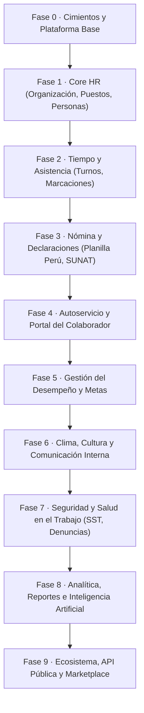

# Guía de trabajo del repositorio — Ayni HR

Esta guía define las normas operativas, el orden de construcción por fases, la Definición de «Hecho» (Definition of Done) por actividad y el procedimiento obligatorio para colaborar en el repositorio de **Ayni HR**.

---

## 1. Regla fundamental de no regresión

> [!CAUTION]
> **Prohibición estricta:** Está terminantemente prohibido eliminar, desactivar o degradar funcionalidad existente sin una justificación técnica y de negocio explícita y documentada por escrito tanto en el mensaje del commit como en la descripción del Pull Request.

Antes de refactorizar o modificar código existente:
1. Evaluar si la funcionalidad actual responde a una regla de negocio o requerimiento legal documentado en `docs/`.
2. Asegurar que las suites de pruebas existentes permanezcan en verde (`make test lint`).
3. Si un componente, endpoint o modelo queda obsoleto por una nueva historia, documentar su motivo de reemplazo y deprecación controlada.

---

## 2. Orden de construcción por fases

El desarrollo de Ayni HR sigue una secuencia ordenada e incremental. No se avanza a la siguiente fase hasta que los cimientos de la fase previa estén completados y verificados:

---

## 3. Cómo evaluar código existente

Al interactuar con código preexistente en el monorepo, se debe clasificar en una de las siguientes cinco categorías antes de actuar:

| Categoría | Criterio | Acción permitida |
|---|---|---|
| **Funciona** | Cumple su contrato, tiene pruebas en verde y respeta las reglas no negociables. | Mantener intacto; construir sobre él sin alterar su interfaz pública. |
| **Mejorable** | Funciona correctamente pero admite optimizaciones de rendimiento, legibilidad o tipado. | Refactorizar preservando contratos y cobertura de pruebas existente. |
| **Parcial** | Implementación incompleta de una historia o caso de uso. | Completar los flujos faltantes manteniendo lo ya implementado y probado. |
| **Duplicado** | Lógica idéntica implementada en varios módulos o carpetas. | Unificar en `App\Shared` o paquete compartido; redirigir usos con pruebas de regresión. |
| **Obsoleto** | Código reemplazado formalmente por una nueva arquitectura o decisión (`docs/13`). | Justificar por escrito en el PR, marcar como deprecado o retirar de forma segura garantizando migración de datos. |

---

## 4. Definición de «Hecho» (Definition of Done) por actividad

Toda historia o tarea técnica se considera terminada únicamente cuando satisface los criterios de cada disciplina involucrada:

### 4.1 Entidades y modelo de datos
- [ ] Columna `tenant_id` presente en toda tabla de negocio.
- [ ] Row Level Security (RLS) habilitado y forzado (`FORCE ROW LEVEL SECURITY`).
- [ ] Política RLS `tenant_isolation` aplicada vinculada a `app.current_tenant_id`.
- [ ] Claves foráneas compuestas obligatorias `(tenant_id, foreign_key_id)` hacia tablas de la misma organización.
- [ ] Restricción de borrado: `ON DELETE RESTRICT` o `NO ACTION` en historia laboral; prohibido `ON DELETE CASCADE` en tablas de personal, contratos y compensación.
- [ ] Índices creados para filtros frecuentes y combinaciones de búsqueda.

### 4.2 Permisos y alcance
- [ ] Permiso declarado en el catálogo bajo la convención `modulo.recurso.accion` (ej. `corehr.employees.view`).
- [ ] Alcance de datos verificado en el servidor (organización, empresa, sede, unidad, equipo, propio).
- [ ] Permisos por campo sensible aplicados (sueldo, salud, biometría, sanciones): si el usuario carece del permiso, el campo no viaja en el payload de la API.
- [ ] Prueba Feature que certifica que un usuario sin permiso recibe `403 Forbidden`.

### 4.3 Servicios y lógica de negocio
- [ ] Lógica encapsulada en Actions o Handlers de aplicación, sin acoplamiento a HTTP en la capa de dominio.
- [ ] Transacciones de base de datos atómicas (`DB::transaction`).
- [ ] Registro de auditoría para toda acción sensible (quién, qué, cuándo, valores anteriores y nuevos).
- [ ] Publicación de eventos de dominio mediante `OutboxService` dentro de la transacción.
- [ ] Fechas laborales con patrón de vigencia (`valid_from` / `valid_to`) sin solapamientos.
- [ ] Máquinas de estado para recursos con ciclo de vida: transacciones validadas y errores `409 invalid_transition` ante estados inválidos.

### 4.4 Backend y API
- [ ] Contrato OpenAPI actualizado mediante `tools/gen_openapi.py` y validado con `make openapi`.
- [ ] Tipos TypeScript sincronizados con `make contracts`.
- [ ] Validación de entrada con `FormRequest` estricto y mensajes en español/i18n.
- [ ] Respuesta envuelta en sobre canónico `{ "data": ... }` o `{ "data": ..., "meta": ... }`.
- [ ] Errores normalizados con sobre canónico `{ "error": { "code": ..., "message": ..., "details": ... } }`.
- [ ] Middleware `EnsureIdempotency` activo en operaciones `POST` con cabecera `Idempotent-Replay: true`.
- [ ] Control de lazy loading activo en entornos no productivos (`preventLazyLoading`).

### 4.5 Interfaz y Frontend
- [ ] Construida con los tokens de diseño y componentes aprobados en `docs/10-diseno-del-sistema.md`.
- [ ] **Prohibido:** No utilizar estilos ad-hoc del prototipo descartado (`prototipo/`).
- [ ] Diseño adaptable (responsive) probado en móvil (375px), tablet (768px) y escritorio (1280px+).
- [ ] Textos internacionalizados mediante claves en `messages/es.json` (sin textos duros en JSX).
- [ ] Accesibilidad: etiquetas semánticas, contraste WCAG AA, soporte de teclado y lectores de pantalla.
- [ ] Cero lógica de cálculo legal en el frontend: toda regla SUNAT/laboral se consulta a la API.

### 4.6 Pruebas automatizadas y calidad
- [ ] Cobertura con Pest (backend) y Vitest (frontend).
- [ ] Toda prueba de endpoint valida el esquema OpenAPI usando `assertMatchesOpenApi()`.
- [ ] Pruebas de matriz de permisos (caso feliz, 403 sin permiso, 403 módulo desactivado, 404 entre organizaciones).
- [ ] Estilo de código validado: `vendor/bin/pint` limpio.
- [ ] Análisis estático: `vendor/bin/phpstan analyse --memory-limit=2G` en nivel 8 sin errores.
- [ ] CI en GitHub (`.github/workflows/ci.yml`) en verde en los tres trabajos (Lint, Contracts, Tests).

---

## 5. Procedimiento para implementar una historia

1. **Leer y contextualizar:**
   - Ubicar la historia en `backlog/backlog.md`.
   - Consultar estados en `docs/05`, reglas en `docs/06`, permisos en `docs/07` y legislación en `docs/14`.
   - Comprobar que no dependa de historias pendientes ni de decisiones abiertas en `docs/13`.
2. **Definir el plan:**
   - Resumen conciso de tablas, casos de uso, endpoints, permisos, eventos y pruebas.
3. **Implementación guiada:**
   - Migración de base de datos → Dominio y entidades → Casos de uso y outbox → Endpoint HTTP y FormRequest → Pruebas automatizadas → Interfaz de usuario.
4. **Verificación local:**
   - Ejecutar `make test` y `make lint`. Corregir cualquier advertencia antes de commitear.
5. **Documentar y sincronizar:**
   - Actualizar `docs/AVANCE.md` marcando la historia como `hecha` con resumen de artefactos.
   - Realizar commit convencional (`feat(...)`, `fix(...)`).
   - Subir cambios (`git push`) y verificar el resultado en GitHub Actions (`gh run list`).
