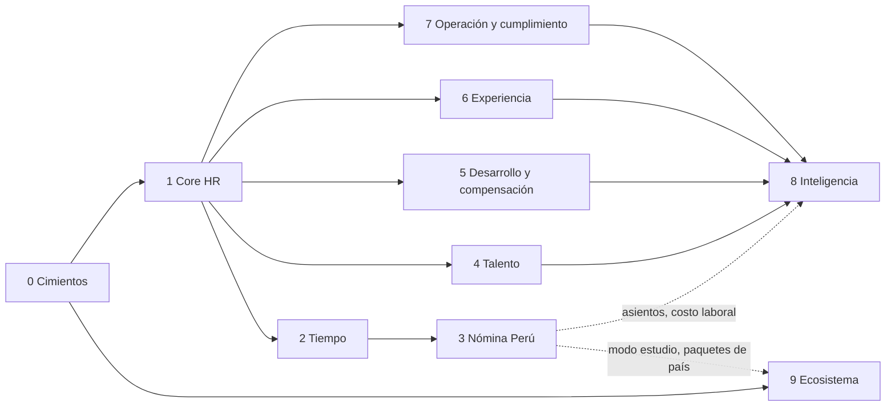

# 01 · Visión y fases

## 1. Visión

GestiaHR es una plataforma de Recursos Humanos donde toda la información del ciclo de vida laboral está conectada: de la vacante a la liquidación, pasando por contrato, asistencia, planilla, desempeño, formación y cumplimiento. Una organización empieza con Core HR y Vacaciones y activa después el resto sin migrar a otro sistema.

Combina tres cosas que hoy no se encuentran juntas en el mercado peruano (ver `docs/00-analisis-de-competencia.md` §5.5):

1. **Profundidad de planilla tradicional** (multi-RUC, multirrégimen, provisiones, asientos, liquidaciones) con **experiencia moderna** para el colaborador.
2. **Suite completa** (talento, clima, SST, denuncias, activos, gastos) sobre **una sola base**, sin integrar productos distintos.
3. **Cumplimiento peruano como producto**: tablero de obligaciones por empresa, expediente de inspección SUNAFIL, igualdad salarial, privacidad.

## 2. Público

| Segmento | Qué necesita | Qué lo decide |
|---|---|---|
| Mediana y gran empresa peruana con varias razones sociales | Planilla correcta, permisos finos, consolidación de grupo, auditoría | Permisos por campo y alcance; multi-RUC y multirrégimen |
| Empresas con mucho personal operativo (retail, logística, seguridad, agro, construcción) | Marcación en campo, turnos, acceso sin correo, móvil | Marcación universal, acceso con documento de identidad, WhatsApp |
| Pequeña empresa y MYPE | Puesta en marcha rápida con plantillas peruanas | Asistente de primeros pasos, importador, régimen MYPE |
| Estudios contables | Administrar muchas planillas pequeñas desde una consola | Modo estudio contable (E-24) |
| Grupos con filiales en la región | Un núcleo común y reglas locales | Paquetes de país, multimoneda, i18n |

Usuarios dentro de cada organización: administrador, RRHH, analista de nómina, reclutador, manager, colaborador, auditor, responsable de SST, investigador de denuncias y contador. Fuera de ella: el superadministrador de la plataforma (consola aparte) y el socio de un estudio contable.

## 3. Principios de producto

1. **La ficha es la fuente única.** Sueldo, jefe, puesto y saldos viven en un solo lugar; los módulos consumen (C-11).
2. **Persona, usuario y relación laboral son cosas distintas** (C-01). Lo laboral cuelga de la relación; una persona puede reingresar o trabajar en dos empresas del grupo.
3. **Puesto no es posición** (C-02). El organigrama, las vacantes y la dotación trabajan sobre posiciones.
4. **Nada se sobrescribe** (C-03). Los cambios llevan fecha de vigencia; se admiten cambios futuros y cálculos retroactivos.
5. **La ley es un dato.** Tasas, topes y plazos son parámetros con vigencia por país y régimen (C-05).
6. **Sencillo por fuera, profundo por dentro.** Divulgación progresiva: lo frecuente a la vista, la configuración avanzada en segundo nivel.
7. **Ningún botón falso.** Todo control visible funciona, persiste y actualiza el resto del sistema.
8. **Permisos finos de base.** Por acción, por campo sensible y por alcance (C-10).
9. **Móvil y sin correo.** El personal operativo entra con documento de identidad y clave u OTP (C-09).
10. **Anonimato real y confidencialidad.** Encuestas y denuncias anónimas no guardan identidad (C-06).
11. **La IA asiste; decide una persona** (C-08). Con bitácora y explicación.
12. **Abierto.** API pública, webhooks y servidor MCP desde el inicio (E-22); toda integración por adaptadores.
13. **Puesta en marcha guiada.** Plantillas peruanas listas e importador con validación (E-27).

## 4. Mapa de módulos comerciales

Un módulo comercial es lo que una organización contrata y se enciende o apaga por organización. Agrupa una o más épicas del backlog (códigos de `docs/00-especificacion-maestra.md`).

| Módulo comercial | Clave | Épicas | Fase | Requiere |
|---|---|---|---|---|
| **Plataforma base** (siempre incluida) | `base` | PLT TEN SEG AUD UI WFL NOT CFG | 0 | — |
| **Core HR** (siempre incluido) | `core` | ORG POS COL HIS CON DOC ESS MSS IMP AYU | 1 | base |
| Asistencia y turnos | `attendance` | ASI TUR BHO | 2 | core |
| Vacaciones y ausencias | `time_off` | VAC AUS | 2 | core |
| Hojas de tiempo | `timesheets` | TSH | 2 | core |
| Nómina Perú | `payroll` | NOM CPT PAR PER BOL BSO DEC PRV LIQ | 3 | core, time_off; attendance recomendado |
| Préstamos y adelanto de sueldo | `advances` | PRE | 3 | payroll |
| Locadores | `contractors` | LOC | 3 | core |
| Reclutamiento | `recruiting` | ATS ENT | 4 | core |
| Onboarding y offboarding | `onboarding` | ONB OFF | 4 | core |
| Desempeño y objetivos | `performance` | DES OKR CMP FBK | 4 | core |
| Aprendizaje | `learning` | LMS | 5 | core |
| Carrera y sucesión | `careers` | CAR | 5 | performance |
| Compensaciones | `compensation` | COM | 5 | core |
| Beneficios | `benefits` | BNF | 5 | core |
| Clima y encuestas | `engagement` | ENC REC CIN | 6 | core |
| Mesa de ayuda | `helpdesk` | HSD | 6 | core |
| Seguridad y salud | `sst` | SST | 7 | core |
| Denuncias | `grievances` | DEN DIS | 7 | core |
| Activos y EPP | `assets` | ACT | 7 | core |
| Gastos y viáticos | `expenses` | GAS | 7 | core |
| Cumplimiento Perú | `compliance` | CUM PRI SIN | 7 | core |
| Analítica y reportes | `analytics` | ANA RPT ALE | 8 | core |
| Asistente de IA | `ai` | IAR | 8 | core |
| API e integraciones | `integrations` | API INT | 9 | base |
| WhatsApp | `whatsapp` | WHA | 9 | core |
| Marca blanca | `white_label` | WLB | 9 | base |
| Estudio contable | `partner` | EST | 9 | payroll |

Notas:

- La consola SaaS (SAS) no es un módulo contratable: es la herramienta del propietario de la plataforma.
- La composición de planes y qué módulo va en cuál es la decisión D-01. La arquitectura solo exige que cada épica pertenezca a una clave de módulo.
- El centro de ayuda (AYU) va en `core` y lo tienen todos los roles de toda organización. El asistente de ayuda con IA (IAR-9 a IAR-11) es la excepción dentro de `ai`: no exige contratar el módulo completo, se habilita por plan con la función `ayuda.asistente_ia` de la consola y luego lo enciende o apaga el administrador de cada organización (`docs/adr/0003-asistente-de-ayuda.md`).
- Privacidad (PRI) tiene una parte obligatoria en la base (consentimientos, registro de accesos, derechos del titular) y una parte de gestión que va en `compliance`. Ver D-14.
- Un módulo apagado no borra datos: oculta menús, rechaza la API con `module_not_enabled` y detiene sus trabajos programados.

### 4.1 Productos de la web

El sitio comercial gestiahr.com (épica WEB) no vende módulos sueltos: los agrupa en cinco productos según lo que el cliente necesita resolver, más la Suite. Es solo una capa de presentación y de venta: lo que se activa en una organización siguen siendo los módulos de §4, con sus dependencias y sus planes. Cada producto tiene su página propia, que abre en la misma ventana; la página de precios es una sola.

| Producto | Clave | Ruta | Módulos | Se vende solo | Sigla |
|---|---|---|---|---|---|
| **Gestia Personas** | `personas` | `/personas` | core | No: es la base y viene en todos los planes | HRIS |
| **Gestia Tiempo** | `tiempo` | `/tiempo` | time_off, attendance, timesheets | Sí | WFM |
| **Gestia Planilla** | `planilla` | `/planilla` | payroll, advances, contractors | No: va en planes con Tiempo (exige `time_off`) | PAY |
| **Gestia Talento** | `talento` | `/talento` | recruiting, onboarding, performance, careers, compensation | Desempeño (`performance`) sí | TMS |
| **Gestia Formación** | `formacion` | `/formacion` | learning | Sí | LMS |
| **Suite GestiaHR** | `suite` | `/suite` | benefits, engagement, helpdesk, sst, grievances, assets, expenses, compliance, analytics, ai, integrations, whatsapp, white_label, partner | No: son complementos o vienen en Corporativo | HCM |

Reglas:

- La sigla acompaña siempre al nombre (por ejemplo «Gestia Tiempo · WFM») para que se distinga cada producto y se reconozca la categoría del mercado: HRIS (información del colaborador), WFM (tiempo y asistencia), PAY (planilla), TMS (gestión del talento), LMS (aprendizaje) y HCM (la suite completa).
- `base` no pertenece a ningún producto: va siempre incluida. En el backlog sus épicas y las de la consola, el sitio y calidad llevan la etiqueta `producto-plataforma`.
- El estado «Disponible» o «Próximamente» de cada parte sale de si su módulo está publicado en la consola (WEB-2). Al primer corte comercial (§5.1) salen Personas, Vacaciones y ausencias (parte de Tiempo) y Planilla; asistencia y turnos, Talento y Formación se muestran en «Próximamente» con lista de espera hasta que se publiquen.
- «Se vende solo» significa que existe un plan público que tiene ese módulo además de `core`. La composición exacta sigue siendo la decisión D-01; los montos los define finanzas en la consola.
- Formación (`learning`) es el LMS propio: la organización sube sus cursos. No incluye una biblioteca de cursos de terceros.
- El catálogo se carga en `web_products` y `web_product_modules` desde esta tabla (`database/catalogos/modulos.json`, clave `productos`).

### 4.2 Planes y complementos iniciales

Composición inicial de los planes públicos (decisión D-01, `docs/adr/0008-planes-y-modulos.md`) y del límite de colaboradores (D-03, `docs/adr/0009-limite-de-colaboradores.md`). Se carga en `plans`, `plan_modules`, `plan_limits` y `plan_features`, y los complementos en `addons` y `addon_modules`, desde estas tablas (`database/catalogos/modulos.json`, claves `planes` y `complementos`). Los planes nacen en estado borrador y **sin monto**: el superadministrador fija el precio, la moneda y los días de prueba en la consola y los publica. Después de la carga inicial, la consola es la fuente; esta tabla no se vuelve a aplicar sobre planes ya publicados.

| Plan | Clave | Colaboradores | Módulos incluidos | Funciones | Público |
|---|---|---|---|---|---|
| Esencial | `esencial` | 50 | base, core, time_off | — | Sí |
| Profesional | `profesional` | 200 | base, core, time_off, payroll, advances, contractors | ayuda.asistente_ia | Sí |
| Corporativo | `corporativo` | 1000 | todos | ayuda.asistente_ia | Sí |
| Empresas | `empresas` | a la medida | según contrato | según contrato | No |

| Complemento | Clave | Producto | Módulos que habilita | Se cobra |
|---|---|---|---|---|
| Gestia Tiempo: asistencia, turnos y hojas de tiempo | `tiempo` | tiempo | attendance, timesheets | por colaborador al mes |
| Gestia Planilla | `planilla` | planilla | payroll, advances, contractors | por colaborador al mes |
| Gestia Talento | `talento` | talento | recruiting, onboarding, performance, careers, compensation | por colaborador al mes |
| Gestia Formación | `formacion` | formacion | learning | por colaborador al mes |

Reglas:

- «todos» son todos los módulos de §4; los que aún no están publicados se activan cuando la consola los publica.
- «a la medida» significa que el plan no tiene tope fijo: se acuerda en el contrato y se carga en `plan_limits` con `is_unlimited`.
- Un complemento solo se ofrece sobre un plan que no trae sus módulos, y la consola rechaza una combinación que rompa `module_dependencies` (por ejemplo, Planilla exige `time_off`).
- Los montos de ejemplo del sitio de referencia viven solo en `kit/tools/sitio/build.py` y se marcan como ejemplo. En el producto, el sitio los lee de `/public/catalog` (WEB-2).

## 5. Fases

Las fases ordenan la construcción; no llevan fechas.

| Fase | Contenido | Resultado verificable |
|---|---|---|
| **0 · Cimientos** | Plataforma técnica, multiempresa, identidad y permisos por campo, consola SaaS (organizaciones, planes, módulos, límites, feature flags), auditoría, sistema de diseño, motor de aprobaciones y workflows, notificaciones, configuración, campos personalizados, i18n y multimoneda | Dos organizaciones aisladas; un rol «administrador sin sueldos»; una aprobación de dos niveles de ejemplo; módulo encendido y apagado desde la consola |
| **1 · Core HR** | Estructura, posiciones, colaboradores y ficha 360, historia con vigencia, contratos, documentos y firma, portales de colaborador y manager, importador y puesta en marcha | Alta, cambio con fecha futura, reingreso y cese de un colaborador; contrato firmado; organización cargada por importador |
| **2 · Tiempo** | Marcación universal, horarios y turnos, vacaciones, ausencias, horas extra y bolsa de horas, hojas de tiempo | Mes de asistencia cerrado listo para planilla; vacaciones aprobadas que actualizan saldo y calendario |
| **3 · Nómina Perú** | Motor, conceptos, parámetros legales, periodos, simulación, boletas, beneficios sociales, préstamos y adelantos, declaraciones y archivos, provisiones y asientos, liquidaciones, locadores | Periodo calculado, comparado, aprobado y cerrado con boletas publicadas y archivos generados; casos dorados en verde |
| **4 · Talento** | Reclutamiento, entrevistas y ofertas, onboarding, offboarding, desempeño, objetivos, competencias, 1:1 y feedback | Vacante → candidato → oferta → colaborador con onboarding; ciclo de evaluación cerrado |
| **5 · Desarrollo y compensación** | Aprendizaje y plan anual, carrera, sucesión y 9-box, bandas, revisión salarial, igualdad salarial, beneficios | Revisión salarial aplicada como cambios con vigencia; reporte de brecha salarial |
| **6 · Experiencia** | Encuestas, clima y eNPS, reconocimientos, comunicación interna, mesa de ayuda y base de conocimiento | Encuesta anónima con umbral; ticket con plazo de atención |
| **7 · Operación y cumplimiento** | SST, denuncias y hostigamiento, casos disciplinarios, activos y EPP, gastos y viáticos, cumplimiento Perú y SUNAFIL, privacidad, sindicatos | Tablero de cumplimiento con evidencias; expediente de inspección exportado |
| **8 · Inteligencia** | Analítica, tableros, reportes y constructor, alertas explicadas, asistente de IA con gobierno | Consulta en lenguaje natural que respeta permisos; alertas con explicación |
| **9 · Ecosistema y expansión** | API pública, webhooks y MCP, integraciones, WhatsApp, paquetes de país, marca blanca, modo estudio contable | Integración externa por webhook; segunda razón social con otro paquete de país |
| **Transversal** | Calidad, seguridad y salida a producción (QA) | Definición de terminado cumplida en cada fase |

### 5.1 Primer corte comercial (MVP)

Las fases ordenan la construcción completa, pero el producto se vende antes de terminarlas. El primer corte comercial es lo mínimo que un cliente peruano compra para reemplazar su planilla:

| Incluye | Épicas |
|---|---|
| Cimientos | PLT, TEN, SEG, SAS, AUD, UI, WFL, NOT, CFG |
| Core HR | ORG, POS, COL, HIS, CON, DOC, ESS, MSS, IMP, AYU (centro de ayuda en todos los roles) |
| Vacaciones y ausencias | VAC, AUS |
| Nómina Perú, régimen general y MYPE | NOM (sin construcción civil ni agrario), CPT, PAR, PER, BOL, BSO, DEC, LIQ |
| Diferenciadores desde el primer día | CUM-9 tablero mínimo de obligaciones de planilla, PAR-7 novedades normativas visibles para el cliente, IMP-7 importadores desde otros sistemas, PER-13 comparación con el sistema anterior, BOL-5 explicación del cambio de neto |
| Asistente de ayuda con IA | IAR-9 asistente documental, IAR-10 activación desde la administración, IAR-11 calidad de respuestas, con su base IAR-1 (proveedor) e IAR-2 (registro de uso) |
| Calidad | QA-1, QA-2 y QA-17 (salida con organización piloto y planilla en paralelo) |

Los cinco diferenciadores responden a lo que el análisis de competencia (`docs/00-analisis-de-competencia.md` §5.5) señala como débil en el líder local: implementación larga, cumplimiento que nadie presenta como producto y poca claridad para el colaborador. Ninguno exige módulos fuera del corte. El asistente de ayuda entra en su versión documental: responde solo con la ayuda del producto y las políticas publicadas por la organización, sin leer datos de personas, por lo que su riesgo de privacidad es bajo. La versión que responde con los datos del propio usuario (IAR-12) queda en la fase 8.

En el backlog esas actividades llevan la etiqueta `mvp` (en Jira: `labels = mvp`) y `generar_backlog.py` verifica que ninguna dependa de algo fuera del corte. Lo demás (asistencia y turnos, préstamos, provisiones, locadores, regímenes especiales y las fases 4 a 9) se construye después del primer cliente, en el orden que pida la venta. El criterio de salida es QA-17: ningún parámetro legal del alcance sin validar (`docs/19-parametros-legales-por-validar.md`) y un periodo calculado en paralelo con el sistema anterior del piloto.

### 5.2 Segunda ola

Lo primero que se construye después del MVP, porque diferencia frente a la competencia y reutiliza lo ya hecho. Etiqueta `ola-2` en el backlog; solo depende del MVP.

| Mejora | Actividades | Por qué |
|---|---|---|
| WhatsApp básico: boleta, saldo de vacaciones y constancia | WHA-1, WHA-2, WHA-3 | El personal operativo lo usa más que la aplicación y nadie lo ofrece completo. Requiere cerrar D-11 (proveedor) |
| Simulador público de costo laboral | PRV-5 | Atrae clientes desde la web con el mismo motor de planilla |
| Modo estudio contable | EST-1 a EST-5 | Un estudio administra muchas planillas MYPE: es un canal de venta, no solo un segmento |

La marcación y la solicitud de vacaciones por WhatsApp (WHA-4, WHA-5) siguen en la fase 9 porque dependen de asistencia y del flujo completo de vacaciones.

## 6. Dependencias entre fases

- **0 y 1 son requisito de todo.**
- **2 antes de 3, salvo en el primer corte comercial**: la planilla consume asistencia, ausencias, vacaciones y horas extra cerradas. Vacaciones y ausencias son obligatorias; asistencia y horas extra entran por puertos y, si la organización no tiene esos módulos, la planilla usa las incidencias del periodo (NOM-5, AUS-6). Por eso el MVP puede salir sin ASI, TUR, BHO ni TSH.
- **4, 5, 6 y 7 son independientes entre sí**; pueden construirse en cualquier orden o en paralelo después de la 1.
- **8 necesita datos** de las anteriores: cada indicador se habilita cuando existe su módulo fuente.
- **9**: API, webhooks y MCP se apoyan en los cimientos (el contrato OpenAPI y los eventos existen desde la fase 0); lo que llega en la fase 9 es la gestión pública de tokens, el portal de desarrolladores y los conectores concretos.

Dependencias finas que cruzan fases (hay que dejar el punto de extensión aunque el módulo llegue después):

| Quien consume | Lo que necesita | Punto de extensión que debe existir antes |
|---|---|---|
| Nómina (3) | Posiciones, compensación con vigencia, régimen por empresa y trabajador (1) | Historia con vigencia y `as_of` |
| Nómina (3) | Préstamos, adelantos, cuota sindical, beneficios, gastos reembolsables | Incidencias de planilla con `source` y evento de cierre |
| Offboarding (4) | Liquidación (3), devolución de activos (7), baja de accesos (0) | Evento `employee.terminated` y tareas |
| ATS (4) | Posiciones aprobadas (1) | Política «no contratar sin posición» configurable |
| Carrera (5) | Evaluaciones (4), competencias (4) | Puntaje de evaluación consultable |
| Compensación (5) | Bandas, compensación con vigencia (1), aprobaciones (0) | Cambio de compensación con fecha futura |
| SST (7) | Cursos obligatorios (5), EPP (7), exámenes médicos | Asignación de cursos por evento |
| Cumplimiento (7) | Datos de casi todos los módulos | Reglas de aplicabilidad que degradan si el módulo no está |
| Alertas (8) | Vencimientos de todos los módulos | Interfaz `AlertSource` por módulo |
| WhatsApp (9) | Boletas, vacaciones, constancias, marcación | Casos de uso reutilizables fuera de HTTP |

## 7. Qué puede contratar una organización por separado

- **Mínimo**: Plataforma base + Core HR. Ya incluye estructura, ficha, historia, contratos, documentos con firma, portales, importador, aprobaciones, notificaciones y auditoría.
- **Combinaciones habituales**
  - Core HR + Vacaciones y ausencias (el punto de entrada que pide el negocio).
  - Core HR + Asistencia y turnos (empresa operativa que ya tiene planilla en otro sistema; exporta el cierre de asistencia).
  - Core HR + Tiempo + Nómina Perú (reemplazo de planilla tradicional).
  - Core HR + Reclutamiento + Onboarding + Desempeño (talento sin planilla).
  - Core HR + Cumplimiento Perú + SST + Denuncias (cumplimiento como producto).
- **Reglas**
  - Nómina exige Vacaciones y ausencias; sin Asistencia, las incidencias se cargan a mano o por importador.
  - Carrera exige Desempeño. Estudio contable exige Nómina.
  - Activar un módulo no requiere migrar datos: las tablas existen para todos; el módulo solo se habilita.
  - Desactivar un módulo conserva los datos en solo lectura para exportación según la política de retención (D-13).
  - Los límites del plan (colaboradores activos, administradores, almacenamiento, razones sociales) se validan en el servidor al crear; superar un límite devuelve `plan_limit_reached` y nunca bloquea la lectura ni la planilla en curso.

## 8. Qué no es GestiaHR

- No es un ERP contable: genera asientos y los exporta.
- No presenta declaraciones ante SUNAT ni AFPnet: genera y valida los archivos; la presentación la hace la empresa (decisión D-09).
- No es empleador de registro (EOR).
- No toma decisiones laborales automáticas.
