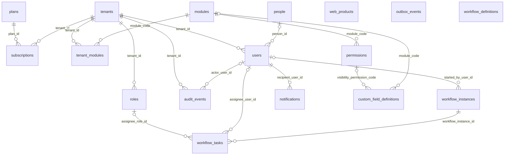
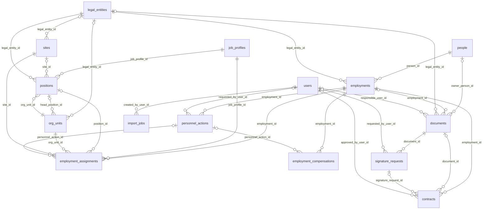
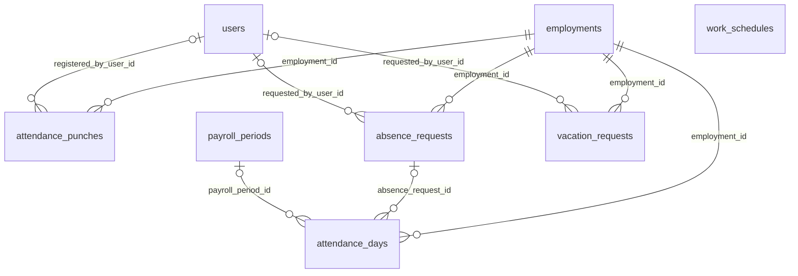
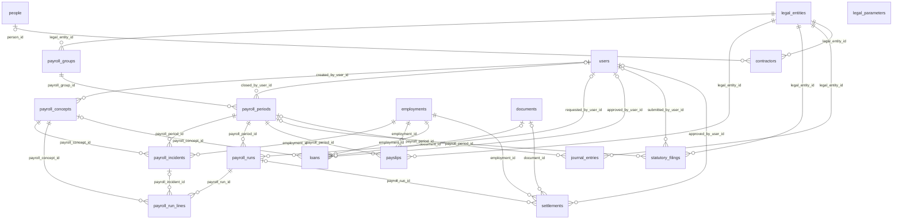
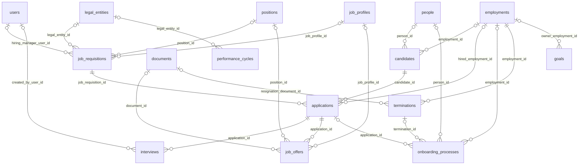
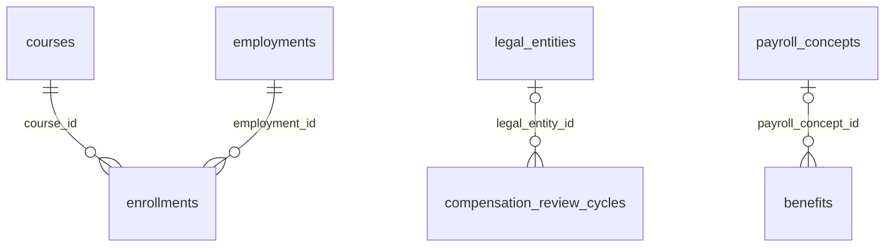
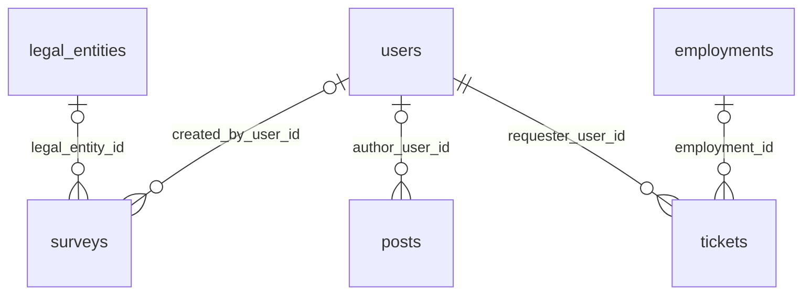
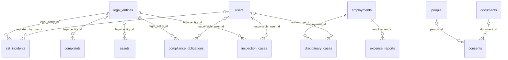
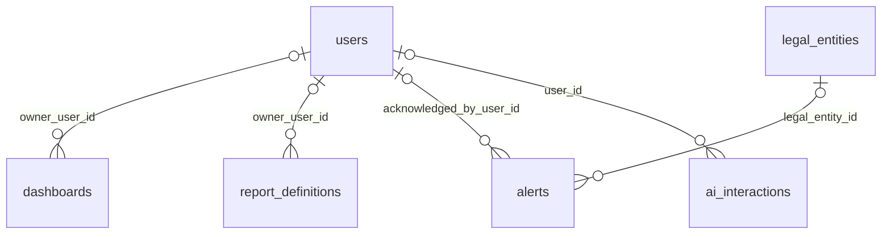
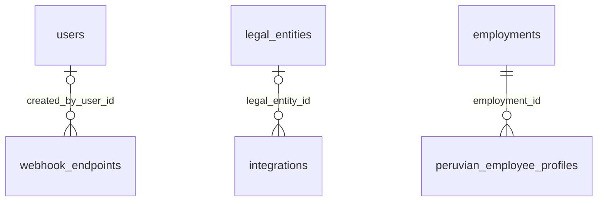

# 04 · Modelo de datos

GestiaHR · kit de desarrollo. Describe `database/schema.sql`: principios, un diagrama por dominio y, por cada tabla, su propósito, columnas clave, relaciones y reglas. El esquema es la referencia; si este documento y `schema.sql` discrepan, manda `schema.sql`.

Archivos relacionados:

| Archivo | Contenido |
|---|---|
| `database/schema.sql` | Esquema completo de las fases 0 a 9, con catálogos de plataforma y la función `seed_tenant_defaults` |
| `database/pruebas_aislamiento.sql` | Pruebas con aserciones de aislamiento, claves foráneas cruzadas, registros inalterables, vigencias y anonimato |
| `database/catalogos/permisos_y_roles.json` | Permisos y matriz de los 11 roles de sistema (misma información que los `INSERT` del esquema) |
| `database/catalogos/modulos.json` | Módulos comerciales y dependencias |
| `database/catalogos/parametros.json` | Parámetros configurables del producto |
| `database/catalogos/parametros_legales_pe.json` | Parámetros legales de Perú con vigencia y marca de verificación |
| `database/catalogos/conceptos_pe.json` | Conceptos de planilla de Perú con afectaciones (por validar) |

## 1. El esquema en números

Conteos obtenidos del catálogo de PostgreSQL (16.15 (Ubuntu 16.15-0ubuntu0.24.04.1)) después de cargar `schema.sql` en una base vacía; no son estimaciones.

| Medida | Cantidad |
|---|---:|
| Tablas | 522 |
| Tablas de organización (con `tenant_id`, RLS activado y forzado, política `tenant_isolation`) | 458 |
| Tablas de plataforma (sin RLS de organización) | 64 |
| Políticas RLS | 461 |
| Claves foráneas | 1681 |
| — compuestas `(tenant_id, x_id)` → `(tenant_id, id)` entre tablas de organización | 1109 |
| — simples `tenant_id` → `tenants(id)` | 471 |
| — resto (hacia catálogos y tablas de plataforma) | 101 |
| Índices (incluye los de claves primarias, únicas y exclusiones) | 2378 |
| — creados con `CREATE INDEX` | 1202 |
| Triggers | 543 |
| Restricciones de exclusión (vigencias sin solapamiento) | 30 |
| Restricciones `CHECK` | 645 |
| Restricciones `UNIQUE` | 624 |
| Columnas | 7060 |
| Columnas marcadas `-- SENSIBLE` | 168 |
| — de ellas, cifradas en la aplicación (`_enc`) | 62 |
| Tablas con vigencia (`valid_from` / `valid_to`) | 42 |
| Tablas inalterables (solo inserción, por trigger) | 24 |
| Tablas con borrado lógico (`deleted_at`) | 171 |
| Tablas con concurrencia optimista (`lock_version`) | 253 |
| Funciones | 30 |
| Vistas | 1 |
| Permisos en el catálogo | 924 |
| — de campo / marcados sensibles | 28 / 108 |
| Roles de sistema | 11 |
| Módulos comerciales | 28 |

Nota: el resto de claves foráneas es la diferencia entre el total y las dos filas anteriores; son referencias a tablas de plataforma (por `id` o por `code`) y las internas de la plataforma. `pruebas_aislamiento.sql` comprueba que **toda** clave foránea entre dos tablas de organización es compuesta.

Tablas por épica:

| Fase | Épica | Título | Tablas |
|---:|---|---|---:|
| 0 | TEN | Multiempresa y aislamiento | 5 |
| 0 | SAS | Consola SaaS: organizaciones, planes, módulos, límites, feature flags, soporte y salud | 32 |
| 0 | WEB | Sitio comercial gestiahr.com: productos, leads, demos, registros, chatbot y libro de reclamaciones | 7 |
| 0 | PLT | Plataforma técnica: archivos, eventos, idempotencia | 12 |
| 0 | SEG | Identidad, roles, permisos por campo y alcance | 17 |
| 0 | AUD | Auditoría, actividad y accesos a datos sensibles | 6 |
| 0 | UI | Sistema de diseño y armazón (preferencias y vistas guardadas) | 2 |
| 0 | WFL | Motor de aprobaciones y workflows | 11 |
| 0 | NOT | Notificaciones y mensajería | 6 |
| 0 | CFG | Configuración, parámetros, campos personalizados, i18n y multimoneda | 10 |
| 1 | ORG | Estructura organizacional | 11 |
| 1 | POS | Posiciones y headcount | 7 |
| 1 | COL | Colaboradores y ficha 360 | 11 |
| 1 | HIS | Historia con vigencia | 8 |
| 1 | CON | Contratos y adendas | 6 |
| 1 | DOC | Gestión documental, plantillas y firma | 12 |
| 1 | ESS | Portal del colaborador | 2 |
| 1 | MSS | Portal del manager | 0 |
| 1 | IMP | Importador y puesta en marcha | 4 |
| 1 | AYU | Centro de ayuda | 10 |
| 2 | ASI | Asistencia y marcación | 8 |
| 2 | TUR | Horarios, jornadas y turnos | 10 |
| 2 | VAC | Vacaciones | 8 |
| 2 | AUS | Ausencias y permisos | 6 |
| 2 | BHO | Horas extra y bolsa de horas | 3 |
| 2 | TSH | Hojas de tiempo por proyecto | 5 |
| 3 | NOM | Motor de nómina | 10 |
| 3 | CPT | Conceptos y fórmulas | 4 |
| 3 | PAR | Parámetros legales con vigencia | 2 |
| 3 | PER | Periodos, incidencias, cálculo, simulación y cierre | 8 |
| 3 | BOL | Boletas | 2 |
| 3 | BSO | Beneficios sociales, seguros y derechohabientes | 6 |
| 3 | PRE | Préstamos, adelantos y adelanto de sueldo | 5 |
| 3 | DEC | Declaraciones y archivos | 9 |
| 3 | PRV | Provisiones y asientos | 7 |
| 3 | LIQ | Liquidación de beneficios | 3 |
| 3 | LOC | Locadores | 3 |
| 4 | ATS | Reclutamiento, portal de empleos y base de talento | 14 |
| 4 | ENT | Entrevistas y ofertas | 7 |
| 4 | ONB | Pre-onboarding y onboarding | 5 |
| 4 | OFF | Offboarding | 3 |
| 4 | DES | Evaluación de desempeño | 11 |
| 4 | OKR | Objetivos | 4 |
| 4 | CMP | Competencias y habilidades | 7 |
| 4 | FBK | Reuniones 1:1 y feedback | 5 |
| 5 | LMS | Aprendizaje y plan anual | 15 |
| 5 | CAR | Desarrollo, carrera, sucesión y 9-box | 7 |
| 5 | COM | Compensaciones, bandas, revisión salarial e igualdad salarial | 8 |
| 5 | BNF | Beneficios | 3 |
| 6 | ENC | Encuestas, clima y eNPS | 9 |
| 6 | REC | Reconocimientos | 5 |
| 6 | CIN | Comunicación interna | 5 |
| 6 | HSD | Mesa de ayuda y base de conocimiento | 5 |
| 7 | SST | Seguridad y salud en el trabajo | 22 |
| 7 | DEN | Canal de denuncias y hostigamiento | 10 |
| 7 | DIS | Casos disciplinarios | 3 |
| 7 | ACT | Activos, EPP y uniformes | 9 |
| 7 | GAS | Gastos, viáticos y reembolsos | 7 |
| 7 | CUM | Cumplimiento Perú y SUNAFIL | 14 |
| 7 | PRI | Privacidad y retención | 9 |
| 7 | SIN | Sindicatos y convenios | 5 |
| 8 | ANA | People analytics y tableros | 4 |
| 8 | RPT | Reportes y constructor | 4 |
| 8 | ALE | Alertas explicadas | 4 |
| 8 | IAR | Asistente de IA y gobierno | 6 |
| 9 | API | API pública, webhooks y MCP | 5 |
| 9 | INT | Integraciones | 5 |
| 9 | WHA | Autoservicio por WhatsApp | 4 |
| 9 | PAI | Paquetes de país | 15 |
| 9 | WLB | Marca blanca | 1 |
| 9 | EST | Modo estudio contable | 4 |

## 2. Principios

### 2.1 Multiempresa en esquema compartido

- Una organización cliente es una fila de `tenants`. Toda tabla de organización lleva `tenant_id uuid NOT NULL`.
- **RLS activado y forzado** en cada tabla de organización (`FORCE ROW LEVEL SECURITY`: también el dueño de la tabla queda sujeto). La política es la misma en todas:

```sql
CREATE POLICY tenant_isolation ON <tabla>
  USING      (tenant_id = NULLIF(current_setting('app.tenant_id', true), '')::uuid)
  WITH CHECK (tenant_id = NULLIF(current_setting('app.tenant_id', true), '')::uuid);
```

- La aplicación fija la organización al abrir cada transacción: `SET LOCAL app.tenant_id = '<uuid>'`. Sin ese valor (o con cadena vacía) la política **no devuelve filas y no lanza error**; por eso se usa `current_setting(..., true)` con `NULLIF`.
- **Claves foráneas compuestas.** Cada tabla de organización tiene `UNIQUE (tenant_id, id)` y las referencias son `FOREIGN KEY (tenant_id, x_id) REFERENCES x (tenant_id, id)`. Una fila no puede apuntar a otra organización aunque falle el código o se use un rol que ignora RLS. Como efecto útil, todos los índices de claves foráneas empiezan por `tenant_id`.
- **Índice por organización.** No hay un índice suelto sobre `tenant_id`: el de `UNIQUE (tenant_id, id)` y los de claves foráneas `(tenant_id, x_id)` ya lo encabezan.
- **Tablas de plataforma** sin `tenant_id` propio ni RLS: planes, organizaciones, suscripciones, módulos, banderas, usuarios y auditoría de plataforma, paquetes de país, parámetros legales globales, catálogos de permisos y regímenes. Algunas guardan un `tenant_id` como dato (suscripciones, facturas, dominios), sin política.
- **Roles de base de datos.** `gestia_app` (sin `BYPASSRLS`) para la API y los trabajadores de cola; `gestia_platform` (`BYPASSRLS`) para la consola SaaS. Son roles sin inicio de sesión: los usuarios de conexión heredan de ellos. `gestia_app` solo lee los catálogos de plataforma y no tiene acceso a `tenants`, planes, suscripciones ni usuarios de plataforma: ve su organización por la vista `current_tenant` y resuelve el dominio con `resolve_tenant_id()`.
- Un superusuario y los roles con `BYPASSRLS` no pasan por RLS: las migraciones corren con el rol dueño y la aplicación nunca se conecta con él.

### 2.2 Persona, usuario y relación laboral (C-01, C-02)

- `people` es la persona; `users` es el acceso (puede no tener persona, y el correo no es obligatorio: los identificadores de acceso están en `user_identities`); `employments` es la relación laboral con **una** razón social (`legal_entities`). Un reingreso es otra fila de `employments` para la misma persona.
- `job_profiles` es el puesto de catálogo; `positions` es la plaza presupuestada. Headcount, vacantes, organigrama y sucesión trabajan sobre posiciones.
- Sueldo, jefe, puesto, unidad, sede y saldos tienen una sola fuente (C-11): las tablas de vigencia y los libros de movimientos. Los demás módulos guardan referencias, no copias; las únicas copias son fotografías deliberadas de un cálculo cerrado (`payroll_run_employments.context_snapshot`, `payslips.content`).

### 2.3 Historia con vigencia (C-03)

- `valid_from` y `valid_to` son fechas **inclusive**; `valid_to` nulo significa «vigente sin fecha de fin».
- Las tablas de vigencia llevan una restricción de exclusión (`btree_gist`) que impide dos filas solapadas para la misma clave:

```sql
EXCLUDE USING gist (tenant_id WITH =, employment_id WITH =,
                    daterange(valid_from, valid_to, '[]') WITH &&) DEFERRABLE INITIALLY IMMEDIATE
```

- Cambiar un dato es cerrar la fila vigente (poner `valid_to`) e insertar otra; un cambio con fecha futura es una fila que empieza más adelante. La restricción es diferible para poder hacer ambas cosas en una transacción.
- Consulta a una fecha: `WHERE valid_from <= :fecha AND (valid_to IS NULL OR valid_to >= :fecha)`.
- `personnel_actions` agrupa los registros que un mismo movimiento genera (promoción = nueva asignación + nueva compensación).

| Tabla con vigencia | Clave sin solapamiento | Exclusión |
|---|---|---|
| `user_roles` | — | No: conviven filas de distinto alcance |
| `tenant_settings` | — | No: conviven filas de distinto alcance |
| `master_catalog_items` | — | No: conviven filas de distinto alcance |
| `org_units` | — | No: conviven filas de distinto alcance |
| `org_unit_versions` | `org_unit_id` | Sí |
| `positions` | — | No: conviven filas de distinto alcance |
| `headcount_budgets` | `org_unit_id` | Sí |
| `person_addresses` | — | No: conviven filas de distinto alcance |
| `person_bank_accounts` | `employment_id`, `purpose` | Sí (filas con status = 'active') |
| `employment_assignments` | `employment_id` | Sí |
| `employment_cost_distributions` | `employment_id` | Sí |
| `employment_compensations` | `employment_id` | Sí |
| `employment_compensation_items` | `employment_id`, `payroll_concept_id` | Sí |
| `employment_labor_regimes` | `employment_id` | Sí |
| `employment_pension_affiliations` | `employment_id` | Sí |
| `contracts` | `employment_id` | Sí (filas con status NOT IN ('draft','pending_approval','superseded','cancelled')) |
| `employment_work_schedules` | `employment_id` | Sí |
| `time_policies` | — | No: conviven filas de distinto alcance |
| `vacation_policy_rules` | `vacation_policy_id` | Sí |
| `absence_type_rules` | `absence_type_id` | Sí |
| `pension_fund_rates` | `pension_fund_id` | Sí |
| `legal_entity_regimes` | `legal_entity_id` | Sí |
| `pe_construction_assignments` | `employment_id` | Sí |
| `payroll_group_members` | `employment_id` | Sí |
| `payroll_concept_versions` | `payroll_concept_id` | Sí |
| `payroll_concept_drafts` | — | No: conviven filas de distinto alcance |
| `legal_parameters` | — | Sí, restricción propia |
| `legal_parameter_overrides` | — | Sí, restricción propia |
| `advance_policies` | — | No: conviven filas de distinto alcance |
| `statutory_file_layouts` | `country_code`, `filing_kind`, `structure_code` | Sí |
| `concept_statutory_mappings` | `payroll_concept_id`, `filing_kind` | Sí |
| `concept_account_mappings` | — | No: conviven filas de distinto alcance |
| `salary_bands` | — | No: conviven filas de distinto alcance |
| `salary_policies` | — | No: conviven filas de distinto alcance |
| `expense_policies` | — | No: conviven filas de distinto alcance |
| `union_memberships` | `union_id`, `employment_id` | Sí |
| `collective_agreements` | — | No: conviven filas de distinto alcance |
| `collective_agreement_clauses` | — | No: conviven filas de distinto alcance |
| `country_concept_templates` | — | No: conviven filas de distinto alcance |
| `pe_parametric_items` | `table_number`, `code` | Sí |
| `peruvian_employee_profiles` | `employment_id` | Sí |
| `peruvian_employment_establishments` | `employment_id`, `establishment_tax_id`, `establishment_code` | Sí |

### 2.4 Registros inalterables y auditoría (C-07)

- Tablas de solo inserción, protegidas por trigger (`reject_mutation`, SQLSTATE `AY001`) contra `UPDATE`, `DELETE` y `TRUNCATE`, y además sin esos privilegios para `gestia_app` y `gestia_platform`: `absence_period_closings`, `ai_interactions`, `application_stage_events`, `asset_events`, `attendance_punches`, `audit_events`, `calibration_adjustments`, `complaint_events`, `compliance_ledger_anchors`, `compliance_ledger_entries`, `data_access_logs`, `employment_status_events`, `evidence_exports`, `fifth_category_ledger`, `help_article_versions`, `job_profile_versions`, `kb_article_versions`, `platform_audit_events`, `position_status_events`, `signature_events`, `tenant_status_events`, `time_bank_entries`, `vacation_ledger_entries`, `workflow_decisions`.
- Los saldos (vacaciones, bolsa de horas) son libros de movimientos: el saldo es la suma y un error se corrige con un contraasiento.
- Una marcación (`attendance_punches`) no se edita: la corrección es otra fila con `entry_type = 'correction'`, `corrects_punch_id` y `correction_reason`.
- Boletas y corridas de planilla se pueden modificar mientras son borrador; cerradas (`closed_at`), cualquier cambio falla con `AY002`.
- Tres almacenes distintos: `audit_events` (negocio, con antes y después), `activity_events` (actividad del usuario) y los logs técnicos, que no viven en esta base. `data_access_logs` registra cada acceso a un dato sensible.

Códigos de error propios del esquema:

| SQLSTATE | Significado |
|---|---|
| `AY001` | Intento de modificar, borrar o truncar una tabla de solo inserción |
| `AY002` | Intento de modificar un registro cerrado (boleta o corrida de planilla) |
| `AY003` | Intento de romper el anonimato (identidad en denuncia o encuesta anónima) |

### 2.5 Datos sensibles

- `-- SENSIBLE` en `schema.sql` y **(S)** en este documento marcan columnas que exigen permiso por campo y cuyo acceso se registra en `data_access_logs`.
- Las columnas `_enc` guardan texto cifrado por la aplicación (la base nunca ve el dato en claro). Cuando hay que buscar por valor exacto existe una columna `_hash` con una huella con clave (documento de identidad, teléfono, RUC del locador).
- Los montos de sueldo y de planilla se marcan sensibles pero **no** van cifrados por campo, porque la planilla, las provisiones y la analítica necesitan operar con ellos en SQL; los protege el permiso por campo, RLS y el cifrado del almacenamiento. Es una decisión a confirmar (sección final).
- Tablas completas tratadas como sensibles: `absence_medical_certificates`, `ai_interactions`, `attrition_risk_scores`, `background_checks`, `biometric_enrollments`, `compensation_review_proposals`, `complaint_attachments`, `complaint_events`, `complaint_identities`, `complaint_messages`, `complaint_protection_measures`, `complaints`, `compliance_ledger_entries`, `cts_deposits`, `disciplinary_case_events`, `disciplinary_cases`, `disciplinary_sanctions`, `employment_compensation_items`, `employment_compensations`, `exit_interviews`, `external_income_declarations`, `fifth_category_ledger`, `fifth_category_refunds`, `insurance_beneficiaries`, `job_offers`, `judicial_withholdings`, `loans`, `occupational_exams`, `pay_equity_report_lines`, `payroll_payment_items`, `payroll_run_employments`, `payroll_run_lines`, `payslips`, `person_bank_accounts`, `person_sensitive_data`, `peruvian_dependent_profiles`, `peruvian_employee_profiles`, `peruvian_person_addresses`, `preboarding_submissions`, `privacy_incidents`, `profit_sharing_items`, `provision_lines`, `salary_advances`, `salary_bands`, `settlement_lines`, `settlements`, `sst_incident_people`, `sst_incidents`, `talent_assessments`, `union_memberships`, `withholding_certificates`.
- **Denuncias (C-06).** `complaints` no tiene columnas de usuario, persona, IP, agente de navegador ni marcas de hora: solo fecha, huellas del código de seguimiento y contenido cifrado. La identidad, cuando la denuncia es identificada, vive cifrada en `complaint_identities`, sin clave foránea a persona, y un trigger impide crearla en una denuncia anónima.
- **Encuestas (C-06).** `survey_responses` y `survey_answers` no tienen clave foránea a persona ni marcas de hora. Quién respondió se sabe por `survey_participations`, que no enlaza con la respuesta. El umbral mínimo por segmento está en `surveys.min_responses_per_segment` y se aplica al mostrar resultados.

### 2.6 Convenciones de columnas

| Elemento | Convención |
|---|---|
| Clave primaria | `id uuid DEFAULT uuid_v7()` (UUID versión 7, ordenable por tiempo; decisión A-03). En las 7 tablas de registro particionadas por mes la clave es (`id`, `occurred_at`) |
| Estados y tipos cerrados | `text` + `CHECK (col IN (...))`, con valores en inglés; nunca `ENUM` de PostgreSQL. Los de `status` están conciliados con `05-maquinas-de-estado.md` (sección final) |
| Fechas | `…_at` es `timestamptz`; `…_on` es `date`; las fechas laborales no llevan hora |
| Dinero | `numeric(14,2)` con una columna de moneda `char(3)` en la misma tabla |
| Booleanos | `is_…`, `has_…` |
| Marcas estándar | `created_at`, `updated_at` (trigger); `deleted_at` en lo que va a papelera; `lock_version` donde hay edición concurrente |
| Borrado lógico | Los índices únicos de esas tablas son parciales (`WHERE deleted_at IS NULL`): se puede reutilizar un código eliminado |
| Concurrencia optimista | La aplicación actualiza con `WHERE id = ? AND lock_version = ?`; el trigger suma 1. Cero filas afectadas = conflicto |
| Referencias polimórficas | `subject_type` + `subject_id` (o `entity_…`, `source_…`) sin clave foránea; solo en piezas transversales (workflows, notificaciones, adjuntos, auditoría, campos personalizados) |
| Campos personalizados | Definición en `custom_field_definitions`, valor `jsonb` en `custom_field_values` |
| Catálogos de plataforma con clave natural | Se referencian por `code` (`modules`, `permissions`, `labor_regimes`…) para que los datos sean legibles |

### 2.7 Reglas legales como datos (C-05)

- `legal_parameters` (plataforma): parámetro por país y, si corresponde, régimen, con `valid_from`/`valid_to` y exclusión de solapamiento. `legal_parameter_overrides` permite un valor propio de la organización o empresa (por ejemplo, la tasa de una póliza).
- `payroll_concepts` + `payroll_concept_versions` (fórmula, condiciones y afectaciones con vigencia). Las fórmulas referencian parámetros por código, nunca valores.
- `schema.sql` **no** carga parámetros legales ni conceptos: los instala el paquete de país desde `catalogos/parametros_legales_pe.json` y `catalogos/conceptos_pe.json`. En el primero, lo no verificado va con `"verificado": false` y valor nulo; el segundo debe validarlo un especialista antes de usarse.

### 2.8 Plataforma en los cimientos (C-04)

- `modules`, `plans`, `subscriptions` y `tenant_modules` condicionan qué puede usar una organización; `tenant_limits` y `tenant_usage_counters` aplican los límites; `feature_flags` con reglas y `tenant_feature_flags` liberan funciones de forma gradual.
- Workflows y aprobaciones (`workflow_*`), notificaciones, campos personalizados, outbox e idempotencia son transversales: los módulos de las fases 2 a 9 los usan, no los duplican. Las solicitudes de cada módulo guardan `workflow_instance_id`.
- `seed_tenant_defaults(tenant uuid)` copia a una organización nueva los roles de sistema y sus permisos desde `system_roles` / `system_role_permissions`, crea su política de seguridad y activa los módulos base. Es idempotente.

## 3. Cómo cargar y comprobar

```bash
createdb gestiahr
psql -v ON_ERROR_STOP=1 -d gestiahr -f database/schema.sql
psql -v ON_ERROR_STOP=1 -d gestiahr -f database/pruebas_aislamiento.sql   # termina en «TODAS LAS PRUEBAS PASARON»
```

El esquema usa la extensión `btree_gist` y crea los roles `gestia_app` y `gestia_platform` si no existen. Para el proyecto Laravel, este archivo es la referencia desde la que se escriben las migraciones por módulo; no se ejecuta en producción tal cual.

## 4. Cómo leer las fichas de tabla

- **Columnas clave** lista las columnas propias (sin `id`, `tenant_id`, marcas estándar ni claves foráneas). **(S)** = sensible.
- **Relaciones** lista las claves foráneas. Hacia tablas de organización son siempre compuestas con `tenant_id`; «(opcional)» = admite nulo. `tabla.code` indica referencia a un catálogo de plataforma por su código.
- **Reglas** resume aislamiento, vigencia, inalterabilidad, sensibilidad, unicidad y validaciones.

## 5. Tablas que no existen a propósito

- **Portal del manager (MSS):** no tiene tablas; es una vista con alcance «equipo» sobre asignaciones, aprobaciones, asistencia, vacaciones, objetivos y evaluaciones.
- **Colas, caché, sesiones del framework y logs técnicos:** viven en Redis y en el agregador de logs, no en este esquema.
- **Calendario de RRHH, bandeja de pendientes, búsqueda global, cumpleaños y aniversarios:** se derivan de otras tablas; solo los eventos propios se guardan (`calendar_events`).
- **Saldos:** no hay columnas de saldo de vacaciones ni de bolsa de horas; se calculan de los libros de movimientos.


## 6. Fase 0 · Cimientos

Diagrama del dominio (solo tablas principales; `people` de otro dominio, como referencia):



### TEN · Multiempresa y aislamiento

#### `countries`

- **Propósito:** Catálogo de países (ISO 3166-1 alfa-2) que usan los paquetes de país y las razones sociales.
- **Columnas clave:** `code`, `name`, `default_currency`, `default_locale`.
- **Relaciones:** ninguna además de la organización.
- **Reglas:** tabla de plataforma: sin `tenant_id` ni RLS; la aplicación solo la lee; único: `code`.

#### `currencies`

- **Propósito:** Catálogo de monedas (ISO 4217) admitidas en montos y compensaciones.
- **Columnas clave:** `code`, `name`, `symbol`, `decimals`.
- **Relaciones:** ninguna además de la organización.
- **Reglas:** tabla de plataforma: sin `tenant_id` ni RLS; la aplicación solo la lee; único: `code`.

#### `tenants`

- **Propósito:** Organización cliente (tenant). Raíz del aislamiento: toda tabla de organización referencia su id. beta_groups: grupos beta a los que pertenece, para las banderas de funcionalidad (SAS-7).
- **Columnas clave:** `slug`, `name`, `status`, `default_currency`, `default_locale`, `timezone`, `is_demo`, `is_partner_managed`, `trial_ends_at`, `suspended_at`, `suspension_reason`, `storage_region`, `contact_name`, `contact_email`, `contact_phone`, `cancelled_at`, `retention_until`, `beta_groups`.
- **Relaciones:** `country_code` → `countries.code`.
- **Reglas:** tabla de plataforma: sin `tenant_id` ni RLS; la aplicación no tiene acceso; borrado lógico (`deleted_at`, papelera); concurrencia optimista (`lock_version`); único: `slug`; la aplicación solo ve su fila por la vista `current_tenant`.

#### `tenant_domains`

- **Propósito:** Dominios y subdominios por los que se resuelve la organización (incluye dominio propio de marca blanca).
- **Columnas clave:** `domain`, `kind`, `verified_at`, `is_primary`.
- **Relaciones:** `tenant_id` → `tenants`.
- **Reglas:** tabla de plataforma: sin `tenant_id` ni RLS; la aplicación no tiene acceso; único: `domain`.

#### `tenant_status_events`

- **Propósito:** Historial inalterable de cambios de estado de la organización (pruebas, suspensiones, bloqueos, reactivaciones).
- **Columnas clave:** `from_status`, `to_status`, `reason`, `occurred_at`.
- **Relaciones:** `tenant_id` → `tenants`; `platform_user_id` → `platform_users` (opcional).
- **Reglas:** tabla de plataforma: sin `tenant_id` ni RLS; la aplicación no tiene acceso; **inalterable**: solo inserción; UPDATE, DELETE y TRUNCATE fallan (AY001).


### SAS · Consola SaaS: organizaciones, planes, módulos, límites, feature flags, soporte y salud

#### `modules`

- **Propósito:** Módulos comerciales que una organización puede contratar; agrupan épicas del backlog. is_published: el módulo está a la venta (WEB-2: el sitio lo muestra «Disponible»; si no, «Próximamente» con lista de espera); lo cambia la consola.
- **Columnas clave:** `code`, `name`, `phase`, `is_core`, `epic_codes`, `description`, `is_published`, `published_at`.
- **Relaciones:** ninguna además de la organización.
- **Reglas:** tabla de plataforma: sin `tenant_id` ni RLS; la aplicación solo la lee; único: `code`.

#### `module_dependencies`

- **Propósito:** Dependencias entre módulos comerciales (un módulo no se activa sin sus requisitos).
- **Columnas clave:** `is_required`.
- **Relaciones:** `module_code` → `modules.code`; `depends_on_code` → `modules.code`.
- **Reglas:** tabla de plataforma: sin `tenant_id` ni RLS; la aplicación solo la lee; único: `module_code`, `depends_on_code`.

#### `plans`

- **Propósito:** Planes comerciales definidos por el superadministrador (nombres libres, duplicables).
- **Columnas clave:** `code`, `name`, `description`, `status`, `billing_cycle`, `price`, `currency`, `trial_days`, `is_public`, `version`.
- **Relaciones:** `duplicated_from_plan_id` → `plans` (opcional); `superseded_by_plan_id` → `plans` (opcional).
- **Reglas:** tabla de plataforma: sin `tenant_id` ni RLS; la aplicación no tiene acceso; borrado lógico (`deleted_at`, papelera); concurrencia optimista (`lock_version`); único: `code`, `version`.

#### `plan_modules`

- **Propósito:** Módulos incluidos en cada plan.
- **Columnas clave:** solo claves foráneas.
- **Relaciones:** `plan_id` → `plans`; `module_code` → `modules.code`.
- **Reglas:** tabla de plataforma: sin `tenant_id` ni RLS; la aplicación no tiene acceso; único: `plan_id`, `module_code`.

#### `plan_limits`

- **Propósito:** Límites por plan (colaboradores, administradores, almacenamiento, razones sociales, llamadas de API).
- **Columnas clave:** `limit_code`, `limit_value`, `is_unlimited`.
- **Relaciones:** `plan_id` → `plans`.
- **Reglas:** tabla de plataforma: sin `tenant_id` ni RLS; la aplicación no tiene acceso; único: `plan_id`, `limit_code`.

#### `plan_features`

- **Propósito:** Funcionalidades puntuales habilitadas por plan.
- **Columnas clave:** `feature_code`, `enabled`.
- **Relaciones:** `plan_id` → `plans`.
- **Reglas:** tabla de plataforma: sin `tenant_id` ni RLS; la aplicación no tiene acceso; único: `plan_id`, `feature_code`.

#### `addons`

- **Propósito:** Complementos contratables sobre un plan (módulo extra, ampliación de límite, funcionalidad o servicio).
- **Columnas clave:** `code`, `name`, `kind`, `web_product_code`, `limit_code`, `limit_increment`, `price`, `currency`, `billing_cycle`, `status`.
- **Relaciones:** ninguna además de la organización.
- **Reglas:** tabla de plataforma: sin `tenant_id` ni RLS; la aplicación no tiene acceso; borrado lógico (`deleted_at`, papelera); único: `code`.

#### `addon_modules`

- **Propósito:** Módulos que habilita un complemento de tipo módulo (un producto de la web puede habilitar varios, docs/01 §4.2).
- **Columnas clave:** solo claves foráneas.
- **Relaciones:** `addon_id` → `addons`; `module_code` → `modules.code`.
- **Reglas:** tabla de plataforma: sin `tenant_id` ni RLS; la aplicación no tiene acceso; único: `addon_id`, `module_code`.

#### `subscriptions`

- **Propósito:** Suscripción de una organización a un plan, con su ciclo, estado y periodo de prueba.
- **Columnas clave:** `status`, `billing_cycle`, `price`, `currency`, `starts_on`, `ends_on`, `trial_ends_on`, `cancelled_at`, `cancel_reason`, `license_key`, `expired_at`.
- **Relaciones:** `tenant_id` → `tenants`; `plan_id` → `plans`.
- **Reglas:** tabla de plataforma: sin `tenant_id` ni RLS; la aplicación no tiene acceso; concurrencia optimista (`lock_version`); único: `tenant_id`.

#### `subscription_addons`

- **Propósito:** Complementos contratados dentro de una suscripción.
- **Columnas clave:** `quantity`, `price`, `currency`, `starts_on`, `ends_on`.
- **Relaciones:** `subscription_id` → `subscriptions`; `addon_id` → `addons`.
- **Reglas:** tabla de plataforma: sin `tenant_id` ni RLS; la aplicación no tiene acceso.

#### `saas_invoices`

- **Propósito:** Facturación del SaaS a la organización cliente (no es la nómina del cliente). SAS-11: el cargo del periodo nace en borrador con los precios guardados en la suscripción; emitirlo lo envía como comprobante electrónico al proveedor OSE o PSE (adaptador) y solo queda emitido con la constancia de aceptación; uno rechazado queda observado. La tasa del impuesto es la del parámetro legal vigente al emitir.
- **Columnas clave:** `number`, `status`, `period_start`, `period_end`, `subtotal`, `tax`, `total`, `currency`, `issued_at`, `due_on`, `paid_at`, `external_ref`, `tax_rate`, `tax_treatment`, `amount_paid`, `buyer_tax_id`, `buyer_name`, `einvoice_status`, `einvoice_series`, `einvoice_number`, `einvoice_ticket`, `einvoice_hash`, `einvoice_message`, `einvoice_accepted_at`, `einvoice_attempts`, `reminded_at`, `overdue_at`, `voided_at`, `void_reason`.
- **Relaciones:** `tenant_id` → `tenants`; `subscription_id` → `subscriptions` (opcional); `created_by_platform_user_id` → `platform_users` (opcional).
- **Reglas:** tabla de plataforma: sin `tenant_id` ni RLS; la aplicación no tiene acceso; concurrencia optimista (`lock_version`); único: `number`.

#### `saas_invoice_lines`

- **Propósito:** Líneas de la factura SaaS.
- **Columnas clave:** `description`, `quantity`, `unit_price`, `amount`, `currency`.
- **Relaciones:** `saas_invoice_id` → `saas_invoices`.
- **Reglas:** tabla de plataforma: sin `tenant_id` ni RLS; la aplicación no tiene acceso.

#### `saas_payments`

- **Propósito:** SAS-11 · Pagos de la organización a un comprobante del SaaS, registrados a mano en la consola o llegados por la pasarela (adaptador de cobro). Un pago no se borra: se anula con motivo.
- **Columnas clave:** `amount`, `currency`, `paid_on`, `method`, `reference`, `source`, `gateway_ref`, `status`, `reversed_at`, `reverse_reason`.
- **Relaciones:** `tenant_id` → `tenants`; `saas_invoice_id` → `saas_invoices`; `recorded_by_platform_user_id` → `platform_users` (opcional).
- **Reglas:** tabla de plataforma: sin `tenant_id` ni RLS; la aplicación no tiene acceso.

#### `tenant_modules`

- **Propósito:** Módulos activos por organización (resultado de plan, complemento o activación manual). Condiciona menú, API y permisos.
- **Columnas clave:** `status`, `source`, `activated_at`, `deactivated_at`, `read_only_until`.
- **Relaciones:** `module_code` → `modules.code`.
- **Reglas:** tabla de organización: `tenant_id`, RLS forzado y claves foráneas compuestas; único: `module_code`.

#### `tenant_limits`

- **Propósito:** Límites efectivos de la organización (plan + complementos + ajustes). warned_at / reached_at marcan el aviso ya enviado al acercarse o llegar al tope (SAS-6, RN-SAS-02); se limpian cuando el consumo baja.
- **Columnas clave:** `limit_code`, `limit_value`, `is_unlimited`, `source`, `warned_at`, `reached_at`.
- **Relaciones:** ninguna además de la organización.
- **Reglas:** tabla de organización: `tenant_id`, RLS forzado y claves foráneas compuestas; único: `limit_code`.

#### `tenant_usage_counters`

- **Propósito:** Consumo medido por organización y periodo para comparar con límites (SAS-6): colaboradores, administradores, empresas y almacenamiento en MB guardan una foto por día (period_start = día); las llamadas de API acumulan por mes (period_start = primer día del mes).
- **Columnas clave:** `metric_code`, `period_start`, `value`, `measured_at`.
- **Relaciones:** ninguna además de la organización.
- **Reglas:** tabla de organización: `tenant_id`, RLS forzado y claves foráneas compuestas; único: `metric_code`, `period_start`.

#### `feature_flags`

- **Propósito:** Banderas de funcionalidad para liberar funciones de forma gradual.
- **Columnas clave:** `code`, `name`, `description`, `default_enabled`, `is_beta`, `status`.
- **Relaciones:** ninguna además de la organización.
- **Reglas:** tabla de plataforma: sin `tenant_id` ni RLS; la aplicación solo la lee; único: `code`.

#### `feature_flag_rules`

- **Propósito:** Reglas de activación de una bandera por plan, país, grupo beta o porcentaje. Orden de evaluación (RN-SAS-07): organización, plan, grupo beta, país; después el porcentaje gradual y, al final, el valor por defecto.
- **Columnas clave:** `target_kind`, `target_value`, `enabled`.
- **Relaciones:** `feature_flag_id` → `feature_flags`.
- **Reglas:** tabla de plataforma: sin `tenant_id` ni RLS; la aplicación solo la lee; único: `feature_flag_id`, `target_kind`, `target_value`.

#### `tenant_feature_flags`

- **Propósito:** Activación explícita de una bandera para una organización (prevalece sobre las reglas).
- **Columnas clave:** `enabled`, `reason`, `expires_at`.
- **Relaciones:** `feature_flag_code` → `feature_flags.code`; `set_by_platform_user_id` → `platform_users` (opcional).
- **Reglas:** tabla de organización: `tenant_id`, RLS forzado y claves foráneas compuestas; único: `feature_flag_code`.

#### `platform_users`

- **Propósito:** Usuarios de la consola del propietario del SaaS, separados por completo de los usuarios de las organizaciones.
- **Columnas clave:** `email`, `full_name`, `password_hash` (S), `role`, `mfa_secret_enc` (S), `status`, `last_login_at`, `mfa_confirmed_at`, `mfa_last_used_step`, `failed_attempts`, `locked_until`.
- **Relaciones:** ninguna además de la organización.
- **Reglas:** tabla de plataforma: sin `tenant_id` ni RLS; la aplicación no tiene acceso; borrado lógico (`deleted_at`, papelera); concurrencia optimista (`lock_version`); contiene columnas sensibles (S); columnas `_enc` cifradas en la aplicación; único: `email`.

#### `platform_sessions`

- **Propósito:** Sesiones de la consola SaaS (SAS-1): cookie propia, segundo factor siempre obligatorio, revocables.
- **Columnas clave:** `session_hash` (S), `ip`, `user_agent`, `mfa_passed`, `last_seen_at`, `expires_at`, `revoked_at`.
- **Relaciones:** `platform_user_id` → `platform_users`.
- **Reglas:** tabla de plataforma: sin `tenant_id` ni RLS; la aplicación no tiene acceso; contiene columnas sensibles (S); único: `session_hash`.

#### `platform_audit_events`

- **Propósito:** Auditoría inalterable de la consola SaaS (quién, qué, sobre qué organización, antes y después).
- **Columnas clave:** `action`, `entity_type`, `entity_id`, `before_data`, `after_data`, `ip`, `user_agent`, `occurred_at`.
- **Relaciones:** `platform_user_id` → `platform_users` (opcional); `tenant_id` → `tenants` (opcional); `entity_type` + `entity_id`: referencia polimórfica sin clave foránea (la valida la aplicación).
- **Reglas:** tabla de plataforma: sin `tenant_id` ni RLS; la aplicación no tiene acceso; **particionada por mes** sobre `occurred_at` (A-06): clave primaria (`id`, `occurred_at`), particiones creadas con `ensure_monthly_partitions()` y retención por descarte de particiones; **inalterable**: solo inserción; UPDATE, DELETE y TRUNCATE fallan (AY001).

#### `platform_settings`

- **Propósito:** Configuraciones globales de la plataforma.
- **Columnas clave:** `key`, `value`, `description`.
- **Relaciones:** ninguna además de la organización.
- **Reglas:** tabla de plataforma: sin `tenant_id` ni RLS; la aplicación no tiene acceso; único: `key`.

#### `support_tickets`

- **Propósito:** Incidencias de soporte abiertas por las organizaciones ante el proveedor del SaaS.
- **Columnas clave:** `opened_by_email`, `subject`, `body`, `status`, `priority`, `resolved_at`.
- **Relaciones:** `tenant_id` → `tenants`; `assigned_platform_user_id` → `platform_users` (opcional).
- **Reglas:** tabla de plataforma: sin `tenant_id` ni RLS; la aplicación no tiene acceso; concurrencia optimista (`lock_version`).

#### `support_ticket_messages`

- **Propósito:** Mensajes de una incidencia de soporte.
- **Columnas clave:** `author_kind`, `author_ref`, `body`.
- **Relaciones:** `support_ticket_id` → `support_tickets`.
- **Reglas:** tabla de plataforma: sin `tenant_id` ni RLS; la aplicación no tiene acceso.

#### `support_access_grants`

- **Propósito:** Autorización explícita y temporal de la organización para que soporte acceda a sus datos.
- **Columnas clave:** `reason`, `access_level`, `starts_at`, `expires_at`, `revoked_at`.
- **Relaciones:** `granted_by_user_id` → `users`; `platform_user_id` → `platform_users` (opcional); `revoked_by_user_id` → `users` (opcional).
- **Reglas:** tabla de organización: `tenant_id`, RLS forzado y claves foráneas compuestas.

#### `support_sessions`

- **Propósito:** Sesiones de soporte con suplantación (SAS-8, RN-SAS-08): motivo, usuario suplantado, vencimiento propio, ingreso por enlace de un solo uso y marca «soporte» en la auditoría de la organización. Sin campos sensibles salvo autorización «full» vigente del cliente.
- **Columnas clave:** `agent_name`, `target_user_id`, `reason`, `ticket_reference`, `status`, `allow_sensitive`, `support_access_grant_id`, `entry_token_hash` (S), `entry_used_at`, `user_session_id`, `expires_at`, `started_at`, `ended_at`.
- **Relaciones:** `platform_user_id` → `platform_users`; `ended_by_platform_user_id` → `platform_users` (opcional).
- **Reglas:** tabla de organización: `tenant_id`, RLS forzado y claves foráneas compuestas; contiene columnas sensibles (S).

#### `backup_runs`

- **Propósito:** Respaldos automáticos y manuales, con estado, tamaño y retención.
- **Columnas clave:** `kind`, `coverage`, `status`, `storage_key`, `size_bytes`, `checksum`, `started_at`, `finished_at`, `retention_until`, `error`.
- **Relaciones:** `tenant_id` → `tenants` (opcional); `requested_by_platform_user_id` → `platform_users` (opcional).
- **Reglas:** tabla de plataforma: sin `tenant_id` ni RLS; la aplicación no tiene acceso.

#### `backup_restores`

- **Propósito:** Solicitudes de restauración con aprobación; por defecto se restaura a un entorno aislado.
- **Columnas clave:** `status`, `target`, `kind`, `approved_at`, `reason`, `verification`, `started_at`, `finished_at`, `error`.
- **Relaciones:** `backup_run_id` → `backup_runs`; `tenant_id` → `tenants` (opcional); `requested_by_platform_user_id` → `platform_users` (opcional); `approved_by_platform_user_id` → `platform_users` (opcional).
- **Reglas:** tabla de plataforma: sin `tenant_id` ni RLS; la aplicación no tiene acceso.

#### `platform_notices`

- **Propósito:** Avisos de la plataforma (mantenimiento, incidencias) para todas las organizaciones o las seleccionadas, con vigencia (SAS-13).
- **Columnas clave:** `title`, `message`, `severity`, `audience`, `tenant_ids`, `starts_at`, `ends_at`, `cancelled_at`.
- **Relaciones:** `created_by_platform_user_id` → `platform_users` (opcional).
- **Reglas:** tabla de plataforma: sin `tenant_id` ni RLS; la aplicación solo la lee.

#### `platform_incidents`

- **Propósito:** Incidentes de servicio de la plataforma (salud).
- **Columnas clave:** `title`, `severity`, `status`, `description`, `started_at`, `resolved_at`.
- **Relaciones:** `affected_tenant_id` → `tenants` (opcional).
- **Reglas:** tabla de plataforma: sin `tenant_id` ni RLS; la aplicación no tiene acceso.

#### `platform_usage_snapshots`

- **Propósito:** Indicadores diarios del tablero SaaS (organizaciones activas, usuarios, colaboradores administrados, almacenamiento, uso por módulo).
- **Columnas clave:** `snapshot_date`, `metric_code`, `dimension`, `value`.
- **Relaciones:** ninguna además de la organización.
- **Reglas:** tabla de plataforma: sin `tenant_id` ni RLS; la aplicación no tiene acceso; único: `snapshot_date`, `metric_code`, `dimension`.


### WEB · Sitio comercial gestiahr.com: productos, leads, demos, registros, chatbot y libro de reclamaciones

Páginas, blog, comentarios, popups y testimonios viven en el CMS del sitio (`apps/site`), no en esta base. Aquí solo lo que la plataforma necesita para vender y crear organizaciones.

#### `web_products`

- **Propósito:** Productos de la web (Personas, Tiempo, Planilla, Talento, Formación y Suite) según docs/01 §4.1; agrupan módulos comerciales.
- **Columnas clave:** `code`, `name`, `acronym`, `slug`, `tagline`, `is_suite`, `sold_standalone`, `sort_order`, `status`.
- **Relaciones:** ninguna además de la organización.
- **Reglas:** tabla de plataforma: sin `tenant_id` ni RLS; la aplicación solo la lee; único: `code`; único: `slug`.

#### `web_product_modules`

- **Propósito:** Módulos comerciales que agrupa cada producto de la web.
- **Columnas clave:** solo claves foráneas.
- **Relaciones:** `web_product_id` → `web_products`; `module_code` → `modules.code`.
- **Reglas:** tabla de plataforma: sin `tenant_id` ni RLS; la aplicación solo la lee; único: `web_product_id`, `module_code`.

#### `web_leads`

- **Propósito:** Leads del sitio: demo, contacto, partner, boletín, calculadora, lista de espera o registro abandonado.
- **Columnas clave:** `kind`, `full_name`, `email`, `phone`, `company_name`, `ruc`, `employees_range`, `source_page`, `utm`, `consent_purpose`, `consent_at`, `status`, `notified_at`, `notes`.
- **Relaciones:** `web_product_id` → `web_products` (opcional); `module_code` → `modules.code` (opcional); `assigned_platform_user_id` → `platform_users` (opcional); `tenant_id` → `tenants` (opcional).
- **Reglas:** tabla de plataforma: sin `tenant_id` ni RLS; la aplicación no tiene acceso; concurrencia optimista (`lock_version`).

#### `web_demo_bookings`

- **Propósito:** Demos agendadas desde el sitio.
- **Columnas clave:** `starts_at`, `ends_at`, `channel`, `meeting_url`, `manage_token_hash`, `status`, `reminded_at`.
- **Relaciones:** `web_lead_id` → `web_leads`; `host_platform_user_id` → `platform_users` (opcional).
- **Reglas:** tabla de plataforma: sin `tenant_id` ni RLS; la aplicación no tiene acceso; concurrencia optimista (`lock_version`); único: `manage_token_hash`.

#### `web_signups`

- **Propósito:** Registros de prueba o suscripción en curso desde el sitio (cuenta, empresa, plan).
- **Columnas clave:** `token_hash`, `email`, `full_name`, `ruc`, `company_name`, `employees_range`, `labor_regime`, `subdomain`, `addon_codes`, `billing_cycle`, `step`, `completed_at`.
- **Relaciones:** `plan_id` → `plans` (opcional); `tenant_id` → `tenants` (opcional); `web_lead_id` → `web_leads` (opcional).
- **Reglas:** tabla de plataforma: sin `tenant_id` ni RLS; la aplicación no tiene acceso; concurrencia optimista (`lock_version`); único: `token_hash`.

#### `web_chat_sessions`

- **Propósito:** Conversaciones del chatbot comercial (solo contenido público), con borrado por retención.
- **Columnas clave:** `visitor_ref`, `started_at`, `ended_at`, `transcript`, `handoff`, `delete_after_on`.
- **Relaciones:** `web_lead_id` → `web_leads` (opcional).
- **Reglas:** tabla de plataforma: sin `tenant_id` ni RLS; la aplicación no tiene acceso.

#### `web_complaints`

- **Propósito:** Libro de reclamaciones virtual del sitio.
- **Columnas clave:** `code`, `kind`, `consumer_name`, `consumer_doc`, `consumer_email`, `consumer_phone`, `detail`, `request`, `status`, `answer`, `answered_at`, `due_on`.
- **Relaciones:** `assigned_platform_user_id` → `platform_users` (opcional).
- **Reglas:** tabla de plataforma: sin `tenant_id` ni RLS; la aplicación no tiene acceso; concurrencia optimista (`lock_version`); único: `code`.


### PLT · Plataforma técnica: archivos, eventos, idempotencia

#### `stored_files`

- **Propósito:** Archivo en almacenamiento compatible con S3 (solo metadatos; el binario vive fuera de la base).
- **Columnas clave:** `storage_key`, `original_name`, `mime_type`, `size_bytes`, `sha256`, `classification`, `scan_status`, `retention_until`.
- **Relaciones:** `uploaded_by_user_id` → `users` (opcional).
- **Reglas:** tabla de organización: `tenant_id`, RLS forzado y claves foráneas compuestas; borrado lógico (`deleted_at`, papelera); único: `storage_key`.

#### `attachments`

- **Propósito:** Vínculo polimórfico entre un archivo y cualquier registro.
- **Columnas clave:** `subject_type`, `subject_id`, `label`.
- **Relaciones:** `stored_file_id` → `stored_files`; `subject_type` + `subject_id`: referencia polimórfica sin clave foránea (la valida la aplicación).
- **Reglas:** tabla de organización: `tenant_id`, RLS forzado y claves foráneas compuestas.

#### `comments`

- **Propósito:** Comentarios y notas sobre cualquier registro (candidato, solicitud, caso), con marca de privado.
- **Columnas clave:** `subject_type`, `subject_id`, `body`, `is_private`.
- **Relaciones:** `author_user_id` → `users`; `subject_type` + `subject_id`: referencia polimórfica sin clave foránea (la valida la aplicación).
- **Reglas:** tabla de organización: `tenant_id`, RLS forzado y claves foráneas compuestas; borrado lógico (`deleted_at`, papelera).

#### `tags`

- **Propósito:** Etiquetas reutilizables (base de talento, documentos, solicitudes).
- **Columnas clave:** `namespace`, `name`, `color`.
- **Relaciones:** ninguna además de la organización.
- **Reglas:** tabla de organización: `tenant_id`, RLS forzado y claves foráneas compuestas; único: `namespace`, `name`.

#### `taggings`

- **Propósito:** Asignación de etiquetas a registros.
- **Columnas clave:** `subject_type`, `subject_id`.
- **Relaciones:** `tag_id` → `tags`; `subject_type` + `subject_id`: referencia polimórfica sin clave foránea (la valida la aplicación).
- **Reglas:** tabla de organización: `tenant_id`, RLS forzado y claves foráneas compuestas; único: `tag_id`, `subject_type`, `subject_id`.

#### `number_sequences`

- **Propósito:** Correlativos por organización y razón social (boletas, casos, solicitudes).
- **Columnas clave:** `code`, `prefix`, `next_value`, `padding`, `reset_policy`.
- **Relaciones:** `legal_entity_id` → `legal_entities` (opcional).
- **Reglas:** tabla de organización: `tenant_id`, RLS forzado y claves foráneas compuestas.

#### `outbox_events`

- **Propósito:** Eventos de dominio pendientes de publicar (patrón outbox): se escriben en la misma transacción que el cambio y los despacha un proceso aparte.
- **Columnas clave:** `event_type`, `aggregate_type`, `aggregate_id`, `payload`, `occurred_at`, `status`, `attempts`, `next_attempt_at`, `published_at`, `last_error`, `correlation_id`.
- **Relaciones:** `aggregate_type` + `aggregate_id`: referencia polimórfica sin clave foránea (la valida la aplicación).
- **Reglas:** tabla de organización: `tenant_id`, RLS forzado y claves foráneas compuestas.

#### `inbox_events`

- **Propósito:** Eventos externos ya recibidos, para no procesar dos veces el mismo mensaje.
- **Columnas clave:** `source`, `external_id`, `event_type`, `payload`, `processed_at`.
- **Relaciones:** ninguna además de la organización.
- **Reglas:** tabla de organización: `tenant_id`, RLS forzado y claves foráneas compuestas; único: `source`, `external_id`.

#### `idempotency_keys`

- **Propósito:** Claves de idempotencia de peticiones con efecto (API, pagos, envíos): la repetición devuelve la misma respuesta.
- **Columnas clave:** `key`, `request_method`, `request_path`, `request_hash`, `response_status`, `response_body`, `locked_until`, `expires_at`.
- **Relaciones:** `user_id` → `users` (opcional); `api_token_id` → `api_tokens` (opcional).
- **Reglas:** tabla de organización: `tenant_id`, RLS forzado y claves foráneas compuestas; único: `key`.

#### `processed_events`

- **Propósito:** Eventos de dominio ya procesados por cada consumidor interno: garantiza el efecto una sola vez por consumidor.
- **Columnas clave:** `consumer`, `event_id`, `processed_at`.
- **Relaciones:** ninguna además de la organización.
- **Reglas:** tabla de organización: `tenant_id`, RLS forzado y claves foráneas compuestas; registro de solo anexado por convención (sin `updated_at`); se depura por retención; único: `consumer`, `event_id`.

#### `search_documents`

- **Propósito:** Proyección para la búsqueda global, alimentada por eventos; se filtra por organización, permiso del tipo y claves de alcance.
- **Columnas clave:** `entity_type`, `entity_id`, `title`, `subtitle`, `body`, `scope_keys`, `search_vector`.
- **Relaciones:** `required_permission` → `permissions.code` (opcional); `entity_type` + `entity_id`: referencia polimórfica sin clave foránea (la valida la aplicación).
- **Reglas:** tabla de organización: `tenant_id`, RLS forzado y claves foráneas compuestas; único: `entity_type`, `entity_id`.

#### `async_operations`

- **Propósito:** Operaciones largas en cola visibles para el usuario, con avance y resultado.
- **Columnas clave:** `kind`, `status`, `progress`, `result`, `error`, `started_at`, `finished_at`.
- **Relaciones:** `requested_by_user_id` → `users` (opcional).
- **Reglas:** tabla de organización: `tenant_id`, RLS forzado y claves foráneas compuestas.


### SEG · Identidad, roles, permisos por campo y alcance

#### `users`

- **Propósito:** Cuenta de acceso (C-01). Puede o no estar ligada a una persona; el correo no es obligatorio (C-09).
- **Columnas clave:** `display_name`, `email` (S), `locale`, `timezone`, `status`, `password_hash` (S), `password_changed_at`, `must_change_password`, `failed_attempts`, `locked_until`, `last_login_at`, `is_service_account`.
- **Relaciones:** `person_id` → `people` (opcional).
- **Reglas:** tabla de organización: `tenant_id`, RLS forzado y claves foráneas compuestas; borrado lógico (`deleted_at`, papelera); concurrencia optimista (`lock_version`); contiene columnas sensibles (S); único: `person_id`.

#### `user_identities`

- **Propósito:** Identificadores con los que un usuario inicia sesión: correo, documento de identidad, teléfono, usuario o SSO (C-09).
- **Columnas clave:** `kind`, `identifier_hash`, `identifier_enc` (S), `verified_at`, `is_primary`, `bounced_at`, `bounce_reason`.
- **Relaciones:** `user_id` → `users`.
- **Reglas:** tabla de organización: `tenant_id`, RLS forzado y claves foráneas compuestas; contiene columnas sensibles (S); columnas `_enc` cifradas en la aplicación; único: `kind`, `identifier_hash`.

#### `user_mfa_factors`

- **Propósito:** Factores de segundo paso por usuario.
- **Columnas clave:** `kind`, `secret_enc` (S), `label`, `confirmed_at`, `last_used_at`, `disabled_at`.
- **Relaciones:** `user_id` → `users`.
- **Reglas:** tabla de organización: `tenant_id`, RLS forzado y claves foráneas compuestas; contiene columnas sensibles (S); columnas `_enc` cifradas en la aplicación.

#### `user_mfa_recovery_codes`

- **Propósito:** Códigos de respaldo del segundo factor (SEG-3): de un solo uso, guardados como HMAC.
- **Columnas clave:** `code_hash` (S), `used_at`.
- **Relaciones:** `user_id` → `users`.
- **Reglas:** tabla de organización: `tenant_id`, RLS forzado y claves foráneas compuestas; contiene columnas sensibles (S).

#### `password_history`

- **Propósito:** Hashes de claves anteriores para impedir reutilizarlas (SEG-5, parámetro seguridad.clave_historial).
- **Columnas clave:** `password_hash` (S).
- **Relaciones:** `user_id` → `users`.
- **Reglas:** tabla de organización: `tenant_id`, RLS forzado y claves foráneas compuestas; contiene columnas sensibles (S).

#### `user_tokens`

- **Propósito:** Tokens de un solo uso: invitación, clave temporal (OTP), restablecimiento, verificación y OTP de firma.
- **Columnas clave:** `purpose`, `token_hash`, `channel`, `expires_at`, `consumed_at`, `attempts`.
- **Relaciones:** `user_id` → `users`.
- **Reglas:** tabla de organización: `tenant_id`, RLS forzado y claves foráneas compuestas; único: `token_hash`.

#### `user_sessions`

- **Propósito:** Sesiones activas, revocables, con marca de suplantación por soporte.
- **Columnas clave:** `session_hash`, `ip`, `user_agent`, `device_label`, `mfa_passed`, `last_seen_at`, `expires_at`, `revoked_at`.
- **Relaciones:** `user_id` → `users`; `impersonated_by_platform_user_id` → `platform_users` (opcional).
- **Reglas:** tabla de organización: `tenant_id`, RLS forzado y claves foráneas compuestas; único: `session_hash`.

#### `user_quick_unlocks`

- **Propósito:** Reingreso rápido en un teléfono (ESS-6): token de dispositivo (solo su SHA-256, en cookie HttpOnly) más PIN con hash; caduca, se olvida tras varios PIN errados y se revoca.
- **Columnas clave:** `device_token_hash`, `pin_hash` (S), `device_label`, `mfa_passed`, `failed_attempts`, `last_used_at`, `expires_at`, `revoked_at`.
- **Relaciones:** `user_id` → `users`.
- **Reglas:** tabla de organización: `tenant_id`, RLS forzado y claves foráneas compuestas; contiene columnas sensibles (S); único: `device_token_hash`.

#### `login_attempts`

- **Propósito:** Intentos de inicio de sesión (éxito o fallo) para bloqueo y detección de abuso.
- **Columnas clave:** `identifier_hash`, `succeeded`, `failure_reason`, `ip`, `user_agent`, `occurred_at`.
- **Relaciones:** `user_id` → `users` (opcional).
- **Reglas:** tabla de organización: `tenant_id`, RLS forzado y claves foráneas compuestas; **particionada por mes** sobre `occurred_at` (A-06): clave primaria (`id`, `occurred_at`), particiones creadas con `ensure_monthly_partitions()` y retención por descarte de particiones; registro de solo anexado por convención (sin `updated_at`); se depura por retención.

#### `security_policies`

- **Propósito:** Política de seguridad de la organización: contraseñas, bloqueo, sesiones, segundo paso y rangos de IP.
- **Columnas clave:** `password_min_length`, `password_require_mixed`, `password_expiry_days`, `password_history`, `max_failed_attempts`, `lockout_minutes`, `session_idle_minutes`, `session_absolute_hours`, `mfa_requirement`, `allowed_ip_ranges`, `allow_national_id_login`, `download_watermark`.
- **Relaciones:** ninguna además de la organización.
- **Reglas:** tabla de organización: `tenant_id`, RLS forzado y claves foráneas compuestas; concurrencia optimista (`lock_version`).

#### `system_roles`

- **Propósito:** Catálogo de los roles de sistema que se copian a cada organización (y el rol de la consola SaaS).
- **Columnas clave:** `code`, `name`, `description`, `realm`, `mfa_required_default`.
- **Relaciones:** ninguna además de la organización.
- **Reglas:** tabla de plataforma: sin `tenant_id` ni RLS; la aplicación solo la lee; único: `code`.

#### `permissions`

- **Propósito:** Catálogo global de permisos modulo.recurso.accion, incluidos los permisos por campo sensible (C-10).
- **Columnas clave:** `code`, `resource`, `action`, `kind`, `is_sensitive`, `description`.
- **Relaciones:** `module_code` → `modules.code`.
- **Reglas:** tabla de plataforma: sin `tenant_id` ni RLS; la aplicación solo la lee; único: `code`.

#### `system_role_permissions`

- **Propósito:** Matriz por defecto rol de sistema × permiso × alcance; plantilla que usa seed_tenant_defaults.
- **Columnas clave:** `scope`.
- **Relaciones:** `role_code` → `system_roles.code`; `permission_code` → `permissions.code`.
- **Reglas:** tabla de plataforma: sin `tenant_id` ni RLS; la aplicación solo la lee; único: `role_code`, `permission_code`.

#### `roles`

- **Propósito:** Roles de la organización: los de sistema (copiados de la plantilla) y los personalizados.
- **Columnas clave:** `code`, `name`, `description`, `is_system`, `mfa_required`.
- **Relaciones:** `system_role_code` → `system_roles.code` (opcional).
- **Reglas:** tabla de organización: `tenant_id`, RLS forzado y claves foráneas compuestas; borrado lógico (`deleted_at`, papelera); concurrencia optimista (`lock_version`); único: `code`.

#### `role_permissions`

- **Propósito:** Permisos concedidos a un rol, con el alcance por defecto (toda la organización, empresa, sede, unidad, equipo, propio).
- **Columnas clave:** `scope`.
- **Relaciones:** `role_id` → `roles`; `permission_code` → `permissions.code`.
- **Reglas:** tabla de organización: `tenant_id`, RLS forzado y claves foráneas compuestas; único: `role_id`, `permission_code`.

#### `user_roles`

- **Propósito:** Roles asignados a un usuario, con vigencia opcional y alcance que puede restringir el del rol.
- **Columnas clave:** `scope_override`, `valid_from`, `valid_to`.
- **Relaciones:** `user_id` → `users`; `role_id` → `roles`; `granted_by_user_id` → `users` (opcional).
- **Reglas:** tabla de organización: `tenant_id`, RLS forzado y claves foráneas compuestas; único: `user_id`, `role_id`.

#### `user_role_scopes`

- **Propósito:** Unidades concretas (empresa, sede o unidad) a las que se limita una asignación de rol.
- **Columnas clave:** solo claves foráneas.
- **Relaciones:** `user_role_id` → `user_roles`; `legal_entity_id` → `legal_entities` (opcional); `site_id` → `sites` (opcional); `org_unit_id` → `org_units` (opcional).
- **Reglas:** tabla de organización: `tenant_id`, RLS forzado y claves foráneas compuestas; `CHECK (num_nonnulls(legal_entity_id, site_id, org_unit_id) = 1)`.


### AUD · Auditoría, actividad y accesos a datos sensibles

#### `audit_events`

- **Propósito:** Auditoría de negocio de solo inserción (C-07): quién, qué, cuándo, desde dónde, valor anterior y nuevo.
- **Columnas clave:** `actor_kind`, `action`, `entity_type`, `entity_id`, `before_data` (S), `after_data` (S), `changed_fields`, `reason`, `ip`, `user_agent`, `request_id`, `occurred_at`, `chain_seq`, `prev_hash`, `row_hash`.
- **Relaciones:** `actor_user_id` → `users` (opcional); `entity_type` + `entity_id`: referencia polimórfica sin clave foránea (la valida la aplicación).
- **Reglas:** tabla de organización: `tenant_id`, RLS forzado y claves foráneas compuestas; **particionada por mes** sobre `occurred_at` (A-06): clave primaria (`id`, `occurred_at`), particiones creadas con `ensure_monthly_partitions()` y retención por descarte de particiones; **inalterable**: solo inserción; UPDATE, DELETE y TRUNCATE fallan (AY001); contiene columnas sensibles (S).

#### `audit_chain_heads`

- **Propósito:** Cabeza de la cadena de hash de la auditoría por organización (AUD-5): último número de secuencia y último hash. Solo la escribe el trigger.
- **Columnas clave:** `last_seq`, `last_hash`.
- **Relaciones:** ninguna además de la organización.
- **Reglas:** tabla de organización: `tenant_id`, RLS forzado y claves foráneas compuestas.

#### `audit_integrity_checks`

- **Propósito:** Resultado de cada verificación programada de la cadena de hash de la auditoría (AUD-5).
- **Columnas clave:** `status`, `checked_rows`, `archived_rows`, `unchained_rows`, `first_seq`, `last_seq`, `issues`, `started_at`, `finished_at`.
- **Relaciones:** ninguna además de la organización.
- **Reglas:** tabla de organización: `tenant_id`, RLS forzado y claves foráneas compuestas; registro de solo anexado por convención (sin `updated_at`); se depura por retención.

#### `audit_archives`

- **Propósito:** Manifiesto del archivado en frío de la auditoría por mes (AUD-5): rango de la cadena, huella del archivo y plazo de consulta.
- **Columnas clave:** `period_month`, `from_seq`, `to_seq`, `row_count`, `first_prev_hash`, `last_hash`, `storage_disk`, `storage_key`, `sha256`, `size_bytes`, `archived_at`, `purge_after`, `purged_at`.
- **Relaciones:** ninguna además de la organización.
- **Reglas:** tabla de organización: `tenant_id`, RLS forzado y claves foráneas compuestas; único: `period_month`.

#### `activity_events`

- **Propósito:** Actividad del usuario (navegación y acciones no sensibles), separada de la auditoría y de los logs técnicos.
- **Columnas clave:** `activity`, `subject_type`, `subject_id`, `metadata`, `occurred_at`.
- **Relaciones:** `user_id` → `users` (opcional); `subject_type` + `subject_id`: referencia polimórfica sin clave foránea (la valida la aplicación).
- **Reglas:** tabla de organización: `tenant_id`, RLS forzado y claves foráneas compuestas; **particionada por mes** sobre `occurred_at` (A-06): clave primaria (`id`, `occurred_at`), particiones creadas con `ensure_monthly_partitions()` y retención por descarte de particiones; registro de solo anexado por convención (sin `updated_at`); se depura por retención.

#### `data_access_logs`

- **Propósito:** Registro inalterable de cada acceso a datos sensibles (sueldo, salud, denuncias, sanciones, biometría).
- **Columnas clave:** `access_kind`, `data_category`, `entity_type`, `entity_id`, `fields`, `purpose`, `ip`, `occurred_at`.
- **Relaciones:** `user_id` → `users` (opcional); `subject_person_id` → `people` (opcional); `entity_type` + `entity_id`: referencia polimórfica sin clave foránea (la valida la aplicación).
- **Reglas:** tabla de organización: `tenant_id`, RLS forzado y claves foráneas compuestas; **particionada por mes** sobre `occurred_at` (A-06): clave primaria (`id`, `occurred_at`), particiones creadas con `ensure_monthly_partitions()` y retención por descarte de particiones; **inalterable**: solo inserción; UPDATE, DELETE y TRUNCATE fallan (AY001).


### UI · Sistema de diseño y armazón (preferencias y vistas guardadas)

#### `user_preferences`

- **Propósito:** Preferencias de interfaz por usuario (tema claro/oscuro, idioma, densidad, inicio).
- **Columnas clave:** `theme`, `locale`, `density`, `home_layout`, `settings`.
- **Relaciones:** `user_id` → `users`.
- **Reglas:** tabla de organización: `tenant_id`, RLS forzado y claves foráneas compuestas; único: `user_id`.

#### `saved_views`

- **Propósito:** Vistas guardadas de tablas (columnas, filtros, orden), propias o compartidas.
- **Columnas clave:** `resource`, `name`, `config`, `is_shared`, `is_default`.
- **Relaciones:** `owner_user_id` → `users`.
- **Reglas:** tabla de organización: `tenant_id`, RLS forzado y claves foráneas compuestas; borrado lógico (`deleted_at`, papelera).


### WFL · Motor de aprobaciones y workflows

#### `workflow_definitions`

- **Propósito:** Definición de un flujo reutilizable: aprobación, automatización o proceso.
- **Columnas clave:** `code`, `name`, `kind`, `subject_type`, `description`, `status`.
- **Relaciones:** `current_version_id` → `workflow_definition_versions` (opcional).
- **Reglas:** tabla de organización: `tenant_id`, RLS forzado y claves foráneas compuestas; borrado lógico (`deleted_at`, papelera); concurrencia optimista (`lock_version`); único: `code`.

#### `workflow_definition_versions`

- **Propósito:** Versión publicada de un flujo; las instancias en curso siguen con la versión con la que empezaron.
- **Columnas clave:** `version`, `graph`, `published_at`.
- **Relaciones:** `workflow_definition_id` → `workflow_definitions`; `published_by_user_id` → `users` (opcional).
- **Reglas:** tabla de organización: `tenant_id`, RLS forzado y claves foráneas compuestas; único: `workflow_definition_id`, `version`.

#### `workflow_steps`

- **Propósito:** Nodos del flujo: inicio, condición, aprobación, acción, notificación, espera y fin.
- **Columnas clave:** `key`, `name`, `kind`, `sort_order`, `approver_kind`, `approval_mode`, `condition`, `action_config`, `sla_hours`, `escalation_config`.
- **Relaciones:** `workflow_definition_version_id` → `workflow_definition_versions`; `approver_role_id` → `roles` (opcional); `approver_user_id` → `users` (opcional).
- **Reglas:** tabla de organización: `tenant_id`, RLS forzado y claves foráneas compuestas; único: `workflow_definition_version_id`, `key`.

#### `workflow_transitions`

- **Propósito:** Aristas entre nodos, con condición opcional.
- **Columnas clave:** `condition`, `label`, `sort_order`.
- **Relaciones:** `workflow_definition_version_id` → `workflow_definition_versions`; `from_step_id` → `workflow_steps`; `to_step_id` → `workflow_steps`.
- **Reglas:** tabla de organización: `tenant_id`, RLS forzado y claves foráneas compuestas.

#### `workflow_instances`

- **Propósito:** Ejecución de un flujo sobre un registro concreto (una solicitud de vacaciones, un gasto, una posición).
- **Columnas clave:** `subject_type`, `subject_id`, `status`, `context`, `started_at`, `finished_at`.
- **Relaciones:** `workflow_definition_version_id` → `workflow_definition_versions`; `started_by_user_id` → `users` (opcional); `current_step_id` → `workflow_steps` (opcional); `subject_type` + `subject_id`: referencia polimórfica sin clave foránea (la valida la aplicación).
- **Reglas:** tabla de organización: `tenant_id`, RLS forzado y claves foráneas compuestas; concurrencia optimista (`lock_version`).

#### `workflow_tasks`

- **Propósito:** Tarea de aprobación pendiente de una persona o rol; alimenta la bandeja de pendientes y el centro de aprobaciones.
- **Columnas clave:** `status`, `due_at`, `resume_at`, `completed_at`, `sequence`.
- **Relaciones:** `workflow_instance_id` → `workflow_instances`; `workflow_step_id` → `workflow_steps`; `assignee_user_id` → `users` (opcional); `assignee_role_id` → `roles` (opcional); `delegated_from_user_id` → `users` (opcional).
- **Reglas:** tabla de organización: `tenant_id`, RLS forzado y claves foráneas compuestas; concurrencia optimista (`lock_version`).

#### `workflow_decisions`

- **Propósito:** Decisión tomada sobre una tarea (aprobar, rechazar, devolver, delegar); inalterable.
- **Columnas clave:** `decision`, `comment`, `decided_at`, `ip`.
- **Relaciones:** `workflow_task_id` → `workflow_tasks`; `decided_by_user_id` → `users`; `on_behalf_of_user_id` → `users` (opcional).
- **Reglas:** tabla de organización: `tenant_id`, RLS forzado y claves foráneas compuestas; **inalterable**: solo inserción; UPDATE, DELETE y TRUNCATE fallan (AY001).

#### `approval_delegations`

- **Propósito:** Delegación temporal de aprobaciones de un usuario a otro.
- **Columnas clave:** `subject_type`, `starts_on`, `ends_on`, `reason`, `revoked_at`.
- **Relaciones:** `from_user_id` → `users`; `to_user_id` → `users`.
- **Reglas:** tabla de organización: `tenant_id`, RLS forzado y claves foráneas compuestas.

#### `automation_rules`

- **Propósito:** Regla sin código CUANDO → SI → ENTONCES que reacciona a eventos de dominio.
- **Columnas clave:** `name`, `trigger_event`, `conditions`, `actions`, `status`, `schedule_cron`, `last_run_at`, `next_run_at`, `failing_since`.
- **Relaciones:** `workflow_definition_id` → `workflow_definitions` (opcional); `owner_user_id` → `users` (opcional).
- **Reglas:** tabla de organización: `tenant_id`, RLS forzado y claves foráneas compuestas; borrado lógico (`deleted_at`, papelera); concurrencia optimista (`lock_version`).

#### `automation_runs`

- **Propósito:** Ejecuciones de reglas con su resultado y error (centro de automatizaciones).
- **Columnas clave:** `trigger_event_id`, `status`, `started_at`, `finished_at`, `log`, `error`.
- **Relaciones:** `automation_rule_id` → `automation_rules`.
- **Reglas:** tabla de organización: `tenant_id`, RLS forzado y claves foráneas compuestas; registro de solo anexado por convención (sin `updated_at`); se depura por retención.

#### `hr_tasks`

- **Propósito:** Tareas internas de RRHH con responsable, fecha, prioridad y vínculo a un proceso.
- **Columnas clave:** `title`, `description`, `subject_type`, `subject_id`, `due_on`, `priority`, `status`, `completed_at`.
- **Relaciones:** `assignee_user_id` → `users` (opcional); `assignee_role_id` → `roles` (opcional); `created_by_user_id` → `users` (opcional); `related_employment_id` → `employments` (opcional); `subject_type` + `subject_id`: referencia polimórfica sin clave foránea (la valida la aplicación).
- **Reglas:** tabla de organización: `tenant_id`, RLS forzado y claves foráneas compuestas; borrado lógico (`deleted_at`, papelera); concurrencia optimista (`lock_version`).


### NOT · Notificaciones y mensajería

#### `notification_templates`

- **Propósito:** Plantillas de mensaje por código, canal e idioma. Las de WhatsApp requieren aprobación del proveedor (approval_status) antes de usarse; sin aprobación el mensaje sale por SMS.
- **Columnas clave:** `code`, `channel`, `locale`, `subject`, `body`, `variables`, `is_system`, `approval_status`, `provider_template_ref`, `approval_requested_at`, `approval_decided_at`, `rejection_reason`.
- **Relaciones:** ninguna además de la organización.
- **Reglas:** tabla de organización: `tenant_id`, RLS forzado y claves foráneas compuestas; borrado lógico (`deleted_at`, papelera); único: `code`, `channel`, `locale`.

#### `notifications`

- **Propósito:** Notificación dentro de la aplicación para un usuario, enlazada al registro que la origina.
- **Columnas clave:** `category`, `title`, `body`, `subject_type`, `subject_id`, `action_url`, `priority`, `read_at`, `archived_at`.
- **Relaciones:** `recipient_user_id` → `users`; `subject_type` + `subject_id`: referencia polimórfica sin clave foránea (la valida la aplicación).
- **Reglas:** tabla de organización: `tenant_id`, RLS forzado y claves foráneas compuestas.

#### `notification_deliveries`

- **Propósito:** Envío de una notificación o de un mensaje directo (código de ingreso, activación) por un canal externo (correo, push, WhatsApp, SMS) con su estado; idempotency_key evita enviar dos veces el mismo mensaje.
- **Columnas clave:** `channel`, `recipient_address_enc` (S), `status`, `provider`, `provider_message_id`, `attempts`, `sent_at`, `delivered_at`, `error`, `purpose`, `template_code`, `fallback_from`, `idempotency_key`.
- **Relaciones:** `notification_id` → `notifications` (opcional).
- **Reglas:** tabla de organización: `tenant_id`, RLS forzado y claves foráneas compuestas; contiene columnas sensibles (S); columnas `_enc` cifradas en la aplicación; único: `idempotency_key`.

#### `notification_preferences`

- **Propósito:** Preferencias del usuario por categoría y canal.
- **Columnas clave:** `category`, `channel`, `enabled`.
- **Relaciones:** `user_id` → `users`.
- **Reglas:** tabla de organización: `tenant_id`, RLS forzado y claves foráneas compuestas; único: `user_id`, `category`, `channel`.

#### `push_devices`

- **Propósito:** Dispositivos registrados para notificaciones push.
- **Columnas clave:** `platform`, `token_enc` (S), `token_hash`, `label`, `last_seen_at`, `revoked_at`.
- **Relaciones:** `user_id` → `users`.
- **Reglas:** tabla de organización: `tenant_id`, RLS forzado y claves foráneas compuestas; contiene columnas sensibles (S); columnas `_enc` cifradas en la aplicación; único: `token_hash`.

#### `message_channels`

- **Propósito:** Configuración de cada canal de mensajería de la organización (proveedor, remitente, credenciales cifradas). El remitente propio de correo solo se usa verificado (NOT-3); mientras tanto sale el de la plataforma.
- **Columnas clave:** `channel`, `provider`, `config_enc` (S), `sender_identity`, `status`, `verification_status`, `verified_at`, `verification_error`.
- **Relaciones:** ninguna además de la organización.
- **Reglas:** tabla de organización: `tenant_id`, RLS forzado y claves foráneas compuestas; concurrencia optimista (`lock_version`); contiene columnas sensibles (S); columnas `_enc` cifradas en la aplicación; único: `channel`, `provider`.


### CFG · Configuración, parámetros, campos personalizados, i18n y multimoneda

#### `parameter_definitions`

- **Propósito:** Catálogo de parámetros configurables del producto, con tipo, valor por defecto y alcances admitidos.
- **Columnas clave:** `code`, `name`, `description`, `data_type`, `default_value`, `allowed_scopes`, `options`.
- **Relaciones:** `module_code` → `modules.code`.
- **Reglas:** tabla de plataforma: sin `tenant_id` ni RLS; la aplicación solo la lee; único: `code`.

#### `tenant_settings`

- **Propósito:** Valor de un parámetro para la organización o para una empresa, sede o unidad, con vigencia opcional.
- **Columnas clave:** `scope_kind`, `value`, `valid_from`, `valid_to`.
- **Relaciones:** `parameter_code` → `parameter_definitions.code`; `legal_entity_id` → `legal_entities` (opcional); `site_id` → `sites` (opcional); `org_unit_id` → `org_units` (opcional).
- **Reglas:** tabla de organización: `tenant_id`, RLS forzado y claves foráneas compuestas; concurrencia optimista (`lock_version`).

#### `custom_field_definitions`

- **Propósito:** Definición de un campo personalizado sobre una entidad (persona, relación laboral, candidato, activo...).
- **Columnas clave:** `entity_type`, `key`, `label`, `data_type`, `options`, `is_required`, `is_sensitive`, `is_searchable`, `sort_order`, `section`, `validation`.
- **Relaciones:** `module_code` → `modules.code` (opcional); `visibility_permission_code` → `permissions.code` (opcional).
- **Reglas:** tabla de organización: `tenant_id`, RLS forzado y claves foráneas compuestas; borrado lógico (`deleted_at`, papelera); concurrencia optimista (`lock_version`); único: `entity_type`, `key`.

#### `custom_field_values`

- **Propósito:** Valor (jsonb) de un campo personalizado para un registro concreto.
- **Columnas clave:** `entity_type`, `entity_id`, `value`.
- **Relaciones:** `custom_field_definition_id` → `custom_field_definitions`; `entity_type` + `entity_id`: referencia polimórfica sin clave foránea (la valida la aplicación).
- **Reglas:** tabla de organización: `tenant_id`, RLS forzado y claves foráneas compuestas; único: `custom_field_definition_id`, `entity_id`.

#### `catalogs`

- **Propósito:** Listas configurables por la organización (motivos, parentescos, tipos).
- **Columnas clave:** `code`, `name`, `is_system`.
- **Relaciones:** ninguna además de la organización.
- **Reglas:** tabla de organización: `tenant_id`, RLS forzado y claves foráneas compuestas; único: `code`.

#### `catalog_items`

- **Propósito:** Elementos de una lista configurable.
- **Columnas clave:** `code`, `label`, `labels`, `sort_order`, `is_active`, `metadata`.
- **Relaciones:** `catalog_id` → `catalogs`.
- **Reglas:** tabla de organización: `tenant_id`, RLS forzado y claves foráneas compuestas; borrado lógico (`deleted_at`, papelera); único: `catalog_id`, `code`.

#### `master_catalogs`

- **Propósito:** Catálogos maestros comunes (tipos de documento, países, ubigeo, bancos, motivos de cese). Los mantiene la plataforma sin desplegar; is_extensible permite que cada organización agregue elementos propios en catalogs con el mismo código.
- **Columnas clave:** `code`, `name`, `description`, `is_extensible`, `source`.
- **Relaciones:** `country_code` → `countries.code` (opcional).
- **Reglas:** tabla de plataforma: sin `tenant_id` ni RLS; la aplicación solo la lee; único: `code`.

#### `master_catalog_items`

- **Propósito:** Elementos de un catálogo maestro con código estable para integraciones y declaraciones (statutory_code), etiquetas por idioma y vigencia. is_verified = falso mientras no se contraste con la fuente oficial.
- **Columnas clave:** `code`, `label`, `labels`, `statutory_code`, `parent_code`, `sort_order`, `metadata`, `is_verified`, `valid_from`, `valid_to`.
- **Relaciones:** `master_catalog_id` → `master_catalogs`.
- **Reglas:** tabla de plataforma: sin `tenant_id` ni RLS; la aplicación solo la lee; **vigencia** (`valid_from`/`valid_to`); se admiten filas simultáneas con distinto alcance; único: `master_catalog_id`, `code`.

#### `translation_overrides`

- **Propósito:** Textos de interfaz que la organización reemplaza sobre los archivos de traducción (es, en, pt).
- **Columnas clave:** `locale`, `key`, `value`.
- **Relaciones:** ninguna además de la organización.
- **Reglas:** tabla de organización: `tenant_id`, RLS forzado y claves foráneas compuestas; único: `locale`, `key`.

#### `exchange_rates`

- **Propósito:** Tipos de cambio por fecha para consolidar montos en grupos con varias monedas.
- **Columnas clave:** `from_currency`, `to_currency`, `rate_date`, `rate`, `source`.
- **Relaciones:** ninguna además de la organización.
- **Reglas:** tabla de organización: `tenant_id`, RLS forzado y claves foráneas compuestas; único: `from_currency`, `to_currency`, `rate_date`.


## 7. Fase 1 · Core HR

Diagrama del dominio (solo tablas principales; `users` de otro dominio, como referencia):



### ORG · Estructura organizacional

#### `legal_entities`

- **Propósito:** Empresa o razón social de la organización (C-01); empleador de las relaciones laborales.
- **Columnas clave:** `legal_name`, `trade_name`, `tax_id`, `tax_regime`, `economic_activity_code`, `profit_sharing_sector`, `currency`, `timezone`, `locale`, `address`, `district_code`, `legal_representative_name`, `legal_representative_document_enc` (S), `started_operations_on`, `status`.
- **Relaciones:** `country_code` → `countries.code`; `logo_file_id` → `stored_files` (opcional).
- **Reglas:** tabla de organización: `tenant_id`, RLS forzado y claves foráneas compuestas; borrado lógico (`deleted_at`, papelera); concurrencia optimista (`lock_version`); contiene columnas sensibles (S); columnas `_enc` cifradas en la aplicación; único: `country_code`, `tax_id`.

#### `sites`

- **Propósito:** Sede, sucursal o ubicación física; base de feriados, geocercas e indicadores por centro de trabajo.
- **Columnas clave:** `code`, `name`, `kind`, `address`, `district_code`, `country_code`, `latitude`, `longitude`, `geofence_radius_m`, `timezone`, `establishment_code`, `is_risk_site`, `status`.
- **Relaciones:** `legal_entity_id` → `legal_entities` (opcional); `holiday_calendar_id` → `holiday_calendars` (opcional).
- **Reglas:** tabla de organización: `tenant_id`, RLS forzado y claves foráneas compuestas; borrado lógico (`deleted_at`, papelera); concurrencia optimista (`lock_version`); único: `code`; `CHECK (establishment_code IS NULL OR country_code IS DISTINCT FROM 'PE' OR establishment_code ~ '^[0-9]{4}$')`; `CHECK ((latitude IS NULL) = (longitude IS NULL) AND (latitude IS NULL OR latitude BETWEEN -90 AND 90) AND (longitude IS NULL OR longitude BETWEEN -180 AND 180))`; `CHECK (geofence_radius_m IS NULL OR (geofence_radius_m > 0 AND latitude IS NOT NULL))`.

#### `org_unit_types`

- **Propósito:** Tipos o niveles de unidad con los nombres que usa cada organización (gerencia, área, departamento, equipo…); rank ordena del nivel más alto al más bajo (ORG-3).
- **Columnas clave:** `code`, `name`, `rank`, `status`.
- **Relaciones:** ninguna además de la organización.
- **Reglas:** tabla de organización: `tenant_id`, RLS forzado y claves foráneas compuestas; borrado lógico (`deleted_at`, papelera); concurrencia optimista (`lock_version`); único: `code`.

#### `org_units`

- **Propósito:** Unidad organizativa jerárquica. Las columnas de estructura (superior, nombre, tipo, responsable, centro de costo, ruta) reflejan la versión vigente hoy; la historia y los cambios programados viven en org_unit_versions (ORG-3). valid_from / valid_to marcan la vida de la unidad.
- **Columnas clave:** `code`, `name`, `path`, `depth`, `valid_from`, `valid_to`, `status`.
- **Relaciones:** `legal_entity_id` → `legal_entities` (opcional); `parent_id` → `org_units` (opcional); `org_unit_type_id` → `org_unit_types` (opcional); `head_position_id` → `positions` (opcional); `cost_center_id` → `cost_centers` (opcional).
- **Reglas:** tabla de organización: `tenant_id`, RLS forzado y claves foráneas compuestas; borrado lógico (`deleted_at`, papelera); concurrencia optimista (`lock_version`); único: `code`.

#### `org_unit_versions`

- **Propósito:** Estructura de una unidad con vigencia (ORG-3): superior, nombre, tipo, responsable y centro de costo desde una fecha. Mover o renombrar cierra la versión vigente e inserta otra; los reportes de periodos anteriores leen la versión de su fecha.
- **Columnas clave:** `name`, `reason`, `valid_from`, `valid_to`.
- **Relaciones:** `org_unit_id` → `org_units`; `parent_id` → `org_units` (opcional); `org_unit_type_id` → `org_unit_types` (opcional); `head_position_id` → `positions` (opcional); `cost_center_id` → `cost_centers` (opcional); `changed_by_user_id` → `users` (opcional).
- **Reglas:** tabla de organización: `tenant_id`, RLS forzado y claves foráneas compuestas; **vigencia** sin solapamiento por `org_unit_id`; concurrencia optimista (`lock_version`).

#### `cost_centers`

- **Propósito:** Centro de costo para imputar planilla, gastos y horas. opened_on / closed_on delimitan su vigencia (closed_on = último día que admite imputaciones); cerrado no admite nuevas asignaciones.
- **Columnas clave:** `code`, `name`, `accounting_code`, `opened_on`, `closed_on`, `status`.
- **Relaciones:** `legal_entity_id` → `legal_entities` (opcional); `parent_id` → `cost_centers` (opcional).
- **Reglas:** tabla de organización: `tenant_id`, RLS forzado y claves foráneas compuestas; borrado lógico (`deleted_at`, papelera); concurrencia optimista (`lock_version`); único: `code`; `CHECK (closed_on IS NULL OR opened_on IS NULL OR closed_on >= opened_on)`.

#### `job_families`

- **Propósito:** Familias de puestos (catálogo configurable; se archivan, no se borran).
- **Columnas clave:** `code`, `name`, `description`, `status`.
- **Relaciones:** ninguna además de la organización.
- **Reglas:** tabla de organización: `tenant_id`, RLS forzado y claves foráneas compuestas; borrado lógico (`deleted_at`, papelera); concurrencia optimista (`lock_version`); único: `code`.

#### `job_levels`

- **Propósito:** Niveles jerárquicos del catálogo de puestos (catálogo configurable; se archivan, no se borran).
- **Columnas clave:** `code`, `name`, `rank`, `description`, `status`.
- **Relaciones:** ninguna además de la organización.
- **Reglas:** tabla de organización: `tenant_id`, RLS forzado y claves foráneas compuestas; borrado lógico (`deleted_at`, papelera); concurrencia optimista (`lock_version`); único: `code`.

#### `job_categories`

- **Propósito:** Categorías laborales; es el cuadro de categorías y funciones que exige la Ley 30709 (E-05).
- **Columnas clave:** `code`, `name`, `description`, `functions`, `responsibility_level`, `requirements`, `rank`, `status`.
- **Relaciones:** ninguna además de la organización.
- **Reglas:** tabla de organización: `tenant_id`, RLS forzado y claves foráneas compuestas; borrado lógico (`deleted_at`, papelera); concurrencia optimista (`lock_version`); único: `code`.

#### `job_profiles`

- **Propósito:** Puesto de catálogo (C-02), p. ej. «Analista Contable»; no es una plaza.
- **Columnas clave:** `code`, `name`, `mission`, `functions`, `requirements`, `occupation_code`, `is_risk_job`, `trust_classification`, `status`.
- **Relaciones:** `job_family_id` → `job_families` (opcional); `job_level_id` → `job_levels` (opcional); `job_category_id` → `job_categories` (opcional).
- **Reglas:** tabla de organización: `tenant_id`, RLS forzado y claves foráneas compuestas; borrado lógico (`deleted_at`, papelera); concurrencia optimista (`lock_version`); único: `code`.

#### `job_profile_versions`

- **Propósito:** Versiones inalterables de la descripción de un puesto de catálogo (misión, funciones y requisitos), ORG-5.
- **Columnas clave:** `version`, `name`, `mission`, `functions`, `requirements`, `change_reason`.
- **Relaciones:** `job_profile_id` → `job_profiles`; `changed_by_user_id` → `users` (opcional).
- **Reglas:** tabla de organización: `tenant_id`, RLS forzado y claves foráneas compuestas; **inalterable**: solo inserción; UPDATE, DELETE y TRUNCATE fallan (AY001); único: `job_profile_id`, `version`.


### POS · Posiciones y headcount

#### `positions`

- **Propósito:** Posición o plaza presupuestada (C-02): una silla concreta con puesto de catálogo, unidad, sede, centro de costo, posición jefe y banda de referencia (POS-1). Admite un ocupante, o tantos como seats si es compartida (RN-POS-02). Ocupada o vacante se deriva de las asignaciones vigentes (POS-2). valid_from / valid_to: vigencia de la plaza. is_implicit: la creó el sistema al registrar un ingreso sin posición con la política «contratar solo contra posición» desactivada (POS-6).
- **Columnas clave:** `code`, `title`, `status`, `is_critical`, `fte`, `is_shared`, `seats`, `is_implicit`, `valid_from`, `valid_to`, `budgeted_from`, `budgeted_to`, `budgeted_cost` (S), `currency`.
- **Relaciones:** `job_profile_id` → `job_profiles`; `org_unit_id` → `org_units`; `site_id` → `sites` (opcional); `legal_entity_id` → `legal_entities`; `reports_to_position_id` → `positions` (opcional); `cost_center_id` → `cost_centers` (opcional); `salary_band_id` → `salary_bands` (opcional); `headcount_plan_line_id` → `headcount_plan_lines` (opcional); `position_request_id` → `position_requests` (opcional).
- **Reglas:** tabla de organización: `tenant_id`, RLS forzado y claves foráneas compuestas; borrado lógico (`deleted_at`, papelera); concurrencia optimista (`lock_version`); contiene columnas sensibles (S); único: `code`; `CHECK (seats >= 1 AND (is_shared OR seats = 1))`; `CHECK (valid_to IS NULL OR valid_to >= valid_from)`; `CHECK (reports_to_position_id IS NULL OR reports_to_position_id <> id)`.

#### `position_status_events`

- **Propósito:** Historial inalterable de estados de una posición (aprobada, congelada, cerrada...) con la acción, el motivo y quién la hizo (POS-2).
- **Columnas clave:** `action`, `from_status`, `to_status`, `reason`, `effective_on`.
- **Relaciones:** `position_id` → `positions`; `changed_by_user_id` → `users` (opcional).
- **Reglas:** tabla de organización: `tenant_id`, RLS forzado y claves foráneas compuestas; **inalterable**: solo inserción; UPDATE, DELETE y TRUNCATE fallan (AY001).

#### `headcount_plans`

- **Propósito:** Plan de dotación por ejercicio.
- **Columnas clave:** `name`, `fiscal_year`, `status`.
- **Relaciones:** `legal_entity_id` → `legal_entities` (opcional).
- **Reglas:** tabla de organización: `tenant_id`, RLS forzado y claves foráneas compuestas; borrado lógico (`deleted_at`, papelera); concurrencia optimista (`lock_version`).

#### `headcount_scenarios`

- **Propósito:** Escenarios de un plan: actual, conservador, crecimiento o personalizado (POS-5). Copian la dotación vigente a base_as_of (líneas «baseline») y suman, congelan o quitan plazas sin tocar las posiciones reales (RN-POS-08) hasta aplicarse con aprobación: aplicar crea solicitudes de posición en borrador para lo agregado y congela o cierra las plazas marcadas (applied_summary).
- **Columnas clave:** `name`, `kind`, `is_baseline`, `assumptions`, `base_as_of`, `status`, `approved_at`, `applied_at`, `applied_summary`.
- **Relaciones:** `headcount_plan_id` → `headcount_plans`; `legal_entity_id` → `legal_entities` (opcional); `created_by_user_id` → `users` (opcional); `approved_by_user_id` → `users` (opcional).
- **Reglas:** tabla de organización: `tenant_id`, RLS forzado y claves foráneas compuestas; concurrencia optimista (`lock_version`).

#### `headcount_plan_lines`

- **Propósito:** Dotación planificada por unidad y puesto dentro de un escenario, con costo proyectado. change: baseline (copia de una posición real), add (plaza nueva), freeze (congelar la posición real) o remove (cerrarla); position_request_id: solicitud creada al aplicar.
- **Columnas clave:** `planned_count`, `planned_start_on`, `projected_cost` (S), `currency`, `notes`, `change`, `title`.
- **Relaciones:** `headcount_scenario_id` → `headcount_scenarios`; `org_unit_id` → `org_units`; `job_profile_id` → `job_profiles`; `site_id` → `sites` (opcional); `position_id` → `positions` (opcional); `position_request_id` → `position_requests` (opcional).
- **Reglas:** tabla de organización: `tenant_id`, RLS forzado y claves foráneas compuestas; contiene columnas sensibles (S).

#### `position_requests`

- **Propósito:** Solicitud de posición (nueva, reemplazo o temporal) sujeta a aprobación antes de reclutar (POS-3, ME-04). Al aprobarse por el motor de aprobaciones crea sus posiciones en «aprobada» (positions.position_request_id). over_budget: al enviarla superaba el presupuesto disponible de la unidad (RN-POS-05).
- **Columnas clave:** `title`, `quantity`, `justification`, `kind`, `estimated_cost` (S), `currency`, `status`, `needed_by`, `over_budget`, `submitted_at`, `decided_at`, `decision_reason`.
- **Relaciones:** `requested_by_user_id` → `users`; `legal_entity_id` → `legal_entities` (opcional); `org_unit_id` → `org_units`; `job_profile_id` → `job_profiles`; `site_id` → `sites` (opcional); `cost_center_id` → `cost_centers` (opcional); `reports_to_position_id` → `positions` (opcional); `salary_band_id` → `salary_bands` (opcional); `replaces_employment_id` → `employments` (opcional); `workflow_instance_id` → `workflow_instances` (opcional).
- **Reglas:** tabla de organización: `tenant_id`, RLS forzado y claves foráneas compuestas; borrado lógico (`deleted_at`, papelera); concurrencia optimista (`lock_version`); contiene columnas sensibles (S); `CHECK (quantity >= 1)`.

#### `headcount_budgets`

- **Propósito:** Presupuesto de dotación por unidad y periodo (POS-4): plazas y costo mensual presupuestados. Un solo presupuesto vigente por unidad a la vez (valid_from / valid_to); el tablero compara contra él las posiciones aprobadas, ocupadas, vacantes y congeladas.
- **Columnas clave:** `budgeted_positions`, `monthly_cost` (S), `currency`, `notes`, `valid_from`, `valid_to`.
- **Relaciones:** `legal_entity_id` → `legal_entities`; `org_unit_id` → `org_units`.
- **Reglas:** tabla de organización: `tenant_id`, RLS forzado y claves foráneas compuestas; **vigencia** sin solapamiento por `org_unit_id`; borrado lógico (`deleted_at`, papelera); concurrencia optimista (`lock_version`); contiene columnas sensibles (S); `CHECK (budgeted_positions >= 0)`.


### COL · Colaboradores y ficha 360

#### `people`

- **Propósito:** Persona natural (C-01). No se duplica en reingresos ni entre empresas del grupo.
- **Columnas clave:** `first_names`, `paternal_surname`, `maternal_surname`, `preferred_name`, `birth_date` (S), `sex` (S), `nationality_code`, `marital_status` (S), `personal_email` (S), `mobile_phone` (S), `anonymized_at`.
- **Relaciones:** `photo_file_id` → `stored_files` (opcional).
- **Reglas:** tabla de organización: `tenant_id`, RLS forzado y claves foráneas compuestas; borrado lógico (`deleted_at`, papelera); concurrencia optimista (`lock_version`); contiene columnas sensibles (S).

#### `person_documents`

- **Propósito:** Documentos de identidad de la persona; el número se guarda cifrado y con huella para búsqueda exacta.
- **Columnas clave:** `doc_type`, `issuing_country`, `number_enc` (S), `number_hash`, `expires_on`, `is_primary`.
- **Relaciones:** `person_id` → `people`; `file_id` → `stored_files` (opcional).
- **Reglas:** tabla de organización: `tenant_id`, RLS forzado y claves foráneas compuestas; borrado lógico (`deleted_at`, papelera); contiene columnas sensibles (S); columnas `_enc` cifradas en la aplicación; único: `doc_type`, `issuing_country`, `number_hash`.

#### `person_addresses`

- **Propósito:** Direcciones de la persona.
- **Columnas clave:** `kind`, `address_enc` (S), `district_code`, `country_code`, `valid_from`, `is_current`.
- **Relaciones:** `person_id` → `people`.
- **Reglas:** tabla de organización: `tenant_id`, RLS forzado y claves foráneas compuestas; borrado lógico (`deleted_at`, papelera); contiene columnas sensibles (S); columnas `_enc` cifradas en la aplicación.

#### `emergency_contacts`

- **Propósito:** Contactos de emergencia.
- **Columnas clave:** `full_name` (S), `relationship`, `phone_enc` (S), `sort_order`.
- **Relaciones:** `person_id` → `people`.
- **Reglas:** tabla de organización: `tenant_id`, RLS forzado y claves foráneas compuestas; borrado lógico (`deleted_at`, papelera); contiene columnas sensibles (S); columnas `_enc` cifradas en la aplicación.

#### `person_bank_accounts`

- **Propósito:** Cuentas de pago de haberes y depósito de CTS por relación laboral y finalidad, con vigencia (COL-8). Un cambio queda pendiente hasta que otra persona lo aprueba (RN-COL-11); la exclusión solo rige entre cuentas activas.
- **Columnas clave:** `purpose`, `bank_code`, `account_type`, `account_number_enc` (S), `interbank_code_enc` (S), `currency`, `is_active`, `verified_at`, `status`, `decided_at`, `decision_reason`, `valid_from`, `valid_to`.
- **Relaciones:** `person_id` → `people`; `employment_id` → `employments`; `requested_by_user_id` → `users` (opcional); `decided_by_user_id` → `users` (opcional).
- **Reglas:** tabla de organización: `tenant_id`, RLS forzado y claves foráneas compuestas; **vigencia** sin solapamiento por `employment_id`, `purpose` (solo filas con status = 'active'); borrado lógico (`deleted_at`, papelera); concurrencia optimista (`lock_version`); **sensible**: permiso por campo y acceso registrado; columnas `_enc` cifradas en la aplicación.

#### `person_education`

- **Propósito:** Formación académica.
- **Columnas clave:** `level`, `institution`, `degree`, `field`, `started_on`, `finished_on`, `is_completed`.
- **Relaciones:** `person_id` → `people`; `file_id` → `stored_files` (opcional).
- **Reglas:** tabla de organización: `tenant_id`, RLS forzado y claves foráneas compuestas.

#### `person_work_experiences`

- **Propósito:** Experiencia laboral previa.
- **Columnas clave:** `employer`, `job_title`, `started_on`, `finished_on`, `description`.
- **Relaciones:** `person_id` → `people`.
- **Reglas:** tabla de organización: `tenant_id`, RLS forzado y claves foráneas compuestas.

#### `person_sensitive_data`

- **Propósito:** Datos sensibles que solo se registran con consentimiento (condición de discapacidad, grupo sanguíneo).
- **Columnas clave:** `disability_enc` (S), `blood_type_enc` (S).
- **Relaciones:** `person_id` → `people`; `disability_certificate_file_id` → `stored_files` (opcional); `consent_id` → `consents` (opcional).
- **Reglas:** tabla de organización: `tenant_id`, RLS forzado y claves foráneas compuestas; concurrencia optimista (`lock_version`); **sensible**: permiso por campo y acceso registrado; columnas `_enc` cifradas en la aplicación; único: `person_id`.

#### `dependents`

- **Propósito:** Derechohabientes del trabajador (E-19): cónyuge, conviviente, hijos; sustento de asignación familiar y registro laboral.
- **Columnas clave:** `full_name` (S), `relationship`, `doc_type`, `number_enc` (S), `number_hash`, `birth_date` (S), `is_student`, `disability_enc` (S), `registered_on`, `deregistered_on`, `deregistration_reason`, `registry_status`, `entitles_family_allowance`, `majority_alerted_on`.
- **Relaciones:** `person_id` → `people`; `proof_file_id` → `stored_files` (opcional).
- **Reglas:** tabla de organización: `tenant_id`, RLS forzado y claves foráneas compuestas; borrado lógico (`deleted_at`, papelera); concurrencia optimista (`lock_version`); contiene columnas sensibles (S); columnas `_enc` cifradas en la aplicación.

#### `employments`

- **Propósito:** Relación laboral (C-01) entre una persona y una razón social. Todo lo laboral cuelga de aquí. work_email, work_phone y work_phone_ext son el contacto laboral que el directorio puede publicar (ORG-7 · RN-ORG-08); nunca el correo o celular personal.
- **Columnas clave:** `employee_code`, `kind`, `worker_category`, `hire_date`, `seniority_date`, `termination_date`, `status`, `probation_ends_on`, `work_email`, `work_phone`, `work_phone_ext`.
- **Relaciones:** `person_id` → `people`; `legal_entity_id` → `legal_entities`; `rehire_of_employment_id` → `employments` (opcional); `source_application_id` → `applications` (opcional).
- **Reglas:** tabla de organización: `tenant_id`, RLS forzado y claves foráneas compuestas; borrado lógico (`deleted_at`, papelera); concurrencia optimista (`lock_version`); único: `legal_entity_id`, `employee_code`; `CHECK (termination_date IS NULL OR termination_date >= hire_date)`.

#### `employment_status_events`

- **Propósito:** Historial inalterable de estados de la relación laboral.
- **Columnas clave:** `from_status`, `to_status`, `reason_code`, `effective_on`, `notes`.
- **Relaciones:** `employment_id` → `employments`; `changed_by_user_id` → `users` (opcional).
- **Reglas:** tabla de organización: `tenant_id`, RLS forzado y claves foráneas compuestas; **inalterable**: solo inserción; UPDATE, DELETE y TRUNCATE fallan (AY001).


### HIS · Historia con vigencia

#### `personnel_actions`

- **Propósito:** Movimiento de personal con fecha efectiva (ingreso, promoción, traslado, cambio de sueldo, de jefe...); agrupa los registros con vigencia que genera. HIS-2: queda en aprobación según la configuración; HIS-4: con fecha futura queda «programado» (scheduled) y se aplica solo ese día; una corrección deja el original como «reemplazado» (replaced) y enlazado.
- **Columnas clave:** `kind`, `effective_on`, `reason`, `status`, `applied_at`, `payload`, `changes`, `decided_at`, `decision_reason`, `cancelled_at`, `is_retroactive`, `affected_from`, `affected_to`.
- **Relaciones:** `employment_id` → `employments`; `requested_by_user_id` → `users` (opcional); `workflow_instance_id` → `workflow_instances` (opcional); `cancelled_by_user_id` → `users` (opcional); `replaces_personnel_action_id` → `personnel_actions` (opcional); `replaced_by_personnel_action_id` → `personnel_actions` (opcional).
- **Reglas:** tabla de organización: `tenant_id`, RLS forzado y claves foráneas compuestas; borrado lógico (`deleted_at`, papelera); concurrencia optimista (`lock_version`).

#### `employment_assignments`

- **Propósito:** Asignación con vigencia (C-03): puesto, posición, unidad, sede, jefe y centro de costo. Fuente única de «dónde trabaja y a quién reporta» (C-11). Los cupos de la posición (seats) los controla un disparador (RN-POS-02).
- **Columnas clave:** `work_modality`, `reason`, `valid_from`, `valid_to`.
- **Relaciones:** `employment_id` → `employments`; `job_profile_id` → `job_profiles`; `position_id` → `positions` (opcional); `org_unit_id` → `org_units`; `site_id` → `sites`; `manager_employment_id` → `employments` (opcional); `cost_center_id` → `cost_centers` (opcional); `personnel_action_id` → `personnel_actions` (opcional).
- **Reglas:** tabla de organización: `tenant_id`, RLS forzado y claves foráneas compuestas; **vigencia** sin solapamiento por `employment_id`; borrado lógico (`deleted_at`, papelera); concurrencia optimista (`lock_version`).

#### `employment_cost_distributions`

- **Propósito:** Distribución con vigencia de una relación laboral entre varios centros de costo (ORG-4 · RN-ORG-06); sus líneas suman siempre 100 %.
- **Columnas clave:** `reason`, `valid_from`, `valid_to`.
- **Relaciones:** `employment_id` → `employments`.
- **Reglas:** tabla de organización: `tenant_id`, RLS forzado y claves foráneas compuestas; **vigencia** sin solapamiento por `employment_id`; concurrencia optimista (`lock_version`).

#### `employment_cost_distribution_lines`

- **Propósito:** Línea de una distribución: centro de costo y porcentaje (dos decimales).
- **Columnas clave:** `percentage`.
- **Relaciones:** `employment_cost_distribution_id` → `employment_cost_distributions`; `cost_center_id` → `cost_centers`.
- **Reglas:** tabla de organización: `tenant_id`, RLS forzado y claves foráneas compuestas; único: `employment_cost_distribution_id`, `cost_center_id`; `CHECK (percentage > 0 AND percentage <= 100)`.

#### `employment_compensations`

- **Propósito:** Compensación con vigencia (C-03): sueldo base y periodicidad. Fuente única del sueldo (C-11).
- **Columnas clave:** `base_salary` (S), `currency`, `pay_frequency`, `salary_basis`, `is_integral_salary`, `change_reason`, `valid_from`, `valid_to`.
- **Relaciones:** `employment_id` → `employments`; `salary_band_id` → `salary_bands` (opcional); `personnel_action_id` → `personnel_actions` (opcional); `compensation_review_proposal_id` → `compensation_review_proposals` (opcional).
- **Reglas:** tabla de organización: `tenant_id`, RLS forzado y claves foráneas compuestas; **vigencia** sin solapamiento por `employment_id`; borrado lógico (`deleted_at`, papelera); concurrencia optimista (`lock_version`); **sensible**: permiso por campo y acceso registrado.

#### `employment_compensation_items`

- **Propósito:** Conceptos fijos recurrentes con vigencia (bonos, asignaciones, movilidad) atados a un concepto de planilla.
- **Columnas clave:** `amount` (S), `percentage`, `currency`, `notes`, `valid_from`, `valid_to`.
- **Relaciones:** `employment_id` → `employments`; `payroll_concept_id` → `payroll_concepts`.
- **Reglas:** tabla de organización: `tenant_id`, RLS forzado y claves foráneas compuestas; **vigencia** sin solapamiento por `employment_id`, `payroll_concept_id`; concurrencia optimista (`lock_version`); **sensible**: permiso por campo y acceso registrado.

#### `employment_labor_regimes`

- **Propósito:** Régimen laboral y de salud del trabajador con vigencia (C-05).
- **Columnas clave:** `health_scheme`, `health_plan_code`, `has_risk_insurance`, `has_family_allowance`, `valid_from`, `valid_to`.
- **Relaciones:** `employment_id` → `employments`; `labor_regime_code` → `labor_regimes.code`; `health_provider_id` → `health_providers` (opcional); `personnel_action_id` → `personnel_actions` (opcional).
- **Reglas:** tabla de organización: `tenant_id`, RLS forzado y claves foráneas compuestas; **vigencia** sin solapamiento por `employment_id`; borrado lógico (`deleted_at`, papelera); concurrencia optimista (`lock_version`).

#### `employment_pension_affiliations`

- **Propósito:** Afiliación previsional del trabajador con vigencia (sistema, administradora, tipo de comisión).
- **Columnas clave:** `pension_system`, `affiliate_code_enc` (S), `commission_scheme`, `affiliated_on`, `valid_from`, `valid_to`.
- **Relaciones:** `employment_id` → `employments`; `pension_fund_code` → `pension_funds.code` (opcional).
- **Reglas:** tabla de organización: `tenant_id`, RLS forzado y claves foráneas compuestas; **vigencia** sin solapamiento por `employment_id`; concurrencia optimista (`lock_version`); contiene columnas sensibles (S); columnas `_enc` cifradas en la aplicación.


### CON · Contratos y adendas

#### `contract_types`

- **Propósito:** Tipos y modalidades de contrato, con el parámetro legal que fija su plazo máximo.
- **Columnas clave:** `code`, `name`, `country_code`, `category`, `modality_code`, `max_duration_parameter_code`, `trial_period_parameter_code`, `requires_objective_cause`, `requires_end_date`, `is_system`.
- **Relaciones:** `document_template_id` → `document_templates` (opcional).
- **Reglas:** tabla de organización: `tenant_id`, RLS forzado y claves foráneas compuestas; borrado lógico (`deleted_at`, papelera); único: `code`.

#### `contracts`

- **Propósito:** Contrato de la relación laboral con vigencia (C-03); controla vencimiento y tope acumulado (E-08). CON-4: expiry_alerted_days/expiry_alerted_for recuerdan la última anticipación avisada para esa fecha de fin (no se repite el aviso), cap_alerted_on el aviso de tope acumulado y over_limit_reason el motivo con que se confirmó una renovación por encima del tope.
- **Columnas clave:** `number`, `objective_cause`, `trial_period_ends_on`, `weekly_hours`, `work_modality`, `status`, `accumulated_days`, `signed_at`, `signature_origin`, `approved_at`, `termination_reason`, `probation_alerted_on`, `expiry_alerted_days`, `expiry_alerted_for`, `cap_alerted_on`, `over_limit_reason`, `valid_from`, `valid_to`.
- **Relaciones:** `employment_id` → `employments`; `contract_type_id` → `contract_types`; `renewal_of_contract_id` → `contracts` (opcional); `document_id` → `documents` (opcional); `signature_request_id` → `signature_requests` (opcional); `approved_by_user_id` → `users` (opcional).
- **Reglas:** tabla de organización: `tenant_id`, RLS forzado y claves foráneas compuestas; **vigencia** sin solapamiento por `employment_id` (solo filas con status NOT IN ('draft','pending_approval','superseded','cancelled')); borrado lógico (`deleted_at`, papelera); concurrencia optimista (`lock_version`).

#### `contract_amendments`

- **Propósito:** Adendas al contrato.
- **Columnas clave:** `number`, `kind`, `effective_on`, `description`, `status`, `changes`, `applied_refs`, `signed_at`, `signature_origin`, `cancellation_reason`.
- **Relaciones:** `contract_id` → `contracts`; `document_id` → `documents` (opcional); `signature_request_id` → `signature_requests` (opcional).
- **Reglas:** tabla de organización: `tenant_id`, RLS forzado y claves foráneas compuestas; borrado lógico (`deleted_at`, papelera); concurrencia optimista (`lock_version`).

#### `contract_renewal_batches`

- **Propósito:** Lote de renovación masiva de contratos con firma (E-08).
- **Columnas clave:** `name`, `status`, `new_end_date`, `sent_at`, `completed_at`.
- **Relaciones:** `legal_entity_id` → `legal_entities` (opcional); `created_by_user_id` → `users`.
- **Reglas:** tabla de organización: `tenant_id`, RLS forzado y claves foráneas compuestas; concurrencia optimista (`lock_version`).

#### `contract_renewal_batch_items`

- **Propósito:** Decisión por contrato dentro de un lote de renovación, con el control de tope acumulado.
- **Columnas clave:** `decision`, `new_valid_to`, `accumulated_days_after`, `exceeds_limit`, `notes`.
- **Relaciones:** `contract_renewal_batch_id` → `contract_renewal_batches`; `contract_id` → `contracts`; `new_contract_id` → `contracts` (opcional).
- **Reglas:** tabla de organización: `tenant_id`, RLS forzado y claves foráneas compuestas; único: `contract_renewal_batch_id`, `contract_id`.

#### `remote_work_agreements`

- **Propósito:** Acuerdo de teletrabajo con su contenido mínimo (E-20, Ley 31572; CON-6). Nace como solicitud de cambio de modalidad con su plazo de respuesta (response_due_on, parámetro); aprobada, se emite solo con el contenido mínimo completo (RN-CON-10), se registra firmada y queda vigente hasta terminarse.
- **Columnas clave:** `modality`, `starts_on`, `ends_on`, `work_place`, `schedule_description`, `disconnection_hours`, `supervision_mechanism`, `equipment_provided_by`, `expense_compensation`, `currency`, `requested_on`, `responded_on`, `status`, `request_reason`, `requested_by`, `response_due_on`, `decision_reason`, `signed_at`, `signature_origin`, `end_reason`, `due_reminder_sent_at`.
- **Relaciones:** `employment_id` → `employments`; `payroll_concept_id` → `payroll_concepts` (opcional); `document_id` → `documents` (opcional); `requested_by_user_id` → `users` (opcional); `decided_by_user_id` → `users` (opcional).
- **Reglas:** tabla de organización: `tenant_id`, RLS forzado y claves foráneas compuestas; borrado lógico (`deleted_at`, papelera); concurrencia optimista (`lock_version`).


### DOC · Gestión documental, plantillas y firma

#### `document_categories`

- **Propósito:** Carpetas o categorías documentales (personal, contratos, boletas, SST...), con permiso requerido y retención. DOC-1: las carpetas no tienen parent_id; los tipos documentales cuelgan de una carpeta y definen confidencialidad, visibilidad para el colaborador, revisión y, con DOC-2, si exigen vencimiento y con qué anticipación se avisa (RN-DOC-09).
- **Columnas clave:** `code`, `name`, `default_classification`, `scope`, `description`, `requires_expiry`, `expiry_notice_days`, `visible_to_employee`, `requires_review`, `is_system`, `sort_order`, `status`.
- **Relaciones:** `parent_id` → `document_categories` (opcional); `retention_policy_id` → `retention_policies` (opcional); `required_permission_code` → `permissions.code` (opcional).
- **Reglas:** tabla de organización: `tenant_id`, RLS forzado y claves foráneas compuestas; borrado lógico (`deleted_at`, papelera); único: `code`.

#### `documents`

- **Propósito:** Documento del repositorio, ligado a una persona, relación laboral, empresa u otro registro.
- **Columnas clave:** `title`, `subject_type`, `subject_id`, `classification`, `status`, `issued_on`, `expires_on`, `source`, `visible_to_employee`, `description`, `expiry_alerted_on`, `archived_at`, `archive_reason`.
- **Relaciones:** `document_category_id` → `document_categories`; `owner_person_id` → `people` (opcional); `employment_id` → `employments` (opcional); `legal_entity_id` → `legal_entities` (opcional); `current_version_id` → `document_versions` (opcional); `document_template_version_id` → `document_template_versions` (opcional); `responsible_user_id` → `users` (opcional); `subject_type` + `subject_id`: referencia polimórfica sin clave foránea (la valida la aplicación).
- **Reglas:** tabla de organización: `tenant_id`, RLS forzado y claves foráneas compuestas; borrado lógico (`deleted_at`, papelera); concurrencia optimista (`lock_version`).

#### `document_versions`

- **Propósito:** Versiones de un documento; cada una apunta a un archivo y guarda su huella. DOC-2 · RN-DOC-01: una versión nueva no reemplaza a la anterior, que queda consultable con sus propias fechas de emisión y vencimiento.
- **Columnas clave:** `version`, `content_hash`, `notes`, `issued_on`, `expires_on`.
- **Relaciones:** `document_id` → `documents`; `stored_file_id` → `stored_files`; `uploaded_by_user_id` → `users` (opcional).
- **Reglas:** tabla de organización: `tenant_id`, RLS forzado y claves foráneas compuestas; único: `document_id`, `version`.

#### `document_access_grants`

- **Propósito:** Permiso puntual sobre un documento para un usuario o rol.
- **Columnas clave:** `access`, `expires_at`.
- **Relaciones:** `document_id` → `documents`; `user_id` → `users` (opcional); `role_id` → `roles` (opcional).
- **Reglas:** tabla de organización: `tenant_id`, RLS forzado y claves foráneas compuestas; `CHECK (num_nonnulls(user_id, role_id) = 1)`.

#### `document_requests`

- **Propósito:** Solicitud de un documento a un colaborador o candidato, con revisión. DOC-3: RRHH pide un tipo documental a una o varias personas (request_group_id agrupa el envío) con fecha límite; el colaborador lo entrega desde el portal (submitted_at), la revisión pasa por el motor de aprobaciones y, si se rechaza, vuelve al colaborador con la observación (rejection_reason) para entregarlo de nuevo.
- **Columnas clave:** `due_on`, `status`, `rejection_reason`, `instructions`, `request_group_id`, `title`, `submitted_at`, `reviewed_at`, `cancellation_reason`.
- **Relaciones:** `employment_id` → `employments` (opcional); `person_id` → `people` (opcional); `document_category_id` → `document_categories`; `requested_by_user_id` → `users` (opcional); `document_id` → `documents` (opcional); `reviewed_by_user_id` → `users` (opcional).
- **Reglas:** tabla de organización: `tenant_id`, RLS forzado y claves foráneas compuestas; concurrencia optimista (`lock_version`).

#### `document_templates`

- **Propósito:** Plantilla con variables para generar documentos (contratos, certificados, cartas, ofertas). DOC-4: se organiza por tipo documental y empresa (legal_entity_id vacío = todas); current_version_id es la versión publicada con la que se genera (active = publicada, inactive = retirada).
- **Columnas clave:** `code`, `name`, `kind`, `locale`, `country_code`, `is_system`, `status`, `description`.
- **Relaciones:** `document_category_id` → `document_categories` (opcional); `current_version_id` → `document_template_versions` (opcional); `legal_entity_id` → `legal_entities` (opcional).
- **Reglas:** tabla de organización: `tenant_id`, RLS forzado y claves foráneas compuestas; borrado lógico (`deleted_at`, papelera); concurrencia optimista (`lock_version`); único: `code`.

#### `document_template_versions`

- **Propósito:** Versión del cuerpo de una plantilla. DOC-4: la versión sin published_at es el borrador que se edita; al publicarse queda fija y los documentos generados conservan la suya (RN-DOC-11). page_settings guarda el encabezado de la empresa.
- **Columnas clave:** `version`, `body`, `variables`, `page_settings`, `published_at`, `notes`.
- **Relaciones:** `document_template_id` → `document_templates`; `created_by_user_id` → `users` (opcional).
- **Reglas:** tabla de organización: `tenant_id`, RLS forzado y claves foráneas compuestas; único: `document_template_id`, `version`.

#### `document_generation_batches`

- **Propósito:** DOC-5: generación de documentos PDF desde una plantilla para una o varias relaciones laborales, en segundo plano: avance (generados y con error) y el resultado por persona en items, con el motivo de los omitidos.
- **Columnas clave:** `status`, `total`, `generated`, `failed`, `items`, `started_at`, `finished_at`.
- **Relaciones:** `document_template_id` → `document_templates`; `document_template_version_id` → `document_template_versions`; `requested_by_user_id` → `users` (opcional).
- **Reglas:** tabla de organización: `tenant_id`, RLS forzado y claves foráneas compuestas; concurrencia optimista (`lock_version`).

#### `document_acknowledgements`

- **Propósito:** Constancia de lectura o recepción de un documento por un colaborador.
- **Columnas clave:** `acknowledged_at`, `method`.
- **Relaciones:** `document_id` → `documents`; `employment_id` → `employments`.
- **Reglas:** tabla de organización: `tenant_id`, RLS forzado y claves foráneas compuestas; único: `document_id`, `employment_id`.

#### `signature_requests`

- **Propósito:** Solicitud de firma de un documento (C-12): firmantes, orden, nivel de firma y proveedor.
- **Columnas clave:** `title`, `signing_order`, `signature_level`, `provider`, `provider_envelope_id`, `status`, `sent_at`, `completed_at`, `expires_at`, `final_hash`, `cancellation_reason`.
- **Relaciones:** `document_id` → `documents`; `document_version_id` → `document_versions`; `integration_id` → `integrations` (opcional); `requested_by_user_id` → `users` (opcional); `final_file_id` → `stored_files` (opcional).
- **Reglas:** tabla de organización: `tenant_id`, RLS forzado y claves foráneas compuestas; concurrencia optimista (`lock_version`).

#### `signature_request_signers`

- **Propósito:** Firmantes de una solicitud y su estado.
- **Columnas clave:** `signer_name`, `signer_role`, `sort_order`, `status`, `viewed_at`, `signed_at`, `declined_reason`, `last_reminded_at`.
- **Relaciones:** `signature_request_id` → `signature_requests`; `user_id` → `users` (opcional); `person_id` → `people` (opcional).
- **Reglas:** tabla de organización: `tenant_id`, RLS forzado y claves foráneas compuestas; concurrencia optimista (`lock_version`).

#### `signature_events`

- **Propósito:** Evidencia inalterable de firma (C-12): huella del documento, sello de tiempo, IP, verificación por OTP y evidencia del proveedor.
- **Columnas clave:** `event`, `document_hash`, `hash_algorithm`, `ip`, `user_agent`, `otp_channel`, `otp_reference_hash`, `timestamp_token`, `provider_evidence`, `occurred_at`, `previous_hash`, `event_hash`.
- **Relaciones:** `signature_request_id` → `signature_requests`; `signer_id` → `signature_request_signers` (opcional).
- **Reglas:** tabla de organización: `tenant_id`, RLS forzado y claves foráneas compuestas; **inalterable**: solo inserción; UPDATE, DELETE y TRUNCATE fallan (AY001).


### ESS · Portal del colaborador

#### `profile_change_requests`

- **Propósito:** Cambio de datos personales pedido por el colaborador, pendiente de validación de RRHH.
- **Columnas clave:** `changes` (S), `status`, `reviewed_at`, `rejection_reason`.
- **Relaciones:** `person_id` → `people`; `requested_by_user_id` → `users`; `reviewed_by_user_id` → `users` (opcional); `workflow_instance_id` → `workflow_instances` (opcional).
- **Reglas:** tabla de organización: `tenant_id`, RLS forzado y claves foráneas compuestas; concurrencia optimista (`lock_version`); contiene columnas sensibles (S).

#### `certificate_requests`

- **Propósito:** Solicitud de constancias y certificados desde el portal.
- **Columnas clave:** `kind`, `purpose`, `status`, `issued_at`, `decided_at`, `rejection_reason`, `auto_issued`.
- **Relaciones:** `employment_id` → `employments`; `document_id` → `documents` (opcional); `requested_by_user_id` → `users` (opcional); `workflow_instance_id` → `workflow_instances` (opcional); `decided_by_user_id` → `users` (opcional).
- **Reglas:** tabla de organización: `tenant_id`, RLS forzado y claves foráneas compuestas; concurrencia optimista (`lock_version`).


### MSS · Portal del manager

El portal del manager no tiene tablas propias: consume asignaciones (jefe), tareas de aprobación, asistencia, vacaciones, objetivos y evaluaciones con alcance «equipo».


### IMP · Importador y puesta en marcha

#### `import_templates`

- **Propósito:** Plantilla de mapeo de columnas para el importador.
- **Columnas clave:** `entity`, `name`, `column_mapping`, `is_system`, `source_code`, `version`, `value_maps`, `default_values`, `description`.
- **Relaciones:** `created_by_user_id` → `users` (opcional).
- **Reglas:** tabla de organización: `tenant_id`, RLS forzado y claves foráneas compuestas; borrado lógico (`deleted_at`, papelera); único: `source_code`, `entity`, `version`.

#### `import_jobs`

- **Propósito:** Importación masiva por etapas: subir, mapear, validar, previsualizar e importar (nunca directo).
- **Columnas clave:** `entity`, `status`, `column_mapping`, `total_rows`, `valid_rows`, `error_rows`, `imported_rows`, `started_at`, `finished_at`, `dry_run`, `file_name`, `headers`, `batch_size`, `summary`, `error_message`.
- **Relaciones:** `import_template_id` → `import_templates` (opcional); `stored_file_id` → `stored_files`; `created_by_user_id` → `users`.
- **Reglas:** tabla de organización: `tenant_id`, RLS forzado y claves foráneas compuestas; concurrencia optimista (`lock_version`).

#### `import_job_rows`

- **Propósito:** Filas de una importación con su validación y el registro creado.
- **Columnas clave:** `row_number`, `raw_data`, `parsed_data`, `status`, `errors`, `warnings`, `entity_id`, `previous_data`, `batch_number`.
- **Relaciones:** `import_job_id` → `import_jobs`.
- **Reglas:** tabla de organización: `tenant_id`, RLS forzado y claves foráneas compuestas; único: `import_job_id`, `row_number`.

#### `setup_checklist_items`

- **Propósito:** Pasos del asistente de puesta en marcha (E-27) y su avance.
- **Columnas clave:** `code`, `title`, `status`, `completed_at`, `sort_order`.
- **Relaciones:** `module_code` → `modules.code` (opcional); `completed_by_user_id` → `users` (opcional).
- **Reglas:** tabla de organización: `tenant_id`, RLS forzado y claves foráneas compuestas; único: `code`.


### AYU · Centro de ayuda

La ayuda del producto es de plataforma (la publica GestiaHR); los artículos de la organización son de cada organización y la mesa de ayuda (HSD) los reutiliza. La búsqueda usa índices GIN sobre `search_vector` (ver `epilogue.sql`).

#### `help_articles`

- **Propósito:** Artículo de ayuda del producto que publica GestiaHR: módulo, roles, pantallas, idioma y versión del producto.
- **Columnas clave:** `slug`, `locale`, `title`, `summary`, `body`, `kind`, `roles`, `screen_keys`, `product_version`, `status`, `published_at`, `search_vector`.
- **Relaciones:** `module_code` → `modules.code` (opcional).
- **Reglas:** tabla de plataforma: sin `tenant_id` ni RLS; la aplicación solo la lee; borrado lógico (`deleted_at`, papelera); concurrencia optimista (`lock_version`); único: `slug`, `locale`.

#### `help_article_versions`

- **Propósito:** Versión publicada de un artículo del producto; no se modifica.
- **Columnas clave:** `version_number`, `product_version`, `title`, `body`, `published_at`.
- **Relaciones:** `help_article_id` → `help_articles`.
- **Reglas:** tabla de plataforma: sin `tenant_id` ni RLS; la aplicación solo la lee; **inalterable**: solo inserción; UPDATE, DELETE y TRUNCATE fallan (AY001); único: `help_article_id`, `version_number`.

#### `help_article_feedback`

- **Propósito:** Valoración «¿te sirvió?» de un artículo del producto por un usuario de la organización.
- **Columnas clave:** `is_helpful`, `comment`, `screen_key`.
- **Relaciones:** `help_article_id` → `help_articles`; `user_id` → `users` (opcional).
- **Reglas:** tabla de organización: `tenant_id`, RLS forzado y claves foráneas compuestas.

#### `kb_categories`

- **Propósito:** Categorías de los artículos de la organización (también las usa la mesa de ayuda).
- **Columnas clave:** `name`, `sort_order`.
- **Relaciones:** `parent_id` → `kb_categories` (opcional).
- **Reglas:** tabla de organización: `tenant_id`, RLS forzado y claves foráneas compuestas; borrado lógico (`deleted_at`, papelera).

#### `kb_articles`

- **Propósito:** Artículos y políticas de la organización (reglamento, vacaciones, permisos) con audiencia, responsable y revisión.
- **Columnas clave:** `title`, `slug`, `body`, `locale`, `status`, `audience`, `review_on`, `version`, `view_count`, `published_at`, `search_vector`.
- **Relaciones:** `kb_category_id` → `kb_categories` (opcional); `owner_user_id` → `users` (opcional).
- **Reglas:** tabla de organización: `tenant_id`, RLS forzado y claves foráneas compuestas; borrado lógico (`deleted_at`, papelera); concurrencia optimista (`lock_version`); único: `slug`, `locale`.

#### `kb_article_versions`

- **Propósito:** Versión publicada de un artículo de la organización; no se modifica.
- **Columnas clave:** `version_number`, `title`, `body`, `published_at`.
- **Relaciones:** `kb_article_id` → `kb_articles`; `published_by_user_id` → `users` (opcional).
- **Reglas:** tabla de organización: `tenant_id`, RLS forzado y claves foráneas compuestas; **inalterable**: solo inserción; UPDATE, DELETE y TRUNCATE fallan (AY001); único: `kb_article_id`, `version_number`.

#### `kb_article_feedback`

- **Propósito:** Valoración de utilidad de un artículo de la organización.
- **Columnas clave:** `is_helpful`, `comment`.
- **Relaciones:** `kb_article_id` → `kb_articles`; `user_id` → `users` (opcional).
- **Reglas:** tabla de organización: `tenant_id`, RLS forzado y claves foráneas compuestas.

#### `help_search_queries`

- **Propósito:** Búsquedas en la ayuda y preguntas al asistente, sin identificar a la persona (RN-AYU-05).
- **Columnas clave:** `query_text`, `screen_key`, `role_code`, `result_count`, `source`, `occurred_at`.
- **Relaciones:** ninguna además de la organización.
- **Reglas:** tabla de organización: `tenant_id`, RLS forzado y claves foráneas compuestas; **particionada por mes** sobre `occurred_at` (A-06): clave primaria (`id`, `occurred_at`), particiones creadas con `ensure_monthly_partitions()` y retención por descarte de particiones; registro de solo anexado por convención (sin `updated_at`); se depura por retención.

#### `help_escalations`

- **Propósito:** Consulta derivada desde la ayuda a RRHH o, si la envía el administrador, al soporte de GestiaHR.
- **Columnas clave:** `target`, `question`, `screen_key`, `consulted_articles`, `status`, `answer`, `answered_at`.
- **Relaciones:** `user_id` → `users`; `workflow_instance_id` → `workflow_instances` (opcional); `support_ticket_id` → `support_tickets` (opcional).
- **Reglas:** tabla de organización: `tenant_id`, RLS forzado y claves foráneas compuestas; concurrencia optimista (`lock_version`).

#### `help_tour_progress`

- **Propósito:** Recorridos guiados vistos o saltados por cada usuario.
- **Columnas clave:** `tour_key`, `status`, `completed_at`.
- **Relaciones:** `user_id` → `users`.
- **Reglas:** tabla de organización: `tenant_id`, RLS forzado y claves foráneas compuestas; único: `user_id`, `tour_key`.


## 8. Fase 2 · Tiempo

Diagrama del dominio (solo tablas principales; `employments`, `payroll_periods`, `users` de otro dominio, como referencia):



### ASI · Asistencia y marcación

#### `attendance_devices`

- **Propósito:** Dispositivos de marcación: reloj biométrico, kiosko, tableta, estación QR o conector por API (E-07).
- **Columnas clave:** `code`, `name`, `kind`, `serial_number`, `device_token_hash`, `timezone`, `status`, `last_sync_at`.
- **Relaciones:** `site_id` → `sites` (opcional); `integration_id` → `integrations` (opcional).
- **Reglas:** tabla de organización: `tenant_id`, RLS forzado y claves foráneas compuestas; borrado lógico (`deleted_at`, papelera); concurrencia optimista (`lock_version`); único: `code`.

#### `attendance_geofences`

- **Propósito:** Geocercas válidas para marcar desde la app.
- **Columnas clave:** `name`, `latitude`, `longitude`, `radius_m`, `is_active`.
- **Relaciones:** `site_id` → `sites` (opcional).
- **Reglas:** tabla de organización: `tenant_id`, RLS forzado y claves foráneas compuestas; borrado lógico (`deleted_at`, papelera).

#### `attendance_sync_batches`

- **Propósito:** Lotes sincronizados por dispositivos o app en modo sin conexión; evita duplicar marcaciones.
- **Columnas clave:** `client_batch_id`, `received_at`, `record_count`, `accepted_count`, `rejected_count`, `status`.
- **Relaciones:** `attendance_device_id` → `attendance_devices` (opcional); `submitted_by_user_id` → `users` (opcional).
- **Reglas:** tabla de organización: `tenant_id`, RLS forzado y claves foráneas compuestas; único: `client_batch_id`.

#### `attendance_punches`

- **Propósito:** Marcación de asistencia inalterable (C-07, DS 004-2006-TR). Una corrección es una fila nueva que apunta a la original e indica el motivo. client_id deduplica las marcaciones sin conexión.
- **Columnas clave:** `punched_at`, `kind`, `method`, `latitude` (S), `longitude` (S), `accuracy_m`, `within_geofence`, `liveness_score`, `is_offline`, `device_recorded_at`, `client_id`, `source_hash`, `entry_type`, `correction_reason`, `ip`.
- **Relaciones:** `employment_id` → `employments`; `attendance_device_id` → `attendance_devices` (opcional); `site_id` → `sites` (opcional); `geofence_id` → `attendance_geofences` (opcional); `selfie_file_id` → `stored_files` (opcional); `registered_by_user_id` → `users` (opcional); `sync_batch_id` → `attendance_sync_batches` (opcional); `corrects_punch_id` → `attendance_punches` (opcional); `correction_request_id` → `attendance_correction_requests` (opcional).
- **Reglas:** tabla de organización: `tenant_id`, RLS forzado y claves foráneas compuestas; **inalterable**: solo inserción; UPDATE, DELETE y TRUNCATE fallan (AY001); contiene columnas sensibles (S); `CHECK (entry_type = 'original' OR (corrects_punch_id IS NOT NULL AND correction_reason IS NOT NULL))`; las correcciones son filas nuevas (`entry_type`, `corrects_punch_id`, `correction_reason`).

#### `attendance_correction_requests`

- **Propósito:** Solicitud de corrección de marcación; al aprobarse genera una marcación nueva, nunca modifica la original.
- **Columnas clave:** `work_date`, `kind`, `proposed_punched_at`, `proposed_kind`, `reason`, `status`, `resolved_at`.
- **Relaciones:** `employment_id` → `employments`; `requested_by_user_id` → `users`; `target_punch_id` → `attendance_punches` (opcional); `workflow_instance_id` → `workflow_instances` (opcional); `resolved_by_user_id` → `users` (opcional).
- **Reglas:** tabla de organización: `tenant_id`, RLS forzado y claves foráneas compuestas; concurrencia optimista (`lock_version`).

#### `attendance_days`

- **Propósito:** Resumen diario calculado a partir de las marcaciones (recalculable): horas trabajadas, tardanza, sobretiempo, nocturnidad.
- **Columnas clave:** `work_date`, `scheduled_minutes`, `worked_minutes`, `break_minutes`, `late_minutes`, `early_leave_minutes`, `overtime_minutes`, `overtime_tier1_minutes`, `overtime_tier2_minutes`, `night_minutes`, `holiday_worked`, `rest_day_worked`, `status`, `is_locked`, `computed_at`.
- **Relaciones:** `employment_id` → `employments`; `shift_id` → `shifts` (opcional); `absence_request_id` → `absence_requests` (opcional); `payroll_period_id` → `payroll_periods` (opcional).
- **Reglas:** tabla de organización: `tenant_id`, RLS forzado y claves foráneas compuestas; concurrencia optimista (`lock_version`); único: `employment_id`, `work_date`.

#### `attendance_incidents`

- **Propósito:** Incidencias de asistencia (tardanza, falta, salida anticipada, marcación faltante) y su justificación.
- **Columnas clave:** `work_date`, `kind`, `minutes`, `status`, `justification`, `resolved_at`.
- **Relaciones:** `employment_id` → `employments`; `attendance_day_id` → `attendance_days` (opcional); `resolved_by_user_id` → `users` (opcional).
- **Reglas:** tabla de organización: `tenant_id`, RLS forzado y claves foráneas compuestas; concurrencia optimista (`lock_version`).

#### `biometric_enrollments`

- **Propósito:** Plantilla biométrica (rostro o huella) cifrada; exige consentimiento y evaluación de impacto (C-08).
- **Columnas clave:** `kind`, `template_enc` (S), `enrolled_at`, `revoked_at`.
- **Relaciones:** `employment_id` → `employments`; `consent_id` → `consents` (opcional); `attendance_device_id` → `attendance_devices` (opcional).
- **Reglas:** tabla de organización: `tenant_id`, RLS forzado y claves foráneas compuestas; borrado lógico (`deleted_at`, papelera); **sensible**: permiso por campo y acceso registrado; columnas `_enc` cifradas en la aplicación.


### TUR · Horarios, jornadas y turnos

#### `holiday_calendars`

- **Propósito:** Calendarios de feriados por país, sede o empresa.
- **Columnas clave:** `code`, `name`, `country_code`, `is_default`.
- **Relaciones:** `site_id` → `sites` (opcional).
- **Reglas:** tabla de organización: `tenant_id`, RLS forzado y claves foráneas compuestas; borrado lógico (`deleted_at`, papelera); único: `code`.

#### `holidays`

- **Propósito:** Feriados de un calendario.
- **Columnas clave:** `holiday_date`, `name`, `kind`.
- **Relaciones:** `holiday_calendar_id` → `holiday_calendars`.
- **Reglas:** tabla de organización: `tenant_id`, RLS forzado y claves foráneas compuestas; único: `holiday_calendar_id`, `holiday_date`.

#### `work_schedules`

- **Propósito:** Jornada u horario tipo: horas semanales, tolerancia, descansos; admite jornadas atípicas por ciclo.
- **Columnas clave:** `code`, `name`, `kind`, `weekly_hours`, `tolerance_minutes`, `break_minutes`, `break_is_paid`, `is_night`, `cycle_days`.
- **Relaciones:** `holiday_calendar_id` → `holiday_calendars` (opcional).
- **Reglas:** tabla de organización: `tenant_id`, RLS forzado y claves foráneas compuestas; borrado lógico (`deleted_at`, papelera); concurrencia optimista (`lock_version`); único: `code`.

#### `work_schedule_days`

- **Propósito:** Detalle por día del horario (entrada, salida, descanso).
- **Columnas clave:** `day_index`, `is_working`, `start_time`, `end_time`, `break_start`, `break_end`, `crosses_midnight`, `expected_minutes`.
- **Relaciones:** `work_schedule_id` → `work_schedules`.
- **Reglas:** tabla de organización: `tenant_id`, RLS forzado y claves foráneas compuestas; único: `work_schedule_id`, `day_index`.

#### `shifts`

- **Propósito:** Turnos (mañana, tarde, noche, partido, rotativo).
- **Columnas clave:** `code`, `name`, `kind`, `start_time`, `end_time`, `crosses_midnight`, `break_minutes`, `color`, `second_start_time`, `second_end_time`.
- **Relaciones:** ninguna además de la organización.
- **Reglas:** tabla de organización: `tenant_id`, RLS forzado y claves foráneas compuestas; borrado lógico (`deleted_at`, papelera); concurrencia optimista (`lock_version`); único: `code`.

#### `shift_patterns`

- **Propósito:** Patrones de rotación de turnos.
- **Columnas clave:** `code`, `name`, `cycle_length`, `pattern`.
- **Relaciones:** ninguna además de la organización.
- **Reglas:** tabla de organización: `tenant_id`, RLS forzado y claves foráneas compuestas; borrado lógico (`deleted_at`, papelera); único: `code`.

#### `shift_assignments`

- **Propósito:** Turno planificado por colaborador y día (calendario de turnos, asignación masiva).
- **Columnas clave:** `work_date`, `is_rest_day`, `status`, `notes`.
- **Relaciones:** `employment_id` → `employments`; `shift_id` → `shifts` (opcional); `site_id` → `sites` (opcional); `shift_pattern_id` → `shift_patterns` (opcional); `assigned_by_user_id` → `users` (opcional).
- **Reglas:** tabla de organización: `tenant_id`, RLS forzado y claves foráneas compuestas; concurrencia optimista (`lock_version`); único: `employment_id`, `work_date`.

#### `shift_swap_requests`

- **Propósito:** Intercambio de turno entre dos colaboradores, con aprobación.
- **Columnas clave:** `status`.
- **Relaciones:** `requester_employment_id` → `employments`; `counterpart_employment_id` → `employments`; `requester_assignment_id` → `shift_assignments`; `counterpart_assignment_id` → `shift_assignments` (opcional); `workflow_instance_id` → `workflow_instances` (opcional).
- **Reglas:** tabla de organización: `tenant_id`, RLS forzado y claves foráneas compuestas; concurrencia optimista (`lock_version`).

#### `employment_work_schedules`

- **Propósito:** Horario del trabajador con vigencia (C-03).
- **Columnas clave:** `attendance_exempt`, `valid_from`, `valid_to`.
- **Relaciones:** `employment_id` → `employments`; `work_schedule_id` → `work_schedules` (opcional); `shift_pattern_id` → `shift_patterns` (opcional); `personnel_action_id` → `personnel_actions` (opcional).
- **Reglas:** tabla de organización: `tenant_id`, RLS forzado y claves foráneas compuestas; **vigencia** sin solapamiento por `employment_id`; concurrencia optimista (`lock_version`).

#### `time_policies`

- **Propósito:** Política de tiempo por empresa, sede o unidad con vigencia: tolerancia, redondeo, sobretiempo, métodos de marcación.
- **Columnas clave:** `name`, `tolerance_minutes`, `rounding_minutes`, `overtime_requires_approval`, `overtime_compensation`, `time_bank_expiry_days`, `night_start`, `night_end`, `min_overtime_minutes`, `allowed_punch_methods`, `require_geofence`, `require_selfie`, `offline_allowed`, `valid_from`, `valid_to`.
- **Relaciones:** `legal_entity_id` → `legal_entities` (opcional); `site_id` → `sites` (opcional); `org_unit_id` → `org_units` (opcional).
- **Reglas:** tabla de organización: `tenant_id`, RLS forzado y claves foráneas compuestas; **vigencia** (`valid_from`/`valid_to`); se admiten filas simultáneas con distinto alcance; borrado lógico (`deleted_at`, papelera); concurrencia optimista (`lock_version`).


### VAC · Vacaciones

#### `vacation_policies`

- **Propósito:** Política de vacaciones (VAC-1): identidad y alcance por empresa, régimen y categoría laboral. Las reglas viven en vacation_policy_rules con vigencia; la más específica que aplica a la relación manda.
- **Columnas clave:** `code`, `name`, `status`.
- **Relaciones:** `legal_entity_id` → `legal_entities` (opcional); `labor_regime_code` → `labor_regimes.code` (opcional); `job_category_id` → `job_categories` (opcional).
- **Reglas:** tabla de organización: `tenant_id`, RLS forzado y claves foráneas compuestas; borrado lógico (`deleted_at`, papelera); concurrencia optimista (`lock_version`); único: `code`.

#### `vacation_policy_rules`

- **Propósito:** Reglas de una política de vacaciones con vigencia (VAC-1): días por año (vacío = los del régimen en los parámetros legales), cómputo calendario o hábil, fraccionamiento mínimo, adelanto, venta, máximo de periodos acumulados y validación de RRHH. Cambiar una regla cierra la fila vigente e inserta otra.
- **Columnas clave:** `days_per_year`, `counts_calendar_days`, `min_days_per_request`, `allow_advance`, `max_advance_days`, `allow_sale`, `max_sale_days`, `max_accumulated_periods`, `requires_hr_validation`, `valid_from`, `valid_to`.
- **Relaciones:** `vacation_policy_id` → `vacation_policies`; `approval_workflow_definition_id` → `workflow_definitions` (opcional).
- **Reglas:** tabla de organización: `tenant_id`, RLS forzado y claves foráneas compuestas; **vigencia** sin solapamiento por `vacation_policy_id`; concurrencia optimista (`lock_version`).

#### `vacation_accrual_periods`

- **Propósito:** Récord vacacional por año de servicio (VAC-2): días que corresponden (prorrateados por política y régimen vigentes en el año), fecha en que se ganan y fecha límite de goce.
- **Columnas clave:** `period_start`, `period_end`, `entitled_days`, `accrued_days`, `enjoy_by`, `status`, `entitlement_detail`, `earned_on`, `pending_validation`.
- **Relaciones:** `employment_id` → `employments`; `vacation_policy_id` → `vacation_policies` (opcional).
- **Reglas:** tabla de organización: `tenant_id`, RLS forzado y claves foráneas compuestas; concurrencia optimista (`lock_version`); único: `employment_id`, `period_start`.

#### `vacation_requests`

- **Propósito:** Solicitud de vacaciones (goce, adelanto o venta) con su flujo de aprobación. VAC-3: days es lo que descuenta del saldo según el cómputo de la política (calendario o hábil, con los feriados de la sede); advance_days es la parte tomada a cuenta del periodo en curso. La exclusión impide dos solicitudes activas solapadas del mismo trabajador.
- **Columnas clave:** `starts_on`, `ends_on`, `days`, `kind`, `status`, `notes`, `approved_at`, `calendar_days`, `advance_days`, `exception_reason`, `submitted_at`, `decided_at`, `decision_reason`, `cancelled_at`, `cancellation_reason`, `started_at`, `completed_at`.
- **Relaciones:** `employment_id` → `employments`; `workflow_instance_id` → `workflow_instances` (opcional); `requested_by_user_id` → `users` (opcional); `cancelled_by_user_id` → `users` (opcional).
- **Reglas:** tabla de organización: `tenant_id`, RLS forzado y claves foráneas compuestas; borrado lógico (`deleted_at`, papelera); concurrencia optimista (`lock_version`); `CHECK (ends_on >= starts_on)`.

#### `vacation_ledger_entries`

- **Propósito:** Libro de movimientos de vacaciones, de solo inserción. El saldo es la suma de movimientos (C-11); un error se corrige con un contraasiento. Los días llevan signo: suman el devengo, el saldo inicial y los ajustes a favor; restan la reserva (programadas), el goce, la venta y la liquidación.
- **Columnas clave:** `entry_type`, `days`, `effective_on`, `reason`, `evidence`, `idempotency_key`.
- **Relaciones:** `employment_id` → `employments`; `vacation_accrual_period_id` → `vacation_accrual_periods` (opcional); `vacation_request_id` → `vacation_requests` (opcional); `reverses_entry_id` → `vacation_ledger_entries` (opcional); `created_by_user_id` → `users` (opcional).
- **Reglas:** tabla de organización: `tenant_id`, RLS forzado y claves foráneas compuestas; **inalterable**: solo inserción; UPDATE, DELETE y TRUNCATE fallan (AY001); único: `idempotency_key`.

#### `vacation_schedules`

- **Propósito:** Rol anual de vacaciones por empresa y año (VAC-5): RRHH abre la campaña, los jefes proponen fechas, cada trabajador confirma y lo confirmado se convierte en solicitudes aprobadas. Cerrar la campaña impide nuevas propuestas.
- **Columnas clave:** `year`, `name`, `status`, `closed_at`.
- **Relaciones:** `legal_entity_id` → `legal_entities`; `opened_by_user_id` → `users` (opcional).
- **Reglas:** tabla de organización: `tenant_id`, RLS forzado y claves foráneas compuestas; concurrencia optimista (`lock_version`); único: `legal_entity_id`, `year`.

#### `vacation_schedule_lines`

- **Propósito:** Fechas propuestas para un trabajador en el rol anual (VAC-5). Estados solo por acciones: propuesta, confirmada o declinada por el trabajador, convertida en solicitud o retirada.
- **Columnas clave:** `starts_on`, `ends_on`, `days`, `status`, `responded_at`, `response_note`.
- **Relaciones:** `vacation_schedule_id` → `vacation_schedules`; `employment_id` → `employments`; `proposed_by_user_id` → `users` (opcional); `vacation_request_id` → `vacation_requests` (opcional).
- **Reglas:** tabla de organización: `tenant_id`, RLS forzado y claves foráneas compuestas; concurrencia optimista (`lock_version`); `CHECK (ends_on >= starts_on)`.

#### `vacation_agreements`

- **Propósito:** Acuerdo escrito de vacaciones (VAC-6, DL 713 · DL 1405): fraccionamiento del descanso, adelanto a cuenta del periodo en curso o venta de días (reducción del descanso). Se emite en PDF al legajo, se registra firmado y entonces queda vigente; la venta firmada descuenta el saldo con un movimiento «sold» y da el concepto de planilla. Los límites salen de parámetros legales y de la política.
- **Columnas clave:** `kind`, `days`, `effective_on`, `status`, `signed_at`, `signature_origin`, `payroll_concept_code`, `cancel_reason`, `notes`.
- **Relaciones:** `employment_id` → `employments`; `vacation_accrual_period_id` → `vacation_accrual_periods` (opcional); `document_id` → `documents` (opcional); `ledger_entry_id` → `vacation_ledger_entries` (opcional); `created_by_user_id` → `users` (opcional).
- **Reglas:** tabla de organización: `tenant_id`, RLS forzado y claves foráneas compuestas; borrado lógico (`deleted_at`, papelera); concurrencia optimista (`lock_version`).


### AUS · Ausencias y permisos

#### `absence_types`

- **Propósito:** Tipo de ausencia configurable (descanso médico, licencias, permiso personal, compensación, trabajo remoto…). Las reglas viven en absence_type_rules con vigencia; los del paquete de país (is_system) no se editan.
- **Columnas clave:** `code`, `name`, `category`, `is_system`, `is_confidential`, `legal_duration_parameter_code`, `status`.
- **Relaciones:** `country_code` → `countries.code` (opcional).
- **Reglas:** tabla de organización: `tenant_id`, RLS forzado y claves foráneas compuestas; borrado lógico (`deleted_at`, papelera); concurrencia optimista (`lock_version`); único: `code`.

#### `absence_type_rules`

- **Propósito:** Reglas de un tipo de ausencia con vigencia (AUS-1): goce, unidad, tope por periodo, anticipación, sustento, quién la solicita, flujo de aprobación, efecto en planilla y alcance por empresa o régimen. Cambiar una regla cierra la fila vigente e inserta otra.
- **Columnas clave:** `is_paid`, `affects_attendance`, `unit`, `max_quantity`, `max_period`, `min_notice_days`, `requires_document`, `document_grace_days`, `requestable_by`, `payroll_concept_code`, `statutory_suspension_code`, `subsidy_kind`, `counts_as_worked_for_benefits`, `day_count`, `legal_entity_ids`, `labor_regime_codes`, `valid_from`, `valid_to`.
- **Relaciones:** `absence_type_id` → `absence_types`; `approval_workflow_definition_id` → `workflow_definitions` (opcional).
- **Reglas:** tabla de organización: `tenant_id`, RLS forzado y claves foráneas compuestas; **vigencia** sin solapamiento por `absence_type_id`; concurrencia optimista (`lock_version`).

#### `absence_requests`

- **Propósito:** Ausencia o permiso solicitado, con días a cargo del empleador y días subsidiados. AUS-2: las fechas laborales (starts_on, ends_on) son la referencia; starts_at y ends_at son el instante en la zona horaria de la empresa (fin exclusivo) y alimentan la exclusión que impide ausencias solapadas del mismo trabajador.
- **Columnas clave:** `starts_at`, `ends_at`, `days`, `hours`, `status`, `reason`, `employer_paid_days`, `subsidized_days`, `starts_on`, `ends_on`, `start_time`, `end_time`, `calendar_days`, `registered_directly`, `document_due_on`, `exception_reason`, `submitted_at`, `decided_at`, `decision_reason`, `cancelled_at`, `cancellation_reason`, `legal_extensions`, `return_on`.
- **Relaciones:** `employment_id` → `employments`; `absence_type_id` → `absence_types`; `workflow_instance_id` → `workflow_instances` (opcional); `requested_by_user_id` → `users` (opcional); `cancelled_by_user_id` → `users` (opcional).
- **Reglas:** tabla de organización: `tenant_id`, RLS forzado y claves foráneas compuestas; borrado lógico (`deleted_at`, papelera); concurrencia optimista (`lock_version`); `CHECK (ends_at >= starts_at)`; `CHECK (starts_on IS NULL OR ends_on >= starts_on)`.

#### `absence_medical_certificates`

- **Propósito:** Certificado médico de un descanso; diagnóstico y número cifrados. AUS-3: uno por ausencia (CITT de EsSalud o certificado particular), con los días que otorga y si el descanso viene de un accidente o enfermedad de trabajo (SCTR).
- **Columnas clave:** `certificate_number_enc` (S), `issuer`, `diagnosis_enc` (S), `issued_on`, `validated_at`, `kind`, `days_granted`, `is_work_related`.
- **Relaciones:** `absence_request_id` → `absence_requests`; `file_id` → `stored_files` (opcional); `validated_by_user_id` → `users` (opcional).
- **Reglas:** tabla de organización: `tenant_id`, RLS forzado y claves foráneas compuestas; borrado lógico (`deleted_at`, papelera); **sensible**: permiso por campo y acceso registrado; columnas `_enc` cifradas en la aplicación; único: `absence_request_id`.

#### `absence_subsidy_cases`

- **Propósito:** Expediente de subsidio de un descanso (AUS-3): los días que pasan a subsidio (incapacidad desde el umbral a cargo del empleador o maternidad completa) y el seguimiento del reembolso ante la seguridad social. Estados por acciones: por presentar → presentado → observado / aprobado → reembolsado, o rechazado.
- **Columnas clave:** `kind`, `status`, `subsidized_days`, `starts_on`, `ends_on`, `year`, `filing_due_on`, `filed_on`, `filing_reference`, `amount_requested`, `amount_approved`, `amount_reimbursed`, `currency`, `reimbursed_on`, `observation`, `decision_reason`.
- **Relaciones:** `absence_request_id` → `absence_requests`; `employment_id` → `employments`.
- **Reglas:** tabla de organización: `tenant_id`, RLS forzado y claves foráneas compuestas; borrado lógico (`deleted_at`, papelera); concurrencia optimista (`lock_version`); único: `absence_request_id`.

#### `absence_period_closings`

- **Propósito:** AUS-6 · Resumen de ausencias de un trabajador para un periodo, congelado al cerrar el periodo (solo inserción). Un cambio posterior se informa como diferencia contra el último cierre; cerrar otra vez con cambios agrega otra fila.
- **Columnas clave:** `period_from`, `period_to`, `fingerprint`, `summary`.
- **Relaciones:** `employment_id` → `employments`; `closed_by_user_id` → `users` (opcional).
- **Reglas:** tabla de organización: `tenant_id`, RLS forzado y claves foráneas compuestas; **inalterable**: solo inserción; UPDATE, DELETE y TRUNCATE fallan (AY001).


### BHO · Horas extra y bolsa de horas

#### `overtime_requests`

- **Propósito:** Autorización previa de sobretiempo.
- **Columnas clave:** `work_date`, `planned_minutes`, `reason`, `status`, `compensation`.
- **Relaciones:** `employment_id` → `employments`; `requested_by_user_id` → `users`; `workflow_instance_id` → `workflow_instances` (opcional).
- **Reglas:** tabla de organización: `tenant_id`, RLS forzado y claves foráneas compuestas; borrado lógico (`deleted_at`, papelera); concurrencia optimista (`lock_version`).

#### `overtime_records`

- **Propósito:** Sobretiempo reconocido por día y tramo; va a pago (incidencia de planilla) o a bolsa de horas.
- **Columnas clave:** `work_date`, `minutes`, `tier`, `compensation`, `status`.
- **Relaciones:** `employment_id` → `employments`; `attendance_day_id` → `attendance_days` (opcional); `overtime_request_id` → `overtime_requests` (opcional); `payroll_incident_id` → `payroll_incidents` (opcional); `approved_by_user_id` → `users` (opcional).
- **Reglas:** tabla de organización: `tenant_id`, RLS forzado y claves foráneas compuestas; concurrencia optimista (`lock_version`).

#### `time_bank_entries`

- **Propósito:** Libro de la bolsa de horas (E-06), de solo inserción: abonos, usos, vencimientos y ajustes.
- **Columnas clave:** `entry_type`, `minutes`, `effective_on`, `expires_on`, `reason`.
- **Relaciones:** `employment_id` → `employments`; `overtime_record_id` → `overtime_records` (opcional); `absence_request_id` → `absence_requests` (opcional); `reverses_entry_id` → `time_bank_entries` (opcional); `created_by_user_id` → `users` (opcional).
- **Reglas:** tabla de organización: `tenant_id`, RLS forzado y claves foráneas compuestas; **inalterable**: solo inserción; UPDATE, DELETE y TRUNCATE fallan (AY001).


### TSH · Hojas de tiempo por proyecto

#### `projects`

- **Propósito:** Proyectos a los que se imputan horas y gastos (E-13).
- **Columnas clave:** `code`, `name`, `client_name`, `starts_on`, `ends_on`, `budget_hours`, `status`, `is_billable`.
- **Relaciones:** `legal_entity_id` → `legal_entities` (opcional); `cost_center_id` → `cost_centers` (opcional); `manager_employment_id` → `employments` (opcional).
- **Reglas:** tabla de organización: `tenant_id`, RLS forzado y claves foráneas compuestas; borrado lógico (`deleted_at`, papelera); concurrencia optimista (`lock_version`); único: `code`.

#### `project_tasks`

- **Propósito:** Tareas o fases de un proyecto.
- **Columnas clave:** `code`, `name`, `is_billable`, `status`.
- **Relaciones:** `project_id` → `projects`.
- **Reglas:** tabla de organización: `tenant_id`, RLS forzado y claves foráneas compuestas; borrado lógico (`deleted_at`, papelera); único: `project_id`, `code`.

#### `project_members`

- **Propósito:** Miembros de un proyecto y su tarifa de costo.
- **Columnas clave:** `role`, `starts_on`, `ends_on`, `cost_rate` (S), `currency`.
- **Relaciones:** `project_id` → `projects`; `employment_id` → `employments`.
- **Reglas:** tabla de organización: `tenant_id`, RLS forzado y claves foráneas compuestas; contiene columnas sensibles (S); único: `project_id`, `employment_id`.

#### `timesheets`

- **Propósito:** Hoja de tiempo por colaborador y periodo, con aprobación.
- **Columnas clave:** `period_start`, `period_end`, `status`, `total_hours`, `submitted_at`, `approved_at`.
- **Relaciones:** `employment_id` → `employments`; `workflow_instance_id` → `workflow_instances` (opcional).
- **Reglas:** tabla de organización: `tenant_id`, RLS forzado y claves foráneas compuestas; concurrencia optimista (`lock_version`); único: `employment_id`, `period_start`.

#### `timesheet_entries`

- **Propósito:** Horas registradas por día, proyecto y tarea, con su costo.
- **Columnas clave:** `work_date`, `hours`, `notes`, `cost_amount` (S), `currency`.
- **Relaciones:** `timesheet_id` → `timesheets`; `project_id` → `projects`; `project_task_id` → `project_tasks` (opcional).
- **Reglas:** tabla de organización: `tenant_id`, RLS forzado y claves foráneas compuestas; concurrencia optimista (`lock_version`); contiene columnas sensibles (S).


## 9. Fase 3 · Nómina Perú

Diagrama del dominio (solo tablas principales; `documents`, `employments`, `legal_entities`, `people`, `users` de otro dominio, como referencia):



### NOM · Motor de nómina

#### `labor_regimes`

- **Propósito:** Regímenes laborales por país (general, microempresa, pequeña empresa, construcción civil, agrario, modalidades formativas) (C-05).
- **Columnas clave:** `code`, `name`, `kind`, `description`.
- **Relaciones:** `country_code` → `countries.code`.
- **Reglas:** tabla de plataforma: sin `tenant_id` ni RLS; la aplicación solo la lee; único: `code`.

#### `pension_funds`

- **Propósito:** Administradoras y sistemas de pensiones por país.
- **Columnas clave:** `code`, `name`, `kind`, `statutory_code`, `afpnet_code`, `status`.
- **Relaciones:** `country_code` → `countries.code`.
- **Reglas:** tabla de plataforma: sin `tenant_id` ni RLS; la aplicación solo la lee; único: `code`.

#### `pension_fund_rates`

- **Propósito:** Tasas por administradora con vigencia (aporte, comisiones, prima, remuneración máxima asegurable). Se cargan de la fuente oficial cada periodo.
- **Columnas clave:** `contribution_rate`, `commission_flow_rate`, `commission_mixed_rate`, `insurance_premium_rate`, `max_insurable_remuneration`, `currency`, `source`, `verified`, `valid_from`, `valid_to`.
- **Relaciones:** `pension_fund_id` → `pension_funds`.
- **Reglas:** tabla de plataforma: sin `tenant_id` ni RLS; la aplicación solo la lee; **vigencia** sin solapamiento por `pension_fund_id`.

#### `health_providers`

- **Propósito:** Entidades de salud y aseguradoras con las que trabaja la organización (EPS, aseguradoras).
- **Columnas clave:** `code`, `name`, `kind`, `tax_id`.
- **Relaciones:** ninguna además de la organización.
- **Reglas:** tabla de organización: `tenant_id`, RLS forzado y claves foráneas compuestas; borrado lógico (`deleted_at`, papelera); único: `code`.

#### `legal_entity_regimes`

- **Propósito:** Régimen laboral de la empresa con vigencia (p. ej. acreditación como micro o pequeña empresa).
- **Columnas clave:** `registry_number`, `registered_on`, `notes`, `accreditation_status`, `grace_period_ends_on`, `valid_from`, `valid_to`.
- **Relaciones:** `legal_entity_id` → `legal_entities`; `labor_regime_code` → `labor_regimes.code`; `accreditation_document_id` → `documents` (opcional).
- **Reglas:** tabla de organización: `tenant_id`, RLS forzado y claves foráneas compuestas; **vigencia** sin solapamiento por `legal_entity_id`; concurrencia optimista (`lock_version`).

#### `legal_entity_annual_figures`

- **Propósito:** Ventas netas anuales (y su equivalente en UIT del ejercicio) y dotación promedio por razón social: umbrales MYPE y tramos del aporte agrario.
- **Columnas clave:** `fiscal_year`, `net_sales`, `currency`, `uit_value`, `sales_in_uit`, `average_headcount`.
- **Relaciones:** `legal_entity_id` → `legal_entities`; `source_document_id` → `documents` (opcional).
- **Reglas:** tabla de organización: `tenant_id`, RLS forzado y claves foráneas compuestas; concurrencia optimista (`lock_version`); único: `legal_entity_id`, `fiscal_year`; `CHECK (net_sales >= 0 AND uit_value > 0)`.

#### `pe_construction_works`

- **Propósito:** Obra de construcción civil; special_regime_applies se evalúa con el costo de obra en UIT frente al parámetro del régimen.
- **Columnas clave:** `code`, `name`, `budget_amount`, `currency`, `budget_in_uit`, `special_regime_applies`, `starts_on`, `ends_on`, `status`.
- **Relaciones:** `legal_entity_id` → `legal_entities`; `site_id` → `sites` (opcional).
- **Reglas:** tabla de organización: `tenant_id`, RLS forzado y claves foráneas compuestas; borrado lógico (`deleted_at`, papelera); concurrencia optimista (`lock_version`); único: `legal_entity_id`, `code`; `CHECK (ends_on IS NULL OR ends_on >= starts_on)`.

#### `pe_construction_assignments`

- **Propósito:** Categoría (operario, oficial, peón) y especialidad del trabajador en una obra, con vigencia; define el jornal y las bonificaciones del convenio.
- **Columnas clave:** `category`, `specialty_code`, `valid_from`, `valid_to`.
- **Relaciones:** `employment_id` → `employments`; `construction_work_id` → `pe_construction_works`.
- **Reglas:** tabla de organización: `tenant_id`, RLS forzado y claves foráneas compuestas; **vigencia** sin solapamiento por `employment_id`; concurrencia optimista (`lock_version`); `CHECK (specialty_code IS NULL OR category = 'operario')`.

#### `payroll_groups`

- **Propósito:** Grupo de planilla: empresa, frecuencia de pago, régimen y moneda.
- **Columnas clave:** `code`, `name`, `pay_frequency`, `currency`, `payment_day`, `cutoff_day`, `status`.
- **Relaciones:** `legal_entity_id` → `legal_entities`; `labor_regime_code` → `labor_regimes.code` (opcional).
- **Reglas:** tabla de organización: `tenant_id`, RLS forzado y claves foráneas compuestas; borrado lógico (`deleted_at`, papelera); concurrencia optimista (`lock_version`); único: `code`.

#### `payroll_group_members`

- **Propósito:** Pertenencia del trabajador a un grupo de planilla, con vigencia.
- **Columnas clave:** `valid_from`, `valid_to`.
- **Relaciones:** `employment_id` → `employments`; `payroll_group_id` → `payroll_groups`.
- **Reglas:** tabla de organización: `tenant_id`, RLS forzado y claves foráneas compuestas; **vigencia** sin solapamiento por `employment_id`; concurrencia optimista (`lock_version`).


### CPT · Conceptos y fórmulas

#### `payroll_concepts`

- **Propósito:** Concepto de planilla (ingreso, descuento, aporte, impuesto, provisión). Los personalizados conviven con los del paquete de país.
- **Columnas clave:** `code`, `name`, `kind`, `category`, `country_code`, `statutory_code`, `is_system`, `is_remunerative`, `calculation_method`, `print_on_payslip`, `sort_order`, `status`, `pack_version`, `statutory_code_verified`, `archived_at`, `archive_reason`.
- **Relaciones:** `created_by_user_id` → `users` (opcional).
- **Reglas:** tabla de organización: `tenant_id`, RLS forzado y claves foráneas compuestas; borrado lógico (`deleted_at`, papelera); concurrencia optimista (`lock_version`); único: `code`.

#### `payroll_concept_versions`

- **Propósito:** Versión con vigencia de un concepto: fórmula, condición de aplicación, redondeo y regímenes a los que aplica. Publicar cierra la vigente e inserta otra (RN-CPT-01); la anterior no cambia.
- **Columnas clave:** `formula`, `condition`, `conditions`, `rounding`, `applies_to_regimes`, `applies_to_period_kinds`, `parameters_used`, `depends_on`, `notes`, `published_at`, `valid_from`, `valid_to`.
- **Relaciones:** `payroll_concept_id` → `payroll_concepts`; `edited_by_user_id` → `users` (opcional); `published_by_user_id` → `users` (opcional).
- **Reglas:** tabla de organización: `tenant_id`, RLS forzado y claves foráneas compuestas; **vigencia** sin solapamiento por `payroll_concept_id`; concurrencia optimista (`lock_version`).

#### `payroll_concept_drafts`

- **Propósito:** CPT-2 · Borrador de la próxima versión de un concepto (uno por concepto): se edita, se prueba y se publica; no entra al cálculo hasta publicarse.
- **Columnas clave:** `formula`, `condition`, `rounding`, `applies_to_regimes`, `applies_to_period_kinds`, `affectations`, `valid_from`, `notes`, `validation`.
- **Relaciones:** `payroll_concept_id` → `payroll_concepts`; `edited_by_user_id` → `users` (opcional).
- **Reglas:** tabla de organización: `tenant_id`, RLS forzado y claves foráneas compuestas; concurrencia optimista (`lock_version`); único: `payroll_concept_id`.

#### `payroll_concept_affectations`

- **Propósito:** Afectaciones de una versión de concepto: a qué bases suma (salud, pensión, renta, CTS, gratificación, vacaciones, utilidades). justification: sustento de una afectación de un concepto no remunerativo (RN-CPT-06).
- **Columnas clave:** `base_code`, `affects`, `projection_kind`, `justification`.
- **Relaciones:** `payroll_concept_version_id` → `payroll_concept_versions`.
- **Reglas:** tabla de organización: `tenant_id`, RLS forzado y claves foráneas compuestas; único: `payroll_concept_version_id`, `base_code`.


### PAR · Parámetros legales con vigencia

#### `legal_parameters`

- **Propósito:** Parámetro legal global con vigencia por país y régimen (tasas, topes, plazos). Nunca constantes en código.
- **Columnas clave:** `code`, `name`, `value_numeric`, `value_json`, `unit`, `currency`, `valid_from`, `valid_to`, `legal_source`, `verified`, `notes`.
- **Relaciones:** `country_code` → `countries.code`; `labor_regime_code` → `labor_regimes.code` (opcional).
- **Reglas:** tabla de plataforma: sin `tenant_id` ni RLS; la aplicación solo la lee; `CHECK (valid_to IS NULL OR valid_to >= valid_from)`.

#### `legal_parameter_overrides`

- **Propósito:** Valor propio de la organización o de una empresa para un parámetro legal (p. ej. tasa de seguro de riesgo), con vigencia y motivo.
- **Columnas clave:** `parameter_code`, `value_numeric`, `value_json`, `reason`, `valid_from`, `valid_to`.
- **Relaciones:** `legal_entity_id` → `legal_entities` (opcional); `approved_by_user_id` → `users` (opcional).
- **Reglas:** tabla de organización: `tenant_id`, RLS forzado y claves foráneas compuestas; **vigencia** (`valid_from`/`valid_to`); el no solapamiento se define en una restricción propia; concurrencia optimista (`lock_version`).


### PER · Periodos, incidencias, cálculo, simulación y cierre

#### `payroll_periods`

- **Propósito:** Periodo de planilla de un grupo, con su máquina de estados hasta el cierre, pago y contabilización.
- **Columnas clave:** `period_year`, `period_number`, `kind`, `starts_on`, `ends_on`, `payment_date`, `attendance_from`, `attendance_to`, `statutory_period_code`, `status`, `closed_at`.
- **Relaciones:** `payroll_group_id` → `payroll_groups`; `closed_by_user_id` → `users` (opcional).
- **Reglas:** tabla de organización: `tenant_id`, RLS forzado y claves foráneas compuestas; concurrencia optimista (`lock_version`); único: `payroll_group_id`, `kind`, `period_year`, `period_number`; `CHECK (statutory_period_code IS NULL OR statutory_period_code ~ '^[0-9]{4}(0[1-9]|1[0-2])$')`.

#### `payroll_incidents`

- **Propósito:** Incidencia o novedad del periodo: valores variables por trabajador y concepto, con su origen (asistencia, ausencia, préstamo, retroactivo...).
- **Columnas clave:** `quantity`, `rate`, `amount`, `currency`, `source`, `source_type`, `source_id`, `notes`, `status`.
- **Relaciones:** `payroll_period_id` → `payroll_periods`; `employment_id` → `employments`; `payroll_concept_id` → `payroll_concepts`; `retro_period_id` → `payroll_periods` (opcional); `source_type` + `source_id`: referencia polimórfica sin clave foránea (la valida la aplicación).
- **Reglas:** tabla de organización: `tenant_id`, RLS forzado y claves foráneas compuestas; borrado lógico (`deleted_at`, papelera); concurrencia optimista (`lock_version`).

#### `payroll_runs`

- **Propósito:** Corrida de cálculo o simulación de un periodo; guarda la versión del motor y los parámetros usados. Cerrada, no se modifica.
- **Columnas clave:** `run_number`, `kind`, `status`, `engine_version`, `parameters_snapshot`, `started_at`, `finished_at`, `closed_at`, `totals`.
- **Relaciones:** `payroll_period_id` → `payroll_periods`; `requested_by_user_id` → `users` (opcional); `approved_by_user_id` → `users` (opcional); `compared_to_run_id` → `payroll_runs` (opcional).
- **Reglas:** tabla de organización: `tenant_id`, RLS forzado y claves foráneas compuestas; concurrencia optimista (`lock_version`); único: `payroll_period_id`, `run_number`; cerrada (`closed_at`), no admite UPDATE ni DELETE (AY002).

#### `payroll_run_employments`

- **Propósito:** Resultado por trabajador de una corrida: totales y fotografía de la asignación, compensación y régimen usados.
- **Columnas clave:** `status`, `gross_amount` (S), `deductions_amount` (S), `net_amount` (S), `employer_cost` (S), `currency`, `worked_days`, `context_snapshot` (S), `error`.
- **Relaciones:** `payroll_run_id` → `payroll_runs`; `employment_id` → `employments`.
- **Reglas:** tabla de organización: `tenant_id`, RLS forzado y claves foráneas compuestas; **sensible**: permiso por campo y acceso registrado; único: `payroll_run_id`, `employment_id`; no se insertan, modifican ni borran si la corrida está cerrada (AY002).

#### `payroll_run_lines`

- **Propósito:** Línea de cálculo por concepto con su traza (fórmula, insumos y parámetros aplicados).
- **Columnas clave:** `quantity`, `rate`, `base_amount`, `amount` (S), `currency`, `origin`, `trace`.
- **Relaciones:** `payroll_run_id` → `payroll_runs`; `payroll_run_employment_id` → `payroll_run_employments`; `payroll_concept_id` → `payroll_concepts`; `payroll_concept_version_id` → `payroll_concept_versions` (opcional); `payroll_incident_id` → `payroll_incidents` (opcional); `cost_center_id` → `cost_centers` (opcional).
- **Reglas:** tabla de organización: `tenant_id`, RLS forzado y claves foráneas compuestas; **sensible**: permiso por campo y acceso registrado; no se insertan, modifican ni borran si la corrida está cerrada (AY002).

#### `payroll_run_anomalies`

- **Propósito:** Anomalía detectada al comparar con el periodo anterior, siempre con explicación (p. ej. «el neto cayó 32 %»).
- **Columnas clave:** `rule_code`, `severity`, `explanation`, `previous_value`, `current_value`, `variation_pct`, `status`, `review_note`.
- **Relaciones:** `payroll_run_id` → `payroll_runs`; `employment_id` → `employments` (opcional); `reviewed_by_user_id` → `users` (opcional).
- **Reglas:** tabla de organización: `tenant_id`, RLS forzado y claves foráneas compuestas; concurrencia optimista (`lock_version`).

#### `payroll_payment_batches`

- **Propósito:** Lote de pago (archivo bancario o billetera) de haberes, adelantos, CTS, liquidaciones, locadores o gastos.
- **Columnas clave:** `kind`, `channel`, `bank_code`, `status`, `total_amount`, `currency`, `payment_date`, `external_reference`.
- **Relaciones:** `payroll_period_id` → `payroll_periods` (opcional); `legal_entity_id` → `legal_entities`; `file_id` → `stored_files` (opcional).
- **Reglas:** tabla de organización: `tenant_id`, RLS forzado y claves foráneas compuestas; concurrencia optimista (`lock_version`).

#### `payroll_payment_items`

- **Propósito:** Pago individual dentro de un lote.
- **Columnas clave:** `amount` (S), `currency`, `status`, `reference`, `rejection_reason`.
- **Relaciones:** `payroll_payment_batch_id` → `payroll_payment_batches`; `employment_id` → `employments` (opcional); `person_bank_account_id` → `person_bank_accounts` (opcional); `payslip_id` → `payslips` (opcional).
- **Reglas:** tabla de organización: `tenant_id`, RLS forzado y claves foráneas compuestas; **sensible**: permiso por campo y acceso registrado.


### BOL · Boletas

#### `payslips`

- **Propósito:** Boleta de pago. Una vez cerrada no admite cambios ni borrado; una rectificación es una boleta nueva que referencia a la anterior.
- **Columnas clave:** `number`, `kind`, `status`, `gross_amount` (S), `deductions_amount` (S), `net_amount` (S), `employer_contributions` (S), `currency`, `content` (S), `content_hash`, `closed_at`.
- **Relaciones:** `payroll_run_employment_id` → `payroll_run_employments` (opcional); `payroll_period_id` → `payroll_periods`; `employment_id` → `employments`; `legal_entity_id` → `legal_entities`; `file_id` → `stored_files` (opcional); `rectifies_payslip_id` → `payslips` (opcional).
- **Reglas:** tabla de organización: `tenant_id`, RLS forzado y claves foráneas compuestas; concurrencia optimista (`lock_version`); **sensible**: permiso por campo y acceso registrado; único: `legal_entity_id`, `number`; `CHECK ((status = 'closed') = (closed_at IS NOT NULL))`; cerrada (`closed_at`), no admite UPDATE ni DELETE (AY002); la rectificación es otra boleta.

#### `payslip_deliveries`

- **Propósito:** Entrega de la boleta al trabajador: publicación, primera vista, descarga y acuse.
- **Columnas clave:** `channel`, `status`, `published_at`, `first_viewed_at`, `downloaded_at`, `acknowledged_at`.
- **Relaciones:** `payslip_id` → `payslips`; `employment_id` → `employments`; `signature_request_id` → `signature_requests` (opcional).
- **Reglas:** tabla de organización: `tenant_id`, RLS forzado y claves foráneas compuestas; único: `payslip_id`, `channel`.


### BSO · Beneficios sociales, seguros y derechohabientes

#### `cts_deposits`

- **Propósito:** Depósito semestral de CTS por trabajador: remuneración computable, monto, entidad depositaria y constancia.
- **Columnas clave:** `period_code`, `computable_remuneration` (S), `sixth_of_bonus`, `computable_months`, `computable_days`, `amount` (S), `currency`, `deposit_bank_code`, `due_on`, `deposited_on`, `status`.
- **Relaciones:** `employment_id` → `employments`; `person_bank_account_id` → `person_bank_accounts` (opcional); `payroll_run_employment_id` → `payroll_run_employments` (opcional); `statement_document_id` → `documents` (opcional).
- **Reglas:** tabla de organización: `tenant_id`, RLS forzado y claves foráneas compuestas; concurrencia optimista (`lock_version`); **sensible**: permiso por campo y acceso registrado; único: `employment_id`, `period_code`.

#### `profit_sharing_distributions`

- **Propósito:** Distribución anual de utilidades por empresa (E-21).
- **Columnas clave:** `fiscal_year`, `net_income_before_tax` (S), `participation_rate`, `total_amount`, `currency`, `total_days_worked`, `total_remunerations`, `status`, `due_on`.
- **Relaciones:** `legal_entity_id` → `legal_entities`.
- **Reglas:** tabla de organización: `tenant_id`, RLS forzado y claves foráneas compuestas; concurrencia optimista (`lock_version`); contiene columnas sensibles (S); único: `legal_entity_id`, `fiscal_year`.

#### `profit_sharing_items`

- **Propósito:** Liquidación individual de utilidades: parte por días y parte por remuneraciones.
- **Columnas clave:** `days_worked`, `remunerations` (S), `amount_by_days`, `amount_by_remuneration`, `amount` (S), `cap_applied`, `currency`.
- **Relaciones:** `profit_sharing_distribution_id` → `profit_sharing_distributions`; `employment_id` → `employments`; `settlement_document_id` → `documents` (opcional).
- **Reglas:** tabla de organización: `tenant_id`, RLS forzado y claves foráneas compuestas; **sensible**: permiso por campo y acceso registrado; único: `profit_sharing_distribution_id`, `employment_id`.

#### `insurance_policies`

- **Propósito:** Pólizas del empleador (seguro de vida de ley, seguro de riesgo, plan de salud) con vigencia y registro (E-19).
- **Columnas clave:** `kind`, `insurer`, `policy_number`, `starts_on`, `ends_on`, `registered_with_authority_on`, `premium_rate`, `status`.
- **Relaciones:** `legal_entity_id` → `legal_entities`; `health_provider_id` → `health_providers` (opcional); `document_id` → `documents` (opcional).
- **Reglas:** tabla de organización: `tenant_id`, RLS forzado y claves foráneas compuestas; borrado lógico (`deleted_at`, papelera); concurrencia optimista (`lock_version`).

#### `insurance_policy_members`

- **Propósito:** Trabajadores cubiertos por una póliza y periodo de cobertura.
- **Columnas clave:** `covered_from`, `covered_to`, `plan_code`, `employee_contribution`, `currency`.
- **Relaciones:** `insurance_policy_id` → `insurance_policies`; `employment_id` → `employments`.
- **Reglas:** tabla de organización: `tenant_id`, RLS forzado y claves foráneas compuestas.

#### `insurance_beneficiaries`

- **Propósito:** Beneficiarios declarados por el trabajador para el seguro de vida (COL-7). Cada declaración (declaration_id) agrupa sus beneficiarios con el archivo firmado; una declaración nueva deja la anterior como superseded.
- **Columnas clave:** `full_name_enc` (S), `document_number_enc` (S), `relationship`, `percentage`, `declared_on`, `declaration_id`, `signed_on`, `status`.
- **Relaciones:** `employment_id` → `employments`; `insurance_policy_member_id` → `insurance_policy_members` (opcional); `declaration_document_id` → `documents` (opcional); `declaration_file_id` → `stored_files` (opcional).
- **Reglas:** tabla de organización: `tenant_id`, RLS forzado y claves foráneas compuestas; borrado lógico (`deleted_at`, papelera); **sensible**: permiso por campo y acceso registrado; columnas `_enc` cifradas en la aplicación; `CHECK (percentage IS NULL OR (percentage > 0 AND percentage <= 100))`.


### PRE · Préstamos, adelantos y adelanto de sueldo

#### `loans`

- **Propósito:** Préstamo al trabajador con cronograma y descuento automático en planilla.
- **Columnas clave:** `number`, `principal` (S), `interest_rate`, `currency`, `installments_count`, `first_due_on`, `status`, `balance` (S), `disbursed_on`.
- **Relaciones:** `employment_id` → `employments`; `payroll_concept_id` → `payroll_concepts` (opcional); `workflow_instance_id` → `workflow_instances` (opcional); `approved_by_user_id` → `users` (opcional); `document_id` → `documents` (opcional).
- **Reglas:** tabla de organización: `tenant_id`, RLS forzado y claves foráneas compuestas; borrado lógico (`deleted_at`, papelera); concurrencia optimista (`lock_version`); **sensible**: permiso por campo y acceso registrado; único: `number`.

#### `loan_installments`

- **Propósito:** Cuotas del préstamo y su descuento en un periodo.
- **Columnas clave:** `installment_number`, `due_on`, `amount`, `principal_part`, `interest_part`, `currency`, `status`.
- **Relaciones:** `loan_id` → `loans`; `payroll_period_id` → `payroll_periods` (opcional); `payroll_incident_id` → `payroll_incidents` (opcional).
- **Reglas:** tabla de organización: `tenant_id`, RLS forzado y claves foráneas compuestas; concurrencia optimista (`lock_version`); único: `loan_id`, `installment_number`.

#### `advance_policies`

- **Propósito:** Política de adelantos con vigencia: tope sobre lo devengado, número de solicitudes, antigüedad mínima, canales de pago (E-09).
- **Columnas clave:** `name`, `max_percentage_of_earned`, `max_amount`, `currency`, `max_requests_per_period`, `min_tenure_days`, `requires_approval`, `payout_channels`, `valid_from`, `valid_to`.
- **Relaciones:** `legal_entity_id` → `legal_entities` (opcional).
- **Reglas:** tabla de organización: `tenant_id`, RLS forzado y claves foráneas compuestas; **vigencia** (`valid_from`/`valid_to`); se admiten filas simultáneas con distinto alcance; borrado lógico (`deleted_at`, papelera); concurrencia optimista (`lock_version`).

#### `salary_advances`

- **Propósito:** Adelanto programado o adelanto de sueldo sobre lo ya devengado (E-09); se descuenta solo en la planilla.
- **Columnas clave:** `kind`, `requested_amount`, `approved_amount`, `earned_to_date` (S), `currency`, `status`, `payout_channel`, `requested_at`, `paid_at`.
- **Relaciones:** `employment_id` → `employments`; `payroll_period_id` → `payroll_periods` (opcional); `advance_policy_id` → `advance_policies` (opcional); `payroll_payment_item_id` → `payroll_payment_items` (opcional); `payroll_incident_id` → `payroll_incidents` (opcional).
- **Reglas:** tabla de organización: `tenant_id`, RLS forzado y claves foráneas compuestas; borrado lógico (`deleted_at`, papelera); concurrencia optimista (`lock_version`); **sensible**: permiso por campo y acceso registrado.

#### `judicial_withholdings`

- **Propósito:** Retenciones por mandato judicial (alimentos, embargos); datos del expediente y del beneficiario cifrados.
- **Columnas clave:** `court_reference_enc` (S), `kind`, `calculation`, `amount`, `percentage`, `currency`, `beneficiary_name_enc` (S), `beneficiary_account_enc` (S), `starts_on`, `ends_on`, `status`.
- **Relaciones:** `employment_id` → `employments`; `payroll_concept_id` → `payroll_concepts` (opcional); `document_id` → `documents` (opcional).
- **Reglas:** tabla de organización: `tenant_id`, RLS forzado y claves foráneas compuestas; borrado lógico (`deleted_at`, papelera); concurrencia optimista (`lock_version`); **sensible**: permiso por campo y acceso registrado; columnas `_enc` cifradas en la aplicación.


### DEC · Declaraciones y archivos

#### `statutory_filings`

- **Propósito:** Declaración o archivo oficial por empresa y periodo (planilla electrónica, registro laboral, aportes previsionales), con validación previa y rectificatorias.
- **Columnas clave:** `kind`, `period_code`, `is_rectification`, `status`, `validation_report`, `submitted_at`, `external_reference`, `due_on`.
- **Relaciones:** `legal_entity_id` → `legal_entities`; `payroll_period_id` → `payroll_periods` (opcional); `rectifies_filing_id` → `statutory_filings` (opcional); `submitted_by_user_id` → `users` (opcional).
- **Reglas:** tabla de organización: `tenant_id`, RLS forzado y claves foráneas compuestas; concurrencia optimista (`lock_version`).

#### `statutory_filing_files`

- **Propósito:** Archivos generados de una declaración.
- **Columnas clave:** `file_kind`, `record_count`, `checksum`, `file_name`, `sha256`, `byte_size`, `control_totals`, `generator_version`.
- **Relaciones:** `statutory_filing_id` → `statutory_filings`; `stored_file_id` → `stored_files`; `statutory_file_layout_id` → `statutory_file_layouts` (opcional); `generated_by_user_id` → `users` (opcional); `supersedes_file_id` → `statutory_filing_files` (opcional).
- **Reglas:** tabla de organización: `tenant_id`, RLS forzado y claves foráneas compuestas; `CHECK (sha256 IS NULL OR sha256 ~ '^[0-9a-f]{64}$')`; `CHECK (byte_size IS NULL OR byte_size >= 0)`.

#### `statutory_file_layouts`

- **Propósito:** Estructura campo por campo de cada archivo oficial, con vigencia. fields = lista de campos con número, nombre, tipo, longitud máxima, decimales, obligatoriedad y tabla paramétrica.
- **Columnas clave:** `filing_kind`, `structure_code`, `name`, `file_name_pattern`, `file_extension`, `layout_version`, `field_separator`, `encoding`, `line_ending`, `has_header`, `trailing_separator`, `fields`, `source`, `verified`, `valid_from`, `valid_to`.
- **Relaciones:** `country_code` → `countries.code`.
- **Reglas:** tabla de plataforma: sin `tenant_id` ni RLS; la aplicación solo la lee; **vigencia** sin solapamiento por `country_code`, `filing_kind`, `structure_code`; `CHECK (jsonb_typeof(fields) = 'array' AND jsonb_array_length(fields) > 0)`.

#### `registry_events`

- **Propósito:** Altas, bajas y modificaciones de trabajadores, practicantes y derechohabientes pendientes ante el registro laboral, con plazo.
- **Columnas clave:** `kind`, `event_date`, `due_on`, `status`.
- **Relaciones:** `legal_entity_id` → `legal_entities`; `employment_id` → `employments` (opcional); `dependent_id` → `dependents` (opcional); `statutory_filing_id` → `statutory_filings` (opcional); `confirmation_document_id` → `documents` (opcional).
- **Reglas:** tabla de organización: `tenant_id`, RLS forzado y claves foráneas compuestas; concurrencia optimista (`lock_version`).

#### `concept_statutory_mappings`

- **Propósito:** Mapeo de conceptos de planilla a códigos oficiales por tipo de declaración.
- **Columnas clave:** `filing_kind`, `statutory_code`, `column_hint`, `amount_role`, `verified`, `valid_from`, `valid_to`.
- **Relaciones:** `payroll_concept_id` → `payroll_concepts`; `verified_by_user_id` → `users` (opcional).
- **Reglas:** tabla de organización: `tenant_id`, RLS forzado y claves foráneas compuestas; **vigencia** sin solapamiento por `payroll_concept_id`, `filing_kind`.

#### `external_income_declarations`

- **Propósito:** Ingresos y retenciones de otros empleadores declarados por el trabajador (renta de quinta categoría).
- **Columnas clave:** `fiscal_year`, `employer_tax_id`, `employer_name`, `gross_income` (S), `tax_withheld` (S), `currency`, `declared_on`, `kind`, `period_from`, `period_to`, `exempt_income` (S), `monthly_detail` (S), `this_employer_withholds`, `status`, `received_on`.
- **Relaciones:** `employment_id` → `employments`; `document_id` → `documents` (opcional); `superseded_by_id` → `external_income_declarations` (opcional).
- **Reglas:** tabla de organización: `tenant_id`, RLS forzado y claves foráneas compuestas; concurrencia optimista (`lock_version`); **sensible**: permiso por campo y acceso registrado; `CHECK (period_to IS NULL OR period_from IS NULL OR period_to >= period_from)`; `CHECK (employer_tax_id IS NULL OR employer_tax_id ~ '^[0-9]{11}$')`.

#### `withholding_certificates`

- **Propósito:** Certificado de rentas y retenciones por trabajador y ejercicio: al cierre, al cese o a solicitud (puede haber más de uno).
- **Columnas clave:** `fiscal_year`, `total_income` (S), `total_withheld` (S), `currency`, `issued_on`, `reason`, `period_from`, `period_to`, `exempt_income` (S), `external_income` (S), `deduction_amount`, `annual_tax` (S), `refunded_amount` (S), `content_hash`.
- **Relaciones:** `employment_id` → `employments`; `document_id` → `documents` (opcional).
- **Reglas:** tabla de organización: `tenant_id`, RLS forzado y claves foráneas compuestas; **sensible**: permiso por campo y acceso registrado; único: `employment_id`, `fiscal_year`, `reason`, `issued_on`; `CHECK (content_hash IS NULL OR content_hash ~ '^[0-9a-f]{64}$')`.

#### `fifth_category_ledger`

- **Propósito:** Libro de retenciones de quinta categoría por relación y ejercicio. Solo inserción: un recálculo es una fila nueva (sequence).
- **Columnas clave:** `fiscal_year`, `period_month`, `sequence`, `entry_kind`, `ordinary_remuneration` (S), `remaining_months`, `projected_gratifications` (S), `prior_income` (S), `external_income` (S), `extraordinary_income` (S), `gross_annual_income` (S), `deduction_amount`, `net_annual_income` (S), `annual_tax` (S), `credits`, `prior_withholdings_deducted`, `divisor`, `ordinary_withholding`, `additional_withholding`, `withholding_amount` (S), `currency`, `uit_value`, `parameters`, `trace`, `engine_version`.
- **Relaciones:** `employment_id` → `employments`; `payroll_run_id` → `payroll_runs` (opcional); `created_by_user_id` → `users` (opcional).
- **Reglas:** tabla de organización: `tenant_id`, RLS forzado y claves foráneas compuestas; **inalterable**: solo inserción; UPDATE, DELETE y TRUNCATE fallan (AY001); **sensible**: permiso por campo y acceso registrado; único: `employment_id`, `fiscal_year`, `period_month`, `entry_kind`, `sequence`; `CHECK (period_month BETWEEN 1 AND 12)`; `CHECK (remaining_months BETWEEN 0 AND 12)`; `CHECK (divisor IS NULL OR divisor BETWEEN 1 AND 12)`; `CHECK (withholding_amount >= 0 OR entry_kind IN ('final_adjustment','refund','correction'))`.

#### `fifth_category_refunds`

- **Propósito:** Excesos de retención de quinta devueltos al trabajador y su compensación contra las retenciones del periodo o su devolución ante la administración tributaria.
- **Columnas clave:** `fiscal_year`, `origin`, `amount` (S), `currency`, `refunded_on`, `compensated_amount`, `compensation_period_code`, `authority_refund_reference`, `status`.
- **Relaciones:** `employment_id` → `employments`; `payroll_run_id` → `payroll_runs` (opcional); `worker_declaration_document_id` → `documents` (opcional).
- **Reglas:** tabla de organización: `tenant_id`, RLS forzado y claves foráneas compuestas; concurrencia optimista (`lock_version`); **sensible**: permiso por campo y acceso registrado; `CHECK (amount > 0)`; `CHECK (compensated_amount >= 0 AND compensated_amount <= amount)`.


### PRV · Provisiones y asientos

#### `accounting_accounts`

- **Propósito:** Cuentas contables usadas en la centralización de planilla.
- **Columnas clave:** `code`, `name`, `kind`.
- **Relaciones:** `legal_entity_id` → `legal_entities` (opcional).
- **Reglas:** tabla de organización: `tenant_id`, RLS forzado y claves foráneas compuestas; borrado lógico (`deleted_at`, papelera).

#### `concept_account_mappings`

- **Propósito:** Contabilización de un concepto: cuentas de debe y haber por empresa y centro de costo.
- **Columnas clave:** `worker_category`, `valid_from`, `valid_to`.
- **Relaciones:** `payroll_concept_id` → `payroll_concepts`; `legal_entity_id` → `legal_entities` (opcional); `cost_center_id` → `cost_centers` (opcional); `debit_account_id` → `accounting_accounts` (opcional); `credit_account_id` → `accounting_accounts` (opcional).
- **Reglas:** tabla de organización: `tenant_id`, RLS forzado y claves foráneas compuestas; **vigencia** (`valid_from`/`valid_to`); se admiten filas simultáneas con distinto alcance; concurrencia optimista (`lock_version`).

#### `provision_runs`

- **Propósito:** Cálculo mensual de provisiones (CTS, gratificaciones, vacaciones) por empresa (E-03).
- **Columnas clave:** `period_code`, `status`, `calculated_at`.
- **Relaciones:** `legal_entity_id` → `legal_entities`; `payroll_period_id` → `payroll_periods` (opcional).
- **Reglas:** tabla de organización: `tenant_id`, RLS forzado y claves foráneas compuestas; concurrencia optimista (`lock_version`).

#### `provision_lines`

- **Propósito:** Provisión por trabajador y tipo, con base, monto del mes, acumulado y traza.
- **Columnas clave:** `kind`, `base_amount` (S), `amount` (S), `accumulated_amount` (S), `currency`, `trace`.
- **Relaciones:** `provision_run_id` → `provision_runs`; `employment_id` → `employments`; `cost_center_id` → `cost_centers` (opcional).
- **Reglas:** tabla de organización: `tenant_id`, RLS forzado y claves foráneas compuestas; **sensible**: permiso por campo y acceso registrado.

#### `journal_entries`

- **Propósito:** Asiento contable generado desde planilla, provisiones, liquidaciones, locadores o gastos.
- **Columnas clave:** `source`, `period_code`, `entry_date`, `description`, `status`, `total_debit`, `total_credit`, `currency`.
- **Relaciones:** `legal_entity_id` → `legal_entities`; `payroll_period_id` → `payroll_periods` (opcional); `provision_run_id` → `provision_runs` (opcional).
- **Reglas:** tabla de organización: `tenant_id`, RLS forzado y claves foráneas compuestas; concurrencia optimista (`lock_version`).

#### `journal_entry_lines`

- **Propósito:** Líneas del asiento por cuenta y centro de costo.
- **Columnas clave:** `account_code`, `debit`, `credit`, `currency`, `description`.
- **Relaciones:** `journal_entry_id` → `journal_entries`; `accounting_account_id` → `accounting_accounts` (opcional); `cost_center_id` → `cost_centers` (opcional); `payroll_concept_id` → `payroll_concepts` (opcional); `employment_id` → `employments` (opcional).
- **Reglas:** tabla de organización: `tenant_id`, RLS forzado y claves foráneas compuestas.

#### `accounting_exports`

- **Propósito:** Exportación de asientos al ERP o a archivo contable.
- **Columnas clave:** `format`, `status`, `external_reference`, `error`.
- **Relaciones:** `legal_entity_id` → `legal_entities`; `journal_entry_id` → `journal_entries` (opcional); `integration_id` → `integrations` (opcional); `stored_file_id` → `stored_files` (opcional); `exported_by_user_id` → `users` (opcional).
- **Reglas:** tabla de organización: `tenant_id`, RLS forzado y claves foráneas compuestas.


### LIQ · Liquidación de beneficios

#### `settlements`

- **Propósito:** Liquidación de beneficios sociales al cese o su simulación (E-04).
- **Columnas clave:** `is_simulation`, `termination_date`, `reason_code`, `status`, `total_amount` (S), `currency`, `due_on`, `paid_on`, `parameters_snapshot`.
- **Relaciones:** `employment_id` → `employments`; `termination_id` → `terminations` (opcional); `payroll_run_id` → `payroll_runs` (opcional); `document_id` → `documents` (opcional); `approved_by_user_id` → `users` (opcional).
- **Reglas:** tabla de organización: `tenant_id`, RLS forzado y claves foráneas compuestas; borrado lógico (`deleted_at`, papelera); concurrencia optimista (`lock_version`); **sensible**: permiso por campo y acceso registrado.

#### `settlement_lines`

- **Propósito:** Líneas de la liquidación (truncos, vacaciones no gozadas, indemnización, saldos por descontar), con traza.
- **Columnas clave:** `kind`, `base_amount`, `quantity`, `amount` (S), `currency`, `trace`.
- **Relaciones:** `settlement_id` → `settlements`; `payroll_concept_id` → `payroll_concepts` (opcional).
- **Reglas:** tabla de organización: `tenant_id`, RLS forzado y claves foráneas compuestas; **sensible**: permiso por campo y acceso registrado.

#### `termination_documents`

- **Propósito:** Documentos de cese entregados (certificado de trabajo, carta de liberación de CTS, constancia de cese).
- **Columnas clave:** `kind`, `delivered_at`, `delivery_method`.
- **Relaciones:** `employment_id` → `employments`; `settlement_id` → `settlements` (opcional); `document_id` → `documents`.
- **Reglas:** tabla de organización: `tenant_id`, RLS forzado y claves foráneas compuestas.


### LOC · Locadores

#### `contractors`

- **Propósito:** Prestador de servicios independiente (E-18), separado de la planilla.
- **Columnas clave:** `business_name`, `tax_id_enc` (S), `tax_id_hash`, `service_description`, `status`, `has_withholding_suspension`, `suspension_valid_until`.
- **Relaciones:** `person_id` → `people` (opcional); `legal_entity_id` → `legal_entities`.
- **Reglas:** tabla de organización: `tenant_id`, RLS forzado y claves foráneas compuestas; borrado lógico (`deleted_at`, papelera); concurrencia optimista (`lock_version`); contiene columnas sensibles (S); columnas `_enc` cifradas en la aplicación.

#### `contractor_engagements`

- **Propósito:** Encargo o contrato de locación de servicios.
- **Columnas clave:** `title`, `starts_on`, `ends_on`, `fee_amount` (S), `currency`, `fee_basis`, `status`.
- **Relaciones:** `contractor_id` → `contractors`; `org_unit_id` → `org_units` (opcional); `cost_center_id` → `cost_centers` (opcional); `document_id` → `documents` (opcional).
- **Reglas:** tabla de organización: `tenant_id`, RLS forzado y claves foráneas compuestas; borrado lógico (`deleted_at`, papelera); concurrencia optimista (`lock_version`); contiene columnas sensibles (S).

#### `contractor_invoices`

- **Propósito:** Recibos por honorarios del locador, con retención y pago.
- **Columnas clave:** `invoice_series`, `invoice_number`, `issued_on`, `period_code`, `gross_amount`, `withholding_amount`, `net_amount`, `currency`, `status`, `paid_on`.
- **Relaciones:** `contractor_engagement_id` → `contractor_engagements`; `file_id` → `stored_files` (opcional); `approved_by_user_id` → `users` (opcional); `payroll_payment_item_id` → `payroll_payment_items` (opcional).
- **Reglas:** tabla de organización: `tenant_id`, RLS forzado y claves foráneas compuestas; concurrencia optimista (`lock_version`).


## 10. Fase 4 · Talento

Diagrama del dominio (solo tablas principales; `documents`, `employments`, `job_profiles`, `legal_entities`, `people`, `positions`, `users` de otro dominio, como referencia):



### ATS · Reclutamiento, portal de empleos y base de talento

#### `recruitment_pipelines`

- **Propósito:** Embudos de selección configurables.
- **Columnas clave:** `name`, `is_default`.
- **Relaciones:** ninguna además de la organización.
- **Reglas:** tabla de organización: `tenant_id`, RLS forzado y claves foráneas compuestas; borrado lógico (`deleted_at`, papelera).

#### `pipeline_stages`

- **Propósito:** Etapas de un embudo.
- **Columnas clave:** `name`, `kind`, `sort_order`, `sla_days`.
- **Relaciones:** `recruitment_pipeline_id` → `recruitment_pipelines`.
- **Reglas:** tabla de organización: `tenant_id`, RLS forzado y claves foráneas compuestas; borrado lógico (`deleted_at`, papelera).

#### `job_requisitions`

- **Propósito:** Vacante: se abre contra una posición o una solicitud aprobada cuando la política lo exige.
- **Columnas clave:** `code`, `title`, `openings`, `employment_kind`, `work_modality`, `salary_min` (S), `salary_max` (S), `currency`, `description`, `requirements`, `benefits_text`, `status`, `is_internal_only`, `opened_at`, `closed_at`.
- **Relaciones:** `position_id` → `positions` (opcional); `position_request_id` → `position_requests` (opcional); `job_profile_id` → `job_profiles` (opcional); `org_unit_id` → `org_units` (opcional); `site_id` → `sites` (opcional); `legal_entity_id` → `legal_entities` (opcional); `hiring_manager_user_id` → `users` (opcional); `recruiter_user_id` → `users` (opcional); `recruitment_pipeline_id` → `recruitment_pipelines` (opcional); `workflow_instance_id` → `workflow_instances` (opcional).
- **Reglas:** tabla de organización: `tenant_id`, RLS forzado y claves foráneas compuestas; borrado lógico (`deleted_at`, papelera); concurrencia optimista (`lock_version`); contiene columnas sensibles (S); único: `code`.

#### `career_sites`

- **Propósito:** Portal público de empleos configurable, con formulario y metadatos para buscadores.
- **Columnas clave:** `slug`, `title`, `intro`, `seo`, `branding`, `application_form`, `is_published`.
- **Relaciones:** `legal_entity_id` → `legal_entities` (opcional).
- **Reglas:** tabla de organización: `tenant_id`, RLS forzado y claves foráneas compuestas; borrado lógico (`deleted_at`, papelera); concurrencia optimista (`lock_version`); único: `slug`.

#### `job_postings`

- **Propósito:** Publicación de una vacante en un canal (portal propio, interno, bolsa externa, referidos).
- **Columnas clave:** `channel`, `slug`, `title`, `body`, `seo_title`, `seo_description`, `show_salary`, `published_at`, `expires_at`, `status`, `external_reference`.
- **Relaciones:** `job_requisition_id` → `job_requisitions`; `career_site_id` → `career_sites` (opcional).
- **Reglas:** tabla de organización: `tenant_id`, RLS forzado y claves foráneas compuestas; borrado lógico (`deleted_at`, papelera); concurrencia optimista (`lock_version`).

#### `candidates`

- **Propósito:** Candidato. Se conserva en la base de talento aunque no sea contratado, con plazo de retención.
- **Columnas clave:** `first_names`, `surnames`, `email` (S), `phone` (S), `document_number_enc` (S), `document_number_hash`, `location_text`, `source`, `source_detail`, `salary_expectation` (S), `currency`, `parsed_profile`, `summary`, `is_internal`, `retention_until`, `anonymized_at`.
- **Relaciones:** `person_id` → `people` (opcional); `cv_file_id` → `stored_files` (opcional); `employment_id` → `employments` (opcional); `consent_id` → `consents` (opcional).
- **Reglas:** tabla de organización: `tenant_id`, RLS forzado y claves foráneas compuestas; borrado lógico (`deleted_at`, papelera); concurrencia optimista (`lock_version`); contiene columnas sensibles (S); columnas `_enc` cifradas en la aplicación.

#### `candidate_experiences`

- **Propósito:** Experiencia laboral del candidato.
- **Columnas clave:** `employer`, `job_title`, `started_on`, `finished_on`, `description`.
- **Relaciones:** `candidate_id` → `candidates`.
- **Reglas:** tabla de organización: `tenant_id`, RLS forzado y claves foráneas compuestas.

#### `candidate_education`

- **Propósito:** Formación del candidato.
- **Columnas clave:** `institution`, `degree`, `level`, `finished_on`.
- **Relaciones:** `candidate_id` → `candidates`.
- **Reglas:** tabla de organización: `tenant_id`, RLS forzado y claves foráneas compuestas.

#### `applications`

- **Propósito:** Postulación de un candidato a una vacante y su etapa actual.
- **Columnas clave:** `status`, `rejection_reason_code`, `rejection_note`, `score`, `applied_at`, `answers`.
- **Relaciones:** `candidate_id` → `candidates`; `job_requisition_id` → `job_requisitions`; `job_posting_id` → `job_postings` (opcional); `pipeline_stage_id` → `pipeline_stages` (opcional); `referral_id` → `referrals` (opcional); `hired_employment_id` → `employments` (opcional).
- **Reglas:** tabla de organización: `tenant_id`, RLS forzado y claves foráneas compuestas; borrado lógico (`deleted_at`, papelera); concurrencia optimista (`lock_version`); único: `candidate_id`, `job_requisition_id`.

#### `application_stage_events`

- **Propósito:** Historial inalterable de movimientos de una postulación entre etapas.
- **Columnas clave:** `note`, `occurred_at`.
- **Relaciones:** `application_id` → `applications`; `from_stage_id` → `pipeline_stages` (opcional); `to_stage_id` → `pipeline_stages` (opcional); `moved_by_user_id` → `users` (opcional).
- **Reglas:** tabla de organización: `tenant_id`, RLS forzado y claves foráneas compuestas; **inalterable**: solo inserción; UPDATE, DELETE y TRUNCATE fallan (AY001).

#### `talent_pools`

- **Propósito:** Grupos de la base de talento (manuales o por filtro).
- **Columnas clave:** `name`, `description`, `is_dynamic`, `filter`.
- **Relaciones:** ninguna además de la organización.
- **Reglas:** tabla de organización: `tenant_id`, RLS forzado y claves foráneas compuestas; borrado lógico (`deleted_at`, papelera).

#### `talent_pool_members`

- **Propósito:** Candidatos de un grupo de talento.
- **Columnas clave:** `note`.
- **Relaciones:** `talent_pool_id` → `talent_pools`; `candidate_id` → `candidates`; `added_by_user_id` → `users` (opcional).
- **Reglas:** tabla de organización: `tenant_id`, RLS forzado y claves foráneas compuestas; único: `talent_pool_id`, `candidate_id`.

#### `referrals`

- **Propósito:** Referidos por colaboradores (E-14), con su estado y recompensa.
- **Columnas clave:** `referred_name`, `referred_contact_enc` (S), `relationship`, `status`, `reward_amount`, `currency`.
- **Relaciones:** `referrer_employment_id` → `employments`; `candidate_id` → `candidates` (opcional); `job_requisition_id` → `job_requisitions` (opcional); `reward_incident_id` → `payroll_incidents` (opcional).
- **Reglas:** tabla de organización: `tenant_id`, RLS forzado y claves foráneas compuestas; concurrencia optimista (`lock_version`); contiene columnas sensibles (S); columnas `_enc` cifradas en la aplicación.

#### `background_checks`

- **Propósito:** Verificaciones del candidato (identidad, referencias, estudios, antecedentes, psicometría) con consentimiento.
- **Columnas clave:** `kind`, `provider`, `status`, `result_summary_enc` (S), `completed_at`.
- **Relaciones:** `candidate_id` → `candidates`; `application_id` → `applications` (opcional); `integration_id` → `integrations` (opcional); `report_file_id` → `stored_files` (opcional); `consent_id` → `consents` (opcional); `requested_by_user_id` → `users` (opcional).
- **Reglas:** tabla de organización: `tenant_id`, RLS forzado y claves foráneas compuestas; concurrencia optimista (`lock_version`); **sensible**: permiso por campo y acceso registrado; columnas `_enc` cifradas en la aplicación.


### ENT · Entrevistas y ofertas

#### `scorecard_templates`

- **Propósito:** Guía y formulario estructurado de evaluación de entrevistas.
- **Columnas clave:** `name`, `guide`.
- **Relaciones:** `job_profile_id` → `job_profiles` (opcional).
- **Reglas:** tabla de organización: `tenant_id`, RLS forzado y claves foráneas compuestas; borrado lógico (`deleted_at`, papelera); concurrencia optimista (`lock_version`).

#### `scorecard_template_criteria`

- **Propósito:** Criterios de un formulario de entrevista.
- **Columnas clave:** `name`, `description`, `weight`, `sort_order`.
- **Relaciones:** `scorecard_template_id` → `scorecard_templates`; `competency_id` → `competencies` (opcional).
- **Reglas:** tabla de organización: `tenant_id`, RLS forzado y claves foráneas compuestas.

#### `interviews`

- **Propósito:** Entrevista agendada para una postulación.
- **Columnas clave:** `kind`, `mode`, `scheduled_start`, `scheduled_end`, `location_text`, `meeting_url`, `status`, `calendar_event_ref`.
- **Relaciones:** `application_id` → `applications`; `pipeline_stage_id` → `pipeline_stages` (opcional); `scorecard_template_id` → `scorecard_templates` (opcional); `created_by_user_id` → `users` (opcional).
- **Reglas:** tabla de organización: `tenant_id`, RLS forzado y claves foráneas compuestas; borrado lógico (`deleted_at`, papelera); concurrencia optimista (`lock_version`).

#### `interview_participants`

- **Propósito:** Entrevistadores y observadores.
- **Columnas clave:** `role`, `response`.
- **Relaciones:** `interview_id` → `interviews`; `user_id` → `users`.
- **Reglas:** tabla de organización: `tenant_id`, RLS forzado y claves foráneas compuestas; único: `interview_id`, `user_id`.

#### `interview_scorecards`

- **Propósito:** Evaluación de un entrevistador sobre una entrevista.
- **Columnas clave:** `overall_recommendation`, `overall_score`, `comments`, `submitted_at`.
- **Relaciones:** `interview_id` → `interviews`; `interviewer_user_id` → `users`.
- **Reglas:** tabla de organización: `tenant_id`, RLS forzado y claves foráneas compuestas; concurrencia optimista (`lock_version`); único: `interview_id`, `interviewer_user_id`.

#### `interview_scorecard_ratings`

- **Propósito:** Calificación por criterio.
- **Columnas clave:** `rating`, `comment`.
- **Relaciones:** `interview_scorecard_id` → `interview_scorecards`; `scorecard_template_criterion_id` → `scorecard_template_criteria`.
- **Reglas:** tabla de organización: `tenant_id`, RLS forzado y claves foráneas compuestas; único: `interview_scorecard_id`, `scorecard_template_criterion_id`.

#### `job_offers`

- **Propósito:** Oferta laboral generada desde plantilla, con aprobación, envío y respuesta.
- **Columnas clave:** `version`, `proposed_start_date`, `base_salary` (S), `currency`, `benefits_text`, `status`, `sent_at`, `responded_at`, `expires_at`, `decline_reason`.
- **Relaciones:** `application_id` → `applications`; `job_profile_id` → `job_profiles` (opcional); `position_id` → `positions` (opcional); `contract_type_id` → `contract_types` (opcional); `document_template_version_id` → `document_template_versions` (opcional); `document_id` → `documents` (opcional); `workflow_instance_id` → `workflow_instances` (opcional); `signature_request_id` → `signature_requests` (opcional).
- **Reglas:** tabla de organización: `tenant_id`, RLS forzado y claves foráneas compuestas; borrado lógico (`deleted_at`, papelera); concurrencia optimista (`lock_version`); **sensible**: permiso por campo y acceso registrado.


### ONB · Pre-onboarding y onboarding

#### `onboarding_templates`

- **Propósito:** Plantilla de proceso (pre-ingreso, ingreso o salida) por empresa, sede, unidad o puesto.
- **Columnas clave:** `name`, `kind`, `is_default`, `status`.
- **Relaciones:** `legal_entity_id` → `legal_entities` (opcional); `site_id` → `sites` (opcional); `org_unit_id` → `org_units` (opcional); `job_profile_id` → `job_profiles` (opcional).
- **Reglas:** tabla de organización: `tenant_id`, RLS forzado y claves foráneas compuestas; borrado lógico (`deleted_at`, papelera); concurrencia optimista (`lock_version`).

#### `onboarding_template_tasks`

- **Propósito:** Tareas de una plantilla con desfase en días respecto de la fecha de referencia y responsable.
- **Columnas clave:** `title`, `description`, `phase_label`, `offset_days`, `assignee_kind`, `task_kind`, `config`, `is_required`, `sort_order`.
- **Relaciones:** `onboarding_template_id` → `onboarding_templates`; `assignee_role_id` → `roles` (opcional).
- **Reglas:** tabla de organización: `tenant_id`, RLS forzado y claves foráneas compuestas.

#### `onboarding_processes`

- **Propósito:** Proceso en curso de pre-ingreso, ingreso o salida de una persona, con avance.
- **Columnas clave:** `kind`, `reference_date`, `status`, `progress_pct`, `completed_at`.
- **Relaciones:** `onboarding_template_id` → `onboarding_templates` (opcional); `employment_id` → `employments` (opcional); `application_id` → `applications` (opcional); `person_id` → `people` (opcional); `buddy_employment_id` → `employments` (opcional); `termination_id` → `terminations` (opcional).
- **Reglas:** tabla de organización: `tenant_id`, RLS forzado y claves foráneas compuestas; concurrencia optimista (`lock_version`).

#### `onboarding_tasks`

- **Propósito:** Tareas de un proceso, con responsable, vencimiento y vínculo al registro que generan.
- **Columnas clave:** `title`, `task_kind`, `due_on`, `status`, `completed_at`, `subject_type`, `subject_id`, `is_required`, `sort_order`.
- **Relaciones:** `onboarding_process_id` → `onboarding_processes`; `onboarding_template_task_id` → `onboarding_template_tasks` (opcional); `assignee_user_id` → `users` (opcional); `completed_by_user_id` → `users` (opcional); `subject_type` + `subject_id`: referencia polimórfica sin clave foránea (la valida la aplicación).
- **Reglas:** tabla de organización: `tenant_id`, RLS forzado y claves foráneas compuestas; concurrencia optimista (`lock_version`).

#### `preboarding_submissions`

- **Propósito:** Datos que el futuro colaborador entrega antes de ingresar (personales, cuenta, contacto), cifrados hasta su validación.
- **Columnas clave:** `access_token_hash`, `personal_data_enc` (S), `bank_data_enc` (S), `emergency_contact_enc` (S), `status`, `submitted_at`, `expires_at`.
- **Relaciones:** `onboarding_process_id` → `onboarding_processes`; `validated_by_user_id` → `users` (opcional).
- **Reglas:** tabla de organización: `tenant_id`, RLS forzado y claves foráneas compuestas; concurrencia optimista (`lock_version`); **sensible**: permiso por campo y acceso registrado; columnas `_enc` cifradas en la aplicación; único: `access_token_hash`.


### OFF · Offboarding

#### `termination_reasons`

- **Propósito:** Motivos de cese.
- **Columnas clave:** `code`, `name`, `category`, `is_voluntary`, `statutory_code`.
- **Relaciones:** ninguna además de la organización.
- **Reglas:** tabla de organización: `tenant_id`, RLS forzado y claves foráneas compuestas; borrado lógico (`deleted_at`, papelera); único: `code`.

#### `terminations`

- **Propósito:** Cese de una relación laboral: motivo, fechas y aprobación. Lo decide una persona (regla 9).
- **Columnas clave:** `notice_date`, `last_working_day`, `termination_date`, `initiated_by`, `detail` (S), `is_rehire_eligible`, `status`.
- **Relaciones:** `employment_id` → `employments`; `termination_reason_id` → `termination_reasons`; `resignation_document_id` → `documents` (opcional); `workflow_instance_id` → `workflow_instances` (opcional); `personnel_action_id` → `personnel_actions` (opcional).
- **Reglas:** tabla de organización: `tenant_id`, RLS forzado y claves foráneas compuestas; borrado lógico (`deleted_at`, papelera); concurrencia optimista (`lock_version`); contiene columnas sensibles (S).

#### `exit_interviews`

- **Propósito:** Entrevista de salida; respuestas cifradas.
- **Columnas clave:** `scheduled_at`, `conducted_at`, `answers_enc` (S), `main_reason_code`, `would_recommend`.
- **Relaciones:** `termination_id` → `terminations`; `interviewer_user_id` → `users` (opcional).
- **Reglas:** tabla de organización: `tenant_id`, RLS forzado y claves foráneas compuestas; concurrencia optimista (`lock_version`); **sensible**: permiso por campo y acceso registrado; columnas `_enc` cifradas en la aplicación; único: `termination_id`.


### DES · Evaluación de desempeño

#### `rating_scales`

- **Propósito:** Escalas de calificación.
- **Columnas clave:** `name`, `min_value`, `max_value`.
- **Relaciones:** ninguna además de la organización.
- **Reglas:** tabla de organización: `tenant_id`, RLS forzado y claves foráneas compuestas; borrado lógico (`deleted_at`, papelera).

#### `rating_scale_levels`

- **Propósito:** Niveles de una escala.
- **Columnas clave:** `value`, `label`, `description`.
- **Relaciones:** `rating_scale_id` → `rating_scales`.
- **Reglas:** tabla de organización: `tenant_id`, RLS forzado y claves foráneas compuestas; único: `rating_scale_id`, `value`.

#### `review_templates`

- **Propósito:** Plantilla de evaluación.
- **Columnas clave:** `name`, `description`.
- **Relaciones:** `rating_scale_id` → `rating_scales` (opcional).
- **Reglas:** tabla de organización: `tenant_id`, RLS forzado y claves foráneas compuestas; borrado lógico (`deleted_at`, papelera); concurrencia optimista (`lock_version`).

#### `review_template_sections`

- **Propósito:** Secciones de una plantilla (competencias, objetivos, preguntas, resumen) con peso.
- **Columnas clave:** `title`, `kind`, `weight`, `sort_order`.
- **Relaciones:** `review_template_id` → `review_templates`.
- **Reglas:** tabla de organización: `tenant_id`, RLS forzado y claves foráneas compuestas.

#### `review_template_questions`

- **Propósito:** Preguntas de una sección.
- **Columnas clave:** `text`, `kind`, `is_required`, `applies_to`, `sort_order`.
- **Relaciones:** `review_template_section_id` → `review_template_sections`; `competency_id` → `competencies` (opcional).
- **Reglas:** tabla de organización: `tenant_id`, RLS forzado y claves foráneas compuestas.

#### `performance_cycles`

- **Propósito:** Campaña de evaluación (90°, 180°, 270° o 360°) con pesos por evaluador y reglas de anonimato de pares.
- **Columnas clave:** `name`, `kind`, `period_start`, `period_end`, `status`, `self_weight`, `manager_weight`, `peer_weight`, `report_weight`, `goals_weight`, `anonymous_peers`, `min_anonymous_responses`.
- **Relaciones:** `review_template_id` → `review_templates`; `legal_entity_id` → `legal_entities` (opcional); `goal_cycle_id` → `goal_cycles` (opcional).
- **Reglas:** tabla de organización: `tenant_id`, RLS forzado y claves foráneas compuestas; borrado lógico (`deleted_at`, papelera); concurrencia optimista (`lock_version`).

#### `performance_cycle_participants`

- **Propósito:** Evaluado dentro de una campaña y su resultado final y calibrado.
- **Columnas clave:** `status`, `final_score` (S), `final_rating_label`, `calibrated_score` (S), `results_published_at`, `acknowledged_at`.
- **Relaciones:** `performance_cycle_id` → `performance_cycles`; `employment_id` → `employments`; `manager_employment_id` → `employments` (opcional).
- **Reglas:** tabla de organización: `tenant_id`, RLS forzado y claves foráneas compuestas; concurrencia optimista (`lock_version`); contiene columnas sensibles (S); único: `performance_cycle_id`, `employment_id`.

#### `reviews`

- **Propósito:** Evaluación de un evaluador sobre un evaluado (auto, jefe, par, subordinado u otro).
- **Columnas clave:** `relationship`, `status`, `overall_score`, `overall_comment`, `submitted_at`.
- **Relaciones:** `performance_cycle_participant_id` → `performance_cycle_participants`; `reviewer_employment_id` → `employments` (opcional).
- **Reglas:** tabla de organización: `tenant_id`, RLS forzado y claves foráneas compuestas; concurrencia optimista (`lock_version`).

#### `review_answers`

- **Propósito:** Respuestas de una evaluación.
- **Columnas clave:** `rating`, `comment`.
- **Relaciones:** `review_id` → `reviews`; `review_template_question_id` → `review_template_questions`.
- **Reglas:** tabla de organización: `tenant_id`, RLS forzado y claves foráneas compuestas; único: `review_id`, `review_template_question_id`.

#### `calibration_sessions`

- **Propósito:** Sesión de calibración de resultados.
- **Columnas clave:** `name`, `held_at`, `status`.
- **Relaciones:** `performance_cycle_id` → `performance_cycles`; `org_unit_id` → `org_units` (opcional); `facilitator_user_id` → `users` (opcional).
- **Reglas:** tabla de organización: `tenant_id`, RLS forzado y claves foráneas compuestas; concurrencia optimista (`lock_version`).

#### `calibration_adjustments`

- **Propósito:** Ajuste de calibración con justificación obligatoria; inalterable.
- **Columnas clave:** `previous_score`, `new_score`, `justification`.
- **Relaciones:** `calibration_session_id` → `calibration_sessions`; `performance_cycle_participant_id` → `performance_cycle_participants`; `adjusted_by_user_id` → `users`.
- **Reglas:** tabla de organización: `tenant_id`, RLS forzado y claves foráneas compuestas; **inalterable**: solo inserción; UPDATE, DELETE y TRUNCATE fallan (AY001).


### OKR · Objetivos

#### `goal_cycles`

- **Propósito:** Periodos de objetivos.
- **Columnas clave:** `name`, `starts_on`, `ends_on`, `status`.
- **Relaciones:** ninguna además de la organización.
- **Reglas:** tabla de organización: `tenant_id`, RLS forzado y claves foráneas compuestas; borrado lógico (`deleted_at`, papelera).

#### `goals`

- **Propósito:** Objetivo corporativo, de unidad o individual, enlazado jerárquicamente.
- **Columnas clave:** `level`, `title`, `description`, `weight`, `progress_pct`, `status`, `starts_on`, `due_on`, `visibility`.
- **Relaciones:** `goal_cycle_id` → `goal_cycles` (opcional); `parent_goal_id` → `goals` (opcional); `org_unit_id` → `org_units` (opcional); `owner_employment_id` → `employments` (opcional).
- **Reglas:** tabla de organización: `tenant_id`, RLS forzado y claves foráneas compuestas; borrado lógico (`deleted_at`, papelera); concurrencia optimista (`lock_version`).

#### `key_results`

- **Propósito:** Resultados clave de un objetivo.
- **Columnas clave:** `title`, `metric_kind`, `start_value`, `target_value`, `current_value`, `unit`, `weight`, `status`, `sort_order`.
- **Relaciones:** `goal_id` → `goals`.
- **Reglas:** tabla de organización: `tenant_id`, RLS forzado y claves foráneas compuestas; concurrencia optimista (`lock_version`).

#### `goal_checkins`

- **Propósito:** Actualizaciones de avance.
- **Columnas clave:** `value`, `progress_pct`, `confidence`, `comment`, `checked_on`.
- **Relaciones:** `goal_id` → `goals`; `key_result_id` → `key_results` (opcional); `author_user_id` → `users`.
- **Reglas:** tabla de organización: `tenant_id`, RLS forzado y claves foráneas compuestas.


### CMP · Competencias y habilidades

#### `competencies`

- **Propósito:** Catálogo de competencias.
- **Columnas clave:** `code`, `name`, `kind`, `description`.
- **Relaciones:** ninguna además de la organización.
- **Reglas:** tabla de organización: `tenant_id`, RLS forzado y claves foráneas compuestas; borrado lógico (`deleted_at`, papelera); concurrencia optimista (`lock_version`); único: `code`.

#### `competency_levels`

- **Propósito:** Niveles de una competencia con sus conductas.
- **Columnas clave:** `level`, `name`, `behaviors`.
- **Relaciones:** `competency_id` → `competencies`.
- **Reglas:** tabla de organización: `tenant_id`, RLS forzado y claves foráneas compuestas; único: `competency_id`, `level`.

#### `job_profile_competencies`

- **Propósito:** Competencias requeridas por puesto y nivel esperado.
- **Columnas clave:** `required_level`, `weight`.
- **Relaciones:** `job_profile_id` → `job_profiles`; `competency_id` → `competencies`.
- **Reglas:** tabla de organización: `tenant_id`, RLS forzado y claves foráneas compuestas; único: `job_profile_id`, `competency_id`.

#### `skills`

- **Propósito:** Catálogo de habilidades (E-14).
- **Columnas clave:** `code`, `name`, `category`, `description`.
- **Relaciones:** ninguna además de la organización.
- **Reglas:** tabla de organización: `tenant_id`, RLS forzado y claves foráneas compuestas; borrado lógico (`deleted_at`, papelera); único: `code`.

#### `job_profile_skills`

- **Propósito:** Habilidades requeridas por puesto.
- **Columnas clave:** `required_level`, `is_required`.
- **Relaciones:** `job_profile_id` → `job_profiles`; `skill_id` → `skills`.
- **Reglas:** tabla de organización: `tenant_id`, RLS forzado y claves foráneas compuestas; único: `job_profile_id`, `skill_id`.

#### `employment_skills`

- **Propósito:** Matriz de habilidades del colaborador, con origen y validación.
- **Columnas clave:** `level`, `source`, `validated_at`.
- **Relaciones:** `employment_id` → `employments`; `skill_id` → `skills`; `validated_by_user_id` → `users` (opcional); `evidence_document_id` → `documents` (opcional).
- **Reglas:** tabla de organización: `tenant_id`, RLS forzado y claves foráneas compuestas; concurrencia optimista (`lock_version`); único: `employment_id`, `skill_id`.

#### `employment_competency_levels`

- **Propósito:** Nivel observado de una competencia por colaborador y fecha.
- **Columnas clave:** `level`, `assessed_on`, `source`.
- **Relaciones:** `employment_id` → `employments`; `competency_id` → `competencies`; `review_id` → `reviews` (opcional).
- **Reglas:** tabla de organización: `tenant_id`, RLS forzado y claves foráneas compuestas.


### FBK · Reuniones 1:1 y feedback

#### `one_on_one_series`

- **Propósito:** Serie de reuniones individuales entre un jefe y un colaborador.
- **Columnas clave:** `cadence`, `is_active`.
- **Relaciones:** `manager_employment_id` → `employments`; `report_employment_id` → `employments`.
- **Reglas:** tabla de organización: `tenant_id`, RLS forzado y claves foráneas compuestas; borrado lógico (`deleted_at`, papelera); único: `manager_employment_id`, `report_employment_id`.

#### `one_on_one_meetings`

- **Propósito:** Reunión individual.
- **Columnas clave:** `scheduled_at`, `held_at`, `status`, `shared_notes`.
- **Relaciones:** `one_on_one_series_id` → `one_on_one_series`.
- **Reglas:** tabla de organización: `tenant_id`, RLS forzado y claves foráneas compuestas; concurrencia optimista (`lock_version`).

#### `one_on_one_items`

- **Propósito:** Temas, notas y compromisos de una reunión; pueden ser privados de su autor.
- **Columnas clave:** `kind`, `content`, `is_private`, `due_on`, `status`.
- **Relaciones:** `one_on_one_meeting_id` → `one_on_one_meetings`; `author_user_id` → `users`; `owner_employment_id` → `employments` (opcional); `carried_from_item_id` → `one_on_one_items` (opcional).
- **Reglas:** tabla de organización: `tenant_id`, RLS forzado y claves foráneas compuestas; concurrencia optimista (`lock_version`).

#### `feedback_requests`

- **Propósito:** Solicitud de feedback sobre un colaborador.
- **Columnas clave:** `question`, `due_on`, `status`.
- **Relaciones:** `requester_user_id` → `users`; `about_employment_id` → `employments`; `asked_user_id` → `users`.
- **Reglas:** tabla de organización: `tenant_id`, RLS forzado y claves foráneas compuestas; concurrencia optimista (`lock_version`).

#### `feedback_entries`

- **Propósito:** Feedback continuo, con visibilidad y vínculo opcional a competencia, objetivo o campaña.
- **Columnas clave:** `kind`, `content`, `visibility`.
- **Relaciones:** `about_employment_id` → `employments`; `author_user_id` → `users`; `feedback_request_id` → `feedback_requests` (opcional); `competency_id` → `competencies` (opcional); `goal_id` → `goals` (opcional); `performance_cycle_id` → `performance_cycles` (opcional).
- **Reglas:** tabla de organización: `tenant_id`, RLS forzado y claves foráneas compuestas; borrado lógico (`deleted_at`, papelera).


## 11. Fase 5 · Desarrollo y compensación

Diagrama del dominio (solo tablas principales; `employments`, `legal_entities`, `payroll_concepts` de otro dominio, como referencia):



### LMS · Aprendizaje y plan anual

#### `course_categories`

- **Propósito:** Categorías de cursos.
- **Columnas clave:** `code`, `name`.
- **Relaciones:** `parent_id` → `course_categories` (opcional).
- **Reglas:** tabla de organización: `tenant_id`, RLS forzado y claves foráneas compuestas; borrado lógico (`deleted_at`, papelera); único: `code`.

#### `training_providers`

- **Propósito:** Proveedores de capacitación.
- **Columnas clave:** `name`, `tax_id`, `contact`.
- **Relaciones:** ninguna además de la organización.
- **Reglas:** tabla de organización: `tenant_id`, RLS forzado y claves foráneas compuestas; borrado lógico (`deleted_at`, papelera).

#### `courses`

- **Propósito:** Curso interno o externo; puede ser obligatorio y con vigencia de recertificación.
- **Columnas clave:** `code`, `title`, `description`, `modality`, `duration_minutes`, `is_mandatory`, `validity_months`, `passing_score`, `compliance_tag`, `status`.
- **Relaciones:** `course_category_id` → `course_categories` (opcional); `training_provider_id` → `training_providers` (opcional); `cover_file_id` → `stored_files` (opcional); `certificate_template_id` → `document_templates` (opcional).
- **Reglas:** tabla de organización: `tenant_id`, RLS forzado y claves foráneas compuestas; borrado lógico (`deleted_at`, papelera); concurrencia optimista (`lock_version`); único: `code`.

#### `course_lessons`

- **Propósito:** Lecciones de un curso (video, PDF, texto, paquete, enlace, evaluación, sesión en vivo).
- **Columnas clave:** `title`, `kind`, `content`, `external_url`, `duration_minutes`, `sort_order`, `is_required`.
- **Relaciones:** `course_id` → `courses`; `stored_file_id` → `stored_files` (opcional).
- **Reglas:** tabla de organización: `tenant_id`, RLS forzado y claves foráneas compuestas; borrado lógico (`deleted_at`, papelera).

#### `course_assessments`

- **Propósito:** Evaluaciones de un curso.
- **Columnas clave:** `title`, `passing_score`, `max_attempts`, `time_limit_minutes`, `shuffle`.
- **Relaciones:** `course_id` → `courses`; `course_lesson_id` → `course_lessons` (opcional).
- **Reglas:** tabla de organización: `tenant_id`, RLS forzado y claves foráneas compuestas; concurrencia optimista (`lock_version`).

#### `assessment_questions`

- **Propósito:** Preguntas de una evaluación.
- **Columnas clave:** `text`, `kind`, `options`, `correct_answer`, `points`, `sort_order`.
- **Relaciones:** `course_assessment_id` → `course_assessments`.
- **Reglas:** tabla de organización: `tenant_id`, RLS forzado y claves foráneas compuestas.

#### `course_assignment_rules`

- **Propósito:** Regla de asignación de un curso: individual, equipo, unidad, puesto, sede, empresa, todos o ingresantes.
- **Columnas clave:** `target_kind`, `due_days`, `recurrence_months`, `is_active`.
- **Relaciones:** `course_id` → `courses`; `employment_id` → `employments` (opcional); `org_unit_id` → `org_units` (opcional); `job_profile_id` → `job_profiles` (opcional); `site_id` → `sites` (opcional); `legal_entity_id` → `legal_entities` (opcional).
- **Reglas:** tabla de organización: `tenant_id`, RLS forzado y claves foráneas compuestas; borrado lógico (`deleted_at`, papelera); concurrencia optimista (`lock_version`).

#### `training_plans`

- **Propósito:** Plan anual de capacitación con presupuesto.
- **Columnas clave:** `name`, `fiscal_year`, `budget_amount`, `currency`, `status`.
- **Relaciones:** `legal_entity_id` → `legal_entities` (opcional).
- **Reglas:** tabla de organización: `tenant_id`, RLS forzado y claves foráneas compuestas; borrado lógico (`deleted_at`, papelera); concurrencia optimista (`lock_version`).

#### `training_plan_items`

- **Propósito:** Actividad del plan: planificado frente a ejecutado (participantes, horas, costo, resultados).
- **Columnas clave:** `title`, `planned_participants`, `planned_hours`, `planned_cost`, `executed_participants`, `executed_hours`, `executed_cost`, `currency`, `planned_month`, `status`, `result_notes`.
- **Relaciones:** `training_plan_id` → `training_plans`; `course_id` → `courses` (opcional); `org_unit_id` → `org_units` (opcional); `training_provider_id` → `training_providers` (opcional).
- **Reglas:** tabla de organización: `tenant_id`, RLS forzado y claves foráneas compuestas; concurrencia optimista (`lock_version`).

#### `training_sessions`

- **Propósito:** Sesión presencial o en vivo de un curso.
- **Columnas clave:** `starts_at`, `ends_at`, `location_text`, `meeting_url`, `instructor_name`, `capacity`, `status`.
- **Relaciones:** `course_id` → `courses`; `training_plan_item_id` → `training_plan_items` (opcional); `site_id` → `sites` (opcional); `training_provider_id` → `training_providers` (opcional).
- **Reglas:** tabla de organización: `tenant_id`, RLS forzado y claves foráneas compuestas; borrado lógico (`deleted_at`, papelera); concurrencia optimista (`lock_version`).

#### `training_session_attendees`

- **Propósito:** Asistencia a una sesión, con firma (sirve de registro de capacitación de SST).
- **Columnas clave:** `attended`, `hours`.
- **Relaciones:** `training_session_id` → `training_sessions`; `employment_id` → `employments`; `signature_file_id` → `stored_files` (opcional).
- **Reglas:** tabla de organización: `tenant_id`, RLS forzado y claves foráneas compuestas; único: `training_session_id`, `employment_id`.

#### `enrollments`

- **Propósito:** Inscripción de un colaborador en un curso y su avance.
- **Columnas clave:** `source`, `status`, `progress_pct`, `due_on`, `started_at`, `completed_at`, `score`, `expires_on`.
- **Relaciones:** `course_id` → `courses`; `employment_id` → `employments`; `course_assignment_rule_id` → `course_assignment_rules` (opcional); `training_session_id` → `training_sessions` (opcional).
- **Reglas:** tabla de organización: `tenant_id`, RLS forzado y claves foráneas compuestas; concurrencia optimista (`lock_version`).

#### `lesson_progress`

- **Propósito:** Avance por lección.
- **Columnas clave:** `status`, `seconds_spent`, `completed_at`.
- **Relaciones:** `enrollment_id` → `enrollments`; `course_lesson_id` → `course_lessons`.
- **Reglas:** tabla de organización: `tenant_id`, RLS forzado y claves foráneas compuestas; único: `enrollment_id`, `course_lesson_id`.

#### `assessment_attempts`

- **Propósito:** Intentos de evaluación.
- **Columnas clave:** `attempt_number`, `answers`, `score`, `passed`, `started_at`, `submitted_at`.
- **Relaciones:** `enrollment_id` → `enrollments`; `course_assessment_id` → `course_assessments`.
- **Reglas:** tabla de organización: `tenant_id`, RLS forzado y claves foráneas compuestas; único: `enrollment_id`, `course_assessment_id`, `attempt_number`.

#### `certificates`

- **Propósito:** Certificados emitidos o externos, con código de verificación y vencimiento.
- **Columnas clave:** `title`, `issued_on`, `expires_on`, `verification_code`, `is_external`.
- **Relaciones:** `employment_id` → `employments`; `enrollment_id` → `enrollments` (opcional); `course_id` → `courses` (opcional); `document_id` → `documents` (opcional).
- **Reglas:** tabla de organización: `tenant_id`, RLS forzado y claves foráneas compuestas; único: `verification_code`.


### CAR · Desarrollo, carrera, sucesión y 9-box

#### `development_plans`

- **Propósito:** Plan de desarrollo individual, normalmente tras una evaluación.
- **Columnas clave:** `title`, `origin`, `starts_on`, `due_on`, `status`, `progress_pct`.
- **Relaciones:** `employment_id` → `employments`; `performance_cycle_id` → `performance_cycles` (opcional).
- **Reglas:** tabla de organización: `tenant_id`, RLS forzado y claves foráneas compuestas; borrado lógico (`deleted_at`, papelera); concurrencia optimista (`lock_version`).

#### `development_plan_actions`

- **Propósito:** Acciones del plan: brecha (nivel actual y objetivo) y acción (curso, mentoría, proyecto).
- **Columnas clave:** `current_level`, `target_level`, `action_kind`, `description`, `due_on`, `status`, `follow_up_notes`.
- **Relaciones:** `development_plan_id` → `development_plans`; `competency_id` → `competencies` (opcional); `skill_id` → `skills` (opcional); `course_id` → `courses` (opcional); `mentor_employment_id` → `employments` (opcional).
- **Reglas:** tabla de organización: `tenant_id`, RLS forzado y claves foráneas compuestas; concurrencia optimista (`lock_version`).

#### `career_paths`

- **Propósito:** Rutas de carrera.
- **Columnas clave:** `name`, `description`.
- **Relaciones:** `job_family_id` → `job_families` (opcional).
- **Reglas:** tabla de organización: `tenant_id`, RLS forzado y claves foráneas compuestas; borrado lógico (`deleted_at`, papelera).

#### `career_path_steps`

- **Propósito:** Pasos de una ruta (puesto y orden).
- **Columnas clave:** `step_order`, `typical_months`.
- **Relaciones:** `career_path_id` → `career_paths`; `job_profile_id` → `job_profiles`.
- **Reglas:** tabla de organización: `tenant_id`, RLS forzado y claves foráneas compuestas; único: `career_path_id`, `step_order`.

#### `succession_plans`

- **Propósito:** Plan de sucesión de una posición crítica.
- **Columnas clave:** `criticality`, `vacancy_risk`, `notes`, `status`.
- **Relaciones:** `position_id` → `positions`.
- **Reglas:** tabla de organización: `tenant_id`, RLS forzado y claves foráneas compuestas; borrado lógico (`deleted_at`, papelera); concurrencia optimista (`lock_version`); único: `position_id`.

#### `succession_candidates`

- **Propósito:** Posibles sucesores y su grado de preparación.
- **Columnas clave:** `readiness`, `rank`, `notes`.
- **Relaciones:** `succession_plan_id` → `succession_plans`; `employment_id` → `employments`; `development_plan_id` → `development_plans` (opcional).
- **Reglas:** tabla de organización: `tenant_id`, RLS forzado y claves foráneas compuestas; concurrencia optimista (`lock_version`); único: `succession_plan_id`, `employment_id`.

#### `talent_assessments`

- **Propósito:** Ubicación en la matriz 9-box (desempeño × potencial). Insumo de análisis: no desencadena decisiones automáticas (C-08).
- **Columnas clave:** `assessed_on`, `performance_score`, `potential_score`, `notes`, `is_calibrated`.
- **Relaciones:** `employment_id` → `employments`; `performance_cycle_id` → `performance_cycles` (opcional); `assessed_by_user_id` → `users`.
- **Reglas:** tabla de organización: `tenant_id`, RLS forzado y claves foráneas compuestas; concurrencia optimista (`lock_version`); **sensible**: permiso por campo y acceso registrado.


### COM · Compensaciones, bandas, revisión salarial e igualdad salarial

#### `salary_bands`

- **Propósito:** Banda salarial por nivel, categoría o puesto, con vigencia.
- **Columnas clave:** `name`, `min_amount` (S), `mid_amount` (S), `max_amount` (S), `currency`, `valid_from`, `valid_to`.
- **Relaciones:** `job_level_id` → `job_levels` (opcional); `job_category_id` → `job_categories` (opcional); `job_profile_id` → `job_profiles` (opcional); `legal_entity_id` → `legal_entities` (opcional); `site_id` → `sites` (opcional).
- **Reglas:** tabla de organización: `tenant_id`, RLS forzado y claves foráneas compuestas; **vigencia** (`valid_from`/`valid_to`); se admiten filas simultáneas con distinto alcance; borrado lógico (`deleted_at`, papelera); concurrencia optimista (`lock_version`); **sensible**: permiso por campo y acceso registrado; `CHECK (max_amount >= min_amount)`.

#### `compensation_review_cycles`

- **Propósito:** Campaña de revisión salarial con presupuesto y etapas de aprobación.
- **Columnas clave:** `name`, `fiscal_year`, `effective_on`, `budget_amount` (S), `budget_pct`, `currency`, `status`, `guidelines`.
- **Relaciones:** `legal_entity_id` → `legal_entities` (opcional).
- **Reglas:** tabla de organización: `tenant_id`, RLS forzado y claves foráneas compuestas; borrado lógico (`deleted_at`, papelera); concurrencia optimista (`lock_version`); contiene columnas sensibles (S).

#### `compensation_review_budgets`

- **Propósito:** Presupuesto de la campaña por unidad.
- **Columnas clave:** `budget_amount` (S), `used_amount`, `currency`.
- **Relaciones:** `compensation_review_cycle_id` → `compensation_review_cycles`; `org_unit_id` → `org_units`; `manager_user_id` → `users` (opcional).
- **Reglas:** tabla de organización: `tenant_id`, RLS forzado y claves foráneas compuestas; contiene columnas sensibles (S); único: `compensation_review_cycle_id`, `org_unit_id`.

#### `compensation_review_proposals`

- **Propósito:** Propuesta de incremento por colaborador; al aplicarse crea un registro de compensación con vigencia.
- **Columnas clave:** `current_salary` (S), `proposed_salary` (S), `increase_pct`, `currency`, `reason`, `justification`, `band_position_pct`, `status`.
- **Relaciones:** `compensation_review_cycle_id` → `compensation_review_cycles`; `employment_id` → `employments`; `proposed_by_user_id` → `users`; `workflow_instance_id` → `workflow_instances` (opcional); `applied_compensation_id` → `employment_compensations` (opcional).
- **Reglas:** tabla de organización: `tenant_id`, RLS forzado y claves foráneas compuestas; concurrencia optimista (`lock_version`); **sensible**: permiso por campo y acceso registrado; único: `compensation_review_cycle_id`, `employment_id`.

#### `salary_policies`

- **Propósito:** Política salarial de la empresa (E-05).
- **Columnas clave:** `title`, `valid_from`, `valid_to`, `criteria`.
- **Relaciones:** `legal_entity_id` → `legal_entities`; `document_id` → `documents` (opcional).
- **Reglas:** tabla de organización: `tenant_id`, RLS forzado y claves foráneas compuestas; borrado lógico (`deleted_at`, papelera); concurrencia optimista (`lock_version`).

#### `salary_policy_communications`

- **Propósito:** Evidencia de comunicación de la política salarial al ingreso, cambio de puesto o de remuneración.
- **Columnas clave:** `trigger_kind`, `communicated_at`, `channel`, `acknowledged_at`.
- **Relaciones:** `salary_policy_id` → `salary_policies`; `employment_id` → `employments`; `evidence_document_id` → `documents` (opcional).
- **Reglas:** tabla de organización: `tenant_id`, RLS forzado y claves foráneas compuestas.

#### `pay_equity_reports`

- **Propósito:** Reporte de brecha salarial por categoría y sexo a una fecha.
- **Columnas clave:** `reference_date`, `status`, `min_group_size`.
- **Relaciones:** `legal_entity_id` → `legal_entities`; `generated_by_user_id` → `users` (opcional); `document_id` → `documents` (opcional).
- **Reglas:** tabla de organización: `tenant_id`, RLS forzado y claves foráneas compuestas; concurrencia optimista (`lock_version`).

#### `pay_equity_report_lines`

- **Propósito:** Líneas del reporte de brecha con criterios objetivos de justificación.
- **Columnas clave:** `headcount_female`, `headcount_male`, `avg_salary_female` (S), `avg_salary_male` (S), `median_female` (S), `median_male` (S), `gap_pct`, `currency`, `justification`, `objective_criteria`.
- **Relaciones:** `pay_equity_report_id` → `pay_equity_reports`; `job_category_id` → `job_categories`.
- **Reglas:** tabla de organización: `tenant_id`, RLS forzado y claves foráneas compuestas; **sensible**: permiso por campo y acceso registrado.


### BNF · Beneficios

#### `benefits`

- **Propósito:** Catálogo de beneficios de la empresa.
- **Columnas clave:** `code`, `name`, `category`, `description`, `provider_name`, `cost_employer`, `cost_employee`, `currency`, `requires_enrollment`, `starts_on`, `ends_on`, `status`.
- **Relaciones:** `payroll_concept_id` → `payroll_concepts` (opcional).
- **Reglas:** tabla de organización: `tenant_id`, RLS forzado y claves foráneas compuestas; borrado lógico (`deleted_at`, papelera); concurrencia optimista (`lock_version`); único: `code`.

#### `benefit_eligibility_rules`

- **Propósito:** Reglas de elegibilidad de un beneficio.
- **Columnas clave:** `min_tenure_months`, `employment_kind`, `conditions`.
- **Relaciones:** `benefit_id` → `benefits`; `legal_entity_id` → `legal_entities` (opcional); `site_id` → `sites` (opcional); `org_unit_id` → `org_units` (opcional); `job_level_id` → `job_levels` (opcional); `job_category_id` → `job_categories` (opcional).
- **Reglas:** tabla de organización: `tenant_id`, RLS forzado y claves foráneas compuestas.

#### `benefit_enrollments`

- **Propósito:** Beneficios de cada colaborador.
- **Columnas clave:** `status`, `starts_on`, `ends_on`, `option_code`, `dependents_covered` (S).
- **Relaciones:** `benefit_id` → `benefits`; `employment_id` → `employments`; `workflow_instance_id` → `workflow_instances` (opcional).
- **Reglas:** tabla de organización: `tenant_id`, RLS forzado y claves foráneas compuestas; concurrencia optimista (`lock_version`); contiene columnas sensibles (S).


## 12. Fase 6 · Experiencia

Diagrama del dominio (solo tablas principales; `employments`, `legal_entities`, `users` de otro dominio, como referencia):



### ENC · Encuestas, clima y eNPS

#### `surveys`

- **Propósito:** Encuesta (clima, compromiso, ingreso, salida, pulso, eNPS, personalizada) con anonimato configurable y umbral mínimo por segmento (C-06).
- **Columnas clave:** `title`, `kind`, `description`, `is_anonymous`, `min_responses_per_segment`, `segment_dimensions`, `opens_at`, `closes_at`, `status`, `recurrence`.
- **Relaciones:** `legal_entity_id` → `legal_entities` (opcional); `created_by_user_id` → `users` (opcional).
- **Reglas:** tabla de organización: `tenant_id`, RLS forzado y claves foráneas compuestas; borrado lógico (`deleted_at`, papelera); concurrencia optimista (`lock_version`); con respuestas, no puede cambiar `is_anonymous` (AY003).

#### `survey_questions`

- **Propósito:** Preguntas de una encuesta, con la dimensión de clima a la que aportan.
- **Columnas clave:** `section`, `text`, `kind`, `dimension`, `options`, `scale_min`, `scale_max`, `is_required`, `sort_order`.
- **Relaciones:** `survey_id` → `surveys`.
- **Reglas:** tabla de organización: `tenant_id`, RLS forzado y claves foráneas compuestas; borrado lógico (`deleted_at`, papelera).

#### `survey_audiences`

- **Propósito:** Segmentos invitados a una encuesta.
- **Columnas clave:** `include_all`.
- **Relaciones:** `survey_id` → `surveys`; `legal_entity_id` → `legal_entities` (opcional); `site_id` → `sites` (opcional); `org_unit_id` → `org_units` (opcional); `job_level_id` → `job_levels` (opcional).
- **Reglas:** tabla de organización: `tenant_id`, RLS forzado y claves foráneas compuestas.

#### `survey_participations`

- **Propósito:** Quién fue invitado y si ya respondió. No se enlaza con la respuesta: permite recordatorios sin romper el anonimato.
- **Columnas clave:** `invited_at`, `reminded_at`, `has_responded`.
- **Relaciones:** `survey_id` → `surveys`; `employment_id` → `employments`.
- **Reglas:** tabla de organización: `tenant_id`, RLS forzado y claves foráneas compuestas; concurrencia optimista (`lock_version`); único: `survey_id`, `employment_id`.

#### `survey_responses`

- **Propósito:** Respuesta a una encuesta SIN vínculo con la persona (C-06): solo guarda el segmento y la fecha (sin hora). No tiene marcas de tiempo.
- **Columnas clave:** `tenure_band`, `submitted_on`.
- **Relaciones:** `survey_id` → `surveys`; `segment_legal_entity_id` → `legal_entities` (opcional); `segment_site_id` → `sites` (opcional); `segment_org_unit_id` → `org_units` (opcional); `segment_job_level_id` → `job_levels` (opcional).
- **Reglas:** tabla de organización: `tenant_id`, RLS forzado y claves foráneas compuestas; sin `created_at` ni `updated_at`, para no permitir correlación por hora.

#### `survey_response_identities`

- **Propósito:** Identidad del respondiente SOLO en encuestas no anónimas; un trigger impide insertar aquí si la encuesta es anónima.
- **Columnas clave:** solo claves foráneas.
- **Relaciones:** `survey_response_id` → `survey_responses`; `employment_id` → `employments`.
- **Reglas:** tabla de organización: `tenant_id`, RLS forzado y claves foráneas compuestas; único: `survey_response_id`; un trigger impide insertar si la encuesta es anónima (AY003).

#### `survey_answers`

- **Propósito:** Respuestas por pregunta.
- **Columnas clave:** `value_numeric`, `value_text`, `value_options`.
- **Relaciones:** `survey_response_id` → `survey_responses`; `survey_question_id` → `survey_questions`.
- **Reglas:** tabla de organización: `tenant_id`, RLS forzado y claves foráneas compuestas; sin `created_at` ni `updated_at`, para no permitir correlación por hora.

#### `survey_action_plans`

- **Propósito:** Plan de acción derivado de los resultados, por unidad y dimensión (E-25).
- **Columnas clave:** `title`, `dimension`, `status`, `due_on`.
- **Relaciones:** `survey_id` → `surveys`; `org_unit_id` → `org_units` (opcional); `owner_user_id` → `users` (opcional).
- **Reglas:** tabla de organización: `tenant_id`, RLS forzado y claves foráneas compuestas; borrado lógico (`deleted_at`, papelera); concurrencia optimista (`lock_version`).

#### `survey_action_items`

- **Propósito:** Acciones de un plan con responsable y seguimiento.
- **Columnas clave:** `description`, `due_on`, `status`, `progress_note`.
- **Relaciones:** `survey_action_plan_id` → `survey_action_plans`; `owner_user_id` → `users` (opcional).
- **Reglas:** tabla de organización: `tenant_id`, RLS forzado y claves foráneas compuestas; concurrencia optimista (`lock_version`).


### REC · Reconocimientos

#### `company_values`

- **Propósito:** Valores de la empresa.
- **Columnas clave:** `name`, `description`, `icon`, `sort_order`.
- **Relaciones:** ninguna además de la organización.
- **Reglas:** tabla de organización: `tenant_id`, RLS forzado y claves foráneas compuestas; borrado lógico (`deleted_at`, papelera).

#### `recognition_badges`

- **Propósito:** Insignias.
- **Columnas clave:** `name`, `description`, `points`.
- **Relaciones:** `icon_file_id` → `stored_files` (opcional).
- **Reglas:** tabla de organización: `tenant_id`, RLS forzado y claves foráneas compuestas; borrado lógico (`deleted_at`, papelera).

#### `recognitions`

- **Propósito:** Reconocimiento entre compañeros, ligado a un valor o insignia.
- **Columnas clave:** `message`, `visibility`.
- **Relaciones:** `giver_user_id` → `users`; `company_value_id` → `company_values` (opcional); `recognition_badge_id` → `recognition_badges` (opcional).
- **Reglas:** tabla de organización: `tenant_id`, RLS forzado y claves foráneas compuestas; borrado lógico (`deleted_at`, papelera).

#### `recognition_recipients`

- **Propósito:** Personas reconocidas.
- **Columnas clave:** solo claves foráneas.
- **Relaciones:** `recognition_id` → `recognitions`; `employment_id` → `employments`.
- **Reglas:** tabla de organización: `tenant_id`, RLS forzado y claves foráneas compuestas; único: `recognition_id`, `employment_id`.

#### `recognition_reactions`

- **Propósito:** Reacciones a un reconocimiento.
- **Columnas clave:** `kind`.
- **Relaciones:** `recognition_id` → `recognitions`; `user_id` → `users`.
- **Reglas:** tabla de organización: `tenant_id`, RLS forzado y claves foráneas compuestas; único: `recognition_id`, `user_id`, `kind`.


### CIN · Comunicación interna

#### `posts`

- **Propósito:** Noticias, comunicados y eventos, con segmentación y confirmación de lectura opcional.
- **Columnas clave:** `kind`, `title`, `body`, `publish_at`, `expires_at`, `status`, `requires_read_confirmation`, `is_pinned`, `allow_comments`.
- **Relaciones:** `cover_file_id` → `stored_files` (opcional); `author_user_id` → `users` (opcional).
- **Reglas:** tabla de organización: `tenant_id`, RLS forzado y claves foráneas compuestas; borrado lógico (`deleted_at`, papelera); concurrencia optimista (`lock_version`).

#### `post_audiences`

- **Propósito:** Segmentos a los que se dirige una publicación.
- **Columnas clave:** `include_all`.
- **Relaciones:** `post_id` → `posts`; `legal_entity_id` → `legal_entities` (opcional); `site_id` → `sites` (opcional); `org_unit_id` → `org_units` (opcional).
- **Reglas:** tabla de organización: `tenant_id`, RLS forzado y claves foráneas compuestas.

#### `post_reads`

- **Propósito:** Lecturas y confirmaciones de lectura.
- **Columnas clave:** `read_at`, `confirmed_at`.
- **Relaciones:** `post_id` → `posts`; `user_id` → `users`.
- **Reglas:** tabla de organización: `tenant_id`, RLS forzado y claves foráneas compuestas; único: `post_id`, `user_id`.

#### `post_reactions`

- **Propósito:** Reacciones a una publicación.
- **Columnas clave:** `kind`.
- **Relaciones:** `post_id` → `posts`; `user_id` → `users`.
- **Reglas:** tabla de organización: `tenant_id`, RLS forzado y claves foráneas compuestas; único: `post_id`, `user_id`, `kind`.

#### `calendar_events`

- **Propósito:** Eventos del calendario de RRHH (los de vacaciones, contratos o cumpleaños se derivan de sus tablas).
- **Columnas clave:** `title`, `kind`, `starts_at`, `ends_at`, `all_day`, `location_text`, `subject_type`, `subject_id`, `visibility`.
- **Relaciones:** `post_id` → `posts` (opcional); `created_by_user_id` → `users` (opcional); `legal_entity_id` → `legal_entities` (opcional); `site_id` → `sites` (opcional); `org_unit_id` → `org_units` (opcional); `subject_type` + `subject_id`: referencia polimórfica sin clave foránea (la valida la aplicación).
- **Reglas:** tabla de organización: `tenant_id`, RLS forzado y claves foráneas compuestas; borrado lógico (`deleted_at`, papelera); concurrencia optimista (`lock_version`).


### HSD · Mesa de ayuda y base de conocimiento

#### `sla_policies`

- **Propósito:** Plazos de primera respuesta y de resolución.
- **Columnas clave:** `name`, `first_response_hours`, `resolution_hours`, `business_hours_only`, `escalation`.
- **Relaciones:** ninguna además de la organización.
- **Reglas:** tabla de organización: `tenant_id`, RLS forzado y claves foráneas compuestas; borrado lógico (`deleted_at`, papelera).

#### `ticket_categories`

- **Propósito:** Categorías de solicitudes a RRHH.
- **Columnas clave:** `code`, `name`, `form`, `is_confidential`, `description`, `requires_attachment`, `sort_order`, `status`.
- **Relaciones:** `parent_id` → `ticket_categories` (opcional); `default_assignee_role_id` → `roles` (opcional); `sla_policy_id` → `sla_policies` (opcional).
- **Reglas:** tabla de organización: `tenant_id`, RLS forzado y claves foráneas compuestas; borrado lógico (`deleted_at`, papelera); único: `code`.

#### `tickets`

- **Propósito:** Solicitud del colaborador a RRHH con estados y plazos.
- **Columnas clave:** `number`, `subject`, `description`, `status`, `priority`, `first_response_due_at`, `resolution_due_at`, `first_responded_at`, `resolved_at`, `closed_at`, `satisfaction_rating`, `channel`.
- **Relaciones:** `ticket_category_id` → `ticket_categories`; `requester_user_id` → `users`; `employment_id` → `employments` (opcional); `assignee_user_id` → `users` (opcional); `sla_policy_id` → `sla_policies` (opcional); `help_escalation_id` → `help_escalations` (opcional).
- **Reglas:** tabla de organización: `tenant_id`, RLS forzado y claves foráneas compuestas; borrado lógico (`deleted_at`, papelera); concurrencia optimista (`lock_version`); único: `number`.

#### `ticket_messages`

- **Propósito:** Mensajes y notas internas de una solicitud.
- **Columnas clave:** `body`, `is_internal_note`, `via`, `event`, `file_name`.
- **Relaciones:** `ticket_id` → `tickets`; `author_user_id` → `users` (opcional); `stored_file_id` → `stored_files` (opcional).
- **Reglas:** tabla de organización: `tenant_id`, RLS forzado y claves foráneas compuestas.

#### `ticket_article_links`

- **Propósito:** Artículos sugeridos o usados para resolver una solicitud.
- **Columnas clave:** `kind`.
- **Relaciones:** `ticket_id` → `tickets`; `kb_article_id` → `kb_articles`.
- **Reglas:** tabla de organización: `tenant_id`, RLS forzado y claves foráneas compuestas; único: `ticket_id`, `kb_article_id`.


## 13. Fase 7 · Operación y cumplimiento

Diagrama del dominio (solo tablas principales; `documents`, `employments`, `legal_entities`, `people`, `users` de otro dominio, como referencia):



### SST · Seguridad y salud en el trabajo

#### `sst_programs`

- **Propósito:** Programa anual de seguridad y salud por empresa.
- **Columnas clave:** `fiscal_year`, `title`, `objectives`, `status`.
- **Relaciones:** `legal_entity_id` → `legal_entities`; `document_id` → `documents` (opcional).
- **Reglas:** tabla de organización: `tenant_id`, RLS forzado y claves foráneas compuestas; borrado lógico (`deleted_at`, papelera); concurrencia optimista (`lock_version`).

#### `sst_program_activities`

- **Propósito:** Actividades del programa con responsable y evidencia.
- **Columnas clave:** `title`, `planned_on`, `done_on`, `status`.
- **Relaciones:** `sst_program_id` → `sst_programs`; `responsible_user_id` → `users` (opcional); `evidence_document_id` → `documents` (opcional).
- **Reglas:** tabla de organización: `tenant_id`, RLS forzado y claves foráneas compuestas; concurrencia optimista (`lock_version`).

#### `risk_matrices`

- **Propósito:** Matriz de identificación de peligros y evaluación de riesgos por empresa, sede o unidad, versionada.
- **Columnas clave:** `title`, `version`, `approved_on`, `status`.
- **Relaciones:** `legal_entity_id` → `legal_entities`; `site_id` → `sites` (opcional); `org_unit_id` → `org_units` (opcional); `approved_by_user_id` → `users` (opcional).
- **Reglas:** tabla de organización: `tenant_id`, RLS forzado y claves foráneas compuestas; borrado lógico (`deleted_at`, papelera); concurrencia optimista (`lock_version`).

#### `risk_matrix_items`

- **Propósito:** Peligro, riesgo, valoración y controles por actividad o puesto.
- **Columnas clave:** `activity`, `hazard`, `risk`, `probability`, `severity`, `risk_level`, `existing_controls`, `proposed_controls`, `residual_level`.
- **Relaciones:** `risk_matrix_id` → `risk_matrices`; `job_profile_id` → `job_profiles` (opcional); `responsible_user_id` → `users` (opcional).
- **Reglas:** tabla de organización: `tenant_id`, RLS forzado y claves foráneas compuestas; concurrencia optimista (`lock_version`).

#### `sst_incidents`

- **Propósito:** Accidente de trabajo, incidente peligroso, incidente o enfermedad ocupacional, con plazo de conservación.
- **Columnas clave:** `number`, `kind`, `severity`, `occurred_at`, `description` (S), `immediate_actions`, `reported_to_authority_at`, `authority_reference`, `lost_days`, `status`, `retention_until`.
- **Relaciones:** `legal_entity_id` → `legal_entities`; `site_id` → `sites` (opcional); `reported_by_user_id` → `users` (opcional).
- **Reglas:** tabla de organización: `tenant_id`, RLS forzado y claves foráneas compuestas; borrado lógico (`deleted_at`, papelera); concurrencia optimista (`lock_version`); **sensible**: permiso por campo y acceso registrado; único: `number`.

#### `sst_incident_people`

- **Propósito:** Personas involucradas en un incidente (lesionado, testigo); descripción de la lesión cifrada.
- **Columnas clave:** `external_person_name`, `role`, `injury_description_enc` (S), `body_part`, `medical_leave_days`.
- **Relaciones:** `sst_incident_id` → `sst_incidents`; `employment_id` → `employments` (opcional); `absence_request_id` → `absence_requests` (opcional).
- **Reglas:** tabla de organización: `tenant_id`, RLS forzado y claves foráneas compuestas; **sensible**: permiso por campo y acceso registrado; columnas `_enc` cifradas en la aplicación.

#### `sst_investigations`

- **Propósito:** Investigación de un incidente: causas, método y conclusiones.
- **Columnas clave:** `root_causes`, `method`, `conclusions`, `started_on`, `closed_on`.
- **Relaciones:** `sst_incident_id` → `sst_incidents`; `lead_user_id` → `users` (opcional); `report_document_id` → `documents` (opcional).
- **Reglas:** tabla de organización: `tenant_id`, RLS forzado y claves foráneas compuestas; concurrencia optimista (`lock_version`).

#### `sst_inspections`

- **Propósito:** Inspecciones internas de seguridad.
- **Columnas clave:** `kind`, `inspected_on`, `area`, `checklist`, `result_summary`, `status`.
- **Relaciones:** `legal_entity_id` → `legal_entities`; `site_id` → `sites` (opcional); `inspector_user_id` → `users` (opcional); `document_id` → `documents` (opcional).
- **Reglas:** tabla de organización: `tenant_id`, RLS forzado y claves foráneas compuestas; borrado lógico (`deleted_at`, papelera); concurrencia optimista (`lock_version`).

#### `sst_inspection_findings`

- **Propósito:** Hallazgos y observaciones de una inspección.
- **Columnas clave:** `description`, `kind`, `risk_level`.
- **Relaciones:** `sst_inspection_id` → `sst_inspections`; `photo_file_id` → `stored_files` (opcional).
- **Reglas:** tabla de organización: `tenant_id`, RLS forzado y claves foráneas compuestas; concurrencia optimista (`lock_version`).

#### `corrective_actions`

- **Propósito:** Medidas correctivas derivadas de incidentes, inspecciones, auditorías o monitoreos, con seguimiento.
- **Columnas clave:** `source_type`, `source_id`, `description`, `due_on`, `completed_on`, `status`, `verification_notes`.
- **Relaciones:** `responsible_user_id` → `users` (opcional); `evidence_document_id` → `documents` (opcional); `source_type` + `source_id`: referencia polimórfica sin clave foránea (la valida la aplicación).
- **Reglas:** tabla de organización: `tenant_id`, RLS forzado y claves foráneas compuestas; concurrencia optimista (`lock_version`).

#### `occupational_exams`

- **Propósito:** Examen médico ocupacional: aptitud y restricciones; resultados cifrados y de acceso restringido.
- **Columnas clave:** `kind`, `exam_on`, `provider`, `aptitude` (S), `restrictions_enc` (S), `next_exam_on`, `delivered_to_worker_at`, `retention_until`.
- **Relaciones:** `employment_id` → `employments`; `results_file_id` → `stored_files` (opcional).
- **Reglas:** tabla de organización: `tenant_id`, RLS forzado y claves foráneas compuestas; borrado lógico (`deleted_at`, papelera); concurrencia optimista (`lock_version`); **sensible**: permiso por campo y acceso registrado; columnas `_enc` cifradas en la aplicación.

#### `agent_monitorings`

- **Propósito:** Monitoreo de agentes físicos, químicos, biológicos, psicosociales y disergonómicos.
- **Columnas clave:** `agent_kind`, `agent`, `measured_on`, `result`, `limit_reference`, `exceeds_limit`.
- **Relaciones:** `legal_entity_id` → `legal_entities`; `site_id` → `sites` (opcional); `document_id` → `documents` (opcional).
- **Reglas:** tabla de organización: `tenant_id`, RLS forzado y claves foráneas compuestas; borrado lógico (`deleted_at`, papelera).

#### `sst_committees`

- **Propósito:** Comité o supervisor de seguridad y salud, con su periodo.
- **Columnas clave:** `kind`, `term_start`, `term_end`, `status`.
- **Relaciones:** `legal_entity_id` → `legal_entities`; `election_document_id` → `documents` (opcional); `site_id` → `sites` (opcional); `installation_document_id` → `documents` (opcional).
- **Reglas:** tabla de organización: `tenant_id`, RLS forzado y claves foráneas compuestas; borrado lógico (`deleted_at`, papelera); concurrencia optimista (`lock_version`).

#### `sst_committee_members`

- **Propósito:** Miembros del comité y a quién representan.
- **Columnas clave:** `represents`, `role`, `starts_on`, `ends_on`.
- **Relaciones:** `sst_committee_id` → `sst_committees`; `employment_id` → `employments`.
- **Reglas:** tabla de organización: `tenant_id`, RLS forzado y claves foráneas compuestas.

#### `sst_committee_meetings`

- **Propósito:** Reuniones del comité con acta y acuerdos.
- **Columnas clave:** `held_on`, `kind`, `agenda`, `agreements`, `status`, `called_on`, `quorum_required`, `quorum_present`.
- **Relaciones:** `sst_committee_id` → `sst_committees`; `minutes_document_id` → `documents` (opcional); `rescheduled_from_meeting_id` → `sst_committee_meetings` (opcional); `minutes_ledger_entry_id` → `compliance_ledger_entries` (opcional).
- **Reglas:** tabla de organización: `tenant_id`, RLS forzado y claves foráneas compuestas; concurrencia optimista (`lock_version`).

#### `sst_committee_meeting_attendees`

- **Propósito:** Asistencia por miembro a cada sesión: base del quórum y de la causal de vacancia por inasistencias.
- **Columnas clave:** `attendance`, `signed_minutes_at`.
- **Relaciones:** `sst_committee_meeting_id` → `sst_committee_meetings`; `sst_committee_member_id` → `sst_committee_members`.
- **Reglas:** tabla de organización: `tenant_id`, RLS forzado y claves foráneas compuestas; único: `sst_committee_meeting_id`, `sst_committee_member_id`.

#### `sst_committee_elections`

- **Propósito:** Proceso de elección de los representantes de los trabajadores ante el comité, subcomité o del supervisor de SST.
- **Columnas clave:** `body_kind`, `headcount_at_start`, `total_members`, `worker_seats`, `convened_by`, `voting_mode`, `call_published_on`, `nominations_close_on`, `candidates_published_on`, `election_date`, `status`.
- **Relaciones:** `legal_entity_id` → `legal_entities`; `site_id` → `sites` (opcional); `outgoing_committee_id` → `sst_committees` (opcional); `resulting_committee_id` → `sst_committees` (opcional); `minutes_document_id` → `documents` (opcional).
- **Reglas:** tabla de organización: `tenant_id`, RLS forzado y claves foráneas compuestas; concurrencia optimista (`lock_version`); `CHECK (headcount_at_start >= 1 AND total_members >= 1 AND worker_seats >= 1)`; `CHECK (body_kind = 'supervisor' OR total_members = worker_seats * 2)`.

#### `sst_election_participants`

- **Propósito:** Junta electoral, candidatos y observadores de una elección. La unicidad por elección impide que un integrante de la junta sea candidato.
- **Columnas clave:** `role`, `candidacy_status`, `votes`, `result`.
- **Relaciones:** `sst_committee_election_id` → `sst_committee_elections`; `employment_id` → `employments`.
- **Reglas:** tabla de organización: `tenant_id`, RLS forzado y claves foráneas compuestas; concurrencia optimista (`lock_version`); único: `sst_committee_election_id`, `employment_id`; `CHECK ((role = 'candidate') = (candidacy_status IS NOT NULL))`; `CHECK (votes IS NULL OR votes >= 0)`.

#### `sst_election_voters`

- **Propósito:** Padrón electoral y constancia de participación. No tiene columna de preferencia: el voto es secreto.
- **Columnas clave:** `voted_on`.
- **Relaciones:** `sst_committee_election_id` → `sst_committee_elections`; `employment_id` → `employments`.
- **Reglas:** tabla de organización: `tenant_id`, RLS forzado y claves foráneas compuestas; sin `created_at` ni `updated_at`, para no permitir correlación por hora; único: `sst_committee_election_id`, `employment_id`.

#### `sst_drills`

- **Propósito:** Simulacros.
- **Columnas clave:** `kind`, `held_on`, `participants_count`, `evaluation`.
- **Relaciones:** `legal_entity_id` → `legal_entities`; `site_id` → `sites` (opcional); `document_id` → `documents` (opcional).
- **Reglas:** tabla de organización: `tenant_id`, RLS forzado y claves foráneas compuestas; borrado lógico (`deleted_at`, papelera).

#### `sst_audits`

- **Propósito:** Auditorías del sistema de gestión de seguridad y salud.
- **Columnas clave:** `audited_on`, `auditor`, `kind`, `audit_scope`, `findings_summary`.
- **Relaciones:** `legal_entity_id` → `legal_entities`; `document_id` → `documents` (opcional).
- **Reglas:** tabla de organización: `tenant_id`, RLS forzado y claves foráneas compuestas; borrado lógico (`deleted_at`, papelera).

#### `safety_equipment`

- **Propósito:** Equipos de seguridad y emergencia por sede, con inspección y vencimiento.
- **Columnas clave:** `kind`, `code`, `position_text`, `last_inspected_on`, `next_inspection_on`, `expires_on`, `status`.
- **Relaciones:** `site_id` → `sites`.
- **Reglas:** tabla de organización: `tenant_id`, RLS forzado y claves foráneas compuestas; borrado lógico (`deleted_at`, papelera); concurrencia optimista (`lock_version`); único: `code`.


### DEN · Canal de denuncias y hostigamiento

#### `harassment_committees`

- **Propósito:** Comité de intervención frente al hostigamiento sexual o delegado (E-15).
- **Columnas clave:** `kind`, `term_start`, `term_end`, `status`.
- **Relaciones:** `legal_entity_id` → `legal_entities`; `site_id` → `sites` (opcional).
- **Reglas:** tabla de organización: `tenant_id`, RLS forzado y claves foráneas compuestas; borrado lógico (`deleted_at`, papelera); concurrencia optimista (`lock_version`).

#### `harassment_committee_members`

- **Propósito:** Miembros del comité y a quién representan.
- **Columnas clave:** `represents`, `is_alternate`, `starts_on`, `ends_on`, `is_hr_representative`.
- **Relaciones:** `harassment_committee_id` → `harassment_committees`; `employment_id` → `employments`.
- **Reglas:** tabla de organización: `tenant_id`, RLS forzado y claves foráneas compuestas.

#### `complaint_channels`

- **Propósito:** Canal de denuncias configurable por empresa, con enlace público propio.
- **Columnas clave:** `name`, `public_slug`, `allow_anonymous`, `categories`, `intro_text`, `is_active`.
- **Relaciones:** `legal_entity_id` → `legal_entities` (opcional).
- **Reglas:** tabla de organización: `tenant_id`, RLS forzado y claves foráneas compuestas; borrado lógico (`deleted_at`, papelera); concurrencia optimista (`lock_version`); único: `public_slug`.

#### `complaints`

- **Propósito:** Denuncia (C-06). NO guarda usuario, persona, IP, agente de navegador ni marcas de hora: solo la fecha y huellas del código de seguimiento. Contenido cifrado.
- **Columnas clave:** `tracking_code_hash`, `access_secret_hash`, `is_anonymous`, `category`, `description_enc` (S), `involved_people_enc` (S), `incident_period_text`, `location_text_enc` (S), `status`, `severity`, `received_on`, `admitted_on`, `due_on`, `resolved_on`, `resolution_enc` (S), `procedure_stage`, `started_ex_officio`, `ledger_chain_key`.
- **Relaciones:** `complaint_channel_id` → `complaint_channels`; `legal_entity_id` → `legal_entities` (opcional); `harassment_committee_id` → `harassment_committees` (opcional).
- **Reglas:** tabla de organización: `tenant_id`, RLS forzado y claves foráneas compuestas; sin `created_at` ni `updated_at`, para no permitir correlación por hora; concurrencia optimista (`lock_version`); **sensible**: permiso por campo y acceso registrado; columnas `_enc` cifradas en la aplicación; único: `tracking_code_hash`; una denuncia anónima no puede volverse identificada (AY003).

#### `complaint_identities`

- **Propósito:** Identidad del denunciante SOLO en denuncias identificadas, cifrada y sin clave foránea a persona o usuario; un trigger impide insertarla si la denuncia es anónima.
- **Columnas clave:** `reporter_name_enc` (S), `reporter_contact_enc` (S), `reporter_reference_enc` (S), `consent_to_disclose`.
- **Relaciones:** `complaint_id` → `complaints`.
- **Reglas:** tabla de organización: `tenant_id`, RLS forzado y claves foráneas compuestas; sin `created_at` ni `updated_at`, para no permitir correlación por hora; **sensible**: permiso por campo y acceso registrado; columnas `_enc` cifradas en la aplicación; único: `complaint_id`; un trigger impide insertar si la denuncia es anónima (AY003).

#### `complaint_messages`

- **Propósito:** Mensajes entre el denunciante (por código de seguimiento) y los investigadores; cifrados y solo con fecha.
- **Columnas clave:** `author_kind`, `body_enc` (S), `sent_on`, `read_by_counterpart`.
- **Relaciones:** `complaint_id` → `complaints`; `investigator_user_id` → `users` (opcional).
- **Reglas:** tabla de organización: `tenant_id`, RLS forzado y claves foráneas compuestas; sin `created_at` ni `updated_at`, para no permitir correlación por hora; **sensible**: permiso por campo y acceso registrado; columnas `_enc` cifradas en la aplicación; `CHECK (author_kind <> 'reporter' OR investigator_user_id IS NULL)`.

#### `complaint_attachments`

- **Propósito:** Evidencia adjunta; los metadatos del archivo se eliminan antes de guardar.
- **Columnas clave:** `description_enc` (S), `metadata_stripped`.
- **Relaciones:** `complaint_id` → `complaints`; `complaint_message_id` → `complaint_messages` (opcional); `stored_file_id` → `stored_files`.
- **Reglas:** tabla de organización: `tenant_id`, RLS forzado y claves foráneas compuestas; sin `created_at` ni `updated_at`, para no permitir correlación por hora; **sensible**: permiso por campo y acceso registrado; columnas `_enc` cifradas en la aplicación.

#### `complaint_assignments`

- **Propósito:** Investigadores y miembros de comité autorizados sobre una denuncia. Sin asignación no hay acceso.
- **Columnas clave:** `role`, `assigned_at`, `revoked_at`, `has_conflict_of_interest`.
- **Relaciones:** `complaint_id` → `complaints`; `user_id` → `users`.
- **Reglas:** tabla de organización: `tenant_id`, RLS forzado y claves foráneas compuestas; único: `complaint_id`, `user_id`.

#### `complaint_events`

- **Propósito:** Trazabilidad inalterable del caso (admisión, asignación, medidas, resolución, accesos) sin datos del denunciante.
- **Columnas clave:** `event`, `detail_enc` (S), `occurred_on`.
- **Relaciones:** `complaint_id` → `complaints`; `actor_user_id` → `users` (opcional).
- **Reglas:** tabla de organización: `tenant_id`, RLS forzado y claves foráneas compuestas; **inalterable**: solo inserción; UPDATE, DELETE y TRUNCATE fallan (AY001); sin `created_at` ni `updated_at`, para no permitir correlación por hora; **sensible**: permiso por campo y acceso registrado; columnas `_enc` cifradas en la aplicación.

#### `complaint_protection_measures`

- **Propósito:** Medidas de protección a la persona afectada, con plazo de dictado e implementación (E-15).
- **Columnas clave:** `measure`, `issued_on`, `due_on`, `implemented_on`, `detail_enc` (S), `status`.
- **Relaciones:** `complaint_id` → `complaints`; `beneficiary_employment_id` → `employments` (opcional).
- **Reglas:** tabla de organización: `tenant_id`, RLS forzado y claves foráneas compuestas; concurrencia optimista (`lock_version`); **sensible**: permiso por campo y acceso registrado; columnas `_enc` cifradas en la aplicación.


### DIS · Casos disciplinarios

#### `disciplinary_cases`

- **Propósito:** Caso disciplinario; información altamente confidencial, cifrada.
- **Columnas clave:** `number`, `opened_on`, `kind`, `summary_enc` (S), `severity`, `status`, `defense_due_on`, `closed_on`.
- **Relaciones:** `employment_id` → `employments`; `owner_user_id` → `users` (opcional).
- **Reglas:** tabla de organización: `tenant_id`, RLS forzado y claves foráneas compuestas; borrado lógico (`deleted_at`, papelera); concurrencia optimista (`lock_version`); **sensible**: permiso por campo y acceso registrado; columnas `_enc` cifradas en la aplicación; único: `number`.

#### `disciplinary_case_events`

- **Propósito:** Hitos del caso: incidente, carta de imputación, descargo, audiencia, pruebas, decisión.
- **Columnas clave:** `kind`, `occurred_on`, `detail_enc` (S).
- **Relaciones:** `disciplinary_case_id` → `disciplinary_cases`; `document_id` → `documents` (opcional); `author_user_id` → `users` (opcional).
- **Reglas:** tabla de organización: `tenant_id`, RLS forzado y claves foráneas compuestas; **sensible**: permiso por campo y acceso registrado; columnas `_enc` cifradas en la aplicación.

#### `disciplinary_sanctions`

- **Propósito:** Medida disciplinaria aplicada; siempre decidida por una persona identificada (regla 9).
- **Columnas clave:** `kind`, `effective_on`, `suspension_days`, `detail_enc` (S), `expires_on`.
- **Relaciones:** `disciplinary_case_id` → `disciplinary_cases`; `employment_id` → `employments`; `document_id` → `documents` (opcional); `decided_by_user_id` → `users`; `payroll_incident_id` → `payroll_incidents` (opcional).
- **Reglas:** tabla de organización: `tenant_id`, RLS forzado y claves foráneas compuestas; concurrencia optimista (`lock_version`); **sensible**: permiso por campo y acceso registrado; columnas `_enc` cifradas en la aplicación.


### ACT · Activos, EPP y uniformes

#### `asset_categories`

- **Propósito:** Categorías de activos.
- **Columnas clave:** `code`, `name`, `kind`, `requires_return`.
- **Relaciones:** ninguna además de la organización.
- **Reglas:** tabla de organización: `tenant_id`, RLS forzado y claves foráneas compuestas; borrado lógico (`deleted_at`, papelera); único: `code`.

#### `assets`

- **Propósito:** Activo de la empresa asignable a colaboradores.
- **Columnas clave:** `code`, `name`, `serial_number`, `brand`, `model`, `status`, `purchased_on`, `purchase_value`, `currency`, `warranty_until`, `license_expires_on`, `notes`.
- **Relaciones:** `asset_category_id` → `asset_categories`; `site_id` → `sites` (opcional); `legal_entity_id` → `legal_entities` (opcional).
- **Reglas:** tabla de organización: `tenant_id`, RLS forzado y claves foráneas compuestas; borrado lógico (`deleted_at`, papelera); concurrencia optimista (`lock_version`); único: `code`.

#### `asset_assignments`

- **Propósito:** Asignación de un activo a un colaborador, con acta de entrega y devolución. Un activo no puede tener dos asignaciones a la vez.
- **Columnas clave:** `assigned_on`, `expected_return_on`, `returned_on`, `condition_out`, `condition_in`, `status`.
- **Relaciones:** `asset_id` → `assets`; `employment_id` → `employments`; `delivery_document_id` → `documents` (opcional); `return_document_id` → `documents` (opcional).
- **Reglas:** tabla de organización: `tenant_id`, RLS forzado y claves foráneas compuestas; un activo no puede tener dos asignaciones en el mismo periodo; concurrencia optimista (`lock_version`).

#### `asset_events`

- **Propósito:** Historial inalterable del activo.
- **Columnas clave:** `event`, `note`, `occurred_at`.
- **Relaciones:** `asset_id` → `assets`; `employment_id` → `employments` (opcional); `actor_user_id` → `users` (opcional).
- **Reglas:** tabla de organización: `tenant_id`, RLS forzado y claves foráneas compuestas; **inalterable**: solo inserción; UPDATE, DELETE y TRUNCATE fallan (AY001).

#### `ppe_items`

- **Propósito:** Catálogo de equipos de protección personal y uniformes (E-12), con escala de tallas y vida útil.
- **Columnas clave:** `code`, `name`, `kind`, `size_scale`, `useful_life_days`, `standard_reference`, `stock_tracking`.
- **Relaciones:** ninguna además de la organización.
- **Reglas:** tabla de organización: `tenant_id`, RLS forzado y claves foráneas compuestas; borrado lógico (`deleted_at`, papelera); concurrencia optimista (`lock_version`); único: `code`.

#### `ppe_requirements`

- **Propósito:** Qué equipo corresponde por puesto, sede o riesgo identificado.
- **Columnas clave:** `quantity`, `renewal_days`.
- **Relaciones:** `ppe_item_id` → `ppe_items`; `job_profile_id` → `job_profiles` (opcional); `site_id` → `sites` (opcional); `risk_matrix_item_id` → `risk_matrix_items` (opcional).
- **Reglas:** tabla de organización: `tenant_id`, RLS forzado y claves foráneas compuestas.

#### `employment_sizes`

- **Propósito:** Tallas del colaborador por escala.
- **Columnas clave:** `size_scale`, `size_value`.
- **Relaciones:** `employment_id` → `employments`.
- **Reglas:** tabla de organización: `tenant_id`, RLS forzado y claves foráneas compuestas; único: `employment_id`, `size_scale`.

#### `ppe_deliveries`

- **Propósito:** Entrega de equipos firmada por el colaborador.
- **Columnas clave:** `delivered_on`, `status`.
- **Relaciones:** `employment_id` → `employments`; `delivered_by_user_id` → `users` (opcional); `signature_request_id` → `signature_requests` (opcional); `signature_file_id` → `stored_files` (opcional); `document_id` → `documents` (opcional).
- **Reglas:** tabla de organización: `tenant_id`, RLS forzado y claves foráneas compuestas; concurrencia optimista (`lock_version`).

#### `ppe_delivery_items`

- **Propósito:** Equipos entregados, con talla, vencimiento y motivo de reposición.
- **Columnas clave:** `quantity`, `size_value`, `expires_on`, `returned_on`, `replacement_reason`.
- **Relaciones:** `ppe_delivery_id` → `ppe_deliveries`; `ppe_item_id` → `ppe_items`.
- **Reglas:** tabla de organización: `tenant_id`, RLS forzado y claves foráneas compuestas.


### GAS · Gastos, viáticos y reembolsos

#### `expense_categories`

- **Propósito:** Categorías de gasto.
- **Columnas clave:** `code`, `name`, `requires_receipt`, `is_per_diem`.
- **Relaciones:** `accounting_account_id` → `accounting_accounts` (opcional).
- **Reglas:** tabla de organización: `tenant_id`, RLS forzado y claves foráneas compuestas; borrado lógico (`deleted_at`, papelera); único: `code`.

#### `expense_policies`

- **Propósito:** Política de gastos con vigencia (E-23).
- **Columnas clave:** `name`, `currency`, `receipt_required_above`, `submission_deadline_days`, `valid_from`, `valid_to`.
- **Relaciones:** `legal_entity_id` → `legal_entities` (opcional); `approval_workflow_definition_id` → `workflow_definitions` (opcional).
- **Reglas:** tabla de organización: `tenant_id`, RLS forzado y claves foráneas compuestas; **vigencia** (`valid_from`/`valid_to`); se admiten filas simultáneas con distinto alcance; borrado lógico (`deleted_at`, papelera); concurrencia optimista (`lock_version`).

#### `expense_policy_limits`

- **Propósito:** Topes por categoría, nivel o puesto y zona de destino.
- **Columnas clave:** `destination_zone`, `limit_amount`, `limit_period`, `currency`.
- **Relaciones:** `expense_policy_id` → `expense_policies`; `expense_category_id` → `expense_categories`; `job_level_id` → `job_levels` (opcional); `job_profile_id` → `job_profiles` (opcional).
- **Reglas:** tabla de organización: `tenant_id`, RLS forzado y claves foráneas compuestas.

#### `travel_requests`

- **Propósito:** Solicitud de viaje o viáticos con anticipo.
- **Columnas clave:** `purpose`, `destination`, `starts_on`, `ends_on`, `estimated_amount`, `advance_amount`, `currency`, `status`.
- **Relaciones:** `employment_id` → `employments`; `cost_center_id` → `cost_centers` (opcional); `project_id` → `projects` (opcional); `workflow_instance_id` → `workflow_instances` (opcional).
- **Reglas:** tabla de organización: `tenant_id`, RLS forzado y claves foráneas compuestas; borrado lógico (`deleted_at`, papelera); concurrencia optimista (`lock_version`).

#### `expense_advances`

- **Propósito:** Anticipo entregado y su rendición; el saldo no rendido puede descontarse por planilla.
- **Columnas clave:** `amount`, `currency`, `paid_on`, `settled_amount`, `status`.
- **Relaciones:** `employment_id` → `employments`; `travel_request_id` → `travel_requests` (opcional); `payroll_payment_item_id` → `payroll_payment_items` (opcional); `payroll_incident_id` → `payroll_incidents` (opcional).
- **Reglas:** tabla de organización: `tenant_id`, RLS forzado y claves foráneas compuestas; concurrencia optimista (`lock_version`).

#### `expense_reports`

- **Propósito:** Rendición de gastos con su flujo colaborador → jefe → finanzas → pago.
- **Columnas clave:** `number`, `title`, `total_amount`, `reimbursable_amount`, `currency`, `status`, `submitted_at`, `paid_on`.
- **Relaciones:** `employment_id` → `employments`; `travel_request_id` → `travel_requests` (opcional); `expense_policy_id` → `expense_policies` (opcional); `cost_center_id` → `cost_centers` (opcional); `workflow_instance_id` → `workflow_instances` (opcional); `payroll_payment_item_id` → `payroll_payment_items` (opcional).
- **Reglas:** tabla de organización: `tenant_id`, RLS forzado y claves foráneas compuestas; borrado lógico (`deleted_at`, papelera); concurrencia optimista (`lock_version`); único: `number`.

#### `expense_items`

- **Propósito:** Gasto con comprobante, categoría, centro de costo y control de política.
- **Columnas clave:** `expense_date`, `merchant`, `merchant_tax_id`, `receipt_kind`, `receipt_number`, `amount`, `tax_amount`, `currency`, `exchange_rate`, `amount_in_report_currency`, `policy_violation`, `is_reimbursable`, `description`.
- **Relaciones:** `expense_report_id` → `expense_reports`; `expense_category_id` → `expense_categories`; `receipt_file_id` → `stored_files` (opcional); `cost_center_id` → `cost_centers` (opcional); `project_id` → `projects` (opcional).
- **Reglas:** tabla de organización: `tenant_id`, RLS forzado y claves foráneas compuestas; concurrencia optimista (`lock_version`).


### CUM · Cumplimiento Perú y SUNAFIL

#### `compliance_obligation_templates`

- **Propósito:** Catálogo de obligaciones por país (comité de SST, comité de hostigamiento, política salarial, seguros, cuota, lactario, registros) con su regla de aplicabilidad.
- **Columnas clave:** `code`, `name`, `legal_basis`, `description`, `applicability_rule`, `frequency`, `evidence_hint`.
- **Relaciones:** `country_code` → `countries.code`; `module_code` → `modules.code` (opcional).
- **Reglas:** tabla de plataforma: sin `tenant_id` ni RLS; la aplicación solo la lee; único: `code`.

#### `compliance_obligations`

- **Propósito:** Obligación de una empresa o sede con semáforo, responsable, vencimiento y explicación de por qué aplica (E-01).
- **Columnas clave:** `name`, `applies`, `applicability_explanation`, `status`, `due_on`, `last_checked_at`, `next_review_on`, `notes`.
- **Relaciones:** `legal_entity_id` → `legal_entities`; `site_id` → `sites` (opcional); `template_code` → `compliance_obligation_templates.code` (opcional); `responsible_user_id` → `users` (opcional).
- **Reglas:** tabla de organización: `tenant_id`, RLS forzado y claves foráneas compuestas; borrado lógico (`deleted_at`, papelera); concurrencia optimista (`lock_version`).

#### `compliance_evidences`

- **Propósito:** Evidencias que sustentan el cumplimiento de una obligación.
- **Columnas clave:** `description`, `period_code`, `valid_until`.
- **Relaciones:** `compliance_obligation_id` → `compliance_obligations`; `document_id` → `documents` (opcional); `uploaded_by_user_id` → `users` (opcional).
- **Reglas:** tabla de organización: `tenant_id`, RLS forzado y claves foráneas compuestas.

#### `compliance_indicators`

- **Propósito:** Indicadores calculados por empresa, sede y periodo (número de trabajadores, cuota de discapacidad, mujeres en edad fértil) con explicación.
- **Columnas clave:** `indicator_code`, `period_code`, `value`, `threshold`, `explanation`, `computed_at`.
- **Relaciones:** `legal_entity_id` → `legal_entities`; `site_id` → `sites` (opcional).
- **Reglas:** tabla de organización: `tenant_id`, RLS forzado y claves foráneas compuestas.

#### `inspection_cases`

- **Propósito:** Actuación de la autoridad inspectiva: orden, requerimiento, acta o procedimiento sancionador (E-02).
- **Columnas clave:** `authority`, `case_number`, `kind`, `subject`, `opened_on`, `status`, `fine_amount`, `currency`.
- **Relaciones:** `legal_entity_id` → `legal_entities`; `responsible_user_id` → `users` (opcional).
- **Reglas:** tabla de organización: `tenant_id`, RLS forzado y claves foráneas compuestas; borrado lógico (`deleted_at`, papelera); concurrencia optimista (`lock_version`).

#### `inspection_requirements`

- **Propósito:** Requerimientos de información de una inspección, con responsable y plazo.
- **Columnas clave:** `description`, `due_at`, `status`, `submitted_at`.
- **Relaciones:** `inspection_case_id` → `inspection_cases`; `responsible_user_id` → `users` (opcional); `response_document_id` → `documents` (opcional).
- **Reglas:** tabla de organización: `tenant_id`, RLS forzado y claves foráneas compuestas; concurrencia optimista (`lock_version`).

#### `mailbox_notices`

- **Propósito:** Bandeja de la casilla electrónica: notificaciones recibidas con responsable y plazo (E-02).
- **Columnas clave:** `authority`, `notice_reference`, `received_on`, `effective_on`, `subject`, `due_on`, `status`, `read_at`, `deposited_at`, `notice_kind`, `response_days`, `response_day_kind`, `content_sha256`.
- **Relaciones:** `legal_entity_id` → `legal_entities`; `document_id` → `documents` (opcional); `inspection_case_id` → `inspection_cases` (opcional); `responsible_user_id` → `users` (opcional); `captured_by_user_id` → `users` (opcional).
- **Reglas:** tabla de organización: `tenant_id`, RLS forzado y claves foráneas compuestas; concurrencia optimista (`lock_version`); único: `legal_entity_id`, `authority`, `notice_reference`; `CHECK (content_sha256 IS NULL OR content_sha256 ~ '^[0-9a-f]{64}$')`.

#### `inspection_dossiers`

- **Propósito:** Expediente de inspección exportable por trabajador y periodo (E-02).
- **Columnas clave:** `title`, `period_from`, `period_to`, `dossier_scope`, `status`, `generated_at`.
- **Relaciones:** `legal_entity_id` → `legal_entities`; `inspection_case_id` → `inspection_cases` (opcional); `stored_file_id` → `stored_files` (opcional); `generated_by_user_id` → `users` (opcional).
- **Reglas:** tabla de organización: `tenant_id`, RLS forzado y claves foráneas compuestas; concurrencia optimista (`lock_version`).

#### `inspection_dossier_items`

- **Propósito:** Piezas del expediente (boletas, asistencia, contratos, SST, constancias) y marca de faltante.
- **Columnas clave:** `section`, `source_type`, `source_id`, `period_code`, `is_missing`.
- **Relaciones:** `inspection_dossier_id` → `inspection_dossiers`; `employment_id` → `employments` (opcional); `document_id` → `documents` (opcional); `source_type` + `source_id`: referencia polimórfica sin clave foránea (la valida la aplicación).
- **Reglas:** tabla de organización: `tenant_id`, RLS forzado y claves foráneas compuestas.

#### `compliance_ledger_entries`

- **Propósito:** Registro inalterable de actos de cumplimiento (comités, elecciones, actas, procedimiento de hostigamiento, casilla). Cada fila guarda la huella de la anterior de su cadena. Sin IP, agente de usuario ni sesión.
- **Columnas clave:** `chain_key`, `seq`, `entry_type`, `subject_type`, `subject_id`, `payload` (S), `payload_canonical` (S), `payload_hash`, `prev_hash`, `entry_hash`, `hash_algorithm`, `actor_kind`, `signer_role`, `occurred_at`, `recorded_at`, `timestamp_token`, `timestamp_authority`, `retain_until`.
- **Relaciones:** `actor_user_id` → `users` (opcional); `signature_event_id` → `signature_events` (opcional); `subject_type` + `subject_id`: referencia polimórfica sin clave foránea (la valida la aplicación).
- **Reglas:** tabla de organización: `tenant_id`, RLS forzado y claves foráneas compuestas; **inalterable**: solo inserción; UPDATE, DELETE y TRUNCATE fallan (AY001); sin `created_at` ni `updated_at`, para no permitir correlación por hora; **sensible**: permiso por campo y acceso registrado; único: `chain_key`, `seq`; único: `chain_key`, `entry_hash`; `CHECK (seq >= 1)`; `CHECK (payload_hash ~ '^[0-9a-f]{64}$' AND prev_hash ~ '^[0-9a-f]{64}$' AND entry_hash ~ '^[0-9a-f]{64}$')`; `CHECK (payload_canonical::jsonb = payload)`; `CHECK (actor_kind <> 'anonymous_reporter' OR (actor_user_id IS NULL AND signature_event_id IS NULL))`; `CHECK (actor_kind <> 'user' OR actor_user_id IS NOT NULL)`.

#### `compliance_ledger_anchors`

- **Propósito:** Huella raíz de todas las cabezas de cadena de la organización en un instante, sellada por una autoridad de sellado de tiempo.
- **Columnas clave:** `anchored_at`, `chain_heads`, `root_hash`, `timestamp_token`, `timestamp_authority`.
- **Relaciones:** ninguna además de la organización.
- **Reglas:** tabla de organización: `tenant_id`, RLS forzado y claves foráneas compuestas; **inalterable**: solo inserción; UPDATE, DELETE y TRUNCATE fallan (AY001); sin `created_at` ni `updated_at`, para no permitir correlación por hora; `CHECK (root_hash ~ '^[0-9a-f]{64}$')`.

#### `compliance_deadlines`

- **Propósito:** Plazo legal en curso sobre un sujeto: guarda el parámetro y el valor con que se calculó el vencimiento, para que un cambio posterior del parámetro no altere plazos ya iniciados.
- **Columnas clave:** `subject_type`, `subject_id`, `deadline_code`, `parameter_code`, `parameter_value`, `day_kind`, `starts_at`, `due_at`, `met_at`, `status`.
- **Relaciones:** `legal_entity_id` → `legal_entities`; `responsible_user_id` → `users` (opcional); `ledger_entry_id` → `compliance_ledger_entries` (opcional); `subject_type` + `subject_id`: referencia polimórfica sin clave foránea (la valida la aplicación).
- **Reglas:** tabla de organización: `tenant_id`, RLS forzado y claves foráneas compuestas; concurrencia optimista (`lock_version`); único: `subject_type`, `subject_id`, `deadline_code`; `CHECK (due_at >= starts_at)`.

#### `authority_communications`

- **Propósito:** Comunicaciones obligatorias a la autoridad (MTPE, SUNAFIL) con su plazo, cargo de presentación y estado.
- **Columnas clave:** `authority`, `subject_type`, `subject_id`, `kind`, `due_at`, `sent_at`, `channel`, `receipt_reference`, `contains_identity`, `status`.
- **Relaciones:** `legal_entity_id` → `legal_entities`; `receipt_document_id` → `documents` (opcional); `subject_type` + `subject_id`: referencia polimórfica sin clave foránea (la valida la aplicación).
- **Reglas:** tabla de organización: `tenant_id`, RLS forzado y claves foráneas compuestas; concurrencia optimista (`lock_version`); único: `subject_type`, `subject_id`, `kind`.

#### `evidence_exports`

- **Propósito:** Paquete de expediente exportado: manifiesto con la huella de cada pieza y las cabezas de cadena en el momento de la exportación.
- **Columnas clave:** `subject_type`, `subject_id`, `purpose`, `includes_identity`, `manifest`, `manifest_sha256`, `chain_heads`, `package_sha256`, `timestamp_token`.
- **Relaciones:** `requested_by_user_id` → `users`; `package_file_id` → `stored_files` (opcional); `subject_type` + `subject_id`: referencia polimórfica sin clave foránea (la valida la aplicación).
- **Reglas:** tabla de organización: `tenant_id`, RLS forzado y claves foráneas compuestas; **inalterable**: solo inserción; UPDATE, DELETE y TRUNCATE fallan (AY001); `CHECK (manifest_sha256 ~ '^[0-9a-f]{64}$')`; `CHECK (package_sha256 IS NULL OR package_sha256 ~ '^[0-9a-f]{64}$')`.


### PRI · Privacidad y retención

#### `data_banks`

- **Propósito:** Bancos de datos personales y su inscripción (E-16).
- **Columnas clave:** `name`, `registry_code`, `purpose`, `data_categories`, `contains_sensitive`, `hosting_country`, `cross_border_transfer`, `security_measures`, `registered_on`, `status`.
- **Relaciones:** `legal_entity_id` → `legal_entities`.
- **Reglas:** tabla de organización: `tenant_id`, RLS forzado y claves foráneas compuestas; borrado lógico (`deleted_at`, papelera); concurrencia optimista (`lock_version`).

#### `processing_purposes`

- **Propósito:** Finalidades de tratamiento con su base legal.
- **Columnas clave:** `code`, `name`, `legal_basis`, `description`, `data_categories`, `requires_consent`.
- **Relaciones:** `data_bank_id` → `data_banks` (opcional).
- **Reglas:** tabla de organización: `tenant_id`, RLS forzado y claves foráneas compuestas; borrado lógico (`deleted_at`, papelera); único: `code`.

#### `consents`

- **Propósito:** Consentimiento otorgado o revocado por una persona o candidato para una finalidad, con evidencia.
- **Columnas clave:** `version`, `text_hash`, `status`, `granted_at`, `revoked_at`, `channel`, `evidence`.
- **Relaciones:** `person_id` → `people` (opcional); `candidate_id` → `candidates` (opcional); `processing_purpose_id` → `processing_purposes`; `document_id` → `documents` (opcional).
- **Reglas:** tabla de organización: `tenant_id`, RLS forzado y claves foráneas compuestas; concurrencia optimista (`lock_version`); `CHECK (num_nonnulls(person_id, candidate_id) = 1)`.

#### `data_subject_requests`

- **Propósito:** Solicitudes de derechos del titular (acceso, rectificación, cancelación, oposición, portabilidad) con plazo.
- **Columnas clave:** `requester_name_enc` (S), `requester_contact_enc` (S), `kind`, `description`, `received_on`, `due_on`, `status`, `answered_on`.
- **Relaciones:** `person_id` → `people` (opcional); `assignee_user_id` → `users` (opcional); `response_document_id` → `documents` (opcional).
- **Reglas:** tabla de organización: `tenant_id`, RLS forzado y claves foráneas compuestas; concurrencia optimista (`lock_version`); contiene columnas sensibles (S); columnas `_enc` cifradas en la aplicación.

#### `privacy_incidents`

- **Propósito:** Incidente de seguridad de datos personales, con el plazo de notificación a la autoridad.
- **Columnas clave:** `detected_at`, `notification_due_at`, `description_enc` (S), `data_categories`, `affected_count`, `severity`, `authority_notified_at`, `subjects_notified_at`, `containment`, `status`.
- **Relaciones:** `legal_entity_id` → `legal_entities` (opcional); `owner_user_id` → `users` (opcional).
- **Reglas:** tabla de organización: `tenant_id`, RLS forzado y claves foráneas compuestas; concurrencia optimista (`lock_version`); **sensible**: permiso por campo y acceso registrado; columnas `_enc` cifradas en la aplicación.

#### `impact_assessments`

- **Propósito:** Evaluación de impacto para tratamientos de alto riesgo: biometría, perfilado con IA, datos sensibles (C-08).
- **Columnas clave:** `title`, `processing_kind`, `description`, `risks`, `mitigations`, `conclusion`, `approved_on`, `next_review_on`, `status`, `related_feature`.
- **Relaciones:** `legal_entity_id` → `legal_entities` (opcional); `approved_by_user_id` → `users` (opcional); `document_id` → `documents` (opcional).
- **Reglas:** tabla de organización: `tenant_id`, RLS forzado y claves foráneas compuestas; borrado lógico (`deleted_at`, papelera); concurrencia optimista (`lock_version`).

#### `retention_policies`

- **Propósito:** Política de retención, anonimización o eliminación por tipo de dato y jurisdicción.
- **Columnas clave:** `code`, `name`, `entity_type`, `data_category`, `retention_years`, `retention_parameter_code`, `start_event`, `action`, `jurisdiction`, `legal_basis`.
- **Relaciones:** ninguna además de la organización.
- **Reglas:** tabla de organización: `tenant_id`, RLS forzado y claves foráneas compuestas; borrado lógico (`deleted_at`, papelera); concurrencia optimista (`lock_version`); único: `code`.

#### `retention_runs`

- **Propósito:** Ejecuciones de una política de retención (incluye simulaciones).
- **Columnas clave:** `executed_at`, `action`, `affected_count`, `dry_run`, `summary`.
- **Relaciones:** `retention_policy_id` → `retention_policies`; `executed_by_user_id` → `users` (opcional).
- **Reglas:** tabla de organización: `tenant_id`, RLS forzado y claves foráneas compuestas; registro de solo anexado por convención (sin `updated_at`); se depura por retención.

#### `legal_holds`

- **Propósito:** Suspensión de la eliminación por litigio o inspección.
- **Columnas clave:** `name`, `reason`, `entity_type`, `entity_id`, `starts_on`, `released_on`.
- **Relaciones:** `person_id` → `people` (opcional); `created_by_user_id` → `users` (opcional); `entity_type` + `entity_id`: referencia polimórfica sin clave foránea (la valida la aplicación).
- **Reglas:** tabla de organización: `tenant_id`, RLS forzado y claves foráneas compuestas; borrado lógico (`deleted_at`, papelera).


### SIN · Sindicatos y convenios

#### `unions`

- **Propósito:** Organización sindical y regla de cuota (E-17).
- **Columnas clave:** `name`, `registry_number`, `kind`, `dues_calculation`, `dues_amount`, `dues_percentage`, `currency`, `status`.
- **Relaciones:** `legal_entity_id` → `legal_entities`; `dues_concept_id` → `payroll_concepts` (opcional).
- **Reglas:** tabla de organización: `tenant_id`, RLS forzado y claves foráneas compuestas; borrado lógico (`deleted_at`, papelera); concurrencia optimista (`lock_version`).

#### `union_memberships`

- **Propósito:** Afiliación sindical con vigencia. Dato sensible: acceso por permiso de campo y registro de accesos.
- **Columnas clave:** `is_representative`, `representative_role`, `dues_authorized`, `valid_from`, `valid_to`.
- **Relaciones:** `union_id` → `unions`; `employment_id` → `employments`; `authorization_document_id` → `documents` (opcional).
- **Reglas:** tabla de organización: `tenant_id`, RLS forzado y claves foráneas compuestas; **vigencia** sin solapamiento por `union_id`, `employment_id`; borrado lógico (`deleted_at`, papelera); concurrencia optimista (`lock_version`); **sensible**: permiso por campo y acceso registrado.

#### `collective_agreements`

- **Propósito:** Convenio colectivo.
- **Columnas clave:** `title`, `signed_on`, `valid_from`, `valid_to`, `coverage`, `status`.
- **Relaciones:** `union_id` → `unions`; `legal_entity_id` → `legal_entities`; `document_id` → `documents` (opcional).
- **Reglas:** tabla de organización: `tenant_id`, RLS forzado y claves foráneas compuestas; borrado lógico (`deleted_at`, papelera); concurrencia optimista (`lock_version`).

#### `collective_agreement_clauses`

- **Propósito:** Cláusulas del convenio; las económicas se enlazan a un concepto de planilla.
- **Columnas clave:** `clause_number`, `title`, `description`, `kind`, `amount`, `currency`, `valid_from`, `valid_to`.
- **Relaciones:** `collective_agreement_id` → `collective_agreements`; `payroll_concept_id` → `payroll_concepts` (opcional).
- **Reglas:** tabla de organización: `tenant_id`, RLS forzado y claves foráneas compuestas; concurrencia optimista (`lock_version`).

#### `union_leave_balances`

- **Propósito:** Licencias sindicales concedidas y usadas por año.
- **Columnas clave:** `fiscal_year`, `granted_days`, `used_days`.
- **Relaciones:** `union_id` → `unions`; `employment_id` → `employments`.
- **Reglas:** tabla de organización: `tenant_id`, RLS forzado y claves foráneas compuestas; único: `union_id`, `employment_id`, `fiscal_year`.


## 14. Fase 8 · Inteligencia

Diagrama del dominio (solo tablas principales; `legal_entities`, `users` de otro dominio, como referencia):



### ANA · People analytics y tableros

#### `metric_definitions`

- **Propósito:** Catálogo de indicadores con la descripción de su fórmula y el permiso que exigen.
- **Columnas clave:** `code`, `name`, `description`, `unit`, `formula_description`, `is_sensitive`.
- **Relaciones:** `module_code` → `modules.code` (opcional); `required_permission_code` → `permissions.code` (opcional).
- **Reglas:** tabla de plataforma: sin `tenant_id` ni RLS; la aplicación solo la lee; único: `code`.

#### `metric_snapshots`

- **Propósito:** Valores agregados de un indicador por periodo y segmento; guarda el tamaño de muestra para no exponer grupos pequeños.
- **Columnas clave:** `period_code`, `dimension_key`, `value`, `sample_size`, `computed_at`.
- **Relaciones:** `metric_code` → `metric_definitions.code`; `legal_entity_id` → `legal_entities` (opcional); `site_id` → `sites` (opcional); `org_unit_id` → `org_units` (opcional).
- **Reglas:** tabla de organización: `tenant_id`, RLS forzado y claves foráneas compuestas.

#### `dashboards`

- **Propósito:** Tablero personalizable por usuario o por rol.
- **Columnas clave:** `name`, `is_default`, `is_shared`, `layout`.
- **Relaciones:** `owner_user_id` → `users` (opcional); `role_id` → `roles` (opcional).
- **Reglas:** tabla de organización: `tenant_id`, RLS forzado y claves foráneas compuestas; borrado lógico (`deleted_at`, papelera); concurrencia optimista (`lock_version`).

#### `dashboard_widgets`

- **Propósito:** Componentes de un tablero.
- **Columnas clave:** `kind`, `title`, `config`, `grid_position`.
- **Relaciones:** `dashboard_id` → `dashboards`; `metric_code` → `metric_definitions.code` (opcional); `report_definition_id` → `report_definitions` (opcional).
- **Reglas:** tabla de organización: `tenant_id`, RLS forzado y claves foráneas compuestas; concurrencia optimista (`lock_version`).


### RPT · Reportes y constructor

#### `report_definitions`

- **Propósito:** Reporte guardado (predefinido o del constructor): fuente, campos, filtros, agrupaciones, métricas y visualización.
- **Columnas clave:** `name`, `description`, `kind`, `data_source`, `fields`, `filters`, `groupings`, `metrics`, `visualization`, `is_shared`, `contains_sensitive`, `required_permission_codes`, `system_code`.
- **Relaciones:** `owner_user_id` → `users` (opcional).
- **Reglas:** tabla de organización: `tenant_id`, RLS forzado y claves foráneas compuestas; borrado lógico (`deleted_at`, papelera); concurrencia optimista (`lock_version`).

#### `report_schedules`

- **Propósito:** Programación de entrega automática de un reporte.
- **Columnas clave:** `cron`, `timezone`, `format`, `recipients`, `is_active`, `last_run_at`, `next_run_at`.
- **Relaciones:** `report_definition_id` → `report_definitions`.
- **Reglas:** tabla de organización: `tenant_id`, RLS forzado y claves foráneas compuestas; concurrencia optimista (`lock_version`).

#### `export_jobs`

- **Propósito:** Exportación masiva en cola (hoja de cálculo, CSV, PDF, comprimido) que respeta permisos y marca si lleva datos sensibles.
- **Columnas clave:** `resource`, `format`, `filters`, `columns`, `status`, `row_count`, `contains_sensitive`, `expires_at`, `download_count`, `error`.
- **Relaciones:** `requested_by_user_id` → `users`; `stored_file_id` → `stored_files` (opcional).
- **Reglas:** tabla de organización: `tenant_id`, RLS forzado y claves foráneas compuestas; concurrencia optimista (`lock_version`).

#### `report_runs`

- **Propósito:** Ejecuciones de reportes.
- **Columnas clave:** `parameters`, `status`, `row_count`, `started_at`, `finished_at`, `error`.
- **Relaciones:** `report_definition_id` → `report_definitions`; `report_schedule_id` → `report_schedules` (opcional); `requested_by_user_id` → `users` (opcional); `export_job_id` → `export_jobs` (opcional).
- **Reglas:** tabla de organización: `tenant_id`, RLS forzado y claves foráneas compuestas; registro de solo anexado por convención (sin `updated_at`); se depura por retención.


### ALE · Alertas explicadas

#### `alert_rules`

- **Propósito:** Regla de alerta con su plantilla de explicación y audiencia.
- **Columnas clave:** `code`, `name`, `description`, `condition`, `threshold_parameter_code`, `severity`, `audience`, `schedule_cron`, `is_system`, `is_active`, `explanation_template`.
- **Relaciones:** `module_code` → `modules.code` (opcional).
- **Reglas:** tabla de organización: `tenant_id`, RLS forzado y claves foráneas compuestas; borrado lógico (`deleted_at`, papelera); concurrencia optimista (`lock_version`); único: `code`.

#### `alerts`

- **Propósito:** Alerta generada. La explicación es obligatoria: nunca se muestra una alerta sin decir por qué.
- **Columnas clave:** `title`, `explanation`, `severity`, `subject_type`, `subject_id`, `data`, `status`, `acknowledged_at`, `resolved_at`, `dedupe_key`.
- **Relaciones:** `alert_rule_id` → `alert_rules` (opcional); `legal_entity_id` → `legal_entities` (opcional); `org_unit_id` → `org_units` (opcional); `acknowledged_by_user_id` → `users` (opcional); `subject_type` + `subject_id`: referencia polimórfica sin clave foránea (la valida la aplicación).
- **Reglas:** tabla de organización: `tenant_id`, RLS forzado y claves foráneas compuestas; concurrencia optimista (`lock_version`).

#### `alert_recipients`

- **Propósito:** Destinatarios de una alerta.
- **Columnas clave:** `seen_at`.
- **Relaciones:** `alert_id` → `alerts`; `user_id` → `users`.
- **Reglas:** tabla de organización: `tenant_id`, RLS forzado y claves foráneas compuestas; único: `alert_id`, `user_id`.

#### `attrition_risk_scores`

- **Propósito:** Riesgo de rotación explicable (E-26): factores visibles y explicación obligatoria. No dispara decisiones automáticas.
- **Columnas clave:** `computed_on`, `risk_level`, `score`, `factors`, `model_version`, `explanation`.
- **Relaciones:** `employment_id` → `employments`; `reviewed_by_user_id` → `users` (opcional).
- **Reglas:** tabla de organización: `tenant_id`, RLS forzado y claves foráneas compuestas; **sensible**: permiso por campo y acceso registrado; único: `employment_id`, `computed_on`.


### IAR · Asistente de IA y gobierno

#### `ai_policies`

- **Propósito:** Gobierno de IA por organización: casos de uso permitidos, proveedor, residencia de datos, retención y evaluación de impacto.
- **Columnas clave:** `enabled`, `allowed_use_cases`, `provider`, `data_residency`, `redact_sensitive`, `retention_days`, `human_review_required`.
- **Relaciones:** `impact_assessment_id` → `impact_assessments` (opcional).
- **Reglas:** tabla de organización: `tenant_id`, RLS forzado y claves foráneas compuestas; concurrencia optimista (`lock_version`).

#### `ai_interactions`

- **Propósito:** Bitácora inalterable de cada uso de IA (C-08): quién, con qué permisos, qué datos consultó y qué respondió.
- **Columnas clave:** `actor_kind`, `use_case`, `prompt_enc` (S), `response_enc` (S), `data_scopes`, `permissions_snapshot`, `referenced_entities`, `model`, `provider`, `input_tokens`, `output_tokens`, `was_blocked`, `block_reason`, `high_impact_flag`, `occurred_at`.
- **Relaciones:** `user_id` → `users` (opcional); `api_token_id` → `api_tokens` (opcional).
- **Reglas:** tabla de organización: `tenant_id`, RLS forzado y claves foráneas compuestas; **inalterable**: solo inserción; UPDATE, DELETE y TRUNCATE fallan (AY001); **sensible**: permiso por campo y acceso registrado; columnas `_enc` cifradas en la aplicación.

#### `ai_use_case_settings`

- **Propósito:** Activación por caso de uso de IA, incluido el asistente de ayuda (`help_assistant`): encendido, límite de preguntas por usuario y aviso. Sin fila, el caso de uso está apagado (RN-IAR-05).
- **Columnas clave:** `use_case`, `is_enabled`, `question_limit`, `limit_period`, `notice`.
- **Relaciones:** `changed_by_user_id` → `users` (opcional).
- **Reglas:** tabla de organización: `tenant_id`, RLS forzado y claves foráneas compuestas; concurrencia optimista (`lock_version`); único: `use_case`.

#### `ai_use_case_roles`

- **Propósito:** Roles habilitados para un caso de uso de IA; sin filas, ningún rol lo ve.
- **Columnas clave:** solo claves foráneas.
- **Relaciones:** `ai_use_case_setting_id` → `ai_use_case_settings`; `role_id` → `roles`.
- **Reglas:** tabla de organización: `tenant_id`, RLS forzado y claves foráneas compuestas; único: `ai_use_case_setting_id`, `role_id`.

#### `ai_feedback`

- **Propósito:** Valoración del usuario sobre una respuesta de IA.
- **Columnas clave:** `rating`, `comment`.
- **Relaciones:** `ai_interaction_id` → `ai_interactions`; `user_id` → `users`.
- **Reglas:** tabla de organización: `tenant_id`, RLS forzado y claves foráneas compuestas; único: `ai_interaction_id`, `user_id`.

#### `ai_suggestions`

- **Propósito:** Borrador o sugerencia de IA que solo surte efecto si una persona lo acepta (regla 9).
- **Columnas clave:** `subject_type`, `subject_id`, `kind`, `content`, `status`, `decided_at`.
- **Relaciones:** `ai_interaction_id` → `ai_interactions`; `decided_by_user_id` → `users` (opcional); `subject_type` + `subject_id`: referencia polimórfica sin clave foránea (la valida la aplicación).
- **Reglas:** tabla de organización: `tenant_id`, RLS forzado y claves foráneas compuestas; concurrencia optimista (`lock_version`).


## 15. Fase 9 · Ecosistema y expansión

Diagrama del dominio (solo tablas principales; `employments`, `legal_entities`, `users` de otro dominio, como referencia):



### API · API pública, webhooks y MCP

#### `api_tokens`

- **Propósito:** Token de API con alcances (scopes); solo se guarda su huella.
- **Columnas clave:** `name`, `token_prefix`, `token_hash`, `scopes`, `kind`, `ip_allowlist`, `expires_at`, `last_used_at`, `revoked_at`, `rate_limit_per_minute`.
- **Relaciones:** `owner_user_id` → `users` (opcional).
- **Reglas:** tabla de organización: `tenant_id`, RLS forzado y claves foráneas compuestas; borrado lógico (`deleted_at`, papelera); concurrencia optimista (`lock_version`); único: `token_hash`.

#### `oauth_clients`

- **Propósito:** Clientes autorizados (asistentes de IA por MCP, integraciones, socios).
- **Columnas clave:** `name`, `client_id`, `client_secret_hash`, `redirect_uris`, `scopes`, `kind`, `is_confidential`, `status`.
- **Relaciones:** ninguna además de la organización.
- **Reglas:** tabla de organización: `tenant_id`, RLS forzado y claves foráneas compuestas; borrado lógico (`deleted_at`, papelera); concurrencia optimista (`lock_version`); único: `client_id`.

#### `webhook_endpoints`

- **Propósito:** Destino de webhooks con secreto de firma y tipos de evento suscritos.
- **Columnas clave:** `name`, `url`, `secret_enc` (S), `event_types`, `status`, `api_version`, `failure_count`, `last_success_at`, `last_failure_at`.
- **Relaciones:** `created_by_user_id` → `users` (opcional).
- **Reglas:** tabla de organización: `tenant_id`, RLS forzado y claves foráneas compuestas; borrado lógico (`deleted_at`, papelera); concurrencia optimista (`lock_version`); contiene columnas sensibles (S); columnas `_enc` cifradas en la aplicación.

#### `webhook_deliveries`

- **Propósito:** Entregas de webhooks con reintentos (salen del outbox).
- **Columnas clave:** `event_type`, `payload`, `attempt`, `status`, `response_status`, `response_body`, `duration_ms`, `next_attempt_at`, `delivered_at`.
- **Relaciones:** `webhook_endpoint_id` → `webhook_endpoints`; `outbox_event_id` → `outbox_events` (opcional).
- **Reglas:** tabla de organización: `tenant_id`, RLS forzado y claves foráneas compuestas.

#### `api_request_logs`

- **Propósito:** Uso de la API por token o cliente (medición y límites); no es el log técnico.
- **Columnas clave:** `method`, `path`, `status_code`, `duration_ms`, `ip`, `request_id`, `occurred_at`.
- **Relaciones:** `api_token_id` → `api_tokens` (opcional); `oauth_client_id` → `oauth_clients` (opcional).
- **Reglas:** tabla de organización: `tenant_id`, RLS forzado y claves foráneas compuestas; **particionada por mes** sobre `occurred_at` (A-06): clave primaria (`id`, `occurred_at`), particiones creadas con `ensure_monthly_partitions()` y retención por descarte de particiones; registro de solo anexado por convención (sin `updated_at`); se depura por retención.


### INT · Integraciones

#### `integration_connectors`

- **Propósito:** Catálogo de conectores (ERP, contabilidad, bancos, biométricos, correo, calendario, SSO, firma, mensajería, billeteras), todos con adaptador falso.
- **Columnas clave:** `code`, `name`, `category`, `has_fake_adapter`, `config_schema`, `status`.
- **Relaciones:** ninguna además de la organización.
- **Reglas:** tabla de plataforma: sin `tenant_id` ni RLS; la aplicación solo la lee; único: `code`.

#### `integrations`

- **Propósito:** Integración configurada por la organización; credenciales cifradas.
- **Columnas clave:** `name`, `config`, `credentials_enc` (S), `status`, `use_fake_adapter`, `last_sync_at`, `last_error`.
- **Relaciones:** `connector_code` → `integration_connectors.code`; `legal_entity_id` → `legal_entities` (opcional).
- **Reglas:** tabla de organización: `tenant_id`, RLS forzado y claves foráneas compuestas; borrado lógico (`deleted_at`, papelera); concurrencia optimista (`lock_version`); contiene columnas sensibles (S); columnas `_enc` cifradas en la aplicación.

#### `integration_sync_runs`

- **Propósito:** Ejecuciones de sincronización.
- **Columnas clave:** `direction`, `resource`, `status`, `started_at`, `finished_at`, `records_total`, `records_failed`, `log`, `error`.
- **Relaciones:** `integration_id` → `integrations`.
- **Reglas:** tabla de organización: `tenant_id`, RLS forzado y claves foráneas compuestas; registro de solo anexado por convención (sin `updated_at`); se depura por retención.

#### `integration_mappings`

- **Propósito:** Correspondencia entre registros propios e identificadores externos.
- **Columnas clave:** `entity_type`, `entity_id`, `external_id`, `external_data`, `synced_at`.
- **Relaciones:** `integration_id` → `integrations`; `entity_type` + `entity_id`: referencia polimórfica sin clave foránea (la valida la aplicación).
- **Reglas:** tabla de organización: `tenant_id`, RLS forzado y claves foráneas compuestas; único: `integration_id`, `entity_type`, `entity_id`.

#### `sso_connections`

- **Propósito:** Conexión de inicio de sesión único (SAML u OIDC).
- **Columnas clave:** `name`, `protocol`, `issuer`, `metadata_url`, `client_id`, `client_secret_enc` (S), `certificate`, `domains`, `auto_provision`, `status`.
- **Relaciones:** `default_role_id` → `roles` (opcional).
- **Reglas:** tabla de organización: `tenant_id`, RLS forzado y claves foráneas compuestas; borrado lógico (`deleted_at`, papelera); concurrencia optimista (`lock_version`); contiene columnas sensibles (S); columnas `_enc` cifradas en la aplicación.


### WHA · Autoservicio por WhatsApp

#### `whatsapp_contacts`

- **Propósito:** Número de WhatsApp verificado de una persona, con consentimiento (E-11).
- **Columnas clave:** `phone_hash`, `phone_enc` (S), `opted_in_at`, `opted_out_at`, `verified_at`.
- **Relaciones:** `person_id` → `people` (opcional); `user_id` → `users` (opcional); `consent_id` → `consents` (opcional).
- **Reglas:** tabla de organización: `tenant_id`, RLS forzado y claves foráneas compuestas; concurrencia optimista (`lock_version`); contiene columnas sensibles (S); columnas `_enc` cifradas en la aplicación; único: `phone_hash`.

#### `whatsapp_conversations`

- **Propósito:** Conversación de autoservicio.
- **Columnas clave:** `status`, `intent`, `last_message_at`, `session_expires_at`.
- **Relaciones:** `whatsapp_contact_id` → `whatsapp_contacts`; `ticket_id` → `tickets` (opcional).
- **Reglas:** tabla de organización: `tenant_id`, RLS forzado y claves foráneas compuestas.

#### `whatsapp_messages`

- **Propósito:** Mensajes entrantes y salientes y la acción que ejecutaron (boleta, vacaciones, constancia, marcación).
- **Columnas clave:** `direction`, `kind`, `body_enc` (S), `template_code`, `provider_message_id`, `status`, `action_type`, `action_ref`, `error`, `occurred_at`.
- **Relaciones:** `whatsapp_conversation_id` → `whatsapp_conversations`; `stored_file_id` → `stored_files` (opcional).
- **Reglas:** tabla de organización: `tenant_id`, RLS forzado y claves foráneas compuestas; registro de solo anexado por convención (sin `updated_at`); se depura por retención; contiene columnas sensibles (S); columnas `_enc` cifradas en la aplicación.

#### `whatsapp_templates`

- **Propósito:** Plantillas de mensaje aprobadas por el proveedor.
- **Columnas clave:** `code`, `locale`, `category`, `body`, `provider_status`, `variables`.
- **Relaciones:** ninguna además de la organización.
- **Reglas:** tabla de organización: `tenant_id`, RLS forzado y claves foráneas compuestas; borrado lógico (`deleted_at`, papelera); único: `code`, `locale`.


### PAI · Paquetes de país

#### `country_packs`

- **Propósito:** Paquete de país: normativa, nómina, feriados, documentos, declaraciones y reglas.
- **Columnas clave:** `code`, `name`, `status`, `current_version`.
- **Relaciones:** `country_code` → `countries.code`.
- **Reglas:** tabla de plataforma: sin `tenant_id` ni RLS; la aplicación solo la lee; único: `code`.

#### `country_pack_versions`

- **Propósito:** Versiones publicadas de un paquete de país.
- **Columnas clave:** `version`, `released_on`, `changelog`, `contents`.
- **Relaciones:** `country_pack_id` → `country_packs`.
- **Reglas:** tabla de plataforma: sin `tenant_id` ni RLS; la aplicación solo la lee; único: `country_pack_id`, `version`.

#### `country_holidays`

- **Propósito:** Feriados oficiales por país y región, base de los calendarios de cada organización.
- **Columnas clave:** `holiday_date`, `name`, `kind`, `region_code`.
- **Relaciones:** `country_code` → `countries.code`.
- **Reglas:** tabla de plataforma: sin `tenant_id` ni RLS; la aplicación solo la lee; único: `country_code`, `holiday_date`, `name`.

#### `country_concept_templates`

- **Propósito:** Plantillas de conceptos de planilla del paquete de país, con vigencia y marca de verificación.
- **Columnas clave:** `code`, `name`, `kind`, `statutory_code`, `formula`, `affectations`, `valid_from`, `valid_to`, `verified`.
- **Relaciones:** `country_code` → `countries.code`; `labor_regime_code` → `labor_regimes.code` (opcional).
- **Reglas:** tabla de plataforma: sin `tenant_id` ni RLS; la aplicación solo la lee; único: `country_code`, `code`, `valid_from`.

#### `country_document_templates`

- **Propósito:** Plantillas de documentos del paquete de país (contratos, certificados, políticas).
- **Columnas clave:** `code`, `name`, `kind`, `body`, `locale`.
- **Relaciones:** `country_code` → `countries.code`.
- **Reglas:** tabla de plataforma: sin `tenant_id` ni RLS; la aplicación solo la lee; único: `country_code`, `code`, `locale`.

#### `tenant_country_packs`

- **Propósito:** Paquetes de país instalados por la organización o por empresa.
- **Columnas clave:** `installed_version`, `installed_at`, `auto_update_parameters`, `status`.
- **Relaciones:** `country_pack_code` → `country_packs.code`; `legal_entity_id` → `legal_entities` (opcional).
- **Reglas:** tabla de organización: `tenant_id`, RLS forzado y claves foráneas compuestas; concurrencia optimista (`lock_version`).

#### `pe_parametric_tables`

- **Propósito:** Tablas paramétricas de la Planilla Electrónica del Perú (número y nombre oficial del Anexo 2).
- **Columnas clave:** `table_number`, `name`, `source_annex`.
- **Relaciones:** ninguna además de la organización.
- **Reglas:** tabla de plataforma: sin `tenant_id` ni RLS; la aplicación solo la lee; único: `table_number`.

#### `pe_parametric_items`

- **Propósito:** Códigos de cada tabla paramétrica con vigencia; attributes guarda datos propios de la tabla (por ejemplo afectaciones de la tabla 22).
- **Columnas clave:** `table_number`, `code`, `description`, `short_description`, `attributes`, `private_sector`, `source`, `verified`, `valid_from`, `valid_to`.
- **Relaciones:** ninguna además de la organización.
- **Reglas:** tabla de plataforma: sin `tenant_id` ni RLS; la aplicación solo la lee; **vigencia** sin solapamiento por `table_number`, `code`.

#### `peruvian_employee_profiles`

- **Propósito:** Datos laborales del T-Registro que no viven en el núcleo, con vigencia por relación laboral. No duplica people, employments, contracts ni afiliaciones.
- **Columnas clave:** `worker_type_code`, `labor_regime_sunat_code`, `occupational_category_code`, `occupation_code`, `education_status_code`, `contract_type_sunat_code`, `has_disability` (S), `is_unionized` (S), `alternative_working_regime`, `subject_to_max_working_time`, `subject_to_night_shift`, `special_situation_code`, `payment_type_code`, `pay_periodicity_code`, `initial_basic_remuneration` (S), `currency`, `worker_situation_code`, `fifth_category_exempt`, `tax_treaty_code`, `is_tax_resident`, `cas_tax_id`, `eps_code`, `sctr_health`, `sctr_pension`, `essalud_vida`, `agrarian_benefit_payment`, `completeness_status`, `missing_fields`, `valid_from`, `valid_to`.
- **Relaciones:** `employment_id` → `employments`; `personnel_action_id` → `personnel_actions` (opcional).
- **Reglas:** tabla de organización: `tenant_id`, RLS forzado y claves foráneas compuestas; **vigencia** sin solapamiento por `employment_id`; concurrencia optimista (`lock_version`); **sensible**: permiso por campo y acceso registrado; `CHECK (initial_basic_remuneration > 0)`; `CHECK (cas_tax_id IS NULL OR cas_tax_id ~ '^[0-9]{11}$')`.

#### `peruvian_employment_establishments`

- **Propósito:** Establecimientos (RUC y código de establecimiento anexo) donde labora el trabajador, con vigencia.
- **Columnas clave:** `establishment_tax_id`, `establishment_code`, `is_third_party`, `valid_from`, `valid_to`.
- **Relaciones:** `employment_id` → `employments`; `site_id` → `sites` (opcional).
- **Reglas:** tabla de organización: `tenant_id`, RLS forzado y claves foráneas compuestas; **vigencia** sin solapamiento por `employment_id`, `establishment_tax_id`, `establishment_code`; concurrencia optimista (`lock_version`); `CHECK (establishment_tax_id ~ '^[0-9]{11}$')`; `CHECK (establishment_code ~ '^[0-9]{4}$')`.

#### `peruvian_registry_periods`

- **Propósito:** Periodos informados al T-Registro por tipo de registro (periodo laboral, tipo de trabajador, régimen de salud, régimen pensionario, SCTR salud): lo declarado, no la fuente del dato.
- **Columnas clave:** `category`, `record_type`, `starts_on`, `ends_on`, `indicator_code`, `eps_code`, `declared_at`.
- **Relaciones:** `employment_id` → `employments`; `registry_event_id` → `registry_events` (opcional).
- **Reglas:** tabla de organización: `tenant_id`, RLS forzado y claves foráneas compuestas; concurrencia optimista (`lock_version`); `CHECK (ends_on IS NULL OR ends_on >= starts_on)`; `CHECK (record_type <> 'period' OR ends_on IS NULL OR indicator_code IS NOT NULL)`.

#### `peruvian_person_profiles`

- **Propósito:** Códigos SUNAT de la persona: país emisor del documento (tabla 26), nacionalidad (tabla 4) y código de larga distancia (tabla 29).
- **Columnas clave:** `document_issuing_country_code`, `nationality_sunat_code`, `phone_area_code`.
- **Relaciones:** `person_id` → `people`.
- **Reglas:** tabla de organización: `tenant_id`, RLS forzado y claves foráneas compuestas; concurrencia optimista (`lock_version`); único: `person_id`.

#### `peruvian_person_addresses`

- **Propósito:** Dirección estructurada del T-Registro (vía, zona, ubigeo) para una dirección del núcleo.
- **Columnas clave:** `address_slot`, `via_type_code`, `via_name_enc` (S), `via_number`, `department`, `interior`, `block_mz`, `lot`, `kilometer`, `block`, `stage`, `zone_type_code`, `zone_name`, `reference_enc` (S), `ubigeo_code`, `is_essalud_reference`.
- **Relaciones:** `person_address_id` → `person_addresses`.
- **Reglas:** tabla de organización: `tenant_id`, RLS forzado y claves foráneas compuestas; concurrencia optimista (`lock_version`); **sensible**: permiso por campo y acceso registrado; columnas `_enc` cifradas en la aplicación; único: `person_address_id`; `CHECK (address_slot IN (1, 2))`; `CHECK (ubigeo_code ~ '^[0-9]{6}$')`; `CHECK (via_type_code IS NOT NULL OR zone_type_code IS NOT NULL)`.

#### `peruvian_education_records`

- **Propósito:** Estudios superiores concluidos codificados con la tabla 34 (institución y carrera) y la tabla 9.
- **Columnas clave:** `education_status_code`, `is_peruvian_institution`, `institution_code`, `career_code`, `graduation_year`.
- **Relaciones:** `person_education_id` → `person_education`.
- **Reglas:** tabla de organización: `tenant_id`, RLS forzado y claves foráneas compuestas; concurrencia optimista (`lock_version`); único: `person_education_id`; `CHECK (graduation_year IS NULL OR graduation_year BETWEEN 1940 AND 2100)`; `CHECK (NOT is_peruvian_institution OR (institution_code IS NOT NULL AND career_code IS NOT NULL))`.

#### `peruvian_dependent_profiles`

- **Propósito:** Datos del derechohabiente que pide el T-Registro (vínculo, documento que lo acredita, mes de concepción, motivo de baja) y sustento de asignación escolar.
- **Columnas clave:** `family_link_code`, `link_document_type_code`, `link_document_number_enc` (S), `conception_month`, `document_issuing_country_code`, `deregistration_reason_code`, `school_allowance_until`.
- **Relaciones:** `dependent_id` → `dependents`; `school_proof_file_id` → `stored_files` (opcional).
- **Reglas:** tabla de organización: `tenant_id`, RLS forzado y claves foráneas compuestas; concurrencia optimista (`lock_version`); **sensible**: permiso por campo y acceso registrado; columnas `_enc` cifradas en la aplicación; único: `dependent_id`; `CHECK (conception_month IS NULL OR extract(day FROM conception_month) = 1)`.


### WLB · Marca blanca

#### `tenant_brandings`

- **Propósito:** Marca propia por organización o empresa: nombre, logotipos, colores, favicon y remitente de correo (según plan).
- **Columnas clave:** `product_name`, `primary_color`, `accent_color`, `email_sender_name`, `email_sender_address`, `email_footer`, `login_message`, `theme_tokens`.
- **Relaciones:** `legal_entity_id` → `legal_entities` (opcional); `logo_file_id` → `stored_files` (opcional); `logo_dark_file_id` → `stored_files` (opcional); `favicon_file_id` → `stored_files` (opcional).
- **Reglas:** tabla de organización: `tenant_id`, RLS forzado y claves foráneas compuestas; concurrencia optimista (`lock_version`).


### EST · Modo estudio contable

#### `partner_firms`

- **Propósito:** Estudio contable o socio que administra las planillas de varias organizaciones (E-24).
- **Columnas clave:** `name`, `tax_id`, `country_code`, `contact_email`, `status`.
- **Relaciones:** ninguna además de la organización.
- **Reglas:** tabla de plataforma: sin `tenant_id` ni RLS; la aplicación no tiene acceso; borrado lógico (`deleted_at`, papelera).

#### `partner_firm_users`

- **Propósito:** Usuarios del estudio en la consola de socio.
- **Columnas clave:** `email`, `full_name`, `password_hash` (S), `role`, `status`.
- **Relaciones:** `partner_firm_id` → `partner_firms`.
- **Reglas:** tabla de plataforma: sin `tenant_id` ni RLS; la aplicación no tiene acceso; contiene columnas sensibles (S); único: `email`.

#### `partner_firm_tenants`

- **Propósito:** Organizaciones que administra un estudio.
- **Columnas clave:** `status`, `since`.
- **Relaciones:** `partner_firm_id` → `partner_firms`; `tenant_id` → `tenants`.
- **Reglas:** tabla de plataforma: sin `tenant_id` ni RLS; la aplicación no tiene acceso; único: `partner_firm_id`, `tenant_id`.

#### `partner_access_grants`

- **Propósito:** Autorización de la organización a un estudio: con qué rol y sobre qué empresa actúa.
- **Columnas clave:** `granted_at`, `revoked_at`.
- **Relaciones:** `partner_firm_id` → `partner_firms`; `partner_firm_user_id` → `partner_firm_users` (opcional); `role_id` → `roles`; `legal_entity_id` → `legal_entities` (opcional); `user_id` → `users` (opcional); `granted_by_user_id` → `users`.
- **Reglas:** tabla de organización: `tenant_id`, RLS forzado y claves foráneas compuestas; concurrencia optimista (`lock_version`).


## 16. Decisiones de modelado por confirmar

Se tomaron para poder entregar un esquema completo y comprobable. Conviene que el equipo las confirme antes de escribir las migraciones.

1. **Sueldos y montos de planilla sin cifrado por campo.** Van como `numeric` marcados sensibles (permiso por campo + RLS + registro de accesos) para poder calcular, provisionar y agregar en SQL. La alternativa (cifrarlos en la aplicación) impide la analítica y complica el motor.
2. **`gestia_platform` con `BYPASSRLS`.** Es lo más simple para la consola SaaS y los trabajos entre organizaciones. La alternativa es una política aparte por rol, más restrictiva pero más larga de mantener.
3. **Organización activa sin error.** Sin `app.tenant_id` las consultas devuelven cero filas en lugar de fallar. El filtro de aplicación sí debe lanzar excepción cuando falte el contexto.
4. **La aplicación no lee `tenants`.** Usa la vista `current_tenant` y la función `resolve_tenant_id()`. Si la API necesita más datos de la suscripción, se amplía la vista, no los privilegios.
5. **Tablas inalterables estrictas y retención por particiones.** Ni la retención puede borrar filas de auditoría, marcaciones o evidencias de firma. Las seis tablas de registro de mayor volumen (`audit_events`, `data_access_logs`, `activity_events`, `login_attempts`, `api_request_logs`, `platform_audit_events`) están particionadas por mes (A-06): la depuración por antigüedad retira particiones completas con el rol dueño (`DETACH` + `DROP`), nunca con `DELETE`. `attendance_punches` y `outbox_events` no se particionaron porque otras tablas las referencian por clave foránea; se revisará con las pruebas de carga (QA-11).
6. **Una posición, un ocupante a la vez.** Hay exclusión por `position_id` en `employment_assignments`. Si se quieren plazas compartidas, hay que retirarla o usar `positions.fte`.
7. **Unidades organizativas de la organización, no de la empresa.** `org_units.legal_entity_id` es opcional: un área puede tener personas de dos razones sociales. La pertenencia legal la da `employments`.
8. **Nombres de persona al modo peruano.** `first_names`, `paternal_surname`, `maternal_surname` en lugar de nombre y apellido únicos; la API puede exponer un nombre compuesto.
9. **Contratos con vigencia y estado.** La exclusión de solapamiento ignora borradores, reemplazados y cancelados, para poder preparar una renovación mientras el contrato actual sigue vigente.
10. **Onboarding, pre-onboarding y offboarding comparten tablas** (`onboarding_*` con `kind`). El cese en sí está en `terminations`.
11. **Sesiones presenciales del LMS como registro de capacitación de SST.** No hay tabla aparte de capacitaciones de SST; se usa `training_sessions` con `courses.compliance_tag`.
12. **Medidas correctivas genéricas.** `corrective_actions` apunta por `source_type` + `source_id` a incidentes, inspecciones, auditorías o monitoreos.
13. **Identidad en denuncias sin clave foránea.** `complaint_identities` guarda la identidad cifrada como texto; no se puede cruzar con `people` en SQL, a propósito.
14. **Respuestas de encuesta con segmento.** `survey_responses` guarda el segmento (empresa, sede, unidad, nivel) para el mapa de calor. Con unidades muy pequeñas el segmento puede reidentificar: la aplicación debe subir de nivel el segmento al guardar cuando el grupo no alcance el umbral.
15. **Permisos referenciados por código.** `role_permissions.permission_code` apunta a `permissions.code`. Renombrar un permiso exige migración. El catálogo y la matriz se generan desde `07-permisos-y-roles.md` (códigos en inglés, D-29).
16. **Alcances.** El alcance por defecto va en `role_permissions.scope`; la asignación (`user_roles`) puede restringirlo y `user_role_scopes` enumera empresas, sedes o unidades. Los valores son `organization`, `legal_entity`, `site`, `org_unit`, `team`, `own`, `assigned`. La marca «○» de la matriz (solo lo propio o asignado) se guarda como `own` en Empleado y Manager y como `assigned` en los demás roles: criterio por confirmar.
17. **Módulo de cada permiso.** `permissions.module_code` es el módulo comercial de la épica bajo la que el documento 07 lista el permiso, no el prefijo del código. La épica PAI no tiene módulo en `01-vision-y-fases.md` y se trata como parte de `base`.
18. **Estados que no se guardan.** «Por vencer» (contratos, documentos), los estados de una marcación y «Publicada/Vista/Con acuse/Anulada» de la boleta se derivan; ver la conciliación al final de `05-maquinas-de-estado.md`. Los `CHECK` admiten además algunos valores técnicos que las máquinas no nombran.
19. **Transiciones no validadas en base.** Los `CHECK` limitan los valores de estado, no las transiciones: la máquina de estados vive en el dominio.
20. **Parámetros y conceptos de Perú fuera del esquema.** No se insertan en `schema.sql`; los carga el paquete de país una vez verificados.
21. **Tasas de AFP.** Se guardan en `pension_fund_rates` (plataforma, con vigencia) y no en `legal_parameters`, porque varían por administradora.
22. **Seguridad adicional para denuncias.** El esquema las aísla por organización como al resto; el acceso «solo asignados» se aplica en la aplicación con `complaint_assignments`. Se podría reforzar con una segunda política RLS por usuario.
